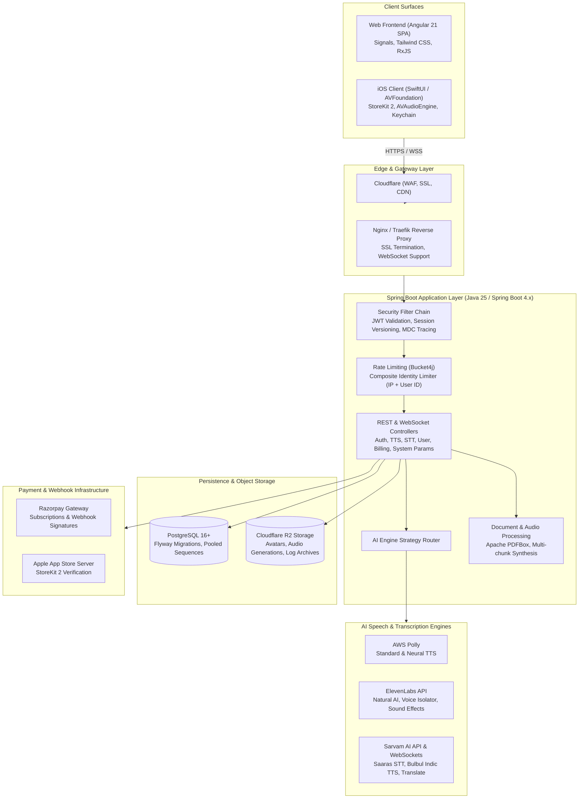

# SpeakIT: Enterprise AI Voice Generation & Audio Intelligence Platform

SpeakIT is a production-grade, full-stack Text-to-Speech (TTS), Speech-to-Text (STT), and audio intelligence platform. It provides enterprise-tier speech synthesis, live multi-dialect transcription, speech-to-speech transformations, document-to-audiobook pipelines, and subscription management across three unified application surfaces: a Spring Boot backend, an Angular web frontend, and a native SwiftUI iOS client.

---

## Architecture Overview

SpeakIT employs a multi-surface architecture sharing a centralized, hardened REST and WebSocket API. The platform integrates AWS Polly, ElevenLabs, and Sarvam AI into an engine strategy router backed by PostgreSQL persistence, Cloudflare R2 object storage, Bucket4j rate limiting, and dual-provider billing (Razorpay and Apple StoreKit 2).



---

## Core Platform Capabilities

### 1. Multi-Engine Speech Synthesis (TTS)
- **AWS Polly Integration**: Low-latency synthesis utilizing Standard and Neural voices with SSML support.
- **ElevenLabs Natural AI**: Studio-grade conversational voices, streaming audio synthesis, sound effect generation, and audio isolation.
- **Sarvam AI (Bulbul)**: High-accuracy synthesis for Indic languages (Hindi, Bengali, Tamil, Telugu, Marathi, Kannada, Malayalam, Odia, Punjabi, Gujarati).
- **Document-to-Audiobook Pipeline**: Multi-page PDF text extraction via Apache PDFBox, automated text normalization, sentence tokenization, chunked background job execution, and unified audio stitching.

### 2. Speech-to-Text & Live Audio Transcription (STT)
- **Batch Transcription**: Multipart audio upload supporting WAV, MP3, AAC, FLAC, and OGG formats with language auto-detection or explicit locale selection.
- **Live Streaming Audio**: Real-time microphone capture streaming over WebSockets with partial transcript events and persistent turn storage.
- **Language Intelligence**: Integrated translation (speech to English), transliteration between scripts, and codemix processing for colloquial bilingual input.

### 3. Native iOS Experience
- **Native SwiftUI Architecture**: Modular architecture built on Swift 6, SwiftUI, and strict MVVM/State patterns.
- **AVFoundation Integration**: Custom audio player and recording visualizer built on `AVAudioEngine`, `AVAudioSession`, and `AVAudioPlayer` with background audio playback capabilities.
- **Apple StoreKit 2 & Razorpay**: In-app purchase workflow validated via backend App Store Server receipt verification, alongside web checkout flows.
- **Parity Legal & System Views**: Native sheets for Terms of Service, Privacy Policy, About, Contact Support, and Changelog updates.

### 4. Enterprise Security & Session Management
- **Stateless JWT with Global Session Versioning**: Token issuance backed by an atomic integer `session_version` in PostgreSQL. Global revocation on password reset or explicit logout across all devices.
- **Input Sanitization**: Server-side HTML/XSS sanitization using Jsoup on all incoming request strings.
- **Dual-Signal Composite Rate Limiter**: Bucket4j token bucket algorithm keyed on composite identities (User ID + Client IP) to prevent distributed brute-force attacks and abuse.
- **Strict Role-Based Data Isolation**: Enforced ownership validations across chat history, billing receipts, and audio downloads.

---

## Repository Structure

```text
speakit/
├── backend/                       # Spring Boot 4.x / Java 25 Application
│   ├── src/main/java/com/speakit/ # Domain modules (auth, tts, stt, billing, user, contact)
│   │   ├── auth/                  # Authentication, JWT, OTP, session management
│   │   ├── billing/               # Razorpay & Apple IAP verification, subscriptions
│   │   ├── contact/               # Contact support and Discord webhook dispatches
│   │   ├── notification/          # Email notifications (Resend / AWS SES) and log backups
│   │   ├── parameter/             # Dynamic database-backed system parameters
│   │   ├── security/              # Security filters, rate limiters, CORS configuration
│   │   ├── shared/                # Aspect logging, global exception handler, utility classes
│   │   ├── stt/                   # STT services, Sarvam providers, live session controllers
│   │   ├── tts/                   # Multi-engine TTS, PDF parsing, synthesis history
│   │   └── user/                  # User profile, password management, avatar storage
│   ├── src/main/resources/        # application.properties, Flyway SQL migrations, logback
│   ├── pom.xml                    # Maven build descriptor (Java 25, Spring Boot 4.1.1)
│   └── Dockerfile                 # Multi-stage production container build
├── frontend/                      # Angular 21 Single Page Application
│   ├── src/app/
│   │   ├── core/                  # Authentication guards, HTTP interceptors, token storage
│   │   ├── features/              # Feature routes (auth, tts, stt, user settings, billing)
│   │   └── shared/                # Reusable UI components (modals, dropdowns, visualizers)
│   ├── package.json               # Frontend dependencies and build scripts
│   └── scripts/                   # Runtime environment injection scripts
├── ios/                           # Native iOS Client Application
│   └── SpeakIT/
│       ├── Config/                # xcconfig build configuration and Info.plist
│       ├── SpeakIT/
│       │   ├── Core/              # Networking, AVFoundation audio engine, Keychain, state
│       │   ├── DesignSystem/      # Buttons, text fields, audio players, recording visualizer
│       │   ├── Features/          # SwiftUI views (Auth, TTS, STT, Live, Activity, Subscription)
│       │   ├── Models/            # Strongly-typed models matching backend DTO schemas
│       │   └── SpeakITApp.swift   # Application entry point
│       └── SpeakIT.xcodeproj      # Xcode project configuration
├── docs/                          # Comprehensive technical documentation
│   ├── architechture-and-guides/  # Technical architecture dive, deployment, security guides
│   ├── ios-migration/             # iOS design specifications, component inventory, guides
│   └── migration/                 # Dependency and schema migration records
├── deployment/                    # Deployment configurations (Systemd, Nginx, UFW scripts)
└── docker-compose.yml             # Local multi-container orchestration
```

---

## Technical Stack & Dependencies

| Component | Technology | Version / Implementation Details |
| :--- | :--- | :--- |
| **Backend Runtime** | Java (OpenJDK) | Java 25 (LTS) |
| **Backend Framework** | Spring Boot | 4.1.1 (`spring-boot-starter-webmvc`, Spring Security, JPA) |
| **Database & Migrations** | PostgreSQL & Flyway | PostgreSQL 16+, Flyway PostgreSQL Starter |
| **Object Storage** | Cloudflare R2 | S3-Compatible API via AWS SDK for Java v2 |
| **Rate Limiting** | Bucket4j | `bucket4j_jdk17-core` (In-memory token bucket) |
| **Observability** | Sentry & Logback | Sentry Spring Boot 4, Logstash Logback Encoder |
| **Frontend Framework** | Angular | 21.2.x (Standalone Components, Signals, RxJS 7.8) |
| **Frontend Styling** | Tailwind CSS | 4.x via PostCSS |
| **Mobile Platform** | Native iOS | Swift 6, iOS 17.0+ deployment target |
| **Audio Frameworks** | Apple AVFoundation | `AVAudioEngine`, `AVAudioSession`, `AVAudioPlayer` |
| **Speech Engines** | AWS Polly, ElevenLabs, Sarvam | Multi-engine strategy router, WebSockets |
| **Payment Gateways** | Razorpay & Apple StoreKit 2 | Web checkout, Webhook HMAC validation, App Store Server |

---

## REST & WebSocket API Specification

All protected endpoints require an HTTP header `Authorization: Bearer <jwt-token>`.

### Authentication & User Management
| Method | Endpoint | Access | Description |
| :--- | :--- | :--- | :--- |
| `POST` | `/api/auth/register` | Public | Register new user account; sends verification OTP |
| `POST` | `/api/auth/verify-email` | Public | Verify registration OTP |
| `POST` | `/api/auth/login` | Public | Authenticate user; returns JWT token and user profile |
| `POST` | `/api/auth/forgot-password` | Public | Initiate password reset OTP dispatch |
| `POST` | `/api/auth/reset-password` | Public | Reset password using verified OTP |
| `POST` | `/api/auth/logout` | Authenticated | Invalidate active session across all devices |
| `GET` | `/api/auth/ping` | Public | Health check endpoint for uptime monitoring |
| `GET` | `/api/v1/users/me` | Authenticated | Fetch current authenticated user profile and quota |
| `PUT` | `/api/v1/users/profile` | Authenticated | Update user profile details |
| `POST` | `/api/v1/users/avatar` | Authenticated | Upload user profile picture to Cloudflare R2 |
| `DELETE` | `/api/v1/users/avatar` | Authenticated | Remove user profile picture |
| `DELETE` | `/api/v1/users/me` | Authenticated | Delete user account and cascade delete all associated records |

### Text-to-Speech (TTS)
| Method | Endpoint | Access | Description |
| :--- | :--- | :--- | :--- |
| `GET` | `/api/tts/voices` | Authenticated | List all available voices across Polly, ElevenLabs, and Sarvam |
| `POST` | `/api/tts/synthesize` | Authenticated | Convert text into speech; stores result in Cloudflare R2 |
| `POST` | `/api/tts/synthesize-stream` | Authenticated | Stream real-time synthesized audio bytes |
| `GET` | `/api/tts/usage` | Authenticated | Fetch character usage and remaining subscription limits |
| `GET` | `/api/tts/usage/analytics` | Authenticated | Detailed usage breakdown and generation history metrics |
| `POST` | `/api/tts/documents/analyze` | Authenticated | Extract text and count tokens from uploaded PDF document |
| `POST` | `/api/tts/jobs` | Authenticated | Submit long-form document synthesis job |
| `GET` | `/api/tts/jobs/{jobId}` | Authenticated | Poll status and download generated audio for a document job |
| `POST` | `/api/tts/audio-isolation` | Authenticated | Remove background noise from uploaded audio |
| `POST` | `/api/tts/speech-to-speech` | Authenticated | Transform speech into another target voice |
| `POST` | `/api/tts/sound-effects` | Authenticated | Generate sound effects from textual description |

### Speech-to-Text (STT)
| Method | Endpoint | Access | Description |
| :--- | :--- | :--- | :--- |
| `POST` | `/api/stt/transcribe` | Authenticated | Transcribe uploaded audio file (multipart/form-data) |
| `POST` | `/api/stt/transcribe-live` | Authenticated | Transcribe recorded chunk from live microphone session |
| `POST` | `/api/stt/translate` | Authenticated | Translate text or audio transcript into target language |
| `POST` | `/api/stt/transliterate` | Authenticated | Transliterate text across supported scripts |
| `POST` | `/api/stt/live/session` | Authenticated | Save complete live transcription session and conversation turns |
| `GET` | `/api/stt/live/session/{id}/turns` | Authenticated | Retrieve conversation turns for a saved session |
| `GET` | `/api/stt/session/{id}/export` | Authenticated | Export session transcript in TXT, SRT, or VTT format |

### Synthesis History & Billing
| Method | Endpoint | Access | Description |
| :--- | :--- | :--- | :--- |
| `GET` | `/api/history` | Authenticated | Paginated history of TTS and STT records |
| `GET` | `/api/history/{id}/audio` | Authenticated | Secure stream or download generated audio record |
| `DELETE` | `/api/history/delete` | Authenticated | Batch delete specified history record IDs |
| `DELETE` | `/api/history/clear-all` | Authenticated | Purge all history records belonging to user |
| `GET` | `/api/v1/payments/proration-quote` | Authenticated | Calculate upgrade cost with prorated remaining balance |
| `POST` | `/api/v1/payments/create-order` | Authenticated | Create a Razorpay order for plan subscription |
| `POST` | `/api/v1/payments/verify` | Authenticated | Verify Razorpay payment signature and activate plan |
| `POST` | `/api/v1/payments/apple/verify` | Authenticated | Validate Apple StoreKit 2 transaction receipt |
| `POST` | `/api/v1/payments/downgrade-free` | Authenticated | Switch active subscription back to Free tier |
| `POST` | `/api/v1/payments/cancel` | Authenticated | Cancel automatic subscription renewal |
| `GET` | `/api/v1/payments/history` | Authenticated | Retrieve user invoice and payment history |
| `POST` | `/api/v1/webhooks/razorpay` | Public (Signed) | Process asynchronous Razorpay payment events |

---

## Local Development Setup

### System Prerequisites
- **Java Development Kit**: JDK 25 installed and available on `PATH`.
- **Node.js & npm**: Node.js v20.x or v22.x with npm v10.x+.
- **PostgreSQL**: PostgreSQL 16 or newer running locally or remotely.
- **Xcode** (for iOS development): Xcode 16.0+ on macOS.

---

### 1. Backend Setup

1. Navigate to the backend directory:
   ```bash
   cd backend
   ```

2. Create a local environment configuration file:
   ```bash
   cp .env.example .env
   ```

3. Configure required credentials in `.env`:
   - `SPRING_DATASOURCE_URL`, `SPRING_DATASOURCE_USERNAME`, `SPRING_DATASOURCE_PASSWORD`
   - `JWT_SECRET` (minimum 64 hex characters)
   - `AWS_ACCESS_KEY_ID`, `AWS_SECRET_ACCESS_KEY`, `AWS_REGION`
   - `ELEVENLABS_API_KEY`, `SARVAM_API_KEY`
   - `R2_ACCOUNT_ID`, `R2_ACCESS_KEY_ID`, `R2_SECRET_ACCESS_KEY`

4. Compile and run database migrations:
   ```bash
   ./mvnw clean compile
   ```
   Flyway will automatically apply `V1__init_schema.sql` and `V2__add_stt_audio_storage.sql` upon launch.

5. Start the backend service:
   ```bash
   ./mvnw spring-boot:run
   ```
   The backend API will start on `http://localhost:8080`.

---

### 2. Frontend Setup

1. Navigate to the frontend directory:
   ```bash
   cd frontend
   ```

2. Install dependencies:
   ```bash
   npm install
   ```

3. Create the local environment file:
   ```bash
   cp .env.example .env
   ```

4. Configure frontend environment variables:
   - `API_URL`: `http://localhost:8080`
   - `RAZORPAY_KEY_ID`: Your test key ID

5. Start the Angular development server:
   ```bash
   npm start
   ```
   The application will be accessible at `http://localhost:4200`.

---

### 3. iOS Client Setup

1. Navigate to the iOS project directory:
   ```bash
   cd ios/SpeakIT
   ```

2. Create a local configuration override file from the template:
   ```bash
   cp Config/Local.xcconfig.example Config/Local.xcconfig
   ```

3. Configure local network endpoints in `Config/Local.xcconfig`:
   ```properties
   IOS_SIMULATOR_BASE_URL = http://localhost:8080
   IOS_API_BASE_URL = http://192.168.1.100:8080
   WEB_HOST_URL = http://localhost:4200
   ```

4. Open the workspace in Xcode:
   ```bash
   open SpeakIT.xcodeproj
   ```

5. Select the `SpeakIT` scheme and a target simulator (e.g., iPhone 16), then press `Cmd + R` to build and run.

---

## Environment Configuration Reference

### Backend Configuration (`backend/.env`)

| Variable | Required | Description |
| :--- | :--- | :--- |
| `SERVER_PORT` | No | Application HTTP port (default: `8080`) |
| `SPRING_DATASOURCE_URL` | Yes | PostgreSQL JDBC connection URL |
| `SPRING_DATASOURCE_USERNAME` | Yes | Database username |
| `SPRING_DATASOURCE_PASSWORD` | Yes | Database password |
| `JWT_SECRET` | Yes | 256-bit secret key for HMAC-SHA token signing |
| `JWT_EXPIRATION_MS` | No | JWT lifespan in milliseconds (default: `86400000` / 24 hours) |
| `CORS_ALLOWED_ORIGINS` | Yes | Permitted CORS origins (comma-separated) |
| `AWS_ACCESS_KEY_ID` | Yes | AWS IAM access key with Polly and SES permissions |
| `AWS_SECRET_ACCESS_KEY` | Yes | AWS IAM secret key |
| `AWS_REGION` | Yes | AWS target region (e.g., `ap-south-1`, `us-east-1`) |
| `ELEVENLABS_API_KEY` | Yes | ElevenLabs API key for Natural voices and audio tools |
| `SARVAM_API_KEY` | Yes | Sarvam AI API key for Indic TTS, Saaras STT, and translation |
| `R2_ACCOUNT_ID` | Yes | Cloudflare account identifier |
| `R2_ACCESS_KEY_ID` | Yes | Cloudflare R2 S3-compatible API token ID |
| `R2_SECRET_ACCESS_KEY` | Yes | Cloudflare R2 S3-compatible API secret token |
| `R2_BUCKET_NAME` | Yes | Cloudflare R2 bucket name for user avatars |
| `R2_AUDIO_BUCKET_NAME` | Yes | Cloudflare R2 bucket name for TTS audio files |
| `R2_LOG_BUCKET_NAME` | Yes | Cloudflare R2 bucket name for encrypted log backups |
| `RAZORPAY_KEY_ID` | Yes | Razorpay API key ID for subscription checkouts |
| `RAZORPAY_KEY_SECRET` | Yes | Razorpay API secret key |
| `RAZORPAY_WEBHOOK_SECRET` | Yes | Secret used to verify incoming Razorpay webhook signatures |
| `RESEND_API_KEY` | Yes | Resend API key for verification and OTP delivery |
| `SENTRY_DSN_BACKEND` | No | Sentry DSN for backend error capturing and telemetry |

---

## Verification & Testing

### Backend Test Suite
The backend includes unit, web slice, and security tests using JUnit 5, Mockito, and Spring Security Test:
```bash
cd backend
./mvnw test
```

### Frontend Test Suite
The frontend utilizes Vitest and Angular testing utilities:
```bash
cd frontend
npm test
```

### iOS Unit Tests
The iOS test suite validates core business logic, models, and utility handlers:
```bash
cd ios/SpeakIT
xcodebuild test \
  -project SpeakIT.xcodeproj \
  -scheme SpeakIT \
  -destination 'platform=iOS Simulator,name=iPhone 16'
```

---

## Documentation Index

For in-depth architectural specifications and operational runbooks, refer to the guides under `docs/`:

- **[Technical Architecture Deep-Dive](docs/architechture-and-guides/speakit-tech-dive.md)**: Exhaustive breakdown of clean architecture boundaries, thread models, synthesis engine router, and database schema.
- **[Native iOS Application Specification](docs/ios-migration/ios-app-spec.md)**: Consolidated master specification covering iOS architecture, SwiftUI design system, UI inventory, StoreKit 2 monetization, and AI audio capabilities.
- **[Security Architecture & Hardening Guide](docs/architechture-and-guides/security-guide-spec.md)**: Session revocation, prompt taint analysis, XSS hardening, security audit assessments, and DevSecOps pipelines.
- **[Core Feature & Infrastructure Setup](docs/architechture-and-guides/speakit-feature-setup.md)**: End-to-end setup for subscription plans, Razorpay payment processing, webhook signatures, Resend OTP delivery, and Amazon SES fallback.
- **[Coolify Deployment Guide](docs/architechture-and-guides/Coolify-Deployment-Guide.md)**: Self-hosting production deployment using Coolify, Traefik, Docker, and PostgreSQL.
- **[API Specification](docs/architechture-and-guides/API-Spec.md)**: Complete request and response payload schemas for all endpoints.
- **[Observability & Quality Setup](docs/architechture-and-guides/Observability-And-Quality-Setup.md)**: Sentry, Logback MDC correlation, and health monitoring.
- **[Xcode Development Guide](docs/ios-migration/xcode-guide.md)**: Native iOS project configuration, simulator execution, and build troubleshooting.

---

## License

SpeakIT is distributed under a dual-licensing model:

1. **Open Source Use**: Licensed under the **GNU Affero General Public License v3.0 (AGPLv3)**. Any public network deployment or modification must remain open source under the AGPLv3. See [LICENSE](LICENSE) for details.
2. **Commercial Licensing**: For commercial applications, private network deployments without source disclosure, and dedicated enterprise support, contact **support@mohitur.com**.
