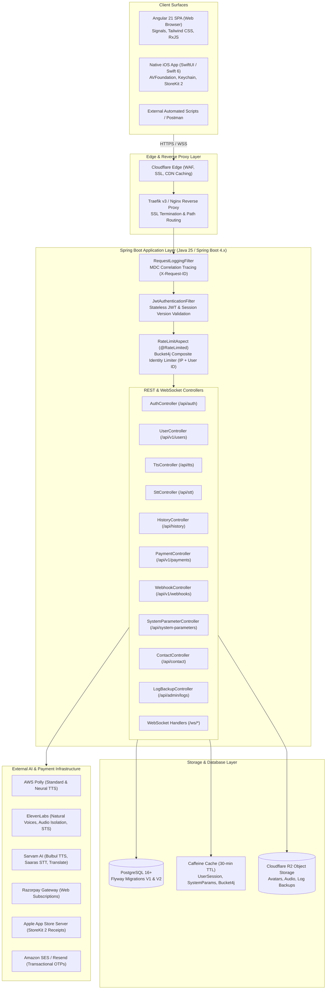
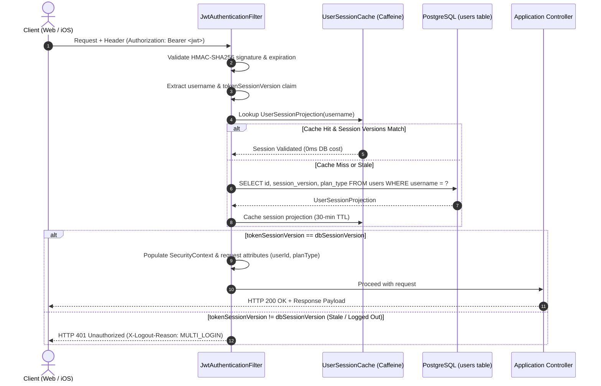
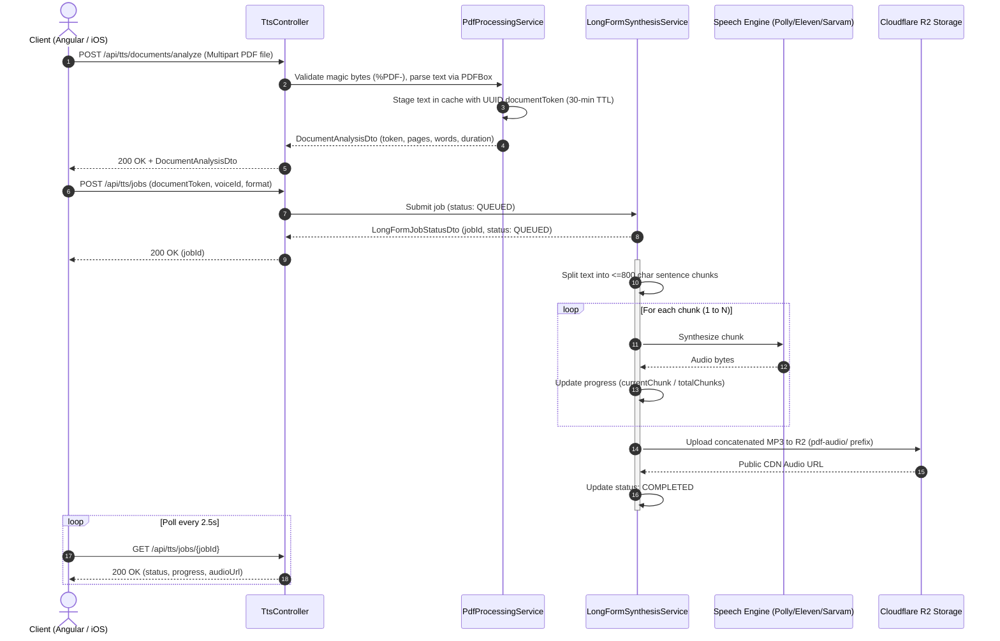
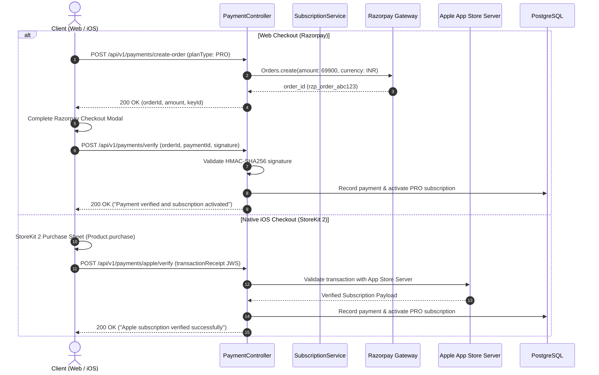

# SpeakIT: Authoritative Production API Reference & System Specification

> **Document Classification:** Authoritative System Specification & API Contract Manual
> **Target Version:** Spring Boot 4.x (Java 25 LTS), Angular 21 (SPA), Native iOS 17+ (Swift 6)
> **Source Repository:** `Mohitur669/speakit`
> **Last Audited:** November 2026

---

## 1. Document Overview

This document provides the definitive, source-code-driven reference for all RESTful and WebSocket Application Programming Interfaces (APIs) exposed by the SpeakIT backend server.

SpeakIT is an enterprise-grade Software-as-a-Service (SaaS) platform engineered for low-latency Text-to-Speech (TTS) synthesis, high-accuracy Speech-to-Text (STT) transcription, real-time speech translation, and tiered subscription monetization.

### System Surface Boundaries

The platform coordinates three interconnected application surfaces:
1. **Authoritative Backend Server (`backend/`)**: Spring Boot 4.1.1 running Java 25 (LTS), PostgreSQL 16+ persistence managed via Flyway, Bucket4j token bucket rate limiting, Cloudflare R2 object storage, Sentry exception telemetry, and multi-vendor AI audio engine routing.
2. **Web Frontend Client (`frontend/`)**: Modern Angular 21.2.x Single Page Application (SPA) utilizing Standalone Components, reactive Signals, Tailwind CSS 4.x, and dynamic runtime environment injection (`window.__env.API_URL`).
3. **Native iOS Client (`ios/SpeakIT/`)**: Native Swift 6 / SwiftUI mobile application targeting iOS 17.0+ with AVFoundation audio engine (`AVAudioEngine`, `AVAudioSession`, `AVAudioPlayer`), hardware-backed Keychain security (`kSecAttrAccessibleAfterFirstUnlock`), StoreKit 2 in-app purchases, and native parity sheets.

---

## 2. API Architecture



---

## 3. Base URLs & Environment Configuration

Base URLs are environment-driven and isolated across execution tiers:

| Environment | Base URL | WebSocket Base URL | Configuration Source |
| :--- | :--- | :--- | :--- |
| **Local Development** | `http://localhost:8080` | `ws://localhost:8080` | `backend/src/main/resources/application.properties` |
| **Development / Preview** | `https://speakit-dev-api.mohitur.com` | `wss://speakit-dev-api.mohitur.com` | Coolify environment injection / `runtime-env.js` |
| **Production** | `https://speakit-prod-api.mohitur.com` | `wss://speakit-prod-api.mohitur.com` | Coolify zero-disk secret storage / Traefik v3 |

### Client Endpoint Resolution

- **Angular Client (`frontend/`)**: Dynamically resolves endpoints at runtime through `frontend/public/runtime-env.js` via `window.__env.API_URL`, preventing static rebuilds between dev and production.
- **iOS Client (`ios/SpeakIT/`)**: Managed in `APIEndpoint.swift`:
  - **Simulator**: Resolves via `IOS_SIMULATOR_BASE_URL` in `Config/Local.xcconfig` (defaults to `http://localhost:8080`).
  - **Physical Device**: Resolves via `IOS_API_BASE_URL` with automatic fallback to `IOS_API_BASE_BACKUP_URL`.

---

## 4. Global HTTP Conventions

### HTTP Verbs
- `GET`: Safe, idempotent resource retrieval.
- `POST`: Creation of entities or execution of non-idempotent operations (synthesis, transcription, authentication, payments).
- `PUT`: Idempotent replacement or complete update of existing resources.
- `DELETE`: Removal of resources.
- `OPTIONS`: Pre-flight CORS negotiation handled automatically by Spring Security.

### Content Types
- Standard Payloads: `application/json;charset=UTF-8`
- File Uploads: `multipart/form-data`
- Text Parameters & Pings: `text/plain;charset=UTF-8`
- Audio Responses: `audio/mpeg` (MP3), `audio/ogg` (OGG Vorbis), `audio/wave` (PCM), or `application/octet-stream`

### Date & Timestamp Formatting
All timestamps returned by the API adhere to ISO 8601 UTC representation: `YYYY-MM-DDTHH:mm:ss.SSSZ` (e.g. `2026-11-13T07:45:30.123Z`).

---

## 5. Authentication & Authorization Lifecycle

SpeakIT enforces a stateless JWT architecture augmented with database-backed session versioning to guarantee immediate global revocation capabilities across distributed nodes.



### Authentication Header
Protected endpoints require an HTTP Authorization header formatted as:
```http
Authorization: Bearer <JWT_ACCESS_TOKEN>
```

### Session Invalidation Mechanism
When a user calls `POST /api/auth/logout`, updates their password, or requests an account deletion:
1. The backend increments the user's `session_version` column atomically in PostgreSQL:
   ```sql
   UPDATE users SET session_version = session_version + 1, updated_at = NOW() WHERE id = ?;
   ```
2. The user's entry in the Caffeine session cache is evicted immediately.
3. Any existing JWTs bearing the prior session version will fail the session check on their next request and receive an immediate `401 Unauthorized`.

---

## 6. Standard Error Response Structure

All uncaught exceptions and validation failures are intercepted by `GlobalExceptionHandler` and returned as a unified JSON payload:

```json
{
  "timestamp": "2026-11-13T07:45:30.123",
  "status": 400,
  "error": "Validation Error",
  "message": "Invalid input data",
  "path": "/api/tts/synthesize",
  "validationErrors": {
    "text": "Text content is required and cannot be empty",
    "voiceId": "Voice ID must be specified"
  }
}
```

### Common HTTP Status Codes

| Status Code | Meaning | Condition |
| :--- | :--- | :--- |
| `200 OK` | Success | Request succeeded and response payload is returned. |
| `201 Created` | Resource Created | Entity successfully created in the database. |
| `202 Accepted` | Accepted | Asynchronous long-form job accepted for processing. |
| `400 Bad Request` | Validation Failure | Invalid DTO, malformed parameters, or unparsable payload. |
| `401 Unauthorized` | Unauthenticated | Missing, expired, invalid, or revoked JWT token. |
| `403 Forbidden` | Access Denied | Active plan tier lacks access to the requested feature or voice. |
| `404 Not Found` | Resource Absent | Requested entity (job, history item, audio) does not exist. |
| `429 Too Many Requests` | Rate Limited | Token bucket exhausted; `Retry-After` header indicates cooldown seconds. |
| `500 Server Error` | Internal Failure | Unhandled server exception or third-party provider failure. |
| `503 Unavailable` | Degraded Service | Upstream provider outage or temporary maintenance. |

---

## 7. Complete Endpoint Inventory by Domain

---

### Domain 1: Authentication & Account Lifecycle (`/api/auth`)

#### 1. User Registration
- **Method & Path:** `POST /api/auth/register`
- **Access:** Public (Rate Limited: `RateLimitAction.AUTH`)
- **Purpose:** Initiates registration, stages details in `pending_registrations`, and dispatches an email OTP.
- **Request Body (`AuthRequest`):**
  ```json
  {
    "username": "alexdeveloper",
    "email": "alex@example.com",
    "password": "SecurePassword123!",
    "fullName": "Alex Developer",
    "phoneNumber": "+14155552671"
  }
  ```
- **Responses:**
  - `200 OK`: `{"token": null, "type": "Bearer", "username": "alexdeveloper", "email": "alex@example.com", "role": "USER", "planType": "FREE", "verified": false}`
  - `400 Bad Request`: Email/username already in use or validation failure.

#### 2. User Authentication (Login)
- **Method & Path:** `POST /api/auth/login`
- **Access:** Public (Rate Limited: `RateLimitAction.AUTH`)
- **Purpose:** Authenticates user credentials and issues a signed JWT token containing the user identity, plan type, and current session version.
- **Request Body (`AuthRequest`):**
  ```json
  {
    "username": "alexdeveloper",
    "password": "SecurePassword123!"
  }
  ```
- **Responses:**
  - `200 OK`: Returns authenticated `AuthResponse` with signed JWT token:
    ```json
    {
      "token": "eyJhbGciOiJIUzI1NiJ9...",
      "type": "Bearer",
      "id": 1042,
      "username": "alexdeveloper",
      "email": "alex@example.com",
      "role": "USER",
      "planType": "PRO",
      "verified": true,
      "avatarUrl": "https://cdn-speakit-avatar.mohitur.com/avatars/u_1042_avatar.png"
    }
    ```
  - `401 Unauthorized`: Invalid credentials or unverified email.

#### 3. Email Verification
- **Method & Path:** `POST /api/auth/verify-email`
- **Access:** Public (Rate Limited: `RateLimitAction.OTP_VERIFY`)
- **Request Body (`VerifyEmailRequest`):**
  ```json
  {
    "email": "alex@example.com",
    "otp": "482910"
  }
  ```
- **Responses:**
  - `200 OK`: Returns authenticated `AuthResponse` with active JWT upon successful verification.
  - `400 Bad Request`: Expired or invalid OTP code.

#### 4. Resend Verification OTP
- **Method & Path:** `POST /api/auth/resend-otp`
- **Access:** Public (Rate Limited: `RateLimitAction.OTP_RESEND`, 60-second cooldown)
- **Request Body (`ResendOtpRequest`):**
  ```json
  {
    "email": "alex@example.com"
  }
  ```
- **Responses:**
  - `200 OK`: Empty response body indicating OTP was dispatched.

#### 5. Forgot Password Request
- **Method & Path:** `POST /api/auth/forgot-password`
- **Access:** Public (Rate Limited: `RateLimitAction.PASSWORD_RESET`)
- **Request Body (`ForgotPasswordRequest`):**
  ```json
  {
    "email": "alex@example.com"
  }
  ```
- **Responses:**
  - `200 OK`: Empty response body indicating reset code was dispatched.

#### 6. Reset Password Execution
- **Method & Path:** `POST /api/auth/reset-password`
- **Access:** Public (Rate Limited: `RateLimitAction.PASSWORD_RESET`)
- **Request Body (`ResetPasswordRequest`):**
  ```json
  {
    "email": "alex@example.com",
    "otp": "482910",
    "newPassword": "NewSecurePassword456!"
  }
  ```
- **Responses:**
  - `200 OK`: Empty body indicating password has been reset. Increments `session_version` to invalidate prior sessions.

#### 7. Global Logout
- **Method & Path:** `POST /api/auth/logout`
- **Access:** Authenticated (Bearer Token)
- **Purpose:** Globally revokes all active tokens across all user devices by incrementing the database `session_version`. Broadcasts disconnect signals to `/ws/logout`.
- **Responses:**
  - `200 OK`: Empty response body.

#### 8. Health Check Ping
- **Method & Path:** `GET /api/auth/ping`
- **Access:** Public (Rate Limited: `RateLimitAction.PING`, 60 req/min)
- **Produces:** `text/plain`
- **Responses:**
  - `200 OK`: `"pong"`

#### 9. WebSocket Single-Use Ticket Handshake
- **Method & Path:** `POST /api/auth/ws-ticket`
- **Access:** Authenticated (Bearer Token)
- **Purpose:** Generates a short-lived (60-second TTL) single-use cryptographic ticket for authenticating WebSocket upgrade connections without transmitting raw JWTs in URL queries.
- **Responses:**
  - `200 OK`: `{"ticket": "a1b2c3d4-e5f6-7890-abcd-ef1234567890"}`

#### 10. Availability Validation Endpoints
- `GET /api/auth/check-username?username=alexdeveloper` -> Returns `Boolean` (`true` if available)
- `GET /api/auth/check-email?email=alex@example.com` -> Returns `Boolean` (`true` if available)
- `GET /api/auth/check-phone?phone=+14155552671` -> Returns `Boolean` (`true` if available)

---

### Domain 2: User Profile & Account Management (`/api/v1/users`)

All endpoints in this domain require authentication (`Authorization: Bearer <JWT>`).

#### 1. Get Current User Profile
- **Method & Path:** `GET /api/v1/users/me`
- **Responses:**
  - `200 OK`: Returns authenticated `AuthResponse` including current quota metrics, subscription status, and avatar details.

#### 2. Update Profile Details
- **Method & Path:** `PUT /api/v1/users/profile`
- **Request Body (`UserProfileUpdateRequest`):**
  ```json
  {
    "fullName": "Alex Developer",
    "username": "alexdev",
    "phoneNumber": "+14155552671"
  }
  ```
- **Responses:**
  - `200 OK`: Updated `AuthResponse`.

#### 3. Direct Field Updates
- `PUT /api/v1/users/full-name`: Updates user full name (`UpdateFullNameRequest`).
- `PUT /api/v1/users/username`: Updates username with unique check (`UpdateUsernameRequest`).
- `PUT /api/v1/users/phone-number` (alias `/phone`): Updates phone (`UpdatePhoneRequest`).

#### 4. Email Change Flow
1. `POST /api/v1/users/email/request-otp`: Sends verification OTP to proposed new email address (`RequestEmailChangeOtpRequest`).
2. `PUT /api/v1/users/email`: Finalizes email change with verified OTP (`UpdateEmailRequest`).
3. `POST /api/v1/users/me/verify-email-change`: Legacy email change verification endpoint.

#### 5. Password Change (In-App)
1. `POST /api/v1/users/password/request-otp`: Dispatches verification OTP to active account email before allowing password change.
2. `POST /api/v1/users/password` (alias `/change-password`): Executes password change with OTP verification.

#### 6. User Avatar Management (Cloudflare R2)
- **Upload Avatar:** `POST /api/v1/users/avatar`
  - **Content-Type:** `multipart/form-data`
  - **Field:** `file` (JPEG, PNG, WebP; max 5MB).
  - **Quota:** Enforces `AVATAR_DAILY_LIMIT = 2` uploads per day.
  - **Storage:** Stores image in Cloudflare R2 bucket `speakit-avatars` and logs audit entry in `user_avatar_history`.
  - **Response (`AvatarResponse`):** `{"avatarUrl": "https://cdn-speakit-avatar.mohitur.com/avatars/u_1042_1731481234_abc.png"}`
- **Delete Avatar:** `DELETE /api/v1/users/avatar`
  - Deletes image from Cloudflare R2 and clears profile avatar URL.

#### 7. Account Deletion
- **Method & Path:** `DELETE /api/v1/users/me`
- **Purpose:** Hard-deletes user account. Cascades deletion cleanly across all 12 child database tables (`otp_verifications`, `user_avatar_history`, `live_session_turns`, `speech_to_text_requests`, `tts_history`, `payments`, `subscriptions`, etc.) avoiding foreign key violations.
- **Responses:**
  - `200 OK`: `{"message": "User account and all associated data deleted successfully"}`

---

### Domain 3: Text-to-Speech Engine (`/api/tts`)

#### 1. Synchronous Speech Synthesis
- **Method & Path:** `POST /api/tts/synthesize`
- **Access:** Authenticated (Rate Limited: `RateLimitAction.TTS`)
- **Request Body (`TtsRequest`):**
  ```json
  {
    "text": "Welcome to SpeakIT enterprise voice intelligence platform.",
    "voiceId": "Joanna",
    "voiceName": "Joanna",
    "outputFormat": "mp3",
    "isElevenLabs": false,
    "isSarvam": false,
    "languageCode": "en-US",
    "pace": 1.0,
    "voiceStyle": "Conversational"
  }
  ```
- **Responses:**
  - `200 OK`: Binary audio bytes (`Content-Type: audio/mpeg`, `Content-Disposition: attachment; filename="speech.mp3"`). Result stored in Cloudflare R2 bucket `speakit-audio` under prefix `translate-audio/`.
  - `400 Bad Request`: Empty text, character limit exceeded, or unsupported format.
  - `403 Forbidden`: Selected voice engine or character limit not permitted on active subscription tier.

#### 2. Streaming Audio Synthesis (AWS Polly)
- **Method & Path:** `POST /api/tts/synthesize-stream`
- **Access:** Authenticated (Rate Limited: `RateLimitAction.TTS`)
- **Produces:** Chunked `InputStreamResource` (`audio/mpeg` or `audio/ogg`).
- **Notes:** Streams Polly audio chunks directly to client socket without buffering entire file in JVM memory. (ElevenLabs and Sarvam requests fallback automatically to buffered synthesis).

#### 3. Voice Catalog
- **Method & Path:** `GET /api/tts/voices`
- **Access:** Authenticated (Rate Limited: `RateLimitAction.PUBLIC`)
- **Responses:**
  - `200 OK`: Array of available voices filtered by caller's active plan:
    ```json
    [
      {
        "id": "Joanna",
        "name": "Joanna",
        "engine": "Neural",
        "language": "en-US",
        "gender": "Female",
        "provider": "AWS_POLLY",
        "tier": "FREE"
      },
      {
        "id": "bulbul:v3:hi-IN:arvind",
        "name": "Arvind",
        "engine": "IndicNeural",
        "language": "hi-IN",
        "gender": "Male",
        "provider": "SARVAM",
        "tier": "PRO"
      }
    ]
    ```

#### 4. Usage & Quotas
- `GET /api/tts/usage`: Returns remaining daily characters, monthly limit, and plan status.
- `GET /api/tts/usage/analytics`: Returns 30-day generation analytics, top voices, and dialect breakdowns (`UsageAnalyticsDto`).

---

### Domain 4: Long-Form PDF & Document Synthesis (`/api/tts`)



#### 1. PDF Document Analysis & Staging
- **Method & Path:** `POST /api/tts/documents/analyze`
- **Access:** Authenticated (Requires Pro or Pro Plus plan)
- **Content-Type:** `multipart/form-data`
- **Field:** `file` (Multipart PDF file)
- **Validation Rules:**
  - Magic byte verification (`%PDF-` in initial 1024 bytes).
  - Tier limits: Free (5MB, 10 pages), Pro (25MB, 100 pages), Pro Plus (50MB, 300 pages).
- **Responses:**
  - `200 OK`:
    ```json
    {
      "documentToken": "d8f1e2c3-b4a5-6789-0123-456789abcdef",
      "fileName": "annual-report.pdf",
      "pageCount": 42,
      "wordCount": 12850,
      "estimatedDurationMinutes": 85,
      "characterCount": 78200
    }
    ```

#### 2. Submit Document Synthesis Job
- **Method & Path:** `POST /api/tts/jobs` (or direct multipart `POST /api/tts/jobs/document`)
- **Access:** Authenticated
- **Request Body (`TtsRequest`):**
  ```json
  {
    "documentToken": "d8f1e2c3-b4a5-6789-0123-456789abcdef",
    "voiceId": "Matthew",
    "outputFormat": "mp3",
    "title": "Annual Report 2026",
    "isElevenLabs": false
  }
  ```
- **Responses:**
  - `200 OK`:
    ```json
    {
      "jobId": "job_94821a3b",
      "status": "QUEUED",
      "progress": 0,
      "title": "Annual Report 2026",
      "createdAt": "2026-11-13T07:45:30.123"
    }
    ```

#### 3. Poll Long-Form Job Status
- **Method & Path:** `GET /api/tts/jobs/{jobId}`
- **Responses:**
  - `200 OK`:
    ```json
    {
      "jobId": "job_94821a3b",
      "status": "COMPLETED",
      "progress": 100,
      "audioUrl": "https://cdn-speakit-audio.mohitur.com/pdf-audio/u_1042_1731482000_annual.mp3",
      "durationSeconds": 5100,
      "totalChunks": 98,
      "completedChunks": 98
    }
    ```
  - `404 Not Found`: Job does not exist or belongs to another user.

---

### Domain 5: Advanced ElevenLabs Audio Tools (`/api/tts`)

All endpoints in this section require `PRO_PLUS` or `ENTERPRISE` subscription status.

#### 1. Audio Isolation (Voice Cleaner)
- **Method & Path:** `POST /api/tts/audio-isolation`
- **Content-Type:** `multipart/form-data`
- **Field:** `file` (Audio recording with background noise).
- **Responses:**
  - `200 OK`: `{"status": "SUCCESS", "audioUrl": "https://cdn-speakit-audio.mohitur.com/translate-audio/isolated.mp3", "sizeBytes": 142050}`

#### 2. Speech-to-Speech (Voice Changer)
- **Method & Path:** `POST /api/tts/speech-to-speech`
- **Content-Type:** `multipart/form-data`
- **Fields:** `file` (Input audio), `voiceId` (Target voice identifier).
- **Responses:**
  - `200 OK`: `{"status": "SUCCESS", "audioUrl": "https://cdn-speakit-audio.mohitur.com/translate-audio/revoiced.mp3", "voiceId": "21m00Tcm4TlvDq8ikWAM"}`

#### 3. Sound Effects Generation
- **Method & Path:** `POST /api/tts/sound-effects`
- **Request Body:**
  ```json
  {
    "prompt": "Cinematic sci-fi laser blast echoing in a large metal cavern",
    "durationSeconds": 3.5
  }
  ```
- **Responses:**
  - `200 OK`: `{"status": "SUCCESS", "audioUrl": "https://cdn-speakit-audio.mohitur.com/translate-audio/sfx_laser.mp3", "sizeBytes": 56000}`

---

### Domain 6: Speech-to-Text & Live Transcription (`/api/stt`)

#### 1. Batch Audio Transcription
- **Method & Path:** `POST /api/stt/transcribe`
- **Access:** Authenticated (Rate Limited: `RateLimitAction.STT`)
- **Content-Type:** `multipart/form-data`
- **Fields:**
  - `file`: Multipart audio file (WAV, MP3, FLAC, AAC, OGG).
  - `language` (Optional): ISO language code (e.g. `hi-IN`, `bn-IN`, `en-US`).
  - `mode` (Optional): `transcribe`, `translate`, `codemix`.
- **Responses:**
  - `200 OK`:
    ```json
    {
      "transcript": "Hello and welcome to SpeakIT speech recognition.",
      "languageCode": "en-US",
      "confidence": 0.96,
      "audioUrl": "https://cdn-speakit-audio.mohitur.com/transcribe-audio/u_1042_recording.mp3",
      "durationSeconds": 14
    }
    ```

#### 2. Live Mic Chunk Transcription
- **Method & Path:** `POST /api/stt/transcribe-live`
- **Content-Type:** `multipart/form-data`
- **Purpose:** Ingests live recorded audio slices from the web or iOS microphone and returns rapid transcription turns.

#### 3. Language Translation
- **Method & Path:** `POST /api/stt/translate`
- **Request Body (`TranslationRequest`):**
  ```json
  {
    "inputText": "नमस्ते, आप कैसे हैं?",
    "sourceLanguage": "hi-IN",
    "targetLanguage": "en-IN"
  }
  ```
- **Responses:**
  - `200 OK`: `{"translatedText": "Hello, how are you?", "sourceLanguage": "hi-IN", "targetLanguage": "en-IN"}`

#### 4. Transliteration
- **Method & Path:** `POST /api/stt/transliterate`
- **Request Body (`TransliterationRequest`):**
  ```json
  {
    "inputText": "shukriya",
    "sourceLanguage": "en-IN",
    "targetLanguage": "hi-IN"
  }
  ```
- **Responses:**
  - `200 OK`: `{"transliteratedText": "शुक्रिया", "sourceLanguage": "en-IN", "targetLanguage": "hi-IN"}`

#### 5. Save Live Session Dialogue Turns
- **Method & Path:** `POST /api/stt/live/session`
- **Request Body (`SaveLiveSessionRequest`):** Persists multi-speaker conversational dialogue turns into `live_session_turns`.
- **Retrieve Turns:** `GET /api/stt/live/session/{id}/turns`
- **Export Transcript:** `GET /api/stt/session/{id}/export?format=srt` -> Exports SubRip subtitle (SRT), WebVTT (VTT), or TXT.

---

### Domain 7: Synthesis History & File Management (`/api/history`)

All history endpoints require authentication (`Authorization: Bearer <JWT>`).

#### 1. Retrieve Paginated History
- **Method & Path:** `GET /api/history`
- **Query Parameters:**
  - `page` (Default: `0`): Page index.
  - `size` (Default: `10`): Items per page.
  - `type` (Optional): Filter by `TTS` or `STT`.
- **Responses:**
  - `200 OK`: Returns Spring `PagedModel<TtsHistoryDto>`:
    ```json
    {
      "content": [
        {
          "id": 849,
          "voiceId": "Joanna",
          "voiceName": "Joanna",
          "voiceType": "NEURAL",
          "textSnippet": "Welcome to SpeakIT enterprise voice...",
          "characterCount": 42,
          "audioUrl": "https://cdn-speakit-audio.mohitur.com/translate-audio/u_1042_audio.mp3",
          "createdAt": "2026-11-13T06:30:00Z"
        }
      ],
      "page": {
        "size": 10,
        "number": 0,
        "totalElements": 48,
        "totalPages": 5
      }
    }
    ```

#### 2. Stream Saved Audio
- **Method & Path:** `GET /api/history/{id}/audio`
- **Purpose:** Securely streams generated audio for a history record. If an R2 storage key exists, returns an HTTP 302 redirect to the CDN URL or streams the bytes directly with ownership validation.

#### 3. Batch Delete History Records
- **Method & Path:** `DELETE /api/history/delete`
- **Request Body:** Array of history record IDs: `[849, 850, 851]`
- **Responses:** `200 OK` (Empty body).

#### 4. Purge All History
- **Method & Path:** `DELETE /api/history/clear-all`
- **Responses:** `200 OK` (Empty body).

---

### Domain 8: Subscription, Razorpay & Apple IAP Billing (`/api/v1/payments`)



#### 1. Proration Quote
- **Method & Path:** `GET /api/v1/payments/proration-quote`
- **Query Parameters:** `targetPlan` (e.g. `PRO_PLUS`), `currency` (e.g. `INR`)
- **Responses:** `200 OK` (`ProrationQuoteResponse` with credit amount and final charge).

#### 2. Create Razorpay Payment Order
- **Method & Path:** `POST /api/v1/payments/create-order`
- **Request Body (`PaymentOrderRequest`):** `{"planType": "PRO", "currency": "INR"}`
- **Responses:**
  - `200 OK` (`PaymentOrderResponse`):
    ```json
    {
      "orderId": "order_NXK12938475",
      "amount": 69900,
      "currency": "INR",
      "keyId": "rzp_test_placeholder",
      "planType": "PRO"
    }
    ```

#### 3. Verify Razorpay Payment Signature
- **Method & Path:** `POST /api/v1/payments/verify`
- **Request Body (`PaymentVerificationRequest`):**
  ```json
  {
    "orderId": "order_NXK12938475",
    "paymentId": "pay_NXK12999999",
    "signature": "c8f9...hmac_sha256_hash...",
    "planType": "PRO"
  }
  ```
- **Responses:**
  - `200 OK`: `"Payment verified and subscription activated successfully"`
  - `400 Bad Request`: Invalid cryptographic signature.

#### 4. Apple In-App Purchase Verification
- **Method & Path:** `POST /api/v1/payments/apple/verify`
- **Request Body (`AppleVerificationRequest`):**
  ```json
  {
    "transactionId": "2000000123456789",
    "productId": "com.speakit.subscription.pro",
    "receiptData": "MIIT/wYJKoZIhvcNAQcCoIIT8DCC..."
  }
  ```
- **Responses:**
  - `200 OK`: `"Apple subscription verified and activated successfully"`

#### 5. Plan Management & Cancellation
- `POST /api/v1/payments/downgrade-free`: Switches active account immediately back to Free tier.
- `POST /api/v1/payments/downgrade?targetPlan=PRO`: Schedules plan downgrade at billing period end.
- `POST /api/v1/payments/cancel`: Cancels auto-renewing subscription in Razorpay.
- `GET /api/v1/payments/history`: Paginated invoice history (`PaymentHistoryDto`).

---

### Domain 9: Webhook Integrations (`/api/v1/webhooks`)

#### 1. Razorpay Webhook Ingestion
- **Method & Path:** `POST /api/v1/webhooks/razorpay`
- **Access:** Public (Secured via `X-Razorpay-Signature` HMAC-SHA256 verification)
- **Purpose:** Ingests asynchronous subscription renewals, payment failures, and dispute events. Idempotent processing verified against `webhook_events` table.
- **Responses:**
  - `200 OK`: `{"status": "processed"}`
  - `400 Bad Request`: Webhook signature mismatch.

---

### Domain 10: Dynamic Parameters & Feature Flags (`/api/system-parameters`)

All parameters endpoints are publicly readable with rate limiting (`RateLimitAction.LIVE_PARAM`):
- `GET /api/system-parameters/bulk?names=SARVAM_ENABLED,PRO_MAX_CHARS,PRO_PRICE_INR`: Returns batch JSON dictionary of active configuration keys.
- `GET /api/system-parameters/cached/{name}`: Returns cached parameter string.
- `GET /api/system-parameters/live/{name}`: Bypasses Caffeine cache to read fresh state from PostgreSQL.

---

### Domain 11: Contact Support & Inquiries (`/api/contact`)

#### 1. Submit Contact Form
- **Method & Path:** `POST /api/contact`
- **Access:** Public (Rate Limited: `RateLimitAction.PUBLIC`)
- **Request Body (`ContactRequest`):**
  ```json
  {
    "name": "Jordan Smith",
    "email": "jordan@example.com",
    "subject": "Enterprise Plan Licensing Inquiry",
    "message": "We are interested in dedicated throughput and custom voice cloning."
  }
  ```
- **Execution Lifecycle:**
  1. Sanitizes all fields using Jsoup whitelist.
  2. Saves entry in database table `contact_submissions`.
  3. Dispatches asynchronous webhook notification to Discord operations channel.
  4. Triggers confirmation email via Resend / Amazon SES.
- **Responses:**
  - `200 OK`: `{"message": "Thank you for reaching out. We will respond shortly."}`

---

### Domain 12: Administrative & Log Backups (`/api/admin/logs`)

Protected endpoints requiring valid authentication:
- `POST /api/admin/logs/backup`: Triggers manual gzip compression of `logs/speakit-backend.log`, computes SHA256 checksum, uploads archive to Cloudflare R2 bucket `speakit-logs`, and records audit entry in `log_backup_audits`.
- `GET /api/admin/logs/download?startDate=01-11-2026&endDate=07-11-2026`: Streams on-the-fly compressed ZIP archive of log backups directly from R2 to client socket via Spring `StreamingResponseBody` (max 7-day span).

---

### Domain 13: Real-Time WebSockets (`/ws/*`)

All WebSocket upgrades connect over `wss://` (or `ws://` locally) and authenticate via short-lived tickets:

#### 1. Instant Cross-Device Logout (`/ws/logout?ticket={ticket}`)
- Handler: `LogoutWebSocketHandler`
- When user logs out on one device, backend sends JSON message `{"action":"LOGOUT","reason":"SESSION_INVALIDATED"}` to all active browser tabs and devices, triggering instant client cleanup.

#### 2. Streaming Speech-to-Text (`/ws/live-stt?ticket={ticket}&language=hi-IN`)
- Handler: `LiveSttWebSocketHandler`
- Streams real-time raw PCM/Opus microphone audio chunks directly to Sarvam AI realtime streaming socket. Returns JSON messages with incremental transcript turns: `{"type":"partial","text":"नमस्ते"}`, followed by `{"type":"final","text":"नमस्ते दोस्तों"}`.

#### 3. Streaming Text-to-Speech (`/ws/live-tts?ticket={ticket}&voiceId={id}`)
- Handler: `ElevenLabsLiveTtsWebSocketHandler`
- Streams textual fragments upstream to ElevenLabs WebSocket API, returning chunked audio bytes with sub-100ms latency.

---

## 8. Provider Integration Matrix

| Feature / Domain | AWS Polly | ElevenLabs | Sarvam AI | Cloudflare R2 | Razorpay / Apple |
| :--- | :---: | :---: | :---: | :---: | :---: |
| **Standard / Neural TTS** | Yes (Standard & Neural) | No | No | S3 Audio Bucket | No |
| **Natural Conversational TTS** | No | Yes (Multilingual v2) | No | S3 Audio Bucket | No |
| **Indic Dialect TTS (10 Languages)** | No | No | Yes (Bulbul v3) | S3 Audio Bucket | No |
| **Audio Isolation & Voice Cleaner** | No | Yes | No | S3 Audio Bucket | No |
| **Speech-to-Speech Voice Changer** | No | Yes | No | S3 Audio Bucket | No |
| **Sound Effects Generation** | No | Yes | No | S3 Audio Bucket | No |
| **Batch Audio STT** | No | No | Yes (Saaras v4) | S3 Audio Bucket | No |
| **Live Streaming STT (WebSocket)** | No | No | Yes (Saaras v3-realtime)| No | No |
| **Text Translation & Transliteration**| No | No | Yes (Translate v1) | No | No |
| **Long-Form PDF Audiobook Engine** | Yes (Polly Chunks) | Yes (Eleven Chunks) | Yes (Sarvam Chunks)| R2 `pdf-audio/` | No |
| **Web Subscription Payments** | No | No | No | No | Razorpay Orders |
| **iOS In-App Purchases** | No | No | No | No | Apple StoreKit 2 |

---

## 9. Cross-Client API Consumption Matrix

| Endpoint Route | HTTP Method | Backend Status | Angular Client | iOS Client | Implementation Notes |
| :--- | :---: | :---: | :---: | :---: | :--- |
| `/api/auth/register` | `POST` | Implemented | Consumed | Consumed | Registration with OTP dispatch |
| `/api/auth/login` | `POST` | Implemented | Consumed | Consumed | JWT token generation |
| `/api/auth/verify-email` | `POST` | Implemented | Consumed | Consumed | Initial signup verification |
| `/api/auth/resend-otp` | `POST` | Implemented | Consumed | Consumed | 60s cooldown enforced |
| `/api/auth/forgot-password` | `POST` | Implemented | Consumed | Consumed | Dispatches reset OTP |
| `/api/auth/reset-password` | `POST` | Implemented | Consumed | Consumed | Resets password; bumps session |
| `/api/auth/me` | `GET` | Implemented | Consumed | Consumed (via `/users/me`)| Returns authenticated profile |
| `/api/auth/ping` | `GET` | Implemented | Consumed (Uptime) | Consumed (Probe)| Keep-alive health check |
| `/api/auth/logout` | `POST` | Implemented | Consumed | Consumed | Global session invalidation |
| `/api/auth/ws-ticket` | `POST` | Implemented | Partially consumed | Consumed | WebSocket single-use token |
| `/api/auth/check-username` | `GET` | Implemented | Consumed | Consumed | Live signup input validation |
| `/api/auth/check-email` | `GET` | Implemented | Consumed | Consumed | Live signup input validation |
| `/api/auth/check-phone` | `GET` | Implemented | Consumed | Consumed | Live signup input validation |
| `/api/v1/users/me` | `GET` | Implemented | Consumed | Consumed | Profile, plan, and quota lookup |
| `/api/v1/users/profile` | `PUT` | Implemented | Consumed | Consumed | Full profile update |
| `/api/v1/users/full-name` | `PUT` | Implemented | Available | Consumed | Direct full name update |
| `/api/v1/users/username` | `PUT` | Implemented | Available | Consumed | Direct username update |
| `/api/v1/users/phone-number` | `PUT` | Implemented | Available | Consumed | Direct phone update |
| `/api/v1/users/avatar` | `POST` | Implemented | Available | Consumed | Multipart avatar to R2 |
| `/api/v1/users/avatar` | `DELETE` | Implemented | Available | Consumed | Delete avatar from R2 |
| `/api/v1/users/me` | `DELETE` | Implemented | Consumed | Consumed | Complete account purge |
| `/api/tts/voices` | `GET` | Implemented | Consumed | Consumed | Filtered by active plan |
| `/api/tts/synthesize` | `POST` | Implemented | Consumed | Consumed | Buffered audio synthesis |
| `/api/tts/synthesize-stream`| `POST` | Implemented | Consumed | Available | Chunked streaming synthesis |
| `/api/tts/usage` | `GET` | Implemented | Consumed | Available | Daily and monthly quota counts |
| `/api/tts/usage/analytics` | `GET` | Implemented | Available | Consumed | 30-day generation analytics |
| `/api/tts/documents/analyze`| `POST` | Implemented | Consumed | Consumed | PDF text extraction & token |
| `/api/tts/jobs` | `POST` | Implemented | Consumed | Consumed | Submit long-form synthesis job |
| `/api/tts/jobs/{jobId}` | `GET` | Implemented | Consumed | Consumed | Poll async synthesis progress |
| `/api/tts/audio-isolation` | `POST` | Implemented | Available | Available | ElevenLabs voice cleaner |
| `/api/tts/speech-to-speech` | `POST` | Implemented | Available | Available | Voice changer |
| `/api/tts/sound-effects` | `POST` | Implemented | Available | Available | AI sound effect generator |
| `/api/stt/transcribe` | `POST` | Implemented | Consumed | Consumed | Batch audio transcription |
| `/api/stt/transcribe-live` | `POST` | Implemented | Consumed | Consumed | Live mic chunk transcription |
| `/api/stt/translate` | `POST` | Implemented | Consumed | Consumed | Sarvam text translation |
| `/api/stt/transliterate` | `POST` | Implemented | Consumed | Consumed | Script transliteration |
| `/api/stt/live/session` | `POST` | Implemented | Available | Consumed | Save multi-turn dialogue |
| `/api/stt/live/session/{id}/turns`| `GET` | Implemented | Available | Consumed | Retrieve conversation turns |
| `/api/stt/session/{id}/export` | `GET` | Implemented | Available | Consumed | Export TXT, SRT, VTT |
| `/api/history` | `GET` | Implemented | Consumed | Consumed | Paginated generation logs |
| `/api/history/{id}/audio` | `GET` | Implemented | Consumed | Consumed | Download / stream audio proxy |
| `/api/history/delete` | `DELETE` | Implemented | Consumed | Consumed | Batch delete history IDs |
| `/api/history/clear-all` | `DELETE` | Implemented | Consumed | Consumed | Purge all history records |
| `/api/v1/payments/proration-quote` | `GET` | Implemented | Available | Consumed | Upgrade quote calculation |
| `/api/v1/payments/create-order` | `POST` | Implemented | Consumed | Consumed | Razorpay order creation |
| `/api/v1/payments/verify` | `POST` | Implemented | Consumed | Consumed | Razorpay signature check |
| `/api/v1/payments/apple/verify` | `POST` | Implemented | Inapplicable | Consumed | StoreKit 2 transaction receipt |
| `/api/v1/payments/downgrade-free`| `POST` | Implemented | Consumed | Consumed | Revert to Free tier |
| `/api/v1/payments/cancel` | `POST` | Implemented | Consumed | Consumed | Cancel auto-renewal |
| `/api/v1/payments/history` | `GET` | Implemented | Consumed | Consumed | Invoice history |
| `/api/v1/webhooks/razorpay`| `POST` | Implemented | External webhook | External webhook | Razorpay renewal events |
| `/api/system-parameters/bulk` | `GET` | Implemented | Consumed | Consumed | Batch feature flags |
| `/api/contact` | `POST` | Implemented | Consumed | Consumed | Inquiries & Discord notification |
| `/api/admin/logs/backup` | `POST` | Implemented | Ops/Script | Ops/Script | Encrypted R2 log archive |
| `/api/admin/logs/download` | `GET` | Implemented | Ops/Script | Ops/Script | Streamed ZIP log downloads |
| `/ws/logout` | `WSS` | Implemented | Consumed | Available | Instant cross-device logout |
| `/ws/live-stt` | `WSS` | Implemented | Consumed | Consumed | Real-time streaming transcription |
| `/ws/live-tts` | `WSS` | Implemented | Consumed | Consumed | Real-time streaming synthesis |

---

## 10. Practical curl Integration Examples

### 1. User Authentication
```bash
curl -X POST "https://speakit-prod-api.mohitur.com/api/auth/login" \
  -H "Content-Type: application/json" \
  -d '{
    "username": "alexdeveloper",
    "password": "SecurePassword123!"
  }'
```

### 2. Synchronous Audio Synthesis (Download MP3)
```bash
curl -X POST "https://speakit-prod-api.mohitur.com/api/tts/synthesize" \
  -H "Authorization: Bearer $ACCESS_TOKEN" \
  -H "Content-Type: application/json" \
  -d '{
    "text": "SpeakIT transforms written content into studio-quality speech.",
    "voiceId": "Joanna",
    "outputFormat": "mp3"
  }' \
  --output speech.mp3
```

### 3. Analyze PDF Document for Audiobook Generation
```bash
curl -X POST "https://speakit-prod-api.mohitur.com/api/tts/documents/analyze" \
  -H "Authorization: Bearer $ACCESS_TOKEN" \
  -F "file=@/path/to/manuscript.pdf"
```

### 4. Enqueue Long-Form Audiobook Synthesis Job
```bash
curl -X POST "https://speakit-prod-api.mohitur.com/api/tts/jobs" \
  -H "Authorization: Bearer $ACCESS_TOKEN" \
  -H "Content-Type: application/json" \
  -d '{
    "documentToken": "d8f1e2c3-b4a5-6789-0123-456789abcdef",
    "voiceId": "Matthew",
    "outputFormat": "mp3",
    "title": "Complete Manuscript"
  }'
```

### 5. Poll Job Status
```bash
curl -X GET "https://speakit-prod-api.mohitur.com/api/tts/jobs/job_94821a3b" \
  -H "Authorization: Bearer $ACCESS_TOKEN"
```

### 6. Transcribe Audio File
```bash
curl -X POST "https://speakit-prod-api.mohitur.com/api/stt/transcribe" \
  -H "Authorization: Bearer $ACCESS_TOKEN" \
  -F "file=@/path/to/voice_sample.wav" \
  -F "language=en-US"
```

### 7. Ingest Razorpay Webhook Event
```bash
curl -X POST "https://speakit-prod-api.mohitur.com/api/v1/webhooks/razorpay" \
  -H "Content-Type: application/json" \
  -H "X-Razorpay-Signature: $HEX_HMAC_SHA256_SIGNATURE" \
  -d @webhook_payload.json
```

---

## 11. Security & Threat Modeling Audit

1. **Replay & Brute-Force Shielding**:
   - Authentication endpoints (`/api/auth/*`) are governed by `RateLimitAction.AUTH`, allowing a burst capacity of 3 to 5 requests per IP and device fingerprint before enforcing cooldowns.
   - OTP validation allows a maximum of 5 failed attempts before freezing the verification code (`RateLimitAction.OTP_VERIFY`).
   - OTP resend enforces a strict 60-second atomic cooldown (`RateLimitAction.OTP_RESEND`).
2. **IP Spoofing & Header Trust**:
   - `RateLimitAspect` extracts client IP via `CF-Connecting-IP` if and only if request arrives from verified Cloudflare IP blocks, preventing proxy header tampering attacks.
3. **Cross-Site Scripting (XSS) Sanitization**:
   - All inbound textual parameters are processed through Jsoup whitelist filters before reaching database persistence or external AI APIs.
4. **Data Isolation & Ownership Guardrails**:
   - Users can only query, stream, or delete history records matching their authenticated `userId`. Attempts to access another user's ID throw immediate 404 or 403 exceptions without leaking existence telemetry.
5. **Zero-Disk Credential Boundary**:
   - No production secrets or third-party tokens are stored in the git repository or filesystem. All secrets are injected directly into JVM process memory.

---

## 12. Cross-Document Index

For related deployment, architecture, and feature manuals:
- **[Technical Architecture Deep-Dive](speakit-tech-dive.md)**: Threading models, database design, and sequence diagrams.
- **[Native iOS Application Specification](../ios-migration/ios-app-spec.md)**: Native iOS design tokens, AVFoundation audio engine, StoreKit 2, and UI inventory.
- **[Security Architecture & Hardening Guide](security-guide-spec.md)**: Detailed penetration audit reports, DevSecOps pipelines, and taint analysis.
- **[Core Feature & Infrastructure Setup](speakit-feature-setup.md)**: Razorpay checkout flows, webhook setup, and email delivery configurations.
- **[Coolify Deployment Guide](coolify-deployment-guide.md)**: Production deployment on OCI with Traefik v3 and Docker.
