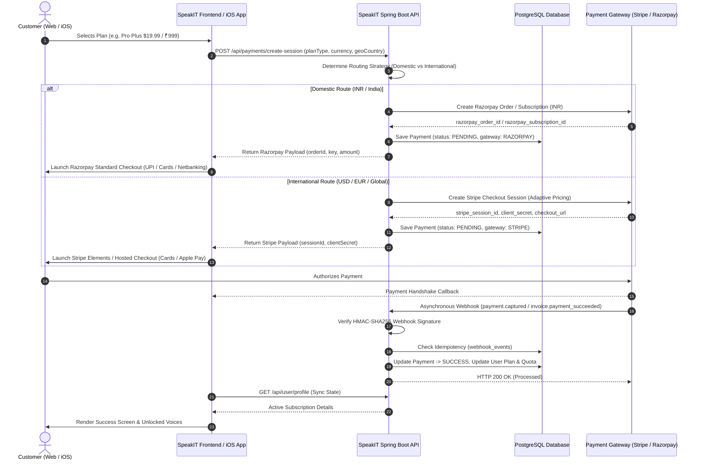
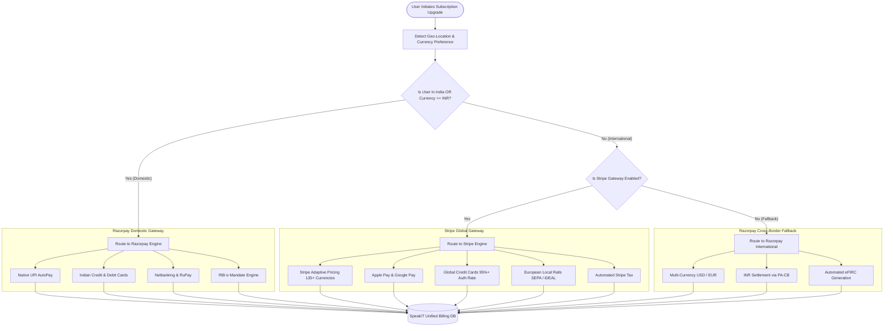
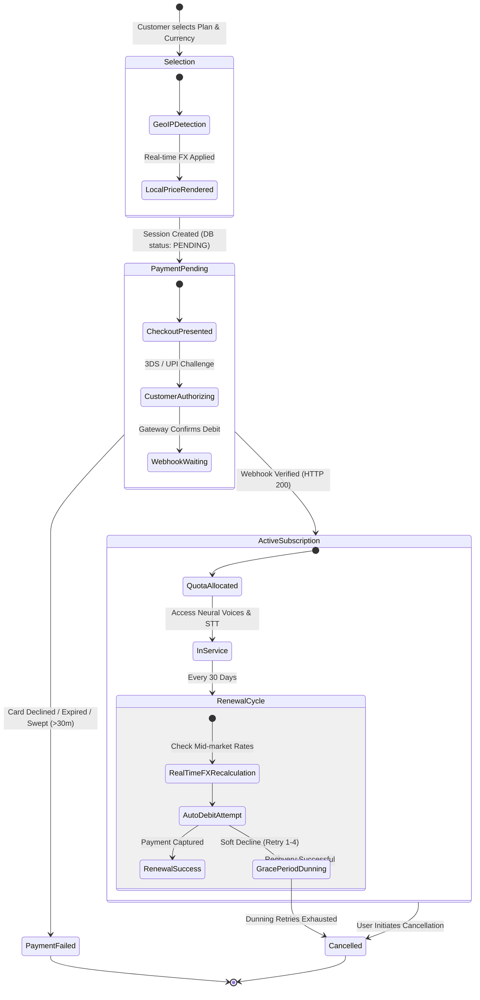
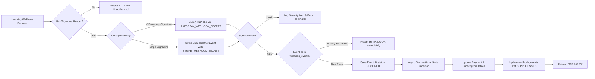

# SpeakIT: Global Payment Gateway Architecture & Strategy
## Comprehensive Analysis, Comparison (Stripe vs. Razorpay), and Real-Time Multi-Currency Implementation Roadmap

**Document Version:** 1.0.0  
**Target Platform:** SpeakIT AI Voice Generation Platform (Spring Boot 3.x, Angular 21, iOS Native Swift)  
**Author:** SpeakIT Engineering & Architecture Team  
**Status:** Approved Architectural Blueprint  

---

## Table of Contents
1. [Executive Summary & Global Vision](#1-executive-summary--global-vision)
2. [Deep Comparative Analysis: Stripe vs. Razorpay](#2-deep-comparative-analysis-stripe-vs-razorpay)
   - [Feature Matrix](#21-feature-matrix)
   - [Currency Support: Presentment vs. Settlement](#22-currency-support-presentment-vs-settlement)
   - [Real-Time Currency Conversion & FX Dynamics](#23-real-time-currency-conversion--fx-dynamics)
   - [Recurring Subscription Engines](#24-recurring-subscription-engines)
   - [Authorization & Success Rates](#25-authorization--success-rates)
   - [Fee Structure, FX Markups & Net Revenue Impact](#26-fee-structure-fx-markups--net-revenue-impact)
   - [Regulatory & Tax Compliance (RBI, FEMA, eFIRC, Stripe Tax)](#27-regulatory--tax-compliance)
3. [Architecture Diagrams & Data Flows](#3-architecture-diagrams--data-flows)
   - [End-to-End Gateway Processing Flow](#31-end-to-end-gateway-processing-flow)
   - [Smart Multi-Gateway Orchestration Layer (Geo-IP & Currency Router)](#32-smart-multi-gateway-orchestration-layer)
   - [Recurring Billing & Real-Time Currency Conversion Lifecycle](#33-recurring-billing--real-time-currency-conversion-lifecycle)
   - [Webhook Signature Verification & Idempotency Pipeline](#34-webhook-signature-verification--idempotency-pipeline)
4. [Target Architecture: Hybrid Multi-Gateway Orchestrator](#4-target-architecture-hybrid-multi-gateway-orchestrator)
   - [Strategy Pattern Design in Spring Boot 3](#41-strategy-pattern-design-in-spring-boot-3)
   - [Unified Database Schema (Supporting Dual Gateways)](#42-unified-database-schema)
   - [Geo-IP & Currency Detection Strategy](#43-geo-ip--currency-detection-strategy)
5. [Implementation Roadmap for SpeakIT](#5-implementation-roadmap-for-speakit)
   - [Phase 1: Razorpay Hardening (Domestic + Basic International)](#phase-1-razorpay-hardening)
   - [Phase 2: Payment Abstraction Layer (Spring Boot Strategy Pattern)](#phase-2-payment-abstraction-layer)
   - [Phase 3: Stripe Integration (Stripe Billing + Adaptive Pricing)](#phase-3-stripe-integration)
   - [Phase 4: Client-Side Parity (Angular & iOS Native)](#phase-4-client-side-parity)
6. [Security, PCI Compliance & Operational Hardening](#6-security-pci-compliance--operational-hardening)
7. [Official Documentation & Authoritative References](#7-official-documentation--authoritative-references)

---

## 1. Executive Summary & Global Vision

SpeakIT is a production-grade SaaS engineered for high-concurrency, sub-second AI Text-to-Speech (TTS) and Speech-to-Text (STT) synthesis. While our initial billing infrastructure is anchored in **Razorpay** for the Indian domestic market, SpeakIT's long-term business model requires seamless global monetization:

1. **Global Presentment in Any Currency:** Users in the US, Europe, UK, Japan, Australia, Latin America, and India must be presented with prices in their native currency (USD, EUR, GBP, JPY, CAD, AUD, INR).
2. **Real-Time Dynamic Currency Conversion:** Currency fluctuations must be handled automatically at checkout without exposing SpeakIT to foreign exchange losses or surprising customers with hidden bank fees.
3. **Frictionless Local Payment Rails:** Domestic Indian users demand instant UPI and RuPay rails with zero friction; European customers expect SEPA Direct Debit and iDEAL; US and international users expect Apple Pay, Google Pay, and single-click card checkout with ~95%+ authorization rates.
4. **Automated Regulatory & Tax Compliance:** Managing cross-border software export compliance under the Reserve Bank of India (RBI) / Foreign Exchange Management Act (FEMA) requires electronic Foreign Inward Remittance Certificates (eFIRC), while global digital services require automated sales tax/VAT calculation (EU VAT, US State Sales Tax).

This document presents a rigorous comparative analysis of **Stripe** versus **Razorpay** and delivers an enterprise architectural blueprint for a **Smart Multi-Gateway Orchestration Layer** in SpeakIT.

---

## 2. Deep Comparative Analysis: Stripe vs. Razorpay

### 2.1 Feature Matrix

| Capability | Stripe (Stripe Billing + Payments) | Razorpay (Subscriptions + Payments) | Architectural Impact on SpeakIT |
| :--- | :--- | :--- | :--- |
| **Supported Currencies** | **135+** presentment currencies; settlements in 25+ local currencies | **100+** presentment currencies; settlements in **INR** for Indian entities | Stripe enables multi-currency bank accounts; Razorpay forces INR conversion. |
| **Real-Time FX Conversion** | **Adaptive Pricing**: Real-time automated conversion based on mid-market rates at checkout | **Dynamic Currency Conversion (DCC)**: Available via international card processors | Stripe Adaptive Pricing works automatically across 40+ countries without manual plan creation. |
| **Domestic India Dominance** | Limited (Invite-only in India; cards only; no native UPI recurring) | **Undisputed Leader**: Instant UPI, UPI AutoPay, Netbanking, RuPay, Indian Wallets | Razorpay is mandatory for optimal Indian domestic conversion (>85% vs ~40% for Stripe cards). |
| **Global Card Authorization Rate** | **Industry Benchmark (94–96%)** via Stripe Radar & direct card network integrations | **70–82%** on international cards (frequently flagged as cross-border foreign merchant) | Stripe eliminates false-positive card declines in US/EU. |
| **Global Payment Methods** | Apple Pay, Google Pay, Link, SEPA, iDEAL, Bancontact, Giropay, Klarna, Afterpay | Domestic cards, UPI, Netbanking; international cards (Visa/Mastercard/Amex) | Stripe unlocks European local rails that do not use credit cards. |
| **SaaS Subscription Engine** | **Stripe Billing**: Multi-currency recurring, automated proration, dunning, tiered usage | **Razorpay Subscriptions**: Plan-based recurring, Indian e-mandate support | Stripe Billing provides far superior dunning and usage-based billing flexibilities. |
| **Cross-Border Compliance** | Global automated tax (Stripe Tax), W-8BEN/W-9 generation, PSD2/SCA compliance | **RBI PA-CB Licensed**: Automated eFIRC/eBRC generation, FEMA purpose codes | Razorpay handles Indian export compliance out of the box. |
| **Mobile SDK Support** | First-class native iOS (Swift Package), Android, React Native, Flutter | Native iOS framework (Cocoapods/SPM), Android, React Native, Flutter | Both provide robust native iOS SDKs with Apple Pay support. |

---

### 2.2 Currency Support: Presentment vs. Settlement

To design a scalable multi-currency architecture, SpeakIT must distinguish between two core financial concepts:

1. **Presentment Currency:** The currency displayed to the end-user and charged on their credit card statement (e.g., $9.99 USD, €9.99 EUR, ₹499 INR).
2. **Settlement Currency:** The currency deposited into SpeakIT's corporate bank account (e.g., INR in an Indian bank, or USD in an international entity).

```text
+---------------------------------------------------------------------------------------+
|                                CURRENCY FLOW COMPARISON                               |
+---------------------------------------------------------------------------------------+
| STRIPE ADAPTIVE PRICING:                                                              |
| [Customer: Tokyo] ---> Pays ¥1,500 JPY ---> Stripe FX (Real-time) ---> Payout $9.99 USD|
|                                                                                       |
| RAZORPAY INTERNATIONAL:                                                               |
| [Customer: New York] -> Pays $9.99 USD ---> Razorpay Bank FX (Mid-rate) -> Payout ₹830 INR|
+---------------------------------------------------------------------------------------+
```

#### Stripe Multi-Currency Architecture:
* Supports charging customers in **135+ currencies** while settling funds in the merchant's base currency, or into separate regional bank accounts (e.g., USD to US bank, EUR to European bank) with zero conversion loss.
* Source: [Stripe Official Documentation - Currencies](https://stripe.com/docs/currencies).

#### Razorpay Multi-Currency Architecture:
* Supports accepting payments in **100+ foreign currencies** (USD, EUR, GBP, SGD, AED, AUD, CAD, etc.).
* Under RBI regulations, all cross-border funds received by an Indian business entity must be converted and settled into an **Indian Current Account in INR**.
* Razorpay passes the foreign exchange rate provided by its banking partners at the time of transaction settlement.
* Source: [Razorpay Official Documentation - International Payments](https://razorpay.com/docs/payments/international-payments/).

---

### 2.3 Real-Time Currency Conversion & FX Dynamics

#### Stripe Adaptive Pricing (State of the Art for Global SaaS)
* **Mechanism:** When a customer visits SpeakIT Checkout or Subscription Paywall, Stripe detects their location and automatically converts prices from your base currency (e.g., USD or INR) to the customer's local currency using real-time mid-market exchange rates.
* **Subscription Handling:** For recurring subscriptions, Stripe calculates the local currency amount using real-time rates at the time of each billing cycle, or allows an optional **stability buffer** (minimum 4%) so prices remain predictable unless the local currency weakens past the threshold.
* **Customer Transparency:** The checkout invoice displays both the localized price and the base currency equivalent, preventing surprise foreign transaction fees on the customer's card statement.
* Source: [Stripe Official Documentation - Adaptive Pricing](https://stripe.com/docs/payments/checkout/adaptive-pricing).

#### Razorpay International & Dynamic Currency Conversion (DCC)
* **Mechanism:** When an international card is entered, Razorpay's checkout detects the issuing country and currency. The customer can be charged directly in their card's domestic currency (Multi-Currency Pricing) or in INR converted at their bank's rate (DCC).
* **Limitations:** Razorpay does not currently have an autonomous "Adaptive Pricing" engine that dynamically adjusts and buffers recurring subscription invoices across 40+ currencies at the product-catalog level. Subscriptions must typically be defined in specific plan currencies (e.g., a USD plan and an INR plan).
* Source: [Razorpay Official Documentation - Currency Conversion](https://razorpay.com/docs/payments/international-payments/currency-conversion/).

---

### 2.4 Recurring Subscription Engines

#### Stripe Billing Capabilities:
* **Proration & Upgrades:** Native handling of mid-cycle upgrades (e.g., moving from Pro to Pro Plus instantly charges the prorated difference).
* **Smart Retries & Dunning:** Machine learning-driven retry schedules (Stripe Smart Retries) that test different times of day to optimize success on card declines.
* **Customer Portal:** Pre-built, hosted self-service portal where customers can change payment methods, view invoices, download PDF receipts, and cancel subscriptions.
* **Usage-Based Metering:** Seamlessly bill per character overage or per API request.

#### Razorpay Subscriptions Capabilities:
* **RBI e-Mandate Compliance:** Specifically designed to comply with the RBI's stringent recurring payment guidelines in India:
  * Automatic pre-debit notifications sent to users 24 hours prior to recurring debit.
  * Frictionless debits up to ₹15,000 without requiring an OTP.
  * Subscriptions over ₹15,000 automatically trigger 2-Factor Authentication (AFA/OTP).
* **Indian Card & UPI AutoPay Coverage:** Supports recurring mandates over Indian Credit Cards, Debit Cards (selected banks), and UPI AutoPay (Google Pay, PhonePe, Paytm).
* **Limitations on International Recurring:** Recurring mandates on international cards require manual 3DS authorization on first charge, and recurring renewals without 3DS can suffer higher decline rates from foreign issuing banks that enforce European SCA (Strong Customer Authentication).

---

### 2.5 Authorization & Success Rates

| Geographic Region | Stripe Success Rate | Razorpay Success Rate | Core Reason |
| :--- | :--- | :--- | :--- |
| **India (Domestic)** | 40% – 55% | **88% – 94%** | Razorpay integrates directly with Indian bank payment gateways, NPCI (UPI), and local card networks. Stripe India lacks native UPI recurring and local debit rails. |
| **North America (US & Canada)** | **94% – 97%** | 72% – 80% | US issuing banks (Chase, Wells Fargo, BoA) frequently flag transactions from Indian merchant acquirers as potential international fraud. |
| **European Union & UK** | **93% – 96%** | 68% – 76% | EU banks mandate **PSD2 Strong Customer Authentication (SCA)**. Stripe's Adaptive 3DS2 dynamically challenges cards only when required, preventing hard declines. |
| **Asia-Pacific (Ex-India)** | **90% – 94%** | 75% – 82% | Stripe local acquirers in Singapore, Japan, Australia, and Hong Kong optimize local routing. |

---

### 2.6 Fee Structure, FX Markups & Net Revenue Impact

Understanding the true cost of cross-border transactions:

```text
Total Processing Cost = Gateway Base Fee + Cross-Border Assessment Fee + FX Conversion Markup
```

| Fee Category | Stripe (International Account) | Razorpay (Indian PA-CB Account) |
| :--- | :--- | :--- |
| **Domestic Transaction Fee** | 2.9% + $0.30 per transaction | **2.0% + GST** (Cards/Netbanking), **0% on UPI** |
| **International Card Fee** | +1.5% for international cards | **3.0% + GST** for international cards |
| **Currency Conversion Markup** | +1.0% to 2.0% when presentment currency differs from settlement currency | **2.0% to 3.5%** forex markup on currency conversion to INR |
| **Billing Engine Fee** | 0.5% – 0.8% on recurring volume (Stripe Billing) | Included in standard subscription processing |
| **Dispute / Chargeback Fee** | $15.00 per dispute (refundable if won) | ₹1,500 + GST per dispute |
| **Payout / Transfer Fee** | Free automated rolling payouts | Free standard settlement to Indian bank |

---

### 2.7 Regulatory & Tax Compliance

#### Cross-Border Compliance for Indian Businesses (FEMA & RBI)
When an Indian business (like SpeakIT) accepts payments from customers abroad:
* **The Problem:** The Reserve Bank of India mandates that all foreign inwards remittances must have an associated **Foreign Inward Remittance Certificate (FIRC)** or Electronic Bank Realisation Certificate (eBRC) for GST export reconciliation and zero-rated tax filing.
* **Razorpay's Advantage:** Because Razorpay holds an RBI **Payment Aggregator - Cross Border (PA-CB)** license, it automatically provides **monthly eFIRC certificates** with designated DGFT Purpose Codes (e.g., `P0802 - Software Downloads / SaaS Services`) directly inside the dashboard.
* **Stripe India's Challenge:** Stripe India accounts require manual coordination with banking partners (e.g., Standard Chartered or Axis Bank) to obtain physical FIRCs, adding operational overhead for early-stage startups.

#### Global Digital Sales Tax (VAT / GST / US State Sales Tax)
* **Stripe Tax:** Automatically calculates and collects EU VAT, UK VAT, and US State Sales Tax across 50+ countries directly within Stripe Checkout and Stripe Elements. It monitors sales thresholds and notifies you when you trigger economic nexus in a country.
* **Razorpay:** Calculates Indian GST (18%) out of the box, but does not provide automated international sales tax determination or EU VAT reverse charge automation.

---

## 3. Architecture Diagrams & Data Flows

### 3.1 End-to-End Gateway Processing Flow



---

### 3.2 Smart Multi-Gateway Orchestration Layer

The optimal architecture for SpeakIT is a **Hybrid Smart-Router** that intelligently routes users based on currency and geolocation:



---

### 3.3 Recurring Billing & Real-Time Currency Conversion Lifecycle



---

### 3.4 Webhook Signature Verification & Idempotency Pipeline



---

## 4. Target Architecture: Hybrid Multi-Gateway Orchestrator

### 4.1 Strategy Pattern Design in Spring Boot 3

To decouple SpeakIT's core business services from third-party vendor SDKs, we implement the **Payment Gateway Strategy Pattern**:

```text
src/main/java/com/speakit/billing/
 ├── gateway/
 │    ├── PaymentGatewayStrategy.java          <-- Core Interface
 │    ├── PaymentGatewayType.java              <-- ENUM (RAZORPAY, STRIPE)
 │    ├── PaymentOrchestrator.java             <-- Dynamic Router
 │    ├── razorpay/
 │    │    ├── RazorpayGatewayStrategy.java    <-- Razorpay Implementation
 │    │    └── RazorpayWebhookHandler.java
 │    └── stripe/
 │         ├── StripeGatewayStrategy.java       <-- Stripe Implementation
 │         └── StripeWebhookHandler.java
 ├── controller/
 │    ├── PaymentController.java               <-- Client Session Initiation
 │    └── WebhookController.java               <-- Multi-Gateway Webhook Ingress
 ├── service/
 │    └── SubscriptionService.java             <-- Domain Logic & Plan Upgrades
 └── entity/
      ├── Payment.java                         <-- Unified Payment Record
      └── Subscription.java                    <-- Unified Subscription Record
```

#### Core Gateway Interface Definition:

```java
package com.speakit.billing.gateway;

import com.speakit.billing.dto.*;
import com.speakit.user.entity.User;

public interface PaymentGatewayStrategy {
    
    PaymentGatewayType getGatewayType();
    
    boolean supportsCurrency(String currency);
    
    InitiatePaymentResponse createCheckoutSession(User user, CreateSessionRequest request);
    
    SubscriptionResponse createSubscription(User user, CreateSubscriptionRequest request);
    
    boolean verifyWebhookSignature(String payload, String signatureHeader);
    
    void processWebhookEvent(String payload, String signatureHeader);
    
    void cancelSubscription(String externalSubscriptionId);
}
```

#### Intelligent Orchestrator Router:

```java
package com.speakit.billing.gateway;

import com.speakit.parameter.service.SystemParameterService;
import lombok.RequiredArgsConstructor;
import org.springframework.stereotype.Service;

import java.util.List;
import java.util.Map;

@Service
@RequiredArgsConstructor
public class PaymentOrchestrator {

    private final List<PaymentGatewayStrategy> strategies;
    private final SystemParameterService systemParameterService;

    public PaymentGatewayStrategy resolveGateway(String currency, String countryCode) {
        boolean stripeEnabled = "true".equalsIgnoreCase(
            systemParameterService.getCachedParameter("ENABLE_STRIPE", "false")
        );
        
        // Domestic India Strategy: Always route INR or IN users to Razorpay
        if ("INR".equalsIgnoreCase(currency) || "IN".equalsIgnoreCase(countryCode)) {
            return getStrategy(PaymentGatewayType.RAZORPAY);
        }
        
        // International Strategy: Prefer Stripe if enabled for optimal conversion
        if (stripeEnabled) {
            return getStrategy(PaymentGatewayType.STRIPE);
        }
        
        // Fallback: Razorpay International
        return getStrategy(PaymentGatewayType.RAZORPAY);
    }

    private PaymentGatewayStrategy getStrategy(PaymentGatewayType type) {
        return strategies.stream()
                .filter(s -> s.getGatewayType() == type)
                .findFirst()
                .orElseThrow(() -> new IllegalStateException("Payment strategy not configured for: " + type));
    }
}
```

---

### 4.2 Unified Database Schema

To support dual gateways without schema duplication or column explosion, we maintain a unified database design:

```sql
-- Updated Subscriptions Table supporting Dual Gateways
ALTER TABLE subscriptions 
    ADD COLUMN IF NOT EXISTS gateway VARCHAR(20) NOT NULL DEFAULT 'RAZORPAY', -- RAZORPAY, STRIPE
    ADD COLUMN IF NOT EXISTS external_subscription_id VARCHAR(100) UNIQUE,
    ADD COLUMN IF NOT EXISTS currency VARCHAR(10) NOT NULL DEFAULT 'INR',
    ADD COLUMN IF NOT EXISTS customer_id VARCHAR(100); -- Stripe cus_xxx or Razorpay cust_xxx

-- Updated Payments Table supporting Multi-Currency & Dual Gateways
ALTER TABLE payments 
    ADD COLUMN IF NOT EXISTS gateway VARCHAR(20) NOT NULL DEFAULT 'RAZORPAY', -- RAZORPAY, STRIPE
    ADD COLUMN IF NOT EXISTS external_order_id VARCHAR(100),
    ADD COLUMN IF NOT EXISTS external_payment_id VARCHAR(100),
    ADD COLUMN IF NOT EXISTS fx_rate DECIMAL(19, 6) DEFAULT 1.000000,
    ADD COLUMN IF NOT EXISTS settlement_currency VARCHAR(10) DEFAULT 'INR',
    ADD COLUMN IF NOT EXISTS settlement_amount DECIMAL(19, 4);

-- Indexes for ultra-fast lookup across either gateway ID
CREATE INDEX IF NOT EXISTS idx_payments_external_order ON payments(external_order_id);
CREATE INDEX IF NOT EXISTS idx_payments_external_payment ON payments(external_payment_id);
CREATE INDEX IF NOT EXISTS idx_subscriptions_external_id ON subscriptions(external_subscription_id);
```

---

### 4.3 Geo-IP & Currency Detection Strategy

1. **Client-Side Initialization (Angular & iOS):**
   * Upon app load, client queries `GET /api/system-parameters/bulk` to obtain currency multipliers and whitelisted prices.
   * Client inspects `Locale.current.currency` on iOS (`NSLocaleCurrencyCode`) or browser `Intl.NumberFormat().resolvedOptions().currency`.
2. **Server-Side Fallback:**
   * SpeakIT backend inspects `CF-IPCountry` (Cloudflare) or `X-Forwarded-For` HTTP request headers.
   * If country == `IN`, presentment defaults to **INR (₹)**.
   * If country in EU, presentment defaults to **EUR (€)**.
   * If country == `GB`, presentment defaults to **GBP (£)**.
   * Otherwise, presentment defaults to **USD ($)**.
3. **User Override:**
   * A clean, accessible currency switcher in the UI allows users to manually override currency at any time.

---

## 5. Implementation Roadmap for SpeakIT

```text
+---------------------------------------------------------------------------------------+
|                               IMPLEMENTATION ROADMAP                                  |
+---------------------------------------------------------------------------------------+
| PHASE 1: Razorpay Production Hardening  [COMPLETED]                                    |
|   - Stale payment automated sweeper (>30 mins to FAILED)                              |
|   - Dual-format HMAC signature verification (Order + Subscription ID)                 |
|   - Multi-state receipt & invoice UI parity (PENDING / FAILED / SUCCESS)              |
|   - Dynamic character limits & feature lock upgrades                                  |
+---------------------------------------------------------------------------------------+
| PHASE 2: Multi-Currency & Gateway Abstraction  [NEXT STEP]                            |
|   - Introduce PaymentGatewayStrategy interface in Spring Boot                         |
|   - Migrate RazorpayService to RazorpayGatewayStrategy                                |
|   - Enable Razorpay International Payments & Currency Conversion in Dashboard         |
|   - Whitelist USD/EUR parameters (PRO_PLAN_PRICE_USD, PRO_PLAN_PRICE_EUR)             |
+---------------------------------------------------------------------------------------+
| PHASE 3: Stripe Integration & Adaptive Pricing  [EXPANSION]                           |
|   - Add stripe-java official dependency (v24.x+)                                      |
|   - Implement StripeGatewayStrategy (Stripe Billing + Adaptive Pricing)               |
|   - Add StripeWebhookHandler with timestamp-tolerance signature verification          |
|   - Introduce ENABLE_STRIPE system parameter toggle                                   |
+---------------------------------------------------------------------------------------+
| PHASE 4: Client-Side Dynamic Checkout UI  [CROSS-PLATFORM]                            |
|   - Angular: Dynamic currency picker & localized price formatting                     |
|   - iOS Native: Passkit / Apple Pay integration via Stripe SDK                        |
|   - Auto-detect local currency & format cleanly with NumberFormatter                  |
+---------------------------------------------------------------------------------------+
```

---

## 6. Security, PCI Compliance & Operational Hardening

### 6.1 PCI DSS Compliance Guidelines
* **SAQ-A Scope:** SpeakIT must **never** ingest, process, transmit, or store raw Primary Account Numbers (PAN), CVVs, or expiration dates on its servers.
* **Tokenization:** All card entry must occur strictly inside **Stripe Elements / Checkout** or **Razorpay Checkout Modal**, which run inside secure, isolated iframes or native Apple Pay sheets. SpeakIT only receives a one-time token (`pm_xxx` or `pay_xxx`).

### 6.2 Webhook Security Checklist
1. **Raw Body Preservation:** Never use JSON request body interceptors before computing HMAC signatures. Signature calculation requires the exact, bit-for-bit raw byte array received on the HTTP wire.
2. **Replay Attack Defense:** 
   * Stripe webhooks include a timestamp header (`t=...`). Reject any webhook older than **300 seconds** (5 minutes).
3. **Database Idempotency:** Check `webhook_events.event_id` before processing. If an event is already marked `PROCESSED`, return `HTTP 200 OK` within 50ms without re-executing transactions.
4. **Sub-200ms Acknowledgement:** Complete verification and return `HTTP 200 OK` immediately; perform heavy downstream operations (like PDF invoice generation or email dispatch) asynchronously via `@Async` virtual threads.

---

## 7. Official Documentation & Authoritative References

### Stripe Official Documentation
* [Stripe Supported Currencies](https://stripe.com/docs/currencies) - Detailed specifications on presentment vs. settlement currencies.
* [Stripe Adaptive Pricing](https://stripe.com/docs/payments/checkout/adaptive-pricing) - Official guide on dynamic real-time currency conversion for global checkouts.
* [Stripe Billing & Subscriptions](https://stripe.com/docs/billing) - Recurring billing cycles, dunning logic, and proration.
* [Stripe Webhook Signature Verification](https://stripe.com/docs/webhooks/signatures) - Official security guide on HMAC-SHA256 timestamp verification.
* [Stripe Tax Integration](https://stripe.com/docs/tax) - Automated calculation of sales tax, VAT, and GST globally.

### Razorpay Official Documentation
* [Razorpay International Payments](https://razorpay.com/docs/payments/international-payments/) - Configuration and multi-currency checkout setup.
* [Razorpay Currency Conversion](https://razorpay.com/docs/payments/international-payments/currency-conversion/) - Mechanics of foreign exchange and settlement in INR.
* [Razorpay Subscriptions & RBI Guidelines](https://razorpay.com/docs/payments/subscriptions/) - Detailed documentation on RBI e-mandate rules, AFA, and recurring billing.
* [Razorpay eFIRC & Cross-Border Compliance](https://razorpay.com/docs/payments/international-payments/firc/) - Export compliance under FEMA and automated eFIRC generation.
* [Razorpay Webhooks & Verification](https://razorpay.com/docs/webhooks/) - Best practices for handling payment events and signature validation.

---

### Conclusion & Immediate Strategic Action
For SpeakIT's current stage:
1. **Immediate Execution:** Keep **Razorpay** as the primary engine, enable Razorpay International Payments in the Razorpay Dashboard, and configure foreign currency plans (USD/EUR) to begin accepting global payments with automated eFIRC compliance.
2. **Strategic Scaling:** Implement the **PaymentGatewayStrategy** abstraction pattern in our Spring Boot backend. When ready for US/EU market acceleration, enable **Stripe** behind the `ENABLE_STRIPE` system parameter to capture maximum global conversion rates via **Stripe Adaptive Pricing** and Apple Pay.
