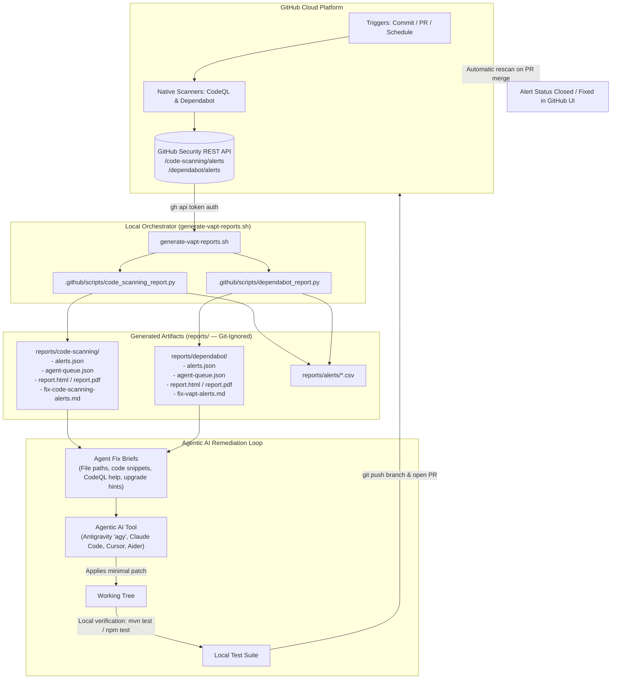
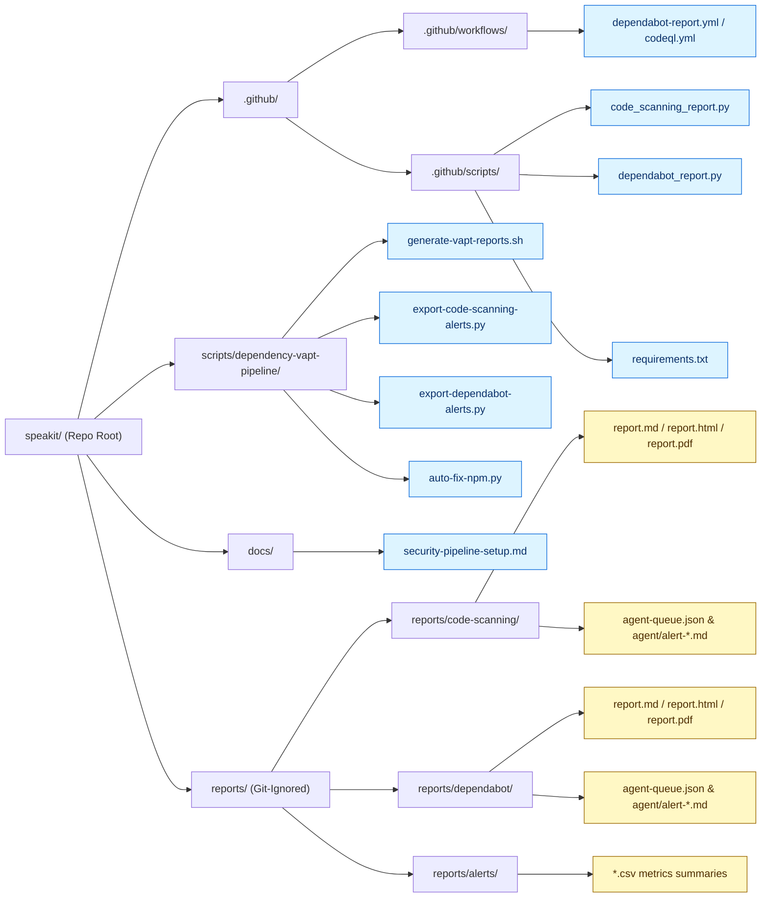
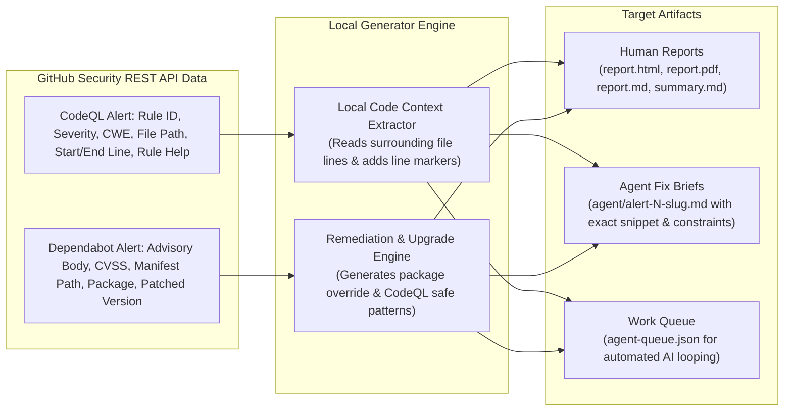
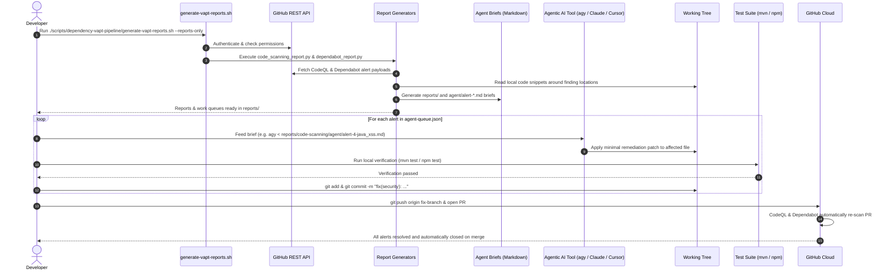

# SpeakIT: Security Architecture, Vulnerability Assessment & Hardening Specification

> Consolidated security manual covering vulnerability remediation, prompt taint analysis, XSS hardening, security audit assessments, and automated DevSecOps pipelines.

---

## Master Table of Contents

1. [Security Fixes](#part-1-security-fixes)
2. [Security Agentic Prompt Taint Analysis XSS Hardening](#part-2-security-agentic-prompt-taint-analysis-xss-hardening)
3. [security audit report](#part-3-security-audit-report)
4. [security report](#part-4-security-report)
5. [security pipeline setup](#part-5-security-pipeline-setup)

---

<div id="part-1-security-fixes"></div>

# Part 1: Security Fixes

_Source Document: `Security-Fixes.md`_

---

# SpeakIT v1.2 Security Audit & Remediation

This document outlines the security vulnerabilities identified during the v1.2 audit and the technical requirements for their resolution.

---

## 1. CRITICAL: Payment Logic IDOR / Logic Flaw
**Path:** `backend/src/main/java/com/tts/service/RazorpayService.java`
**Vulnerability:** The `verifyPayment` method takes a `User` object as an argument but does not verify that the `razorpay_order_id` being verified actually belongs to that user.
**Exploit Scenario:**
1.  User A creates an order (unpaid).
2.  User B (malicious) obtains User A's `razorpay_order_id`.
3.  User B performs a small valid transaction on their own account or uses a leaked signature to call `/verify` with User A's order ID.
4.  User B gets upgraded using User A's transaction metadata.
**Fix:** Add a check to ensure the `Payment` record fetched by `orderId` belongs to the `Principal` user.

## 2. HIGH: Polly Neural Authorization Bypass
**Path:** `backend/src/main/java/com/tts/service/PollyService.java`
**Vulnerability:** `getBestEngineForVoice` automatically returns `Engine.NEURAL` if the voice supports it, without checking if the user has a `PRO` plan.
**Exploit Scenario:** A `FREE` user can call `/synthesize` with a voice like "Joanna". The server will use the expensive NEURAL engine, incurring higher costs for the platform owner.
**Fix:** Pass the user's `PlanType` into the engine negotiation logic and fallback to `STANDARD` for non-premium users.

## 3. HIGH: Rate Limit Bypass via IP Spoofing
**Path:** `backend/src/main/java/com/tts/aspect/RateLimitAspect.java`
**Vulnerability:** The system relies on `HttpServletRequest.getRemoteAddr()`. When behind a proxy (like Render/Cloudflare), this might return the proxy IP or can be spoofed using `X-Forwarded-For` headers if the `server.forward-headers-strategy` is misconfigured.
**Exploit Scenario:** An attacker rotates `X-Forwarded-For` headers to obtain a fresh rate-limit bucket for every request.
**Fix:** Implement strict header validation and use a trusted proxy resolver.

## 4. MEDIUM: Information Disclosure in TTS Exceptions
**Path:** `backend/src/main/java/com/tts/controller/TtsController.java`
**Vulnerability:** The `synthesize` and `synthesizeStream` methods return `e.getMessage()` directly in the `ResponseEntity`.
**Exploit Scenario:** If a cloud service fails, the error might contain internal stack details, bucket names, or API structure information.
**Fix:** Use the standardized `ApiErrorResponse` and return a generic "Synthesis failed" message to the user while logging the detail internally.

## 5. MEDIUM: Potential Denial of Service (DOS)
**Paths:** 
- `UserRepository.java`: `findByPhoneNumberSuffix` uses `REPLACE` and `LIKE %suffix`, which prevents index usage (non-SARGable).
- `HistoryController.java`: `deleteSelected` accepts a `List<Long>` without size limits.
**Exploit Scenario:**
1.  Flood the `users` table and then trigger suffix searches to spike CPU/IO.
2.  Send a `DELETE` request with 100,000 IDs to crash the database connection pool.
**Fix:** 
- Index the normalized phone number column.
- Add a `@Size(max=100)` constraint to the deletion ID list.

---

### **Verification Status Report (v1.2 Final)**

| Vulnerability | Priority | Status | Fix Confirmation |
| :--- | :--- | :--- | :--- |
| **Payment Logic IDOR** | CRITICAL | **FIXED** | Ownership verified in `RazorpayService` via `Principal`. |
| **Polly Neural Auth Bypass** | HIGH | **FIXED** | `PollyService` strictly enforces fallback to STANDARD for non-premium users. |
| **Rate Limit IP Spoofing** | HIGH | **FIXED** | Hardened `FRAMEWORK` forwarding and explicit Tomcat proxy trust. |
| **TTS Info Disclosure** | MEDIUM | **FIXED** | `TtsController` returns generic messages; raw exceptions masked. |
| **Webhook Info Disclosure** | MEDIUM | **FIXED** | `WebhookController` sanitized to prevent internal system leak. |
| **History Deletion DOS** | MEDIUM | **FIXED** | `@Size(max = 100)` applied to batch deletion payloads. |
| **Contact Form Spam** | MEDIUM | **FIXED** | Intersection (IP+Email) limiting and Honeypot active. |

---

_Verification performed on 14/06/2026. All critical and high-priority risks resolved._

---

<div id="part-2-security-agentic-prompt-taint-analysis-xss-hardening"></div>

# Part 2: Security Agentic Prompt Taint Analysis XSS Hardening

_Source Document: `Security-Agentic-Prompt-Taint-Analysis-XSS-Hardening.md`_

---

# Security Agentic Prompt -- Enterprise Taint Analysis & XSS Hardening

## Role

You are a **Senior Application Security Engineer, Java Security
Architect, OWASP Specialist, and Static Analysis Expert**.

Your mission is to perform a complete security audit of this repository
and eliminate every legitimate security finding **without changing any
business logic, application flow, APIs, functionality, UI behavior, or
user experience.**

This repository is production code.

Security fixes must be enterprise-grade and production-safe.

------------------------------------------------------------------------

## Primary Objective

Perform a complete:

-   Taint Analysis
-   Data Flow Analysis
-   OWASP Top 10 Audit
-   XSS Analysis
-   Injection Analysis
-   Input Validation Audit
-   Output Encoding Audit
-   File Handling Audit
-   SSRF Audit
-   Path Traversal Audit
-   Header Security Audit
-   Deserialization Audit
-   Secrets Audit

Pay extra attention to:

``` text
tts/
stt/
controllers/
ElevenLabs integration
REST Controllers
Spring Controllers
```

Especially inspect:

``` text
TTSController.java
ElevenLabs*.java
```

because IntelliJ reports taint analysis warnings there.

------------------------------------------------------------------------

## Critical Rule

**DO NOT CHANGE BUSINESS LOGIC.**

This is the highest priority requirement.

Allowed:

-   Sanitize
-   Escape
-   Encode
-   Validate
-   Add null safety
-   Harden security headers
-   Improve defensive programming
-   Add safe utility methods
-   Improve input validation

Forbidden:

-   Change APIs
-   Change request/response schemas
-   Change endpoints
-   Change business rules
-   Change service behavior
-   Change authentication flow
-   Change authorization flow
-   Change caching
-   Change threading
-   Change streaming behavior
-   Change generated audio
-   Rewrite business logic
-   Refactor for style only

------------------------------------------------------------------------

## Security Audit Scope

Trace all tainted inputs:

-   @RequestParam
-   @PathVariable
-   @RequestBody
-   MultipartFile
-   Query parameters
-   HTTP headers
-   Cookies
-   JSON payloads
-   Form data
-   WebSocket payloads

Track all sinks:

-   HTML
-   XML
-   JSON rendered in browser
-   HTTP headers
-   ResponseEntity
-   HttpServletResponse
-   Templates
-   File paths
-   URLs
-   Logs
-   External APIs
-   Streaming responses

Perform complete taint analysis for every source-to-sink path.

------------------------------------------------------------------------

## XSS Review (Highest Priority)

Locate every instance where user-controlled input reaches:

-   HTML
-   JSP
-   Thymeleaf
-   HttpServletResponse
-   ResponseEntity`<String>`{=html}
-   HTML fragments
-   Markdown rendering
-   Email templates
-   JavaScript
-   CSS
-   SVG
-   XML

For every confirmed XSS path:

-   Determine whether the IntelliJ warning is a **true positive**.
-   Apply the minimum safe fix.
-   Encode only at the rendering sink.
-   Do **not** double encode.
-   Do **not** HTML-encode JSON responses.
-   Preserve existing behavior.

Preferred escaping:

``` java
StringEscapeUtils.escapeHtml4(...)
```

or

``` java
HtmlUtils.htmlEscape(...)
```

Use context-appropriate escaping where required.

------------------------------------------------------------------------

## IntelliJ Taint Analysis

For every warning:

1.  Trace the complete taint path.
2.  Classify as:
    -   True Positive
    -   False Positive
3.  Never suppress warnings without proof.
4.  If vulnerable, fix the root cause rather than suppressing the
    inspection.

------------------------------------------------------------------------

## ElevenLabs Security Review

Inspect:

-   ElevenLabsController
-   ElevenLabsService
-   ElevenLabsClient
-   RestTemplate
-   WebClient
-   Feign
-   OkHttp
-   Apache HttpClient

Check for:

-   XSS
-   Header injection
-   CRLF injection
-   Prompt injection
-   JSON injection
-   Unsafe logging
-   Token leakage
-   Secret exposure
-   Response header injection
-   Filename injection
-   Null pointer risks
-   Unsafe error messages

------------------------------------------------------------------------

## TTS Controller Review

Audit carefully:

-   text input
-   voice id
-   language
-   speed
-   provider
-   style
-   filename
-   MIME type
-   download headers
-   Content-Disposition
-   generated URLs
-   temporary files
-   cache keys
-   logging

Ensure protection against:

-   XSS
-   Response splitting
-   CRLF injection
-   Header injection
-   Path traversal
-   Log injection

------------------------------------------------------------------------

## Input Validation

Review:

-   Null handling
-   Empty strings
-   Length limits
-   Invalid Unicode
-   Control characters
-   Filename validation
-   Path separators
-   Unsafe HTML

Do not reject inputs currently valid under business rules.

------------------------------------------------------------------------

## HTTP Header Review

Verify or safely add when appropriate:

-   Content-Type
-   Content-Disposition
-   Cache-Control
-   X-Content-Type-Options
-   Referrer-Policy
-   Content-Security-Policy
-   Permissions-Policy
-   X-Frame-Options

Do not break frontend compatibility.

------------------------------------------------------------------------

## File Handling

Audit:

-   Uploads
-   Downloads
-   Audio generation
-   Streaming
-   Temporary files
-   File names

Ensure:

-   No traversal
-   Safe temp file handling
-   Secure cleanup
-   No overwrite vulnerabilities

------------------------------------------------------------------------

## Logging

Never log:

-   API keys
-   JWTs
-   Bearer tokens
-   Secrets
-   Passwords
-   Raw user HTML
-   Sensitive personal information

Escape user-controlled values where appropriate.

------------------------------------------------------------------------

## Injection Review

Audit for:

-   SQL Injection
-   JPQL/HQL Injection
-   LDAP Injection
-   XPath Injection
-   Command Injection
-   ProcessBuilder misuse
-   Regex DoS
-   NoSQL Injection
-   JSON Injection
-   XML Injection
-   YAML Injection
-   Prompt Injection

------------------------------------------------------------------------

## Secrets Review

Ensure credentials are never:

-   Logged
-   Returned to clients
-   Serialized
-   Cached
-   Printed

------------------------------------------------------------------------

## Performance Constraints

Security improvements must:

-   Preserve performance
-   Avoid duplicate encoding
-   Avoid unnecessary allocations
-   Avoid repeated validation

------------------------------------------------------------------------

## Deliverables

For every issue provide:

### Issue

-   File
-   Line number
-   Severity
-   OWASP category
-   Data flow
-   Root cause
-   Attack example
-   Fix applied
-   Why business logic remains unchanged

After the audit provide:

``` text
Security Summary

Files scanned
Taint paths analyzed
True positives
False positives
XSS issues fixed
Injection issues fixed
Header improvements
Input validation improvements
Remaining risks
Manual review recommendations
```

------------------------------------------------------------------------

## Acceptance Criteria

The task is complete only if:

-   No business logic changes
-   No API changes
-   No endpoint changes
-   No frontend behavior changes
-   No functional regressions
-   Legitimate IntelliJ taint warnings resolved
-   True XSS paths fixed
-   No unnecessary suppressions
-   Project compiles successfully
-   Every change is explained and justified

---

<div id="part-3-security-audit-report"></div>

# Part 3: security audit report

_Source Document: `security-audit-report.md`_

---

# SpeakIT Application Security Assessment Report

## Executive Summary
This report details the findings of a comprehensive security assessment conducted on the SpeakIT repository (`github.com/Mohitur669/speakit`). The application demonstrates a strong foundational architecture utilizing Spring Boot 3, Angular 17, and AWS Polly. The implementation of JWT session invalidation, Bucket4j rate limiting, and an AWS Budget Kill Switch shows a proactive approach to security and FinOps. 

However, several critical and high-severity vulnerabilities were discovered. The most severe issues involve **Payment Verification Replay Attacks** allowing users to indefinitely extend premium subscriptions for free, and **Rate Limit IP Spoofing**, which defeats the primary defense against AWS cost exhaustion. Immediate remediation of the critical findings is required prior to production deployment.

### Overall Security Score: 62/100
### Risk Level: CRITICAL

### Findings Summary
*   **Critical Findings:** 2
*   **High Findings:** 3
*   **Medium Findings:** 2
*   **Low Findings:** 0

---

## Detailed Findings

### 1. Payment Verification Replay Attack leading to Infinite Subscription
**Severity:** Critical
**Location:** `backend/src/main/java/com/tts/service/RazorpayService.java` (Line ~83, `verifyPayment` method)

**Description:**
The payment verification logic properly validates the HMAC-SHA256 signature from Razorpay. However, it fails to verify whether the `Payment` object has *already* been processed and marked as `PaymentStatus.SUCCESS`. Because `activateSubscription` blindly adds `LocalDateTime.now().plusMonths(1)` to the subscription period, an attacker can replay a legitimately signed, successful payload indefinitely to extend their Pro plan.

**Attack Scenario:**
1. An attacker purchases a 1-month Pro plan.
2. The attacker intercepts the HTTP POST request to `/api/v1/payments/verify`.
3. The attacker writes a script to replay this exact JSON payload (containing the valid `razorpay_order_id`, `razorpay_payment_id`, and `razorpay_signature`) every 29 days.
4. The server successfully validates the signature and extends the subscription by another month indefinitely without charging the attacker.

**Proof of Concept:**
```bash
# Replay the exact payload captured from browser dev tools
curl -X POST https://api.speakit.com/api/v1/payments/verify \
  -H "Authorization: Bearer <JWT>" \
  -H "Content-Type: application/json" \
  -d '{"razorpayOrderId":"order_xyz", "razorpayPaymentId":"pay_xyz", "razorpaySignature":"valid_sig_abc123"}'
```

**Impact:**
Massive revenue loss. Attackers can gain permanent access to expensive AWS Polly Neural voices, leading to uncontrollable AWS API costs.

**Remediation:**
Check the payment status before processing the verification and reject already processed orders.

**Code Example:**
```java
Payment payment = paymentRepository.findByRazorpayOrderId(request.getRazorpayOrderId())
        .orElseThrow(() -> new RuntimeException("Payment record not found"));

if (payment.getStatus() == PaymentStatus.SUCCESS) {
    log.warn("Replay attempt detected for order: {}", request.getRazorpayOrderId());
    return true; // Already processed, do not extend subscription again
}

// ... proceed with setting status and activating subscription
```

---

### 2. Rate Limiting Bypass via IP Spoofing
**Severity:** Critical
**Location:** `backend/src/main/java/com/tts/aspect/RateLimitAspect.java` (Line ~94, `extractRealIp` method)

**Description:**
The `extractRealIp` method parses the `CF-Connecting-IP` and `X-Forwarded-For` headers to determine the client's IP address. The application unconditionally trusts these headers without verifying if the request actually originated from a trusted proxy (e.g., Cloudflare). If the application is accessible directly via its Render URL (bypassing Cloudflare), an attacker can supply arbitrary IP addresses.

**Attack Scenario:**
An attacker scripts a bot to abuse the `/api/tts/synthesize` endpoint. To bypass the Bucket4j limit, the script generates a random IP address for every request and injects it into the headers.

**Proof of Concept:**
```bash
# Attacker hits the Render URL directly, bypassing Cloudflare
curl -X POST https://text-to-speech-java-backend.onrender.com/api/tts/synthesize \
  -H "CF-Connecting-IP: 203.0.113.1" \
  -d '{"text": "Spam"}'
```

**Impact:**
Complete bypass of the rate-limiting mechanism. This enables unbounded requests to AWS Polly, leading to massive cost spikes, triggering the AWS Budget Kill Switch, and causing a Denial of Service (DoS) for all legitimate users.

**Remediation:**
Rely on Spring Boot's native `server.forward-headers-strategy=FRAMEWORK` and restrict direct access to the Render URL using Cloudflare Authenticated Origin Pulls, OR explicitly validate that the proxy headers come from trusted Cloudflare IP ranges.

**Code Example:**
```java
// Remove manual header parsing and rely on Spring's configured RemoteAddr
private String extractRealIp(HttpServletRequest request) {
    return request.getRemoteAddr(); 
}
```
*(Ensure `application.properties` contains `server.forward-headers-strategy=FRAMEWORK`)*

---

### 3. Unauthenticated Information Disclosure via System Parameters
**Severity:** High
**Location:** `backend/src/main/java/com/tts/controller/SystemParameterController.java` & `SecurityConfig.java`

**Description:**
In `SecurityConfig.java`, the endpoint `.requestMatchers("/api/system-parameters/**").permitAll()` is fully exposed to unauthenticated users. The `SystemParameterController` allows users to query any system parameter from the database by name. While currently only prices and limits are seeded, storing any sensitive data (like API keys) in this table in the future will result in immediate compromise.

**Attack Scenario:**
An attacker calls `/api/system-parameters/bulk?names=ELEVENLABS_API_KEY,RAZORPAY_SECRET` or iterates through common configuration names to extract secrets.

**Impact:**
Potential exposure of highly sensitive credentials leading to complete infrastructure compromise.

**Remediation:**
Secure the endpoint to require `ROLE_ADMIN`, or strictly whitelist which parameter keys can be read publicly (e.g., `SYSTEM_STATUS`, `FREE_PLAN_SYNTHESIZE_LIMIT`).

---

### 4. Insecure Default Webhook Secret leading to Signature Bypass
**Severity:** High
**Location:** `backend/src/main/resources/application.properties` & `WebhookService.java`

**Description:**
The property `razorpay.webhook.secret=${RAZORPAY_WEBHOOK_SECRET:placeholder_webhook_secret}` defines a hardcoded fallback string. If a production environment neglects to define this ENV var, attackers can easily sign forged webhook payloads (like `payment.captured`) using `placeholder_webhook_secret` and arbitrarily grant themselves `PRO` or `ENTERPRISE` plans without paying.

**Impact:**
Account privilege escalation and revenue theft.

**Remediation:**
Remove the default fallback for production secrets. The application should fail to start if critical secrets are missing.

**Code Example:**
```properties
# Remove the :placeholder_webhook_secret fallback
razorpay.webhook.secret=${RAZORPAY_WEBHOOK_SECRET}
```

---

### 5. User Enumeration and Denial of Service via Unrated Endpoints
**Severity:** High
**Location:** `backend/src/main/java/com/tts/controller/AuthController.java`

**Description:**
The endpoints `/check-username`, `/check-email`, and `/check-phone` lack the `@RateLimited(action = RateLimitAction.PUBLIC)` annotation. An attacker can brute-force the user database without restriction.

**Attack Scenario:**
An attacker scripts a loop to check millions of email addresses against `/api/auth/check-email?email=target@example.com` to enumerate registered users, simultaneously overwhelming the PostgreSQL database.

**Impact:**
Privacy violation (identifying registered users) and Database DoS.

**Remediation:**
Apply the `@RateLimited` annotation to all public endpoints.

**Code Example:**
```java
@RateLimited(action = RateLimitAction.PUBLIC)
@GetMapping("/check-email")
public ResponseEntity<Boolean> checkEmail(@RequestParam String email) { ... }
```

---

### 6. JWT Token Exposure in WebSocket URL
**Severity:** Medium
**Location:** `backend/src/main/java/com/tts/config/WebSocketConfig.java` (Line 52)

**Description:**
The WebSocket authentication mechanism accepts the JWT via query parameters (`ws://.../ws/logout?token=eyJ...`). Query parameters are often logged in plaintext by reverse proxies, WAFs, and browser histories, leading to token leakage.

**Remediation:**
Pass the JWT token via the `Sec-WebSocket-Protocol` subprotocol header, or immediately exchange a short-lived, single-use ticket for the WebSocket connection instead of the long-lived JWT.

---

### 7. Potential XSS via Angular bypassSecurityTrustHtml
**Severity:** Medium
**Location:** `frontend/src/app/features/marketing/blog/blog-detail/blog-detail.component.ts` (Line 118)

**Description:**
The Angular frontend uses `this.sanitizer.bypassSecurityTrustHtml(this.post.content)` to render blog content. While the current data source is static and trusted (`blog.data.ts`), this is a fragile pattern. If SpeakIT later migrates to a dynamic CMS, this bypass will create a severe Stored XSS vulnerability.

**Remediation:**
Use a dedicated Markdown/HTML sanitization library (like `DOMPurify`) before bypassing Angular's security, or strictly rely on Angular's default HTML sanitization by binding directly to `[innerHTML]="post.content"`.

---

## Security Architecture Assessment

*   **Authentication Architecture:** **Good**. The dual-layer JWT + Session Versioning system effectively handles global logout without requiring a Redis cache. 
*   **Authorization Architecture:** **Needs Improvement**. Critical endpoints (like system parameters) are left publicly accessible. A proper `@PreAuthorize` layer is missing on configuration routes.
*   **API Security:** **Poor**. The reliance on client-provided headers for IP tracking defeats the Bucket4j rate limiter.
*   **Data Protection:** **Good**. Jsoup sanitization on TTS inputs effectively neutralizes prompt injection and XSS attempts against the processing engine.
*   **DevSecOps Maturity:** **Excellent**. Implementing AWS Budgets tied to a Lambda IAM kill switch is an outstanding defense-in-depth mechanism for FinOps security.

---

## Quick Wins (Fixes within 1 Day)
1. **1 Hour:** Apply `@RateLimited(action = RateLimitAction.PUBLIC)` to the `check-*` auth endpoints.
2. **1 Hour:** Add the `payment.getStatus() == PaymentStatus.SUCCESS` check to `RazorpayService.java` to stop the replay attack.
3. **1 Hour:** Remove the `placeholder_webhook_secret` fallback from `application.properties`.
4. **1 Day:** Refactor `RateLimitAspect.java` to stop manually parsing proxy headers. Enforce Cloudflare routing to the Render backend via Authenticated Origin Pulls to secure the IP chain.

---

## Final Verdict

**Production Readiness Score:** 45/100
**Deployment Recommendation:** **DO NOT DEPLOY** until the Critical and High findings are resolved.

**Must Fix Before Launch:**
1. The Payment Replay Attack.
2. The Rate Limiter IP Spoofing bypass.
3. Securing the System Parameters endpoint.

**Recommended Security Roadmap:**
Once the immediate vulnerabilities are patched, the team should focus on migrating WebSocket authentication to use ticketing systems rather than URL parameters, and implementing strict WAF rules on Cloudflare to drop requests bypassing the `mohitur.com` domain.

---

<div id="part-4-security-report"></div>

# Part 4: security report

_Source Document: `security-report.md`_

---

# SpeakIT Defensive Security Audit Report

## 1. Executive Summary
SpeakIT is a full-stack SaaS platform designed with several robust security principles in place, including parameterized SQL querying, centralized Spring Security JWT authorization filters, and HTML input sanitization with JSoup. However, the current codebase contains configuration and design flaws that compromise its production integrity. The systemd deployment environment contains folder permission misconfigurations allowing Local Privilege Escalation to root. In addition, in-memory caching maps lack key eviction parameters, posing Denial of Service (DoS) memory leak risks, and outbound integrations with ElevenLabs allow path traversal via unconstrained voice parameters.

---

## 2. Industry Baseline Comparison
As a consumer-facing text-to-speech SaaS application, SpeakIT resembles mainstream platforms like play.ht and ElevenLabs. 
- **Tech Stack Security**: Using Spring Boot 3.5.11 and Java 21 is a highly secure baseline, offering robust memory-safety protections and structured logging with MDC context.
- **Key Divergence**: Mainstream platforms typically rely on expiring caches (like Redis, Caffeine, or Memcached) to handle high-frequency data (like deduplication and rate-limiting keys). Storing rate limits indefinitely in-memory diverges from standard secure operational engineering.

---

## 3. Summary of Findings

| ID | Severity | Title | CWE | OWASP Top 10 | Target |
| :--- | :--- | :--- | :--- | :--- | :--- |
| **SEC-01** | **HIGH** | Local Privilege Escalation via Cron Path Ownership | CWE-276 | A05:2021-Security Misconfiguration | [server-initial-setup.sh](file:///home/cyberbully/Documents/Desktop/git-projects/speakit/deployment/scripts/server-initial-setup.sh) |
| **SEC-02** | **MEDIUM** | Indefinite Memory Leak in Rate-Limiting Cache | CWE-770 | A05:2021-Security Misconfiguration | [RateLimitAspect.java](file:///home/cyberbully/Documents/Desktop/git-projects/speakit/backend/src/main/java/com/speakit/shared/aspect/RateLimitAspect.java) |
| **SEC-03** | **MEDIUM** | Memory Leak in STT Deduplication Map | CWE-770 | A05:2021-Security Misconfiguration | [SttService.java](file:///home/cyberbully/Documents/Desktop/git-projects/speakit/backend/src/main/java/com/speakit/stt/service/SttService.java) |
| **SEC-04** | **MEDIUM** | Outbound Path Traversal in ElevenLabs TTS Service | CWE-22 | A01:2021-Broken Access Control | [ElevenLabsService.java](file:///home/cyberbully/Documents/Desktop/git-projects/speakit/backend/src/main/java/com/speakit/tts/service/ElevenLabsService.java) |
| **SEC-05** | **LOW** | Payment Signature Verification Timing Attack | CWE-208 | A02:2021-Cryptographic Failures | [RazorpayService.java](file:///home/cyberbully/Documents/Desktop/git-projects/speakit/backend/src/main/java/com/speakit/billing/service/RazorpayService.java) |
| **SEC-06** | **LOW** | Missing Security Headers in Production Deployments | CWE-693 | A05:2021-Security Misconfiguration | [nginx.conf](file:///home/cyberbully/Documents/Desktop/git-projects/speakit/frontend/nginx.conf) / [vercel.json](file:///home/cyberbully/Documents/Desktop/git-projects/speakit/frontend/vercel.json) |

---

## 4. Detailed Findings

### SEC-01: Local Privilege Escalation via Cron Path Ownership (HIGH)
- **File**: [server-initial-setup.sh](file:///home/cyberbully/Documents/Desktop/git-projects/speakit/deployment/scripts/server-initial-setup.sh#L58-L65)
- **Intended Behavior**: Root-executed cron tasks should live in secure directories where write access is restricted only to root.
- **Root Cause**: The script recursively changes ownership of `/opt/speakit` to the low-privileged `deploy` user while running `/opt/speakit/monitor.sh` under the root crontab.
- **Attack Scenario**: A compromised `deploy` user deletes the `/opt/speakit/monitor.sh` file and replaces it with a script that writes to `/etc/sudoers`. When the root cron runs the script (within 60 seconds), it executes as root and escalates the deploy user to full root access.
- **Remediation**:
  Ensure `/opt/speakit` is owned by `root:root` with permissions `755` so that the `deploy` user cannot replace scripts in that directory. Create a specific subdirectory like `/opt/speakit/backend` owned by `deploy` for deployments.

---

### SEC-02: Indefinite Memory Leak in Rate-Limiting Cache (MEDIUM)
- **File**: [RateLimitAspect.java](file:///home/cyberbully/Documents/Desktop/git-projects/speakit/backend/src/main/java/com/speakit/shared/aspect/RateLimitAspect.java#L45)
- **Intended Behavior**: Rate-limiting buckets should be stored in a self-expiring cache.
- **Root Cause**: A ConcurrentHashMap `rateLimitBuckets` stores rate-limiting buckets permanently, and never evicts keys.
- **Attack Scenario**: An attacker runs a script that sends requests from rotating IP addresses and device fingerprints. This forces the server to keep adding entries to the map until JVM memory is exhausted, causing an OutOfMemoryError (OOM) and DoS.
- **Remediation**:
  Refactor `RateLimitConfig.java` to define `rateLimitBuckets` using a Caffeine cache with an expiration policy:
  ```java
  @Bean
  public Cache<String, Bucket> rateLimitBuckets() {
      return Caffeine.newBuilder()
              .expireAfterAccess(Duration.ofMinutes(30))
              .maximumSize(100000)
              .build();
  }
  ```

---

### SEC-03: Memory Leak in STT Deduplication Map (MEDIUM)
- **File**: [SttService.java](file:///home/cyberbully/Documents/Desktop/git-projects/speakit/backend/src/main/java/com/speakit/stt/service/SttService.java#L38)
- **Intended Behavior**: Duplicate request fingerprints should expire after the deduplication window (60 seconds).
- **Root Cause**: The Map `messageFingerprints` accumulates hashes for every audio file submitted and never evicts them.
- **Attack Scenario**: Authenticated users upload audio files over a long period. The memory footprint grows continuously until the JVM crashes with an OOM.
- **Remediation**:
  Use Caffeine or Guava cache with `.expireAfterWrite(Duration.ofSeconds(60))` instead of a raw `ConcurrentHashMap`.

---

### SEC-04: Outbound Path Traversal in ElevenLabs TTS Service (MEDIUM)
- **File**: [ElevenLabsService.java](file:///home/cyberbully/Documents/Desktop/git-projects/speakit/backend/src/main/java/com/speakit/tts/service/ElevenLabsService.java#L37)
- **Intended Behavior**: The voice ID parameter should only accept alphanumeric characters.
- **Root Cause**: The user-supplied `voiceId` parameter is directly concatenated into the outbound URL path without validating it is a valid token.
- **Attack Scenario**: An attacker submits a voice ID containing traversal characters, e.g. `../../voices`. This forces the server to call a different ElevenLabs endpoint under the context of the server's ElevenLabs API key.
- **Remediation**:
  Validate that `voiceId` matches an alphanumeric regex (e.g., `^[a-zA-Z0-9_-]+$`) before appending it to API endpoint URLs.

---

### SEC-05: Payment Signature Verification Timing Attack (LOW)
- **File**: [RazorpayService.java](file:///home/cyberbully/Documents/Desktop/git-projects/speakit/backend/src/main/java/com/speakit/billing/service/RazorpayService.java#L192)
- **Intended Behavior**: Cryptographic signatures should be compared in constant time to prevent side-channel timing leaks.
- **Root Cause**: Standard string comparison `equals()` is used to verify payment signatures.
- **Attack Scenario**: An attacker measures high-precision response times to determine how many characters of a guessed signature match, eventually forging a valid signature to bypass subscription payment.
- **Remediation**:
  Use `MessageDigest.isEqual` to compare signatures:
  ```java
  return java.security.MessageDigest.isEqual(hexString.toString().getBytes(StandardCharsets.UTF_8), signature.getBytes(StandardCharsets.UTF_8));
  ```

---

### SEC-06: Missing Security Headers in Production Deployments (LOW)
- **Files**: [nginx.conf](file:///home/cyberbully/Documents/Desktop/git-projects/speakit/frontend/nginx.conf) / [vercel.json](file:///home/cyberbully/Documents/Desktop/git-projects/speakit/frontend/vercel.json)
- **Intended Behavior**: Production web servers should serve HTTP security headers.
- **Root Cause**: The Nginx container and Vercel configuration do not define headers like `X-Frame-Options`, `X-Content-Type-Options`, or `Strict-Transport-Security`.
- **Attack Scenario**: Clients are vulnerable to Clickjacking or MIME-sniffing when the application is accessed directly via Vercel or the standalone Nginx container.
- **Remediation**:
  Configure security headers inside `vercel.json` and `nginx.conf`.

---

## 5. Hardening Notes (Defense-In-Depth)
1. **Redis Rate Limiting**: The rate-limiting configuration uses in-memory maps which will not synchronize across multiple API instances. Migrate to Redis-based rate limiting for horizontal scaling.
2. **WebSocket Origin restrictions**: Specify explicit allowed origins (e.g. `https://yourdomain.com`) in `WebSocketConfig` rather than relying on wildcard allowed origin patterns (`*`).

---

## 6. Positive Security Patterns
1. **No SQL Injection**: All queries in the database repositories utilize JPA bindings, avoiding raw string concatenation.
2. **No CSWSH**: WebSocket connections require short-lived tickets generated from authenticated endpoints, preventing Cross-Site WebSocket Hijacking.
3. **No Stale Sessions**: `JwtAuthenticationFilter` checks token versions against the database on every request, ensuring that logging out from all devices invalidates JWTs immediately.

---

<div id="part-5-security-pipeline-setup"></div>

# Part 5: security pipeline setup

_Source Document: `security-pipeline-setup.md`_

---

# Unified Security Pipeline Setup: GitHub Code Scanning (CodeQL) & Dependabot -> AI Agent Remediation

Destination: `docs/security-pipeline-setup.md`  
*(Unified guide incorporating setup instructions, architecture models, and AI agent remediation workflows for both CodeQL SAST and Dependabot SCA)*

---

## 1. Overview & Architecture

GitHub provides automated native security scanning directly on GitHub Cloud:
1. **GitHub Code Scanning (CodeQL)** — Static Application Security Testing (SAST) detecting code-level security vulnerabilities (XSS, CSRF, insecure clear-text storage, unhandled workflow permissions, SQLi, etc.).
2. **Dependabot Alerts** — Software Composition Analysis (SCA) tracking vulnerable third-party dependencies across Maven, NPM, pip, etc.

Both scanners run automatically on GitHub Cloud (triggered on push, pull request, or scheduled workflows).

**The role of this local pipeline is NOT to execute heavy scanning compilers locally, but to:**
1. Fetch active alerts from GitHub's Security REST API (`/code-scanning/alerts` and `/dependabot/alerts`).
2. Synthesize alerts into unified human-readable reports (Markdown, styled HTML, print-ready PDF, and CSV).
3. Generate **self-contained, structured task briefs** (`agent-queue.json` and `agent/alert-*.md`) containing the exact file path, vulnerable code snippets, CodeQL remediation rules, and upgrade paths.
4. **Feed these briefs into any Agentic AI coding assistant** (e.g., Google Antigravity `agy`, Claude Code, Cursor, Aider, GitHub Copilot) to automatically remediate each vulnerability with minimal human intervention.

---

### 1.1 End-to-End System Architecture



---

### 1.2 Repository Structure: Committed vs Generated



> [!NOTE]
> Everything under `reports/` is dynamically generated on each run and should never be committed. Verify that `reports/` is present in your `.gitignore`.

---

### 1.3 Where Alert Data Comes From Inside One Alert



---

## 2. Step 1 — Prerequisites & GitHub UI Setup

### 2.1 Enable Scanning in GitHub UI
Ensure both scanners are activated on GitHub:
- **CodeQL Code Scanning**:  
  Navigate to **Repository -> Settings -> Code security and analysis -> Code scanning -> Set up -> Default** (or Advanced setup via `.github/workflows/codeql.yml`).
- **Dependabot Alerts**:  
  Navigate to **Repository -> Settings -> Code security and analysis -> Dependabot alerts -> Enable**.

### 2.2 Local System Requirements

| Tool | Verification | How to Install |
| --- | --- | --- |
| **Python 3.10+** | `python3 --version` | `sudo apt install python3 python3-venv` (Ubuntu/Debian) |
| **GitHub CLI (`gh`)** | `gh --version` | [cli.github.com](https://cli.github.com) or `sudo apt install gh` |
| **`jq`** | `jq --version` | `sudo apt install jq` / `brew install jq` |
| **Agent CLI** | `agy --version` or `claude --version` | Any CLI agent capable of reading prompts from stdin or file |

*(Optional)* For local PDF generation with WeasyPrint:
```bash
sudo apt-get install -y libpango-1.0-0 libpangoft2-1.0-0 libharfbuzz0b libffi-dev libjpeg-turbo8
# macOS: brew install pango libffi
```
*Note: If these libraries are absent, the generator cleanly skips PDF generation while preserving Markdown, HTML, and agent briefs.*

---

## 3. Step 2 — Token Permissions & Authentication

The GitHub CLI token or Personal Access Token (PAT) must have permissions to query security alerts.

### 3.1 Authenticate via GitHub CLI
```bash
gh auth login
```
Select GitHub.com, HTTPS, and authenticate via browser or token.

### 3.2 Token Permissions Required

- **Fine-grained Personal Access Token (Recommended)**:
  - Repository Access: Target repository (`speakit`)
  - Permissions:
    - **Code scanning alerts**: `Read-only`
    - **Dependabot alerts**: `Read-only`
- **Classic Personal Access Token**:
  - Scopes: `repo` and `security_events` (read).

### 3.3 Verify API Access
Test both endpoints before generating reports:

```bash
# Verify Dependabot alerts access
gh api /repos/Mohitur669/speakit/dependabot/alerts --jq 'length'

# Verify Code Scanning (CodeQL) alerts access
gh api /repos/Mohitur669/speakit/code-scanning/alerts --jq 'length'
```

If either command returns an integer, your permissions are properly configured. If you receive a `403 Forbidden`, update your token permissions in GitHub Developer Settings.

---

## 4. Step 3 — Repository File Structure

Ensure the pipeline scripts are in place:

```text
speakit/
├── .github/
│   └── scripts/
│       ├── code_scanning_report.py       # CodeQL report & agent brief generator
│       ├── dependabot_report.py          # Dependabot report & agent brief generator
│       └── requirements.txt              # Python dependencies (requests, markdown, weasyprint)
├── scripts/
│   └── dependency-vapt-pipeline/
│       ├── generate-vapt-reports.sh      # Unified orchestrator (creates venv, runs generators)
│       ├── export-code-scanning-alerts.py# Standalone CodeQL CSV exporter
│       ├── export-dependabot-alerts.py   # Standalone Dependabot CSV exporter
│       └── auto-fix-npm.py               # Optional automated NPM package upgrade runner
├── reports/                              # Output folder (automatically added to .gitignore)
│   ├── code-scanning/                   # CodeQL reports, JSON, queue, and agent briefs
│   ├── dependabot/                      # Dependabot reports, JSON, queue, and agent briefs
│   └── alerts/                          # CSV summaries
└── docs/
    └── security-pipeline-setup.md       # This comprehensive guide
```

Ensure scripts are executable:
```bash
chmod +x scripts/dependency-vapt-pipeline/*.sh
chmod +x scripts/dependency-vapt-pipeline/*.py
chmod +x .github/scripts/*.py
```

---

## 5. Step 4 — Quickstart: One-Command Report Orchestration

The orchestrator script handles environment setup, token export, and runs both generators in sequence:

```bash
./scripts/dependency-vapt-pipeline/generate-vapt-reports.sh --reports-only
```

### Supported Orchestrator Flags:

| Flag | Purpose |
| --- | --- |
| `--reports-only` *(or `--skip-autofix`, `--no-autofix`)* | **Recommended**. Generates all CodeQL and Dependabot reports without triggering automated local git commit scripts. |
| *(no flags)* | Generates reports and initiates the automated NPM fast-track upgrade script (`auto-fix-npm.py`). |

---

## 6. Step 5 — Deep Dive: Running Generators with All Flags

You can run each report generator independently using the project virtual environment (`.venv/bin/python`).

### 6.1 Code Scanning Generator (`code_scanning_report.py`)

Generates comprehensive reports and agent briefs for CodeQL SAST alerts.

```bash
GITHUB_TOKEN=$(gh auth token) .venv/bin/python .github/scripts/code_scanning_report.py --repo Mohitur669/speakit [FLAGS]
```

#### All Flags & Options:

| Flag | Type / Choices | Default | Description |
| --- | --- | --- | --- |
| `--repo` | `owner/repo` | `$GITHUB_REPOSITORY` | Target GitHub repository. |
| `--state` | `open`, `closed`, `dismissed`, `fixed`, `all` | `open` | Filter alerts by lifecycle state. Use `all` for complete historical compliance audits. |
| `--min-severity` | `low`, `medium`, `high`, `critical` | `low` | Filter alerts at or above this severity threshold. |
| `--out` | `directory path` | `reports/code-scanning` | Directory where all reports, queues, and briefs are stored. |
| `--no-pdf` | Boolean flag | `False` | Disables PDF generation (skips WeasyPrint). Useful in headless or minimal container environments. |
| `--fail-on` | `low`, `medium`, `high`, `critical` | `None` | Exits with status code `1` if any alerts at or above this threshold exist (ideal for CI gating). |

#### Common Usage Examples:

```bash
# 1. Standard run: open alerts, all severities
.venv/bin/python .github/scripts/code_scanning_report.py --repo Mohitur669/speakit

# 2. Critical & High alerts only (dropping low/medium noise)
.venv/bin/python .github/scripts/code_scanning_report.py --repo Mohitur669/speakit --min-severity high

# 3. Fast mode (skip PDF rendering)
.venv/bin/python .github/scripts/code_scanning_report.py --repo Mohitur669/speakit --no-pdf

# 4. CI build failure check: fail build if any Critical or High vulnerability exists
.venv/bin/python .github/scripts/code_scanning_report.py --repo Mohitur669/speakit --fail-on high --no-pdf
```

---

### 6.2 Dependabot Generator (`dependabot_report.py`)

Generates reports, remediation plans, and agent briefs for third-party dependency vulnerabilities.

```bash
GITHUB_TOKEN=$(gh auth token) .venv/bin/python .github/scripts/dependabot_report.py --repo Mohitur669/speakit [FLAGS]
```

#### All Flags & Options:

| Flag | Type / Choices | Default | Description |
| --- | --- | --- | --- |
| `--repo` | `owner/repo` | `$GITHUB_REPOSITORY` | Target GitHub repository. |
| `--state` | `open`, `fixed`, `dismissed`, `auto_dismissed`, `all` | `open` | Filter alerts by state. |
| `--min-severity` | `low`, `medium`, `high`, `critical` | `low` | Filter alerts at or above this severity. |
| `--out` | `directory path` | `reports/dependabot` | Destination directory. |
| `--no-pdf` | Boolean flag | `False` | Skips WeasyPrint PDF rendering. |
| `--no-images` | Boolean flag | `False` | Skips fetching remote advisory screenshots (accelerates execution). |
| `--fail-on` | `low`, `medium`, `high`, `critical` | `None` | Returns exit code `1` if matching alerts survive filtering. |

---

### 6.3 Standalone CSV Exporters

For quick spreadsheets or reporting to compliance officers:

```bash
# Export CodeQL Code Scanning alerts to reports/alerts/code-scanning-alerts.csv
./scripts/dependency-vapt-pipeline/export-code-scanning-alerts.py

# Export Dependabot alerts to reports/alerts/dependabot-alerts-report.csv
./scripts/dependency-vapt-pipeline/export-dependabot-alerts.py
```

---

## 7. Step 6 — Generated Output Artifacts

Running the pipeline populates the `reports/` folder:

```text
reports/
├── code-scanning/
│   ├── alerts.json                  # Complete, unmodified GitHub API response
│   ├── agent-queue.json             # Work queue ordered by severity for AI agents
│   ├── agent/                       # Self-contained task briefs for each alert
│   │   ├── alert-1-actions_missing-workflow-permissions.md
│   │   ├── alert-2-js_clear-text-storage-of-sensitive-data.md
│   │   ├── alert-3-java_spring-disabled-csrf-protection.md
│   │   ├── alert-4-java_xss.md
│   │   └── alert-5-java_xss.md
│   ├── report.md                    # Human-readable report with code snippets & CWEs
│   ├── report.html                  # GitHub-styled HTML report
│   ├── report.pdf                   # Print-ready executive PDF
│   └── summary.md                   # Concise summary markdown table
├── dependabot/
│   ├── alerts.json
│   ├── agent-queue.json
│   ├── agent/
│   │   └── alert-*.md               # Fix briefs with exact manifest upgrade snippets
│   ├── report.md
│   ├── report.html
│   ├── report.pdf
│   └── summary.md
└── alerts/
    ├── code-scanning-alerts.csv     # CSV table with severity metrics
    └── dependabot-alerts.csv        # CSV table with severity metrics
```

---

`reports/code-scanning/fix-code-scanning-alerts.md` and `reports/dependabot/fix-vapt-alerts.md` are **single consolidated remediation plans & agent protocols** explicitly engineered for an AI coding assistant.

### 8.1 The Local Fix Sequence Diagram



---

### 8.2 Anatomy of an Agent Fix Brief:
- **Target Location**: Precise file path, start line, end line, start column, end column.
- **Vulnerable Code Snippet**: Actual surrounding code lines extracted from the local repository with pointer markers (`>`).
- **CodeQL Remediation Guidance**: Official explanation, secure alternative patterns, and code examples.
- **Guardrails & Constraints**: Directives instructing the agent not to make stylistic refactors, to touch only the necessary files, and to keep existing tests intact.

### 8.3 How to Feed the Brief to Your AI Tool:

#### Option A: Using Google Antigravity CLI (`agy`)
To fix a specific alert:
```bash
agy < reports/code-scanning/agent/alert-4-java_xss.md
```

To run interactively:
```bash
agy
# Then paste the contents of reports/code-scanning/agent/alert-4-java_xss.md
```

#### Option B: Using Claude Code (`claude`)
```bash
claude -p "$(cat reports/code-scanning/agent/alert-4-java_xss.md)"
```

#### Option C: Using Aider (`aider`)
```bash
aider --message-file reports/code-scanning/agent/alert-4-java_xss.md
```

#### Option D: Using Cursor, GitHub Copilot, or ChatGPT / Web UI
1. Open the target file mentioned in the brief (e.g. `backend/src/main/java/com/speakit/parameter/controller/SystemParameterController.java`).
2. Attach or paste the content of `reports/code-scanning/agent/alert-4-java_xss.md` into the AI chat prompt.
3. Prompt: *"Please implement the remediation described in this task brief while adhering to all constraints."*

#### Option E: Automated Queue Loop Pattern
You can iterate through `reports/code-scanning/agent-queue.json` in a script or interactive loop:

```bash
# Read alert queue and process each brief sequentially
jq -c '.[]' reports/code-scanning/agent-queue.json | while read -r item; do
    BRIEF=$(echo "$item" | jq -r '.brief')
    ALERT_NUM=$(echo "$item" | jq -r '.alert_number')
    RULE=$(echo "$item" | jq -r '.rule_id')
    
    echo "=== Processing Alert #$ALERT_NUM ($RULE) via AI Agent ==="
    agy < "reports/code-scanning/$BRIEF"
    
    # Run tests to verify
    # mvn test / npm test
done
```

---

## 9. Step 8 — Verification & Alert Closure

1. **Verify Locally**:
   - For backend changes (Java / Spring Boot):
     ```bash
     ./mvnw -B test
     ```
   - For frontend changes (Angular / TypeScript):
     ```bash
     cd frontend && npm run build && npm test -- --watch=false
     ```
2. **Review Diff & Commit**:
   - Inspect changes: `git diff`
   - Commit with clear attribution:
     ```bash
     git add <modified-files>
     git commit -m "fix(security): remediate CodeQL java/xss in SystemParameterController (#4)"
     ```
3. **Push to GitHub**:
   - Push your branch and open a Pull Request.
   - GitHub Actions automatically re-scans the repository with CodeQL and Dependabot.
   - Once the pull request merges into the default branch (`main` or `master`), GitHub automatically transitions the alert status from **Open** to **Closed (Fixed)** in the GitHub Security tab.

---

## 10. Troubleshooting & FAQ

| Problem | Cause | Resolution |
| --- | --- | --- |
| `403 from Code Scanning alerts API` | The token lacks the security scope. | Ensure your fine-grained PAT has `Code scanning alerts: Read-only` or your classic token has `security_events` scope. |
| `403 from Dependabot alerts API` | Token lacks Dependabot permission. | Add `Dependabot alerts: Read-only` to the token permissions. |
| `404 for repo` | Code scanning or Dependabot is disabled. | In GitHub UI, go to **Settings -> Code security and analysis** and verify both scanners are enabled. |
| `PDF rendering skipped: cannot load library 'gobject-2.0'` | Missing Pango/Cairo system libraries on host. | Install system packages listed in Section 2.2 or pass `--no-pdf` to generate Markdown and HTML only. |
| `No alerts found (0 alerts written)` | No open alerts exist or filters excluded them. | Check `--state all` to inspect closed/dismissed alerts. |
| Local snippet shows `_Code snippet unavailable_` | File was moved or script ran outside repo root. | Ensure you execute commands from the project root (`speakit/`). |

---

