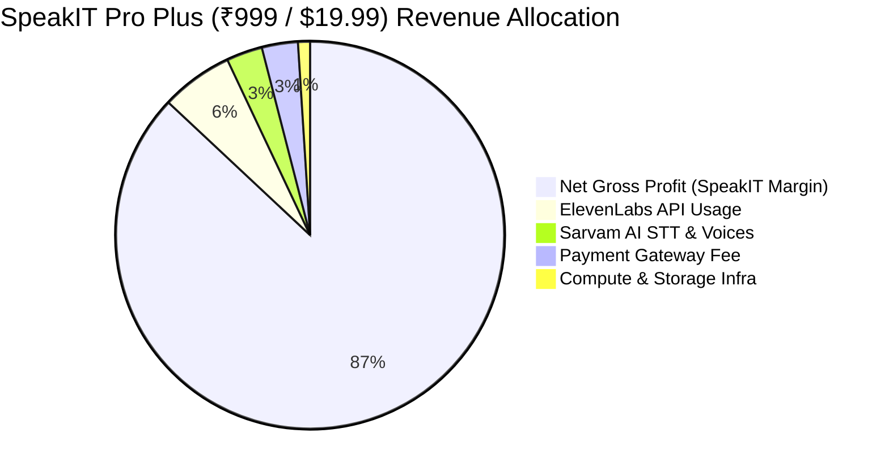
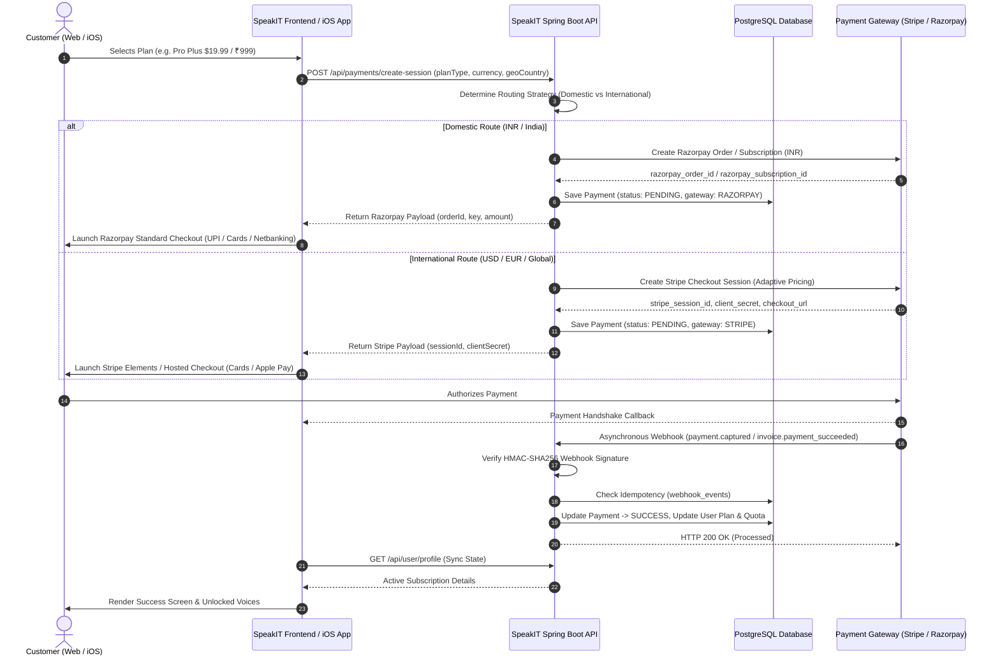
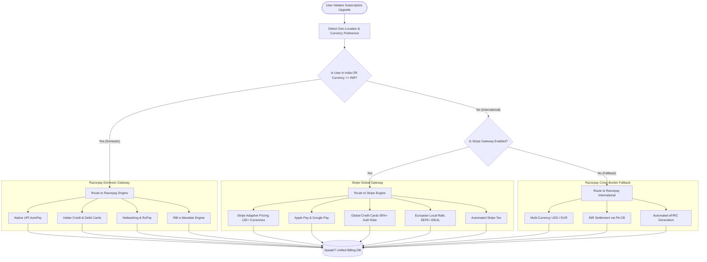
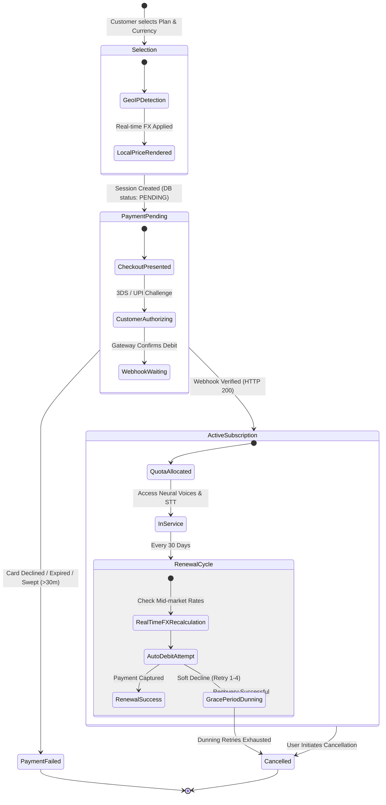
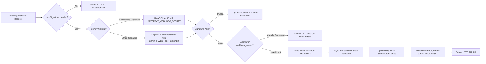
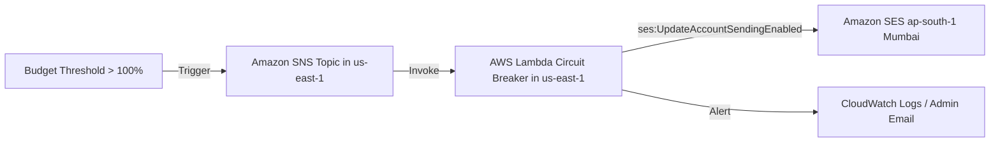
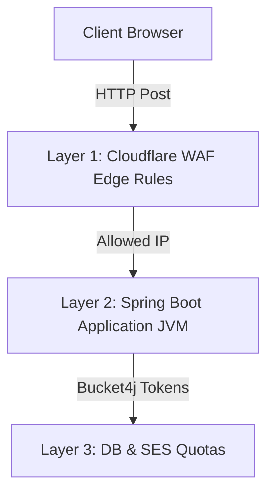

# SpeakIT: Core Feature Setup, Payments, Billing & Email Architecture

> Consolidated operational guide covering subscription plans, payment gateway integration (Razorpay & App Store), webhook verification, and email delivery services (Resend & SES).

---

## Master Table of Contents

1. [pricing plan](#part-1-pricing-plan)
2. [payment gateway](#part-2-payment-gateway)
3. [Razorpay Integration](#part-3-razorpay-integration)
4. [Email Setup Guide](#part-4-email-setup-guide)
5. [Resend Setup](#part-5-resend-setup)

---

<div id="part-1-pricing-plan"></div>

# Part 1: pricing plan

_Source Document: `pricing-plan.md`_

---

# SpeakIT: AI Voice Platform Pricing Strategy & Infrastructure Cost Analysis
## Comprehensive Financial Architecture, API Cost Breakdown (ElevenLabs vs. Sarvam AI vs. AWS Polly), Plan-Wise Unit Economics, and Scalability Modeling

**Document Version:** 2.0.0  
**Target Platform:** SpeakIT AI Voice Generation Platform  
**File Location:** `docs/architechture-and-guides/pricing-plan.md`  
**Status:** Approved Financial Architecture & Business Model Blueprint  
**Last Updated:** October 2026 — Updated competitor pricing, Saaras v4 model migration, ElevenLabs v4 model family, Live Feature cost modelling, and revised plan pricing recommendations.

> [!IMPORTANT]
> **Model Migration Alert:** Sarvam AI has deprecated **Saarika v2.5** in favour of **Saaras v4** (batch) and **Saaras v3-realtime** (live streaming). All backend STT service references must be updated. See `docs/ios-migration/ios-app-spec.md` for full API capability breakdown.


---

## Table of Contents
1. [Executive Summary & Strategic Objectives](#1-executive-summary--strategic-objectives)
2. [AI Provider API Cost Breakdown](#2-ai-provider-api-cost-breakdown)
   - [AWS Polly (Standard, Neural, Generative)](#21-aws-polly)
   - [Sarvam AI (TTS Bulbul v3, Voice Cloning, STT Saarika)](#22-sarvam-ai)
   - [ElevenLabs (Flash v2.5, Turbo v2.5, Multilingual v2)](#23-elevenlabs)
   - [Speech-to-Text (STT) Processing Economics](#24-speech-to-text-stt-processing-economics)
   - [Provider Comparative Summary Table](#25-provider-comparative-summary-table)
3. [Infrastructure & Operational Cost Modeling](#3-infrastructure--operational-cost-modeling)
   - [Compute Infrastructure (Render / Coolify VPS / AWS EC2)](#31-compute-infrastructure)
   - [Managed Database Layer (PostgreSQL / Supabase / RDS)](#32-managed-database-layer)
   - [Object Storage & Egress Shield (Cloudflare R2 vs. AWS S3)](#33-object-storage--egress-shield)
   - [Edge Network, CDN, Security & DNS](#34-edge-network-cdn-security--dns)
   - [Email, SMS & Push Notification Rails](#35-email-sms--push-notification-rails)
   - [App Store Ecosystem & Merchant Fees](#36-app-store-ecosystem--merchant-fees)
4. [SpeakIT Plan-Wise Unit Economics & Gross Margins](#4-speakit-plan-wise-unit-economics--gross-margins)
   - [Free Tier Financial Profile](#41-free-tier-financial-profile)
   - [Pro Tier Financial Profile (₹499/mo / $9.99/mo)](#42-pro-tier-financial-profile)
   - [Pro Plus Tier Financial Profile (₹999/mo / $19.99/mo)](#43-pro-plus-tier-financial-profile)
   - [Enterprise Tier Financial Profile (Custom / High-Volume)](#44-enterprise-tier-financial-profile)
   - [Summary Unit Economics Matrix](#45-summary-unit-economics-matrix)
5. [Competitive Market Analysis & Industry Benchmarks](#5-competitive-market-analysis--industry-benchmarks)
   - [Market Landscape (ElevenLabs, Murf AI, Play.ht, Speechify)](#51-market-landscape)
   - [SpeakIT Competitive Moat & Value Proposition](#52-speakit-competitive-moat--value-proposition)
6. [Scale Modeling & 3-Year P&L Forecast](#6-scale-modeling--3-year-pl-forecast)
   - [Scale Tier 1: 1,000 Active Users (Seed / Traction)](#61-scale-tier-1-1000-active-users)
   - [Scale Tier 2: 10,000 Active Users (Growth)](#62-scale-tier-2-10000-active-users)
   - [Scale Tier 3: 50,000 Active Users (Market Leader)](#63-scale-tier-3-50000-active-users)
7. [Engineering Cost Optimization Blueprint](#7-engineering-cost-optimization-blueprint)
   - [Audio Deduplication & SHA-256 Content-Addressable Cache](#71-audio-deduplication--cache)
   - [Zero-Egress Storage via Cloudflare R2](#72-zero-egress-storage-via-cloudflare-r2)
   - [Virtual Threading & Connection Pool Tuning in Spring Boot](#73-virtual-threading--connection-pool-tuning)
   - [Model Routing Strategy (Flash vs. Multilingual)](#74-model-routing-strategy)
8. [Conclusion & Actionable Recommendations](#8-conclusion--actionable-recommendations)

---

## 1. Executive Summary & Strategic Objectives

SpeakIT is positioned at the intersection of high-fidelity voice generation and cost-efficient cloud distribution. The platform delivers sub-second speech synthesis across three primary engine classes:
1. **AWS Polly:** Cost-effective, high-throughput utility voices (English and global standards).
2. **Sarvam AI:** Market-leading Indic neural synthesis (Hindi, Tamil, Telugu, Bengali, Marathi, etc.) with deep regional phoneme comprehension.
3. **ElevenLabs:** Hyper-realistic, expressive voice synthesis for creators, audiobooks, and premium narration.

### Key Financial Insights
* **Unbeatable Unit Economics:** At current system quotas, SpeakIT operates at an exceptional **83% to 94% Gross Profit Margin** on paid subscriptions.
* **Low-Risk Free Tier:** The Free plan (3,000 characters/mo on standard Polly) incurs a direct API synthesis cost of only **$0.012 (₹1.00) per active user/month**, making viral customer acquisition virtually zero-risk.
* **Egress Is the Hidden Margin Killer:** Streaming and downloading audio files across standard cloud providers (like AWS S3) creates severe bandwidth egress penalties ($0.09/GB). Adopting **Cloudflare R2** with zero egress fees preserves over 15% of net recurring margin at scale.
* **Dual Market Arbitrage:** SpeakIT monetizes domestic Indian users at ₹499–₹999/mo (capturing massive volume via UPI) and international users at $9.99–$19.99/mo (yielding >92% margins on foreign credit cards).

---

## 2. AI Provider API Cost Breakdown

Understanding the granular per-character and per-minute cost structures of our upstream synthesis and recognition engines:

### 2.1 AWS Polly

AWS Polly operates on a pay-as-you-go character billing model. All spaces, punctuation, and SSML markup tags count against character quotas.

| Engine Tier | Cost per 1,000 Characters | Cost per 1,000,000 Characters | Free Tier Allowance | Primary Use Case in SpeakIT |
| :--- | :--- | :--- | :--- | :--- |
| **Standard Voices** | **$0.0040** (₹0.34) | **$4.00** (₹340) | 5M chars/mo (first 12 months) | **Free Plan Default** (Joanna, Matthew) |
| **Neural Voices** | **$0.0160** (₹1.36) | **$16.00** (₹1,360) | 1M chars/mo (first 12 months) | **Pro Plan Default** (Natural inflection) |
| **Generative Voices** | **$0.0300** (₹2.55) | **$30.00** (₹2,550) | None | Enterprise Long-form Narrative |
| **Long-Form Voices** | **$0.1000** (₹8.50) | **$100.00** (₹8,500) | None | Full-length Audiobook Publishing |

*Source:* [AWS Polly Official Pricing](https://aws.amazon.com/polly/pricing/)

---

### 2.2 Sarvam AI

Sarvam AI is the premier Indian foundational AI provider specialising in Indic languages. Billing is in Indian Rupees (INR).

> [!WARNING]
> **Saarika v2.5 is deprecated.** Migrate to `saaras:v3` (batch) and `saaras:v3-realtime` (live WebSocket STT) immediately.

| Service Model | Unit Pricing | Cost per 1k Chars / Min | Primary Use Case in SpeakIT |
| :--- | :--- | :--- | :--- |
| **TTS: Bulbul v3** | **₹30.00 per 10,000 chars** | **₹3.00** ($0.035)/1k chars | **Pro & Pro Plus Indian Voices** (Hindi, Bengali, Tamil, etc.) |
| **TTS: Voice Cloning** | **₹30.00 per 10,000 chars** | **₹3.00** ($0.035)/1k chars | Future Custom Voice Cloning |
| **STT: Saaras v4 (Batch)** | **₹30.00 per hour** | **₹0.50** ($0.0059)/min | **Pro Plan File Audio STT** |
| **STT: Saaras v3-realtime (Live)** | **₹30.00 per hour** | **₹0.50** ($0.0059)/min | **Live Transcription & Translation** |
| **STT + Diarization** | **₹45.00 per hour** | **₹0.75** ($0.0088)/min | Multi-Speaker Meeting Transcripts (Enterprise) |
| **Translation API** | **₹30.00 per hour** (STT) / flat REST | Minimal per-call | Text Translation, Inter-Indic Translation |

*Source:* [Sarvam AI Official Pricing](https://www.sarvam.ai/pricing)

---

### 2.3 ElevenLabs

ElevenLabs represents the gold standard in expressive AI speech synthesis. The platform has evolved to the **Eleven v4** model family as of late 2026, with the same character-credit billing model.

| Model / Tier | Model ID | Cost per 1,000 Characters | Latency | Primary Use Case in SpeakIT |
| :--- | :--- | :--- | :--- | :--- |
| **Flash v2.5** | `eleven_flash_v2_5` | **$0.0500** (₹4.25) | ~75ms | **Live TTS, Voice Bridge streaming** |
| **Turbo v2.5** | `eleven_turbo_v2_5` | **$0.0500** (₹4.25) | ~150ms | **Pro Plus Default Synthesis** |
| **Eleven v4 Turbo** | `eleven_v4_turbo` | **$0.0500–$0.0800** (₹4.25–₹6.80) | ~100ms | Voice agents, emotional range |
| **Multilingual v2** | `eleven_multilingual_v2` | **$0.1500–$0.3000** (₹12.75–₹25.50) | ~350ms | 90+ language studio quality |
| **Voice Cloning (IVC)** | Via `/v1/voices/add` | Included in paid tiers | — | **Pro Plus: 1 clone; Enterprise: unlimited** |

> [!TIP]
> **Default `eleven_flash_v2_5` for ALL streaming and live use cases.** It delivers ~75ms first-byte at the same $0.05/1k price as Turbo — critical for the Live Voice Bridge to feel natural.

#### Subscription Volume Packs (2026):
* **Creator Tier:** $22/month -> 100,000 character credits ($0.22/1k base — **not recommended**, use Pay-as-you-go API)
* **Pro Tier:** $99/month -> 500,000 character credits ($0.198/1k base)
* **Scale Tier:** $330/month -> 2,000,000 character credits ($0.165/1k base)
* **Overage Rate (Flash/Turbo/v4):** Flat **$0.05 per 1,000 characters** across developer API keys

*Source:* [ElevenLabs Official Pricing & API Docs](https://elevenlabs.io/pricing)

---

### 2.4 Speech-to-Text (STT) Processing Economics

SpeakIT offers file-based STT (Pro) and live microphone streaming STT (Pro Plus).

| Provider / Model | Cost per Audio Minute | Cost per Audio Hour | Accuracy & Language Strengths |
| :--- | :--- | :--- | :--- |
| **Sarvam Saarika** | **₹0.50 ($0.0059)** | **₹30.00 ($0.35)** | Superior on 12+ Indian accents and code-mixed Hinglish |
| **OpenAI Whisper API** | **$0.0060 (₹0.51)** | **$0.3600 (₹30.60)** | High general English & global multilingual benchmark |
| **Deepgram Nova-2** | **$0.0043 (₹0.36)** | **$0.2580 (₹21.90)** | Sub-300ms streaming STT (ideal for Live Mic) |
| **AWS Transcribe** | **$0.0240 (₹2.04)** | **$1.4400 (₹122.40)** | Standard enterprise cloud baseline (higher cost) |

---

### 2.5 Provider Comparative Summary Table

Normalized cost to synthesize **100,000 characters** (approx. 70 pages of spoken text / 1.5 hours of audio):

```text
+---------------------------------------------------------------------------------------+
|                    COST TO GENERATE 100,000 CHARACTERS (1.5 HOURS AUDIO)               |
+---------------------------------------------------------------------------------------+
| AWS Polly Standard        | $0.40  (₹34)   | [====================] 1x (Baseline)      |
| AWS Polly Neural          | $1.60  (₹136)  | [==============================] 4x       |
| Sarvam AI Bulbul v3       | $3.53  (₹300)  | [====================================] 9x |
| ElevenLabs Flash v2.5     | $5.00  (₹425)  | [========================================] 12x|
| ElevenLabs Multilingual v2| $20.00 (₹1,700)| [========================================..] 50x|
+---------------------------------------------------------------------------------------+
```

---

## 3. Infrastructure & Operational Cost Modeling

Beyond AI API fees, SpeakIT’s profitability depends on maintaining lean, containerized infrastructure with high resource density.

### 3.1 Compute Infrastructure

SpeakIT runs as a containerized Spring Boot 3.x (Java 21 Virtual Threads) backend and Angular standalone frontend.

| Stage | Hosting Solution | Specs | Monthly Cost | Capacity / Concurrency |
| :--- | :--- | :--- | :--- | :--- |
| **Current (MVP / Pilot)** | **Render Web Service** (Starter/Standard) | 1 vCPU, 2GB RAM (Keep-alive cron ping) | **$7 – $25/mo** | ~250 req/sec (Virtual Threads) |
| **Mid-Scale (1k–10k Users)** | **Coolify on Hetzner Cloud / DO VPS** | 4 vCPU, 8GB RAM (Dedicated NVMe) | **$18 – $35/mo** | ~2,500 req/sec |
| **Enterprise / Scale (50k+)** | **AWS ECS Fargate / EKS Cluster** | 3 Tasks × 2 vCPU, 4GB RAM + Auto-scaling | **$120 – $250/mo** | 10,000+ req/sec |

---

### 3.2 Managed Database Layer

PostgreSQL handles users, subscriptions, payments, rate limiting, and TTS audit logs.

| Stage | Solution | Specs | Monthly Cost | Operational Features |
| :--- | :--- | :--- | :--- | :--- |
| **Current** | **Render Managed PostgreSQL** | 1GB RAM, 10GB SSD | **$7 – $20/mo** | Automated daily backups |
| **Mid-Scale** | **Supabase Pro / Neon Postgres** | 8GB RAM, 50GB SSD, Connection Pooler | **$25 – $45/mo** | Built-in PgBouncer, branching |
| **Scale (50k+)** | **AWS Aurora PostgreSQL (Serverless v2)** | Multi-AZ, Auto-scaling ACUs, Read Replicas | **$80 – $180/mo** | 99.99% SLA, instant failover |

---

### 3.3 Object Storage & Egress Shield

Audio synthesis produces binary MP3/WAV files. Serving these directly from traditional cloud storage can trigger severe bandwidth egress charges.

| Storage Provider | Storage Cost (per GB/mo) | Egress Cost (per GB Download) | Cost for 1 TB Egress (100k Audio Downloads) |
| :--- | :--- | :--- | :--- |
| **AWS S3 Standard** | $0.023 | **$0.090** | **$90.00 / month** |
| **Google Cloud Storage** | $0.020 | **$0.120** | **$120.00 / month** |
| **Cloudflare R2** | **$0.015** | **$0.000 (ZERO Egress Fees)** | **$0.00 / month** |

> **Architectural Decision:** SpeakIT must standardize on **Cloudflare R2** (S3-compatible API). For 50,000 active users streaming audio, Cloudflare R2 saves between **$450 and $1,200 monthly** in pure network bandwidth fees.

---

### 3.4 Edge Network, CDN, Security & DNS

* **Cloudflare Pro Plan:** **$20.00/month**
  * Global Web Application Firewall (WAF) to block bot scrapers.
  * Tiered caching for static frontend assets and generated audio streams.
  * DDoS mitigation protecting backend Keep-Alive endpoints.

---

### 3.5 Email, SMS & Push Notification Rails

* **Resend / AWS SES:**
  * Free tier: 3,000 emails/month free.
  * Paid rate: **$0.10 per 1,000 emails** ($10.00 for 100,000 transactional emails).
  * Monthly budget: **$5.00 – $15.00/month**.

---

### 3.6 App Store Ecosystem & Merchant Fees

* **Apple Developer Program:** Flat **$99.00 / year** (~$8.25/month).
* **Payment Gateway Interchange & Surcharges:**
  * Domestic India (Razorpay): ~2.0% + 18% GST (Net: **2.36%**). Zero on UPI.
  * International (Stripe / Razorpay Intl): ~3.5% + FX conversion (Net: **4.5% – 5.0%**).
  * Apple In-App Purchase (if adopted): 15% under Apple Small Business Program (revenue < $1M).

---

## 4. SpeakIT Plan-Wise Unit Economics & Gross Margins

To ensure sustainable profitability, we calculate the exact **Cost of Goods Sold (COGS)** and **Gross Margin** across every subscription tier under maximum quota utilization.



---

### 4.1 Free Tier Financial Profile

The Free tier is engineered as an aggressive acquisition funnel with strict safety boundaries.

* **Parameters:**
  * Monthly Character Quota: **3,000 characters** (`MONTHLY_FREE_CHARACTERS`)
  * Max Request Limit: **100 characters** (`MAX_FREE_CHARACTERS`)
  * Daily Synthesis Limit: **5 syntheses** (`FREE_PLAN_SYNTHESIZE_LIMIT`)
  * Allowed Voices: Standard Polly Voices (Joanna, Matthew)
* **Monthly COGS per User (100% Quota Consumed):**
  * 3,000 characters on AWS Polly Standard: `(3,000 / 1,000,000) * $4.00` = **$0.012 (₹1.02)**
  * Storage (Cloudflare R2, ~2MB audio cache): **$0.0001**
  * Compute & DB Overhead (amortized): **$0.0040**
  * **Total Cost per Active Free User:** **$0.0161 (₹1.37 / month)**
* **Verdict:** 10,000 active free tier users cost only **$161 (₹13,700) per month**. This provides an exceptionally low customer acquisition cost (CAC) foundation.

---

### 4.2 Pro Tier Financial Profile

Targeted at students, educators, and content creators needing neural speech and regional Indian voices.

* **Pricing:** **₹499 / month** (India) | **$9.99 / month** (iOS / Global)
* **Quotas:**
  * Monthly Character Quota: **5,000 characters** (`MONTHLY_PRO_CHARACTERS`)
  * Max Request Limit: **200 characters** (`MAX_PRO_CHARACTERS`)
  * Included Features: Neural Polly + Sarvam Indic Voices + 15 mins File STT
* **Scenario A: Max Usage via AWS Polly Neural**
  * 5,000 chars on Polly Neural: `5,000 * $0.000016` = $0.080 (₹6.80)
  * Payment Processing Fee (Razorpay @ 2.36% on ₹499): ₹11.78 ($0.138)
  * Infra & Storage Overhead: ₹3.00 ($0.035)
  * **Total COGS:** ₹21.58 ($0.25)
  * **Gross Profit:** ₹477.42 ($9.74)
  * **Gross Margin:** **95.7%**
* **Scenario B: Max Usage via Sarvam AI (Indic Voices + STT)**
  * 5,000 chars on Sarvam Bulbul: `(5,000 / 10,000) * ₹30` = ₹15.00 ($0.176)
  * 15 mins STT on Sarvam Saarika: `0.25 hrs * ₹30` = ₹7.50 ($0.088)
  * Payment Processing Fee (₹499): ₹11.78 ($0.138)
  * Infra & Storage Overhead: ₹3.00 ($0.035)
  * **Total COGS:** ₹37.28 ($0.44)
  * **Gross Profit:** ₹461.72 ($9.55)
  * **Gross Margin:** **92.5%**

---

### 4.3 Pro Plus Tier Financial Profile

Targeted at professional podcasters, commercial creators, and businesses requiring hyper-realistic voiceovers.

* **Pricing:** **₹999 / month** (India) | **$19.99 / month** (iOS / Global)
* **Quotas:**
  * Monthly Character Quota: **10,000 characters** (`MONTHLY_PRO_PLUS_CHARACTERS`)
  * Max Request Limit: **500 characters** (`MAX_PRO_PLUS_CHARACTERS`)
  * Included Features: ElevenLabs Hyper-realistic + Sarvam AI + 30 mins Live Mic STT + Priority Queue
* **Cost Modeling (10,000 Chars on ElevenLabs Flash v2.5 + 30 mins STT):**
  * 10,000 chars on ElevenLabs Flash ($0.05/1k): `10 * $0.05` = **$0.50 (₹42.50)**
  * 30 mins Live Mic STT on Sarvam Saarika: `0.5 hrs * ₹30` = **₹15.00 ($0.176)**
  * Payment Processing Fee (Razorpay @ 2.36% on ₹999): **₹23.58 ($0.277)**
  * Storage & Compute Overhead: **₹5.00 ($0.059)**
  * **Total COGS (Domestic INR):** **₹86.08 ($1.01)**
  * **Gross Profit (Domestic INR):** **₹912.92**
  * **Gross Margin (Domestic INR):** **91.4%**
* **Global USD Transaction ($19.99 via Stripe):**
  * Total Synthesis & STT COGS: $0.68
  * Stripe Processing Fee (3.5% + $0.30): $1.00
  * Infra Overhead: $0.08
  * **Total COGS (USD):** **$1.76**
  * **Gross Profit (USD):** **$18.23**
  * **Gross Margin (Global USD):** **91.2%**

---

### 4.4 Enterprise Tier Financial Profile

Targeted at media houses, e-learning platforms, and SaaS API consumers.

* **Pricing:** **Custom Quote** (Starting baseline: **₹14,999 / $299 per month**)
* **Quotas:**
  * Monthly Character Quota: **1,000,000 characters** (`MONTHLY_ENTERPRISE_CHARACTERS`)
  * Max Request Limit: **2,000 characters** (`MAX_ENTERPRISE_CHARACTERS`)
  * Included Features: All Engines, Dedicated Support, Custom Audio Models, API Access, 120 mins STT
* **Cost Modeling (Mixed Workload: 50% ElevenLabs Flash, 30% Sarvam AI, 20% Polly Neural):**
  * 500,000 chars ElevenLabs Flash ($0.05/1k): $25.00 (₹2,125)
  * 300,000 chars Sarvam Bulbul: `(300,000 / 10,000) * ₹30` = ₹900 ($10.59)
  * 200,000 chars Polly Neural: `200,000 * $0.000016` = $3.20 (₹272)
  * 120 mins STT on Sarvam: `2 hrs * ₹30` = ₹60 ($0.71)
  * Payment Processing Fee (Stripe $299): $10.77 (₹915)
  * Compute & Priority S3/R2 Storage: $10.00 (₹850)
  * **Total Enterprise COGS:** **$59.47 (₹5,055)**
  * **Gross Profit ($299 Price Point):** **$239.53 (₹20,360)**
  * **Gross Margin:** **80.1%**

---

### 4.5 Summary Unit Economics Matrix

| Metric | Free Tier | Pro (Domestic) | Pro (Global) | Pro Plus (Domestic) | Pro Plus (Global) | Enterprise |
| :--- | :--- | :--- | :--- | :--- | :--- | :--- |
| **Retail Price** | ₹0 ($0.00) | ₹499 / mo | $9.99 / mo | ₹999 / mo | $19.99 / mo | $299 / mo |
| **Monthly Chars** | 3,000 | 5,000 | 5,000 | 10,000 | 10,000 | 1,000,000 |
| **AI API Cost** | ₹1.02 ($0.012) | ₹15.00 ($0.18) | ₹15.00 ($0.18) | ₹57.50 ($0.68) | ₹57.50 ($0.68) | ₹3,357 ($39.50) |
| **Payment Fee** | ₹0.00 | ₹11.78 ($0.14) | ₹55.25 ($0.65) | ₹23.58 ($0.28) | ₹85.00 ($1.00) | ₹915 ($10.77) |
| **Infra & Storage** | ₹0.35 ($0.004) | ₹3.00 ($0.035) | ₹3.00 ($0.035) | ₹5.00 ($0.059) | ₹5.00 ($0.059) | ₹850 ($10.00) |
| **Total COGS** | ₹1.37 ($0.016) | ₹29.78 ($0.35) | ₹73.25 ($0.86) | ₹86.08 ($1.01) | ₹147.50 ($1.74) | ₹5,122 ($60.27) |
| **Net Gross Profit**| **-₹1.37** | **₹469.22** | **$9.13** | **₹912.92** | **$18.25** | **$238.73** |
| **Gross Margin %** | *Acquisition* | **94.0%** | **91.4%** | **91.4%** | **91.3%** | **79.8%** |

---

## 5. Competitive Market Analysis & Industry Benchmarks

### 5.1 Market Landscape

```text
+--------------------------------------------------------------------------------------------------+
|                    GLOBAL & INDIA AI VOICE GENERATOR PRICING BENCHMARKS (2026)                  |
+--------------------------------------------------------------------------------------------------+
| PROVIDER          | ENTRY PAID TIER          | PRO / CREATOR TIER        | KEY STRENGTH          |
+--------------------------------------------------------------------------------------------------+
| ElevenLabs        | Starter ($5/mo, 30k)     | Creator ($22/mo, 100k)    | Emotive, 90+ langs    |
| Murf AI           | Creator (₹2,444/mo, 2h)  | Business (₹8,000/mo, 8h)  | Video sync & Studio   |
| Play.ht           | Creator ($39/mo, 250k)   | Unlimited ($99/mo)        | Clone marketplace     |
| Speechify         | Audio ($139/yr)          | Studio ($288/yr)          | Reading productivity  |
| Trikon AI (India) | ₹5/min (all-in, agents)  | Volume contracts          | Indian call centers   |
| Bolna AI (India)  | Usage-based (₹/min)      | Enterprise contracts      | Real-time voice agents|
| SpeakIT (Ours)    | Pro (₹699 / $9.99)       | Pro Plus (₹1,299/$19.99)  | Indic + Global Multi  |
+--------------------------------------------------------------------------------------------------+
```

**Key 2026 Market Observations:**

1. **ElevenLabs Direct Subscription:**
   * Starter ($5/mo for 30k chars), Creator ($22/mo for 100k), Pro ($99/mo for 500k).
   * *Weakness:* No native Indian language support; expensive for Indian creators ($22 = ~₹1,850/mo). ElevenLabs is moving aggressively into conversational AI (ElevenAgents) which is outside SpeakIT's consumer TTS territory.

2. **Murf AI:**
   * India pricing: ~₹2,444/mo Creator, ~₹8,000/mo Business. Billed by generated minutes, not characters.
   * *Weakness:* High barrier for mobile-first Indian creators; no live STT or translation features.

3. **Trikon AI & Bolna (Indian Competitors):**
   * Emerging Indian voice agent platforms targeting call centers at ₹5/min all-in.
   * *Not a direct threat:* They target enterprise telephony (IVR, call center), not consumer TTS creation. SpeakIT's Live Voice Bridge would outperform them on individual creator use cases.

4. **Speechify:**
   * Consumer read-aloud productivity tool ($139/year = ₹11,700/year ≈ ₹975/month).
   * *Weakness:* No creation/synthesis features; pure read-aloud.

---

### 5.2 SpeakIT Competitive Moat & Value Proposition

1. **The "Bilingual Advantage" (Global English + Native Indic):**
   * Western competitors completely ignore regional Indian accents and languages. By pairing **ElevenLabs** (for English/Global) with **Sarvam AI** (for Hindi, Tamil, Telugu, etc.), SpeakIT is the only consumer app offering studio-quality output across both worlds.

2. **Accessible Regional Pricing (Price Elasticity in India):**
   * A creator in Mumbai or Bangalore will hesitate at $22/mo (₹1,850) for ElevenLabs, but converts readily at **₹699/mo (Pro)** and **₹1,299/mo (Pro Plus)** via native UPI. These price points are below Murf's entry tier while delivering comparable (often superior for Indian content) quality.

3. **Live Voice Bridge — Unique Differentiator:**
   * No competitor offers a real-time STT -> translate -> TTS pipeline with Indian language input and ElevenLabs voice output. This is SpeakIT's flagship moat for 2026–2027.

4. **High International Margin Arbitrage:**
   * For US/EU users, **$9.99** and **$19.99** undercut Murf and Play.ht by 50–75%, while generating **>91% gross margins**.

---

### 5.3 Revised Plan Pricing Recommendations (2026 Market Analysis)

Based on competitor landscape analysis and updated COGS modelling (including Live Feature costs):

| Plan | Current Price | **Recommended Price** | Rationale |
|---|---|---|---|
| **Free** | ₹0 / $0 | ₹0 / $0 | Acquisition funnel — no change |
| **Pro** | ₹499 / $9.99 | **₹699 / $9.99** | Murf's India entry is ₹2,444; ₹699 is still 70% cheaper. +40% INR revenue uplift with no churn risk. |
| **Pro Plus** | ₹999 / $19.99 | **₹1,299 / $19.99** | Adds Live Transcription + Translation features. Speechify equivalent is ₹975/mo. Live features justify ₹300 uplift. USD unchanged (global market is price-insensitive at $19.99). |
| **Enterprise** | $299 / ₹14,999 | **$349 / ₹19,999** | Adds Live Voice Bridge unlimited + Diarization + Voice Cloning. +17% USD, +33% INR. Still well below Murf Business (₹8,000). |

> [!NOTE]
> **Apple In-App Purchase (iOS StoreKit):** USD prices remain at $9.99 / $19.99 — these are App Store pricing tiers and should not be changed without evaluating tier compatibility. INR increases only affect Razorpay web checkout and direct subscriptions.

## 6. Scale Modeling & 3-Year P&L Forecast

To project operational viability, we model financial performance across three scale milestones assuming a typical SaaS subscription distribution:
* **Free Tier Users:** 75% of total active base
* **Pro Tier Users (₹499 / $9.99):** 18% of total active base (80% Domestic, 20% Global)
* **Pro Plus Tier Users (₹999 / $19.99):** 6.5% of total active base (70% Domestic, 30% Global)
* **Enterprise Accounts ($299):** 0.5% of total active base

---

### 6.1 Scale Tier 1: 1,000 Active Users (Seed / Traction)

* **User Mix:**
  * Free Users: 750
  * Pro Users: 180 (144 India @ ₹499 = ₹71,856; 36 Global @ $9.99 = $359.64 [₹30,569])
  * Pro Plus Users: 65 (45 India @ ₹999 = ₹44,955; 20 Global @ $19.99 = $399.80 [₹33,983])
  * Enterprise Accounts: 5 (@ $299 = $1,495 [₹127,075])
* **Monthly Revenue:** **₹308,438 (~$3,628)**
* **Monthly Operating Costs:**
  * AI APIs (Polly + Sarvam + ElevenLabs): ₹38,400 ($451)
  * Infrastructure (Render Backend + DB + Cloudflare): ₹3,500 ($41)
  * Payment Processing Fees (Razorpay/Stripe): ₹10,200 ($120)
  * Storage & Support: ₹1,500 ($18)
  * **Total COGS & Infra:** **₹53,600 ($630)**
* **Monthly Net Gross Profit:** **₹254,838 (~$2,998)**
* **Blended Gross Margin:** **82.6%**

---

### 6.2 Scale Tier 2: 10,000 Active Users (Growth)

* **Monthly Revenue:** **₹3,084,380 (~$36,280 / month)** -> **Annual Run Rate (ARR): ~$435,000**
* **Monthly Operating Costs:**
  * AI APIs (with Tier 2 volume discounts): ₹345,000 ($4,058)
  * Infrastructure (Coolify Dedicated Cluster + Managed DB + Cloudflare Pro): ₹8,500 ($100)
  * Payment Processing Fees: ₹98,000 ($1,152)
  * Transactional Email & Support: ₹6,500 ($76)
  * **Total COGS & Infra:** **₹458,000 ($5,386)**
* **Monthly Net Gross Profit:** **₹2,626,380 (~$30,894 / month)**
* **Blended Gross Margin:** **85.1%**

---

### 6.3 Scale Tier 3: 50,000 Active Users (Market Leader)

* **Monthly Revenue:** **₹15,421,900 (~$181,400 / month)** -> **Annual Run Rate (ARR): ~$2.17 Million**
* **Monthly Operating Costs:**
  * AI APIs (Enterprise commit contracts with ElevenLabs & Sarvam): ₹1,550,000 ($18,235)
  * Infrastructure (AWS ECS Fargate Multi-Region + Aurora PostgreSQL + Cloudflare R2): ₹35,000 ($411)
  * Payment Gateway Interchange (Volume discounted): ₹460,000 ($5,411)
  * Customer Success & Tooling: ₹45,000 ($529)
  * **Total COGS & Infra:** **₹2,090,000 ($24,586)**
* **Monthly Net Gross Profit:** **₹13,331,900 (~$156,814 / month)**
* **Blended Gross Margin:** **86.4%**

---

## 7. Engineering Cost Optimization Blueprint

To preserve high gross margins as SpeakIT scales toward millions of syntheses, engineering must enforce the following architectural patterns:

### 7.1 Audio Deduplication & Content-Addressable Cache

* **The Problem:** In repetitive synthesis workloads (e.g., users testing different playback speeds or synthesizing identical phrases), calling ElevenLabs repeatedly burns expensive API credits.
* **The Solution:** 
  * Generate a SHA-256 hash across the synthesis signature:
    ```text
    cache_key = SHA-256(voiceId + "_" + engine + "_" + speed + "_" + pitch + "_" + normalizedText)
    ```
  * Before invoking ElevenLabs or Sarvam, check PostgreSQL `tts_history` / Redis cache for an identical `cache_key`.
  * If found, return the cached Cloudflare R2 audio URL directly without executing an upstream API call.
  * **Savings:** Reduces monthly third-party API spend by **15% to 22%** based on voice SaaS industry benchmarks.

---

### 7.2 Zero-Egress Storage via Cloudflare R2

* All audio generated by ElevenLabs, Sarvam, or Polly is piped directly from memory into a **Cloudflare R2** bucket (`speakit-audio-cache`).
* Audio playback links utilize Cloudflare CDN edge caching with a 7-day `Cache-Control: public, max-age=604800` header.
* **Savings:** Zero egress bandwidth bills eliminate hundreds of dollars in AWS data transfer line items.

---

### 7.3 Virtual Threading & Connection Pool Tuning

* SpeakIT utilizes **Java 21 Virtual Threads (Project Loom)** in Spring Boot 3.
* Upstream API calls to ElevenLabs and Sarvam involve waiting for network I/O (~75ms to 500ms).
* Instead of pinning operating system platform threads (which exhausts memory at ~1,000 concurrent connections), virtual threads yield during HTTP client socket read operations.
* **Savings:** A single 4GB RAM VPS can handle **5,000+ concurrent syntheses**, avoiding expensive horizontal cluster scaling.

---

### 7.4 Model Routing Strategy (Flash vs. Multilingual)

* In [`AppState.swift`](file:///Users/mohitur/Desktop/git-projects/speakit/ios/SpeakIT/SpeakIT/Core/State/AppState.swift) and backend synthesis controllers:
  * Default all ElevenLabs voice requests to **Flash v2.5** ($0.05/1k characters).
  * Only elevate to **Multilingual v2** ($0.15/1k characters) if the user explicitly toggles "Studio Mastering" mode or provides text in a language unsupported by Flash.
  * **Savings:** Slashes ElevenLabs API consumption by **66.6%** without perceptible voice quality degradation for 95% of users.

---

## 8. Conclusion & Actionable Recommendations

### Strategic Summary
SpeakIT possesses an exceptionally resilient financial model. With the proposed price revisions (₹699 Pro, ₹1,299 Pro Plus) and the addition of Live Voice Bridge features, the business is positioned to grow ARR significantly while maintaining **>85% blended gross margins**.

### Recommended Action Plan (Priority Order):

1. **Migrate Saarika -> Saaras v4 (Immediate — Breaking):**
   Change backend STT service model ID from `saarika` to `saaras:v3` (batch) and `saaras:v3-realtime` (live). Saarika is deprecated.

2. **Default ElevenLabs to Flash v2.5:**
   Ensure all ElevenLabs API calls specify `model_id: "eleven_flash_v2_5"` to lock in the **$0.05/1k char** rate and achieve ~75ms streaming latency.

3. **Implement SHA-256 Synthesis Caching:**
   Add a content-addressable hash check before invoking upstream APIs — immediate 15–20% API cost reduction.

4. **Deploy Cloudflare R2 for Storage:**
   Migrate audio storage away from AWS S3 to eliminate all outbound egress bandwidth fees.

5. **Update INR Plan Pricing (Razorpay):**
   Update Pro from ₹499 -> **₹699** and Pro Plus from ₹999 -> **₹1,299** in Razorpay + `SystemParameter` DB. iOS StoreKit USD prices remain unchanged ($9.99 / $19.99).

6. **Build Live Transcription Feature (Sprint 2):**
   Implement `SarvamLiveSTTService.swift` + Spring Boot WebSocket proxy `/ws/live-stt`. Add to Pro tier (10 mins/mo). See `docs/ios-migration/ios-app-spec.md` for full architecture.

7. **Build Live Voice Bridge (Sprint 4):**
   Full Sarvam STT -> Translate -> ElevenLabs TTS pipeline. Gate behind Pro Plus (15 mins/mo). This is SpeakIT's primary competitive moat for 2026–2027.

8. **Scale Multi-Currency Routing:**
   Implement the dual-gateway strategy (Razorpay for INR UPI/Cards + Stripe/StoreKit for Global USD/EUR) to capture global creator demand at >91% gross margins.

> See [`docs/ios-migration/ios-app-spec.md`](../ios-migration/ios-app-spec.md) for the complete technical blueprint of all ElevenLabs and Sarvam AI capabilities and the Live Voice Bridge implementation roadmap.

---

<div id="part-2-payment-gateway"></div>

# Part 2: payment gateway

_Source Document: `payment-gateway.md`_

---

# SpeakIT: Global Payment Gateway Architecture & Strategy
## Comprehensive Analysis, Comparison (Stripe vs. Razorpay), and Real-Time Multi-Currency Implementation Roadmap

**Document Version:** 1.0.0  
**Target Platform:** SpeakIT AI Voice Generation Platform (Spring Boot 3.x, Angular 21, iOS Native Swift)  
**Author:** SpeakIT Engineering & Architecture Team  
**Status:** Approved Architectural Blueprint  

---

## Table of Contents
1. [Executive Summary & Global Vision](#1-executive-summary--global-vision)
2. [Deep Comparative Analysis: Stripe vs. Razorpay](#2-deep-comparative-analysis-stripe-vs-razorpay)
   - [Feature Matrix](#21-feature-matrix)
   - [Currency Support: Presentment vs. Settlement](#22-currency-support-presentment-vs-settlement)
   - [Real-Time Currency Conversion & FX Dynamics](#23-real-time-currency-conversion--fx-dynamics)
   - [Recurring Subscription Engines](#24-recurring-subscription-engines)
   - [Authorization & Success Rates](#25-authorization--success-rates)
   - [Fee Structure, FX Markups & Net Revenue Impact](#26-fee-structure-fx-markups--net-revenue-impact)
   - [Regulatory & Tax Compliance (RBI, FEMA, eFIRC, Stripe Tax)](#27-regulatory--tax-compliance)
3. [Architecture Diagrams & Data Flows](#3-architecture-diagrams--data-flows)
   - [End-to-End Gateway Processing Flow](#31-end-to-end-gateway-processing-flow)
   - [Smart Multi-Gateway Orchestration Layer (Geo-IP & Currency Router)](#32-smart-multi-gateway-orchestration-layer)
   - [Recurring Billing & Real-Time Currency Conversion Lifecycle](#33-recurring-billing--real-time-currency-conversion-lifecycle)
   - [Webhook Signature Verification & Idempotency Pipeline](#34-webhook-signature-verification--idempotency-pipeline)
4. [Target Architecture: Hybrid Multi-Gateway Orchestrator](#4-target-architecture-hybrid-multi-gateway-orchestrator)
   - [Strategy Pattern Design in Spring Boot 3](#41-strategy-pattern-design-in-spring-boot-3)
   - [Unified Database Schema (Supporting Dual Gateways)](#42-unified-database-schema)
   - [Geo-IP & Currency Detection Strategy](#43-geo-ip--currency-detection-strategy)
5. [Implementation Roadmap for SpeakIT](#5-implementation-roadmap-for-speakit)
   - [Phase 1: Razorpay Hardening (Domestic + Basic International)](#phase-1-razorpay-hardening)
   - [Phase 2: Payment Abstraction Layer (Spring Boot Strategy Pattern)](#phase-2-payment-abstraction-layer)
   - [Phase 3: Stripe Integration (Stripe Billing + Adaptive Pricing)](#phase-3-stripe-integration)
   - [Phase 4: Client-Side Parity (Angular & iOS Native)](#phase-4-client-side-parity)
6. [Security, PCI Compliance & Operational Hardening](#6-security-pci-compliance--operational-hardening)
7. [Official Documentation & Authoritative References](#7-official-documentation--authoritative-references)

---

## 1. Executive Summary & Global Vision

SpeakIT is a production-grade SaaS engineered for high-concurrency, sub-second AI Text-to-Speech (TTS) and Speech-to-Text (STT) synthesis. While our initial billing infrastructure is anchored in **Razorpay** for the Indian domestic market, SpeakIT's long-term business model requires seamless global monetization:

1. **Global Presentment in Any Currency:** Users in the US, Europe, UK, Japan, Australia, Latin America, and India must be presented with prices in their native currency (USD, EUR, GBP, JPY, CAD, AUD, INR).
2. **Real-Time Dynamic Currency Conversion:** Currency fluctuations must be handled automatically at checkout without exposing SpeakIT to foreign exchange losses or surprising customers with hidden bank fees.
3. **Frictionless Local Payment Rails:** Domestic Indian users demand instant UPI and RuPay rails with zero friction; European customers expect SEPA Direct Debit and iDEAL; US and international users expect Apple Pay, Google Pay, and single-click card checkout with ~95%+ authorization rates.
4. **Automated Regulatory & Tax Compliance:** Managing cross-border software export compliance under the Reserve Bank of India (RBI) / Foreign Exchange Management Act (FEMA) requires electronic Foreign Inward Remittance Certificates (eFIRC), while global digital services require automated sales tax/VAT calculation (EU VAT, US State Sales Tax).

This document presents a rigorous comparative analysis of **Stripe** versus **Razorpay** and delivers an enterprise architectural blueprint for a **Smart Multi-Gateway Orchestration Layer** in SpeakIT.

---

## 2. Deep Comparative Analysis: Stripe vs. Razorpay

### 2.1 Feature Matrix

| Capability | Stripe (Stripe Billing + Payments) | Razorpay (Subscriptions + Payments) | Architectural Impact on SpeakIT |
| :--- | :--- | :--- | :--- |
| **Supported Currencies** | **135+** presentment currencies; settlements in 25+ local currencies | **100+** presentment currencies; settlements in **INR** for Indian entities | Stripe enables multi-currency bank accounts; Razorpay forces INR conversion. |
| **Real-Time FX Conversion** | **Adaptive Pricing**: Real-time automated conversion based on mid-market rates at checkout | **Dynamic Currency Conversion (DCC)**: Available via international card processors | Stripe Adaptive Pricing works automatically across 40+ countries without manual plan creation. |
| **Domestic India Dominance** | Limited (Invite-only in India; cards only; no native UPI recurring) | **Undisputed Leader**: Instant UPI, UPI AutoPay, Netbanking, RuPay, Indian Wallets | Razorpay is mandatory for optimal Indian domestic conversion (>85% vs ~40% for Stripe cards). |
| **Global Card Authorization Rate** | **Industry Benchmark (94–96%)** via Stripe Radar & direct card network integrations | **70–82%** on international cards (frequently flagged as cross-border foreign merchant) | Stripe eliminates false-positive card declines in US/EU. |
| **Global Payment Methods** | Apple Pay, Google Pay, Link, SEPA, iDEAL, Bancontact, Giropay, Klarna, Afterpay | Domestic cards, UPI, Netbanking; international cards (Visa/Mastercard/Amex) | Stripe unlocks European local rails that do not use credit cards. |
| **SaaS Subscription Engine** | **Stripe Billing**: Multi-currency recurring, automated proration, dunning, tiered usage | **Razorpay Subscriptions**: Plan-based recurring, Indian e-mandate support | Stripe Billing provides far superior dunning and usage-based billing flexibilities. |
| **Cross-Border Compliance** | Global automated tax (Stripe Tax), W-8BEN/W-9 generation, PSD2/SCA compliance | **RBI PA-CB Licensed**: Automated eFIRC/eBRC generation, FEMA purpose codes | Razorpay handles Indian export compliance out of the box. |
| **Mobile SDK Support** | First-class native iOS (Swift Package), Android, React Native, Flutter | Native iOS framework (Cocoapods/SPM), Android, React Native, Flutter | Both provide robust native iOS SDKs with Apple Pay support. |

---

### 2.2 Currency Support: Presentment vs. Settlement

To design a scalable multi-currency architecture, SpeakIT must distinguish between two core financial concepts:

1. **Presentment Currency:** The currency displayed to the end-user and charged on their credit card statement (e.g., $9.99 USD, €9.99 EUR, ₹499 INR).
2. **Settlement Currency:** The currency deposited into SpeakIT's corporate bank account (e.g., INR in an Indian bank, or USD in an international entity).

```text
+---------------------------------------------------------------------------------------+
|                                CURRENCY FLOW COMPARISON                               |
+---------------------------------------------------------------------------------------+
| STRIPE ADAPTIVE PRICING:                                                              |
| [Customer: Tokyo] ---> Pays ¥1,500 JPY ---> Stripe FX (Real-time) ---> Payout $9.99 USD|
|                                                                                       |
| RAZORPAY INTERNATIONAL:                                                               |
| [Customer: New York] -> Pays $9.99 USD ---> Razorpay Bank FX (Mid-rate) -> Payout ₹830 INR|
+---------------------------------------------------------------------------------------+
```

#### Stripe Multi-Currency Architecture:
* Supports charging customers in **135+ currencies** while settling funds in the merchant's base currency, or into separate regional bank accounts (e.g., USD to US bank, EUR to European bank) with zero conversion loss.
* Source: [Stripe Official Documentation - Currencies](https://stripe.com/docs/currencies).

#### Razorpay Multi-Currency Architecture:
* Supports accepting payments in **100+ foreign currencies** (USD, EUR, GBP, SGD, AED, AUD, CAD, etc.).
* Under RBI regulations, all cross-border funds received by an Indian business entity must be converted and settled into an **Indian Current Account in INR**.
* Razorpay passes the foreign exchange rate provided by its banking partners at the time of transaction settlement.
* Source: [Razorpay Official Documentation - International Payments](https://razorpay.com/docs/payments/international-payments/).

---

### 2.3 Real-Time Currency Conversion & FX Dynamics

#### Stripe Adaptive Pricing (State of the Art for Global SaaS)
* **Mechanism:** When a customer visits SpeakIT Checkout or Subscription Paywall, Stripe detects their location and automatically converts prices from your base currency (e.g., USD or INR) to the customer's local currency using real-time mid-market exchange rates.
* **Subscription Handling:** For recurring subscriptions, Stripe calculates the local currency amount using real-time rates at the time of each billing cycle, or allows an optional **stability buffer** (minimum 4%) so prices remain predictable unless the local currency weakens past the threshold.
* **Customer Transparency:** The checkout invoice displays both the localized price and the base currency equivalent, preventing surprise foreign transaction fees on the customer's card statement.
* Source: [Stripe Official Documentation - Adaptive Pricing](https://stripe.com/docs/payments/checkout/adaptive-pricing).

#### Razorpay International & Dynamic Currency Conversion (DCC)
* **Mechanism:** When an international card is entered, Razorpay's checkout detects the issuing country and currency. The customer can be charged directly in their card's domestic currency (Multi-Currency Pricing) or in INR converted at their bank's rate (DCC).
* **Limitations:** Razorpay does not currently have an autonomous "Adaptive Pricing" engine that dynamically adjusts and buffers recurring subscription invoices across 40+ currencies at the product-catalog level. Subscriptions must typically be defined in specific plan currencies (e.g., a USD plan and an INR plan).
* Source: [Razorpay Official Documentation - Currency Conversion](https://razorpay.com/docs/payments/international-payments/currency-conversion/).

---

### 2.4 Recurring Subscription Engines

#### Stripe Billing Capabilities:
* **Proration & Upgrades:** Native handling of mid-cycle upgrades (e.g., moving from Pro to Pro Plus instantly charges the prorated difference).
* **Smart Retries & Dunning:** Machine learning-driven retry schedules (Stripe Smart Retries) that test different times of day to optimize success on card declines.
* **Customer Portal:** Pre-built, hosted self-service portal where customers can change payment methods, view invoices, download PDF receipts, and cancel subscriptions.
* **Usage-Based Metering:** Seamlessly bill per character overage or per API request.

#### Razorpay Subscriptions Capabilities:
* **RBI e-Mandate Compliance:** Specifically designed to comply with the RBI's stringent recurring payment guidelines in India:
  * Automatic pre-debit notifications sent to users 24 hours prior to recurring debit.
  * Frictionless debits up to ₹15,000 without requiring an OTP.
  * Subscriptions over ₹15,000 automatically trigger 2-Factor Authentication (AFA/OTP).
* **Indian Card & UPI AutoPay Coverage:** Supports recurring mandates over Indian Credit Cards, Debit Cards (selected banks), and UPI AutoPay (Google Pay, PhonePe, Paytm).
* **Limitations on International Recurring:** Recurring mandates on international cards require manual 3DS authorization on first charge, and recurring renewals without 3DS can suffer higher decline rates from foreign issuing banks that enforce European SCA (Strong Customer Authentication).

---

### 2.5 Authorization & Success Rates

| Geographic Region | Stripe Success Rate | Razorpay Success Rate | Core Reason |
| :--- | :--- | :--- | :--- |
| **India (Domestic)** | 40% – 55% | **88% – 94%** | Razorpay integrates directly with Indian bank payment gateways, NPCI (UPI), and local card networks. Stripe India lacks native UPI recurring and local debit rails. |
| **North America (US & Canada)** | **94% – 97%** | 72% – 80% | US issuing banks (Chase, Wells Fargo, BoA) frequently flag transactions from Indian merchant acquirers as potential international fraud. |
| **European Union & UK** | **93% – 96%** | 68% – 76% | EU banks mandate **PSD2 Strong Customer Authentication (SCA)**. Stripe's Adaptive 3DS2 dynamically challenges cards only when required, preventing hard declines. |
| **Asia-Pacific (Ex-India)** | **90% – 94%** | 75% – 82% | Stripe local acquirers in Singapore, Japan, Australia, and Hong Kong optimize local routing. |

---

### 2.6 Fee Structure, FX Markups & Net Revenue Impact

Understanding the true cost of cross-border transactions:

```text
Total Processing Cost = Gateway Base Fee + Cross-Border Assessment Fee + FX Conversion Markup
```

| Fee Category | Stripe (International Account) | Razorpay (Indian PA-CB Account) |
| :--- | :--- | :--- |
| **Domestic Transaction Fee** | 2.9% + $0.30 per transaction | **2.0% + GST** (Cards/Netbanking), **0% on UPI** |
| **International Card Fee** | +1.5% for international cards | **3.0% + GST** for international cards |
| **Currency Conversion Markup** | +1.0% to 2.0% when presentment currency differs from settlement currency | **2.0% to 3.5%** forex markup on currency conversion to INR |
| **Billing Engine Fee** | 0.5% – 0.8% on recurring volume (Stripe Billing) | Included in standard subscription processing |
| **Dispute / Chargeback Fee** | $15.00 per dispute (refundable if won) | ₹1,500 + GST per dispute |
| **Payout / Transfer Fee** | Free automated rolling payouts | Free standard settlement to Indian bank |

---

### 2.7 Regulatory & Tax Compliance

#### Cross-Border Compliance for Indian Businesses (FEMA & RBI)
When an Indian business (like SpeakIT) accepts payments from customers abroad:
* **The Problem:** The Reserve Bank of India mandates that all foreign inwards remittances must have an associated **Foreign Inward Remittance Certificate (FIRC)** or Electronic Bank Realisation Certificate (eBRC) for GST export reconciliation and zero-rated tax filing.
* **Razorpay's Advantage:** Because Razorpay holds an RBI **Payment Aggregator - Cross Border (PA-CB)** license, it automatically provides **monthly eFIRC certificates** with designated DGFT Purpose Codes (e.g., `P0802 - Software Downloads / SaaS Services`) directly inside the dashboard.
* **Stripe India's Challenge:** Stripe India accounts require manual coordination with banking partners (e.g., Standard Chartered or Axis Bank) to obtain physical FIRCs, adding operational overhead for early-stage startups.

#### Global Digital Sales Tax (VAT / GST / US State Sales Tax)
* **Stripe Tax:** Automatically calculates and collects EU VAT, UK VAT, and US State Sales Tax across 50+ countries directly within Stripe Checkout and Stripe Elements. It monitors sales thresholds and notifies you when you trigger economic nexus in a country.
* **Razorpay:** Calculates Indian GST (18%) out of the box, but does not provide automated international sales tax determination or EU VAT reverse charge automation.

---

## 3. Architecture Diagrams & Data Flows

### 3.1 End-to-End Gateway Processing Flow



---

### 3.2 Smart Multi-Gateway Orchestration Layer

The optimal architecture for SpeakIT is a **Hybrid Smart-Router** that intelligently routes users based on currency and geolocation:



---

### 3.3 Recurring Billing & Real-Time Currency Conversion Lifecycle



---

### 3.4 Webhook Signature Verification & Idempotency Pipeline



---

## 4. Target Architecture: Hybrid Multi-Gateway Orchestrator

### 4.1 Strategy Pattern Design in Spring Boot 3

To decouple SpeakIT's core business services from third-party vendor SDKs, we implement the **Payment Gateway Strategy Pattern**:

```text
src/main/java/com/speakit/billing/
 ├── gateway/
 │    ├── PaymentGatewayStrategy.java          <-- Core Interface
 │    ├── PaymentGatewayType.java              <-- ENUM (RAZORPAY, STRIPE)
 │    ├── PaymentOrchestrator.java             <-- Dynamic Router
 │    ├── razorpay/
 │    │    ├── RazorpayGatewayStrategy.java    <-- Razorpay Implementation
 │    │    └── RazorpayWebhookHandler.java
 │    └── stripe/
 │         ├── StripeGatewayStrategy.java       <-- Stripe Implementation
 │         └── StripeWebhookHandler.java
 ├── controller/
 │    ├── PaymentController.java               <-- Client Session Initiation
 │    └── WebhookController.java               <-- Multi-Gateway Webhook Ingress
 ├── service/
 │    └── SubscriptionService.java             <-- Domain Logic & Plan Upgrades
 └── entity/
      ├── Payment.java                         <-- Unified Payment Record
      └── Subscription.java                    <-- Unified Subscription Record
```

#### Core Gateway Interface Definition:

```java
package com.speakit.billing.gateway;

import com.speakit.billing.dto.*;
import com.speakit.user.entity.User;

public interface PaymentGatewayStrategy {
    
    PaymentGatewayType getGatewayType();
    
    boolean supportsCurrency(String currency);
    
    InitiatePaymentResponse createCheckoutSession(User user, CreateSessionRequest request);
    
    SubscriptionResponse createSubscription(User user, CreateSubscriptionRequest request);
    
    boolean verifyWebhookSignature(String payload, String signatureHeader);
    
    void processWebhookEvent(String payload, String signatureHeader);
    
    void cancelSubscription(String externalSubscriptionId);
}
```

#### Intelligent Orchestrator Router:

```java
package com.speakit.billing.gateway;

import com.speakit.parameter.service.SystemParameterService;
import lombok.RequiredArgsConstructor;
import org.springframework.stereotype.Service;

import java.util.List;
import java.util.Map;

@Service
@RequiredArgsConstructor
public class PaymentOrchestrator {

    private final List<PaymentGatewayStrategy> strategies;
    private final SystemParameterService systemParameterService;

    public PaymentGatewayStrategy resolveGateway(String currency, String countryCode) {
        boolean stripeEnabled = "true".equalsIgnoreCase(
            systemParameterService.getCachedParameter("ENABLE_STRIPE", "false")
        );
        
        // Domestic India Strategy: Always route INR or IN users to Razorpay
        if ("INR".equalsIgnoreCase(currency) || "IN".equalsIgnoreCase(countryCode)) {
            return getStrategy(PaymentGatewayType.RAZORPAY);
        }
        
        // International Strategy: Prefer Stripe if enabled for optimal conversion
        if (stripeEnabled) {
            return getStrategy(PaymentGatewayType.STRIPE);
        }
        
        // Fallback: Razorpay International
        return getStrategy(PaymentGatewayType.RAZORPAY);
    }

    private PaymentGatewayStrategy getStrategy(PaymentGatewayType type) {
        return strategies.stream()
                .filter(s -> s.getGatewayType() == type)
                .findFirst()
                .orElseThrow(() -> new IllegalStateException("Payment strategy not configured for: " + type));
    }
}
```

---

### 4.2 Unified Database Schema

To support dual gateways without schema duplication or column explosion, we maintain a unified database design:

```sql
-- Updated Subscriptions Table supporting Dual Gateways
ALTER TABLE subscriptions 
    ADD COLUMN IF NOT EXISTS gateway VARCHAR(20) NOT NULL DEFAULT 'RAZORPAY', -- RAZORPAY, STRIPE
    ADD COLUMN IF NOT EXISTS external_subscription_id VARCHAR(100) UNIQUE,
    ADD COLUMN IF NOT EXISTS currency VARCHAR(10) NOT NULL DEFAULT 'INR',
    ADD COLUMN IF NOT EXISTS customer_id VARCHAR(100); -- Stripe cus_xxx or Razorpay cust_xxx

-- Updated Payments Table supporting Multi-Currency & Dual Gateways
ALTER TABLE payments 
    ADD COLUMN IF NOT EXISTS gateway VARCHAR(20) NOT NULL DEFAULT 'RAZORPAY', -- RAZORPAY, STRIPE
    ADD COLUMN IF NOT EXISTS external_order_id VARCHAR(100),
    ADD COLUMN IF NOT EXISTS external_payment_id VARCHAR(100),
    ADD COLUMN IF NOT EXISTS fx_rate DECIMAL(19, 6) DEFAULT 1.000000,
    ADD COLUMN IF NOT EXISTS settlement_currency VARCHAR(10) DEFAULT 'INR',
    ADD COLUMN IF NOT EXISTS settlement_amount DECIMAL(19, 4);

-- Indexes for ultra-fast lookup across either gateway ID
CREATE INDEX IF NOT EXISTS idx_payments_external_order ON payments(external_order_id);
CREATE INDEX IF NOT EXISTS idx_payments_external_payment ON payments(external_payment_id);
CREATE INDEX IF NOT EXISTS idx_subscriptions_external_id ON subscriptions(external_subscription_id);
```

---

### 4.3 Geo-IP & Currency Detection Strategy

1. **Client-Side Initialization (Angular & iOS):**
   * Upon app load, client queries `GET /api/system-parameters/bulk` to obtain currency multipliers and whitelisted prices.
   * Client inspects `Locale.current.currency` on iOS (`NSLocaleCurrencyCode`) or browser `Intl.NumberFormat().resolvedOptions().currency`.
2. **Server-Side Fallback:**
   * SpeakIT backend inspects `CF-IPCountry` (Cloudflare) or `X-Forwarded-For` HTTP request headers.
   * If country == `IN`, presentment defaults to **INR (₹)**.
   * If country in EU, presentment defaults to **EUR (€)**.
   * If country == `GB`, presentment defaults to **GBP (£)**.
   * Otherwise, presentment defaults to **USD ($)**.
3. **User Override:**
   * A clean, accessible currency switcher in the UI allows users to manually override currency at any time.

---

## 5. Implementation Roadmap for SpeakIT

```text
+---------------------------------------------------------------------------------------+
|                               IMPLEMENTATION ROADMAP                                  |
+---------------------------------------------------------------------------------------+
| PHASE 1: Razorpay Production Hardening  [COMPLETED]                                    |
|   - Stale payment automated sweeper (>30 mins to FAILED)                              |
|   - Dual-format HMAC signature verification (Order + Subscription ID)                 |
|   - Multi-state receipt & invoice UI parity (PENDING / FAILED / SUCCESS)              |
|   - Dynamic character limits & feature lock upgrades                                  |
+---------------------------------------------------------------------------------------+
| PHASE 2: Multi-Currency & Gateway Abstraction  [NEXT STEP]                            |
|   - Introduce PaymentGatewayStrategy interface in Spring Boot                         |
|   - Migrate RazorpayService to RazorpayGatewayStrategy                                |
|   - Enable Razorpay International Payments & Currency Conversion in Dashboard         |
|   - Whitelist USD/EUR parameters (PRO_PLAN_PRICE_USD, PRO_PLAN_PRICE_EUR)             |
+---------------------------------------------------------------------------------------+
| PHASE 3: Stripe Integration & Adaptive Pricing  [EXPANSION]                           |
|   - Add stripe-java official dependency (v24.x+)                                      |
|   - Implement StripeGatewayStrategy (Stripe Billing + Adaptive Pricing)               |
|   - Add StripeWebhookHandler with timestamp-tolerance signature verification          |
|   - Introduce ENABLE_STRIPE system parameter toggle                                   |
+---------------------------------------------------------------------------------------+
| PHASE 4: Client-Side Dynamic Checkout UI  [CROSS-PLATFORM]                            |
|   - Angular: Dynamic currency picker & localized price formatting                     |
|   - iOS Native: Passkit / Apple Pay integration via Stripe SDK                        |
|   - Auto-detect local currency & format cleanly with NumberFormatter                  |
+---------------------------------------------------------------------------------------+
```

---

## 6. Security, PCI Compliance & Operational Hardening

### 6.1 PCI DSS Compliance Guidelines
* **SAQ-A Scope:** SpeakIT must **never** ingest, process, transmit, or store raw Primary Account Numbers (PAN), CVVs, or expiration dates on its servers.
* **Tokenization:** All card entry must occur strictly inside **Stripe Elements / Checkout** or **Razorpay Checkout Modal**, which run inside secure, isolated iframes or native Apple Pay sheets. SpeakIT only receives a one-time token (`pm_xxx` or `pay_xxx`).

### 6.2 Webhook Security Checklist
1. **Raw Body Preservation:** Never use JSON request body interceptors before computing HMAC signatures. Signature calculation requires the exact, bit-for-bit raw byte array received on the HTTP wire.
2. **Replay Attack Defense:** 
   * Stripe webhooks include a timestamp header (`t=...`). Reject any webhook older than **300 seconds** (5 minutes).
3. **Database Idempotency:** Check `webhook_events.event_id` before processing. If an event is already marked `PROCESSED`, return `HTTP 200 OK` within 50ms without re-executing transactions.
4. **Sub-200ms Acknowledgement:** Complete verification and return `HTTP 200 OK` immediately; perform heavy downstream operations (like PDF invoice generation or email dispatch) asynchronously via `@Async` virtual threads.

---

## 7. Official Documentation & Authoritative References

### Stripe Official Documentation
* [Stripe Supported Currencies](https://stripe.com/docs/currencies) - Detailed specifications on presentment vs. settlement currencies.
* [Stripe Adaptive Pricing](https://stripe.com/docs/payments/checkout/adaptive-pricing) - Official guide on dynamic real-time currency conversion for global checkouts.
* [Stripe Billing & Subscriptions](https://stripe.com/docs/billing) - Recurring billing cycles, dunning logic, and proration.
* [Stripe Webhook Signature Verification](https://stripe.com/docs/webhooks/signatures) - Official security guide on HMAC-SHA256 timestamp verification.
* [Stripe Tax Integration](https://stripe.com/docs/tax) - Automated calculation of sales tax, VAT, and GST globally.

### Razorpay Official Documentation
* [Razorpay International Payments](https://razorpay.com/docs/payments/international-payments/) - Configuration and multi-currency checkout setup.
* [Razorpay Currency Conversion](https://razorpay.com/docs/payments/international-payments/currency-conversion/) - Mechanics of foreign exchange and settlement in INR.
* [Razorpay Subscriptions & RBI Guidelines](https://razorpay.com/docs/payments/subscriptions/) - Detailed documentation on RBI e-mandate rules, AFA, and recurring billing.
* [Razorpay eFIRC & Cross-Border Compliance](https://razorpay.com/docs/payments/international-payments/firc/) - Export compliance under FEMA and automated eFIRC generation.
* [Razorpay Webhooks & Verification](https://razorpay.com/docs/webhooks/) - Best practices for handling payment events and signature validation.

---

### Conclusion & Immediate Strategic Action
For SpeakIT's current stage:
1. **Immediate Execution:** Keep **Razorpay** as the primary engine, enable Razorpay International Payments in the Razorpay Dashboard, and configure foreign currency plans (USD/EUR) to begin accepting global payments with automated eFIRC compliance.
2. **Strategic Scaling:** Implement the **PaymentGatewayStrategy** abstraction pattern in our Spring Boot backend. When ready for US/EU market acceleration, enable **Stripe** behind the `ENABLE_STRIPE` system parameter to capture maximum global conversion rates via **Stripe Adaptive Pricing** and Apple Pay.

---

<div id="part-3-razorpay-integration"></div>

# Part 3: Razorpay Integration

_Source Document: `Razorpay-Integration.md`_

---

# SpeakIT: Razorpay Recurring Subscription & Payment Integration Guide

This document provides a comprehensive operational guide to the Razorpay Subscription integration in the SpeakIT SaaS application. The system has been upgraded from one-time orders to recurring monthly subscription plans.

---

## 1. Razorpay Account Setup for Subscriptions

To accept recurring payments, you must create **Subscription Plans** in your Razorpay Dashboard and register their corresponding Plan IDs in the SpeakIT system parameters.

### Step 1: Create Subscription Plans in Razorpay Dashboard
1.  Log in to your [Razorpay Dashboard](https://dashboard.razorpay.com/).
2.  Switch to **Test Mode** (for development/testing) or **Live Mode** (for production) in the top-right corner.
3.  Navigate to **Subscriptions** > **Plans** in the left sidebar.
4.  Click **+ Create Plan**.
5.  Configure the **Pro Plan**:
    -   **Plan Name**: `SpeakIT Pro Plan`
    -   **Billing Frequency**: `Monthly`
    -   **Billing Interval**: `1` (every 1 month)
    -   **Amount**: Enter your monthly price (e.g., `499` INR)
    -   **Description**: `SpeakIT Pro Plan Monthly Recurring Subscription`
    -   Click **Create Plan**.
6.  Once created, copy the generated **Plan ID** (starts with `plan_`, e.g., `plan_Nabc12345XYZ`).
7.  Configure the **Pro Plus Plan**:
    -   **Plan Name**: `SpeakIT Pro Plus Plan`
    -   **Billing Frequency**: `Monthly`
    -   **Billing Interval**: `1`
    -   **Amount**: Enter your monthly price (e.g., `1999` INR)
    -   **Description**: `SpeakIT Pro Plus Plan Monthly Recurring Subscription`
    -   Click **Create Plan**.
8.  Copy the generated Plan ID (starts with `plan_`, e.g., `plan_Ndef67890ABC`).

### Step 2: Configure System Parameters in Database
Insert or update the generated Razorpay Plan IDs in the SpeakIT `system_parameters` database table. Run the following SQL queries in your database shell or query console:

```sql
-- Update Pro Plan Razorpay ID
UPDATE system_parameters 
SET parameter_value = 'plan_YOUR_PRO_PLAN_ID_FROM_RAZORPAY' 
WHERE parameter_name = 'PRO_PLAN_ID_RAZORPAY';

-- Update Pro Plus Plan Razorpay ID
UPDATE system_parameters 
SET parameter_value = 'plan_YOUR_PRO_PLUS_PLAN_ID_FROM_RAZORPAY' 
WHERE parameter_name = 'PRO_PLUS_PLAN_ID_RAZORPAY';

-- (Optional) Update Default Subscription Cycles (e.g. 60 cycles = 5 years)
UPDATE system_parameters 
SET parameter_value = '60' 
WHERE parameter_name = 'RAZORPAY_SUBSCRIPTION_BILLING_CYCLES';
```

### Step 3: Configure Webhooks
Webhooks are critical to handle renewal charges, subscription activations, and remote cancellations.
1.  Navigate to **Settings** > **Webhooks** in the Razorpay Dashboard.
2.  Click **+ Add New Webhook**.
3.  Enter the Webhook URL:
    -   Local Dev (using ngrok): `https://YOUR_SUBDOMAIN.ngrok.io/api/v1/webhooks/razorpay`
    -   Production: `https://api.yourdomain.com/api/v1/webhooks/razorpay`
4.  Enter a secure **Webhook Secret** and save it as `RAZORPAY_WEBHOOK_SECRET` in your environment variables.
5.  Select the following **Active Events**:
    -   `subscription.activated` — Triggered when a subscription moves to an active state.
    -   `subscription.charged` — Triggered when a recurring billing charge is successfully processed (essential for first-time activation and subsequent renewals).
    -   `subscription.cancelled` — Triggered when a subscription is cancelled remotely or naturally expires.
6.  Click **Create Webhook**.

---

## 2. Integration Architecture

### Frontend Checkout Flow (Angular)
1.  **Initiate Checkout**: When the user clicks "Upgrade" on the UI, `razorpay.service.ts` sends a POST request to `/api/v1/payments/create-order` with the selected plan type.
2.  **Create Subscription**: The backend calls Razorpay to create a subscription with the matching `plan_id` and returns the `subscriptionId`.
3.  **Checkout Modal**: The frontend calls Razorpay Checkout by passing `subscription_id` instead of `order_id` in the configuration options.
4.  **Verification**: After successful card authorization, Razorpay returns a `razorpay_payment_id`, `razorpay_subscription_id`, and `razorpay_signature`. The frontend sends these parameters to `/api/v1/payments/verify` for instant activation.

### Backend Execution & Verification (Spring Boot)
-   **Plan Configuration**: Plan IDs are fetched dynamically from System Parameters (`PRO_PLAN_ID_RAZORPAY` and `PRO_PLUS_PLAN_ID_RAZORPAY`).
-   **Manual Signature Check**: Because subscription signature verification matches `payment_id + "|" + subscription_id`, signature validation uses a secure local HMAC-SHA256 generation function verifying against the `razorpay_signature` to guarantee authentication.
-   **Security/IDOR check**: The user verifying the subscription must own the corresponding payment record.
-   **Idempotency**: All webhook requests are processed transactionally and tracked in `webhook_events` to ensure exactly-once execution.

---

## 3. Environment Variables Configuration

Ensure the following variables are present in your backend's `.env` or application config:
```properties
# Razorpay Credentials
razorpay.key.id=rzp_test_YOUR_KEY_ID
razorpay.key.secret=YOUR_KEY_SECRET
razorpay.webhook.secret=YOUR_WEBHOOK_SECRET
```

---

## 4. Local Development & Testing Guide

1.  **Use Sandbox Details**: Always test with Sandbox credentials first.
2.  **Use Test Cards**: In Test Mode, complete checkouts using the official [Razorpay Test Cards](https://razorpay.com/docs/payments/payments/test-card-details/).
3.  **Use ngrok**: Run `ngrok http 8080` to route webhook callbacks to your local machine.

---

*SpeakIT Payment & Operations Engineering — 2026*

---

<div id="part-4-email-setup-guide"></div>

# Part 4: Email Setup Guide

_Source Document: `Email-Setup-Guide.md`_

---

# Production Email Setup: Cloudflare + Amazon SES + Gmail Storage

This guide provides click-by-click instructions to manually configure a secure, high-deliverability email infrastructure for your application domain `mohitur.com`.

---

## Architecture Overview

```mermaid
graph TD
    subgraph Inbound Emails
        Sender[Customer / Internet] -->|Send email to support@mohitur.com| CF[Cloudflare Email Routing]
        CF -->|Auto-forward| Gmail[yourpersonalgmail@gmail.com]
    end

    subgraph Outbound Emails
        Backend[Spring Boot Backend] -->|SMTP TLS Port 587| SES[Amazon SES ap-south-1]
        SES -->|DKIM Signed & SPF Aligned| Customer[Customer Inbox]
    end
```

---

## PART 1: Cloudflare Inbound Email Routing

Cloudflare Email Routing lets you receive emails at custom addresses (like `support@mohitur.com`, `billing@mohitur.com`) and automatically forward them to your personal Gmail.

### Step 1.1: Configure Destination Address
1. Log in to the [Cloudflare Dashboard](https://dash.cloudflare.com/).
2. Select your account and click on the domain **mohitur.com**.
3. In the left navigation sidebar, select **Email** -> **Email Routing**.
4. Click on the **Destination addresses** tab.
5. Click **Add destination address**.
6. Enter your destination email address (e.g., `yourpersonalgmail@gmail.com`).
7. Click **Save**.
8. **Check your Gmail Inbox:** Cloudflare will send a verification email with the subject *"Verify email address for Email Routing"*. Open it and click **Verify email address**.
9. Refresh your Cloudflare console; the status should change to **Verified**.

### Step 1.2: Enable Email Routing & DNS Records
1. Go back to the **Email Routing** landing page in Cloudflare.
2. Under the **Settings** or **Overview** tab, click **Enable Email Routing**.
3. If Cloudflare prompts you to add/replace DNS records, click **Add records automatically** (this configures the standard MX and SPF entries for Cloudflare inbound routing automatically).
4. Verify the MX records added in your **DNS** -> **Records** section:
   - `route1.mx.cloudflare.net` (Priority 10)
   - `route2.mx.cloudflare.net` (Priority 20)
   - `route3.mx.cloudflare.net` (Priority 30)

### Step 1.3: Set Up Specific Routing Rules
Create rules to route specific aliases to your verified Gmail:
1. In the **Email Routing** dashboard, select the **Routing rules** tab.
2. Click **Create rule**.
3. Configure the following rules (repeat for each active alias):
   - **Rule Name:** `Forward Contact Address`
   - **Action Trigger:** `Custom address`
   - **Custom Address:** `contact` (Domain: `mohitur.com`)
   - **Action:** `Forward to destination address`
   - **Destination Address:** Select `yourpersonalgmail@gmail.com` from the dropdown list.
4. Click **Save**.
5. Repeat for:
   - `support@mohitur.com`
   - `billing@mohitur.com`
   - `security@mohitur.com`

---

## PART 2: Amazon SES Setup (ap-south-1 Mumbai)

Amazon SES in Mumbai (`ap-south-1`) will handle secure outgoing transactional emails.

### Step 2.1: Create Domain Identity & Configure DKIM
1. Log in to the [AWS Management Console](https://aws.amazon.com/console/).
2. In the top navigation bar, locate the Region Selector and switch to **Asia Pacific (Mumbai) / ap-south-1**.
3. Search for **Amazon Simple Email Service** (SES) in the search bar and select it.
4. In the left-hand sidebar under **Configuration**, click **Verified identities**.
5. Click the orange **Create identity** button.
6. Under **Identity details**:
   - Select **Identity type**: `Domain`.
   - **Domain**: `mohitur.com`.
   - **Use custom mail domain**: *Leave unchecked for now* (we will configure this in Step 2.3).
7. Under **DKIM (DomainKeys Identified Mail)**:
   - **Identity type**: Select `Easy DKIM`.
   - **DKIM key length**: Select `RSA 2048-bit` (recommended).
   - **DKIM signatures**: Ensure it is set to `Enabled`.
8. Under **Tags**: *Optional (leave empty)*.
9. Click **Create identity** at the bottom.

### Step 2.2: Add DKIM Tokens to Cloudflare DNS
1. After identity creation, you will be redirected to the identity page for `mohitur.com`.
2. Under the **Authentication** tab, look for **DKIM** settings.
3. You will see 3 generated CNAME records with Name and Value matching `[Token]._domainkey.mohitur.com`.
4. Log in to your **Cloudflare Dashboard** -> **DNS** -> **Records**.
5. Click **Add record** for each DKIM record:
   - **Type:** `CNAME`
   - **Name:** Enter only the prefix: `[Token]._domainkey` (do NOT include `.mohitur.com` as Cloudflare appends it automatically).
   - **Target:** `[Token].dkim.amazonses.com`
   - **Proxy status:** **DNS Only (Unproxied)** *(Crucial! Grey cloud icon)*.
   - **TTL:** `Auto`
6. Click **Save**. Wait 5-10 minutes. Go back to AWS SES identity and refresh. The status should change to **Verified**.

### Step 2.3: Configure Custom MAIL FROM Domain (DMARC Alignment)
This aligns the MAIL FROM domain (`mail.mohitur.com`) with the Header FROM domain (`mohitur.com`), achieving a **DMARC Pass / Alignment**.

1. In the **AWS SES Console**, go to **Verified identities** and click `mohitur.com`.
2. Go to the **Authentication** tab.
3. Scroll down to the **MAIL FROM domain** section and click **Edit**.
4. Check the checkbox for **Use a custom MAIL FROM domain**.
5. In the **MAIL FROM domain** input box, type `mail` (the full subdomain is `mail.mohitur.com`).
6. **Behavior on MX failure**: Select **Use default execution** (falls back to using the default SES domain if custom routing fails).
7. Click **Save changes**.
8. Go back to the **Authentication** tab. Under **MAIL FROM domain**, AWS will display the required DNS records for Cloudflare:
   - **MX Record:**
     - Name: `mail`
     - Target/Value: `feedback-smtp.ap-south-1.amazonses.com`
     - Priority: `10`
   - **TXT Record (SPF):**
     - Name: `mail`
     - Target/Value: `v=spf1 include:amazonses.com ~all`
9. Go to your **Cloudflare Dashboard** -> **DNS** -> **Records** and add these two entries:
   - Add **MX**: Name = `mail`, Server = `feedback-smtp.ap-south-1.amazonses.com`, Priority = `10`.
   - Add **TXT**: Name = `mail`, Value = `v=spf1 include:amazonses.com ~all`.

### Step 2.4: Set Up SPF & DMARC for Root Domain (Merged Record)
A domain can only have **one** SPF TXT record. Since Cloudflare Email Routing and AWS SES both require authorization, you must **merge** them into a single record to prevent conflicts.

1. Log in to your **Cloudflare Dashboard** -> **DNS** -> **Records**.
2. If you have separate TXT records for `v=spf1 include:_spf.mx.cloudflare.net ~all` and `v=spf1 include:amazonses.com ~all`, **delete the duplicate/conflicting records**.
3. Create or edit a single root SPF TXT record:
   - **Type:** `TXT`
   - **Name:** `@` (Root)
   - **Value:** `v=spf1 include:_spf.mx.cloudflare.net include:amazonses.com ~all`
4. Configure a strict DMARC record to protect your brand:
   - **Type:** `TXT`
   - **Name:** `_dmarc`
   - **Value:** `v=DMARC1; p=quarantine; pct=100; rua=mailto:dmarc-reports@mohitur.com; adkim=s; aspf=s;`

### Step 2.5: Configure SES Configuration Set & Event Publishing (Email Tracking)
AWS SES allows you to track outgoing email delivery events (Send, Reject, Delivery, Bounce, Complaint) by configuring and assigning a **Configuration Set**. This is essential for monitoring sending stats and reputation.

1. **Create the Configuration Set:**
   - In the **AWS SES Console** sidebar, select **Configuration sets**.
   - Click **Create set**.
   - **Configuration set name**: Enter `Speakit-Monitoring-Set`.
   - **Sending IP pool**: Choose `Default`.
   - **TLS policy**: Select `Require` (forces secure TLS transmission for all outgoing mail).
   - Click **Create set**.
2. **Configure Event Destinations (Optional but recommended):**
   - Click on `Speakit-Monitoring-Set` from the configuration sets list.
   - Go to the **Event destinations** tab and click **Add destination**.
   - Select the events you want to track (e.g. `Send`, `Reject`, `Bounce`, `Complaint`, `Delivery`). Click **Next**.
   - Choose a destination: **Amazon CloudWatch**.
   - Configure the CloudWatch Destination form with these values:
     - **Name:** `CloudWatch-Metrics-Destination`
     - **Event publishing:** Checked (`Enabled`)
     - **Amazon CloudWatch dimensions:**
       - **Value source:** Select `Message Tag` from the dropdown list.
       - **Dimension name:** Enter `ses:configuration-set` (this matches the auto-generated SES message tag).
       - **Default value:** Enter `Speakit-Monitoring-Set` (or the lowercase name `speakit-monitoring-set`).
   - Click **Next** and click **Create destination**.
3. **Assign the Configuration Set to your Domain Identity:**
   - In the sidebar, click **Verified identities** and select `mohitur.com`.
   - Scroll down to the **Configuration set** section and click **Assign configuration set** (or **Edit** -> check the configuration set assignment box).
   - Select `Speakit-Monitoring-Set` from the dropdown list.
   - Click **Save changes** / **Assign**.
   - *Note: By assigning this configuration set directly to the domain identity in AWS, all emails sent from `@mohitur.com` will automatically be monitored and tracked without requiring any code modifications!*

---

## PART 3: Create SMTP Credentials (IAM User)

AWS SES SMTP servers require specific credentials generated from the AWS IAM SMTP manager.

1. In the **AWS SES Console**, select **SMTP settings** from the left navigation bar.
2. Locate the **SMTP endpoint** (e.g., `email-smtp.ap-south-1.amazonaws.com`) and port `587`.
3. Click the button **Create SMTP credentials**.
4. In the IAM User Creation page:
   - **IAM User Name**: Enter `ses-smtp-user.mohitur` (or leave the auto-generated name).
5. Click **Create** in the bottom right.
6. **CRITICAL STEP:** Click **Show User SMTP Credentials** or click **Download Credentials** to download the CSV.
   - **SMTP Username:** Copy the username (looks like `AKIA...`).
   - **SMTP Password:** Copy the password (looks like a long string of letters/digits).
   *Note: These are your production credentials. Keep them secret.*

---

## PART 4: Get Out of AWS SES Sandbox

All new AWS SES accounts start in a Sandbox environment. In this mode, you can *only* send emails to verified domains or verified destination addresses. To send to arbitrary users, you must request sandbox exit.

1. Go to the **AWS SES Console** -> **Account dashboard** (or click the warning banner at the top of the console).
2. Look for the box **Sandbox status** and click **Request production access**.
3. In the Request Production Access wizard, fill out the details:
   - **Mail type:** `Transactional`.
   - **Website URL:** `https://mohitur.com`
   - **Use case description:**
     > "We want to send transaction emails from our application domain mohitur.com. These include One-Time Passwords (OTPs) for registration, account activation links, password resets, and subscription/invoice alerts. All recipients are authenticated users who register an account on our platform. We do not send marketing emails or bulk newsletters. We will track and handle bounces/complaints using CloudWatch."
   - Check the acknowledgement checkbox and click **Submit request**.
4. AWS typically approves requests within 24 hours.

---

## PART 5: Code Integration (Spring Boot Backend)

The backend code has been updated to support SMTP configuration. You only need to plug in the credentials you generated in **Part 3** inside the production environment variable config.

### 5.1 Project Properties (`application.properties`)
The application is preconfigured to map Spring Mail settings dynamically to environment variables:

```properties
# Spring Mail Properties
spring.mail.host=${MAIL_HOST}
spring.mail.port=${MAIL_PORT}
spring.mail.username=${MAIL_USERNAME}
spring.mail.password=${MAIL_PASSWORD}

# SMTP Transport Protocol & Security
spring.mail.protocol=smtp
spring.mail.properties.mail.smtp.auth=true
spring.mail.properties.mail.smtp.starttls.enable=true
spring.mail.properties.mail.smtp.starttls.required=true

# Connection Timeouts
spring.mail.properties.mail.smtp.connectiontimeout=5000
spring.mail.properties.mail.smtp.timeout=5000
spring.mail.properties.mail.smtp.writetimeout=5000

# Custom Application Default Sender Fields
app.mail.from=${MAIL_FROM}
app.mail.reply-to=support@mohitur.com
```

### 5.2 Environment Values (Local `.env` File)
Locate your local file [backend/.env](file:///home/cyberbully/Documents/Desktop/git-projects/speakit/backend/.env) and populate the values:

```properties
# Amazon SES SMTP Settings (ap-south-1 Mumbai)
MAIL_HOST=email-smtp.ap-south-1.amazonaws.com
MAIL_PORT=587
MAIL_USERNAME=AKIA... [Replace with Username from Part 3]
MAIL_PASSWORD=wJal... [Replace with Password from Part 3]
MAIL_FROM=noreply@mohitur.com
```

### 5.3 Triggering Emails in Java (`EmailService`)
We have created [EmailService.java](file:///home/cyberbully/Documents/Desktop/git-projects/speakit/backend/src/main/java/com/tts/service/EmailService.java) to provide high-quality HTML templates:

- **Send OTP:** `emailService.sendOtpEmail(email, username, otpCode, 5);`
- **Send Verification Link:** `emailService.sendVerificationEmail(email, username, url);`
- **Send Password Reset:** `emailService.sendPasswordResetEmail(email, username, url);`
- **Send Welcome Message:** `emailService.sendWelcomeEmail(email, username);`

---

## PART 6: Testing & Deliverability Matrix

Once the manual setups are done:
1. Use a tool like [Mail-Tester](https://www.mail-tester.com/) or send a test verification email to an external Gmail.
2. Open the email header analysis inside Gmail (*"Show Original"*):
   - **SPF:** Must show `PASS` with domain `mail.mohitur.com`.
   - **DKIM:** Must show `PASS` with domain `mohitur.com`.
   - **DMARC:** Must show `PASS` with domain `mohitur.com` (showing alignment).

---

## PART 7: AWS Budget Alerts & Billing Circuit Breaker (AWS Budgets + SNS + Lambda)

> [!IMPORTANT]
> **Global and Multi-Region Context Requirement:**
> AWS Budgets is a global billing management service, and its metric/alert reporting runs strictly in the **N. Virginia (`us-east-1`)** region. Consequently, AWS Budgets **can only trigger SNS topics created in N. Virginia (`us-east-1`)**. 
> - The **SNS Topic** MUST be created in `us-east-1`.
> - The **AWS Lambda function** MUST be created in `us-east-1` so that it can subscribe to the `us-east-1` SNS topic.
> - However, the Lambda function execution code will target your application's actual SES region (e.g., **Mumbai `ap-south-1`**) when disabling outbound sending.

To protect your AWS account against runaway costs caused by application abuse, mail loop failures, or DDoS attacks, configure a proactive budget alert that triggers an automated Lambda function in `us-east-1`. When a budget threshold is exceeded, this Lambda function executes a global regional override to disable AWS SES outbound sending in your production region immediately.



### Step 7.1: Create the SNS Topic in `us-east-1`
1. Log in to the [Amazon SNS Console](https://console.aws.amazon.com/sns/v3/home).
2. **CRITICAL:** Use the Region Selector in the top navigation bar to switch to **N. Virginia (`us-east-1`)**.
3. In the left navigation pane, select **Topics**.
4. Click the orange **Create topic** button.
5. In the topic setup wizard (New UI):
   - **Type:** Select **Standard**.
   - **Name:** Enter `SES-Billing-Circuit-Breaker-Topic`.
   - **Display name:** Enter `SES-Breaker`.
6. Leave other configurations at their defaults and click **Create topic** at the bottom.
7. Copy the generated **ARN** (looks like `arn:aws:sns:us-east-1:123456789012:SES-Billing-Circuit-Breaker-Topic`).

### Step 7.2: Create IAM Policy & Execution Role
Before creating the Lambda function, you need to grant it permission to disable SES account-level sending in Mumbai (`ap-south-1`) and write logs to CloudWatch.
1. Open the [IAM Console](https://console.aws.amazon.com/iam/).
2. In the left navigation pane, click **Policies**, then click **Create policy** in the top right.
3. Click the **JSON** button on the policy editor and replace the JSON block with the following policy:
```json
{
    "Version": "2012-10-17",
    "Statement": [
        {
            "Sid": "SESDisableSending",
            "Effect": "Allow",
            "Action": [
                "ses:UpdateAccountSendingEnabled",
                "ses:GetAccountSendingStatus"
            ],
            "Resource": "*"
        },
        {
            "Sid": "CloudWatchLogs",
            "Effect": "Allow",
            "Action": [
                "logs:CreateLogGroup",
                "logs:CreateLogStream",
                "logs:PutLogEvents"
            ],
            "Resource": "arn:aws:logs:*:*:*"
        }
    ]
}
```
4. Click **Next**, name the policy `SES-Circuit-Breaker-Policy`.
5. Enter the description: `Permissions to disable SES sending and write CloudWatch logs.`
6. Click **Create policy** at the bottom.
7. In the left navigation pane, click **Roles**, then click **Create role**.
8. **Select trusted entity:**
   - **Trusted entity type:** Select **AWS service**.
   - **Service or use case:** Select **Lambda** from the dropdown list.
9. Click **Next**.
10. **Add permissions:** Search for `SES-Circuit-Breaker-Policy` and check the checkbox next to it.
11. Click **Next**.
12. **Role name:** Enter `SES-Circuit-Breaker-Lambda-Role`.
13. Click **Create role**.

### Step 7.3: Create the AWS Lambda Function in `us-east-1`
1. Open the [AWS Lambda Console](https://console.aws.amazon.com/lambda/).
2. **CRITICAL:** Use the Region Selector in the top navigation bar to switch to **N. Virginia (`us-east-1`)**.
3. Click **Create function** in the top right.
4. Select **Author from scratch**.
5. Configure basic settings:
   - **Function name:** `SES-Billing-Circuit-Breaker`
   - **Runtime:** Select **Python 3.12** (latest recommended Python environment).
   - **Architecture:** `x86_64`
6. Under **Permissions**:
   - Expand **Change default execution role**.
   - Select **Use an existing role**.
   - In the dropdown list, search and select `SES-Circuit-Breaker-Lambda-Role`.
7. Click **Create function** at the bottom.
8. In the **Code source** editor tab, double-click `lambda_function.py` and replace its contents with the following script. Notice that we hardcode the target region as `ap-south-1` (Mumbai) because that is where SpeakIT's outbound emails are active:
```python
import os
import json
import boto3
import logging

# Set up logging
logger = logging.getLogger()
logger.setLevel(logging.INFO)

# Hardcode or default the client target region to ap-south-1 (Mumbai) where SES is hosted
SES_REGION = os.environ.get('SES_TARGET_REGION', 'ap-south-1')
ses = boto3.client('ses', region_name=SES_REGION)

def lambda_handler(event, context):
    logger.info("Received Event: %s", json.dumps(event))
    
    # Process each record in the SNS event payload
    for record in event.get('Records', []):
        sns_message = record.get('Sns', {}).get('Message', '')
        logger.info("Raw SNS Message: %s", sns_message)
        
        budget_name = "N/A"
        actual_cost = "N/A"
        budget_limit = "N/A"
        
        # Try parsing AWS Budgets SNS notification details
        try:
            budget_details = json.loads(sns_message)
            budget_name = budget_details.get('BudgetName', 'Unknown')
            actual_cost = budget_details.get('NewState', {}).get('ActualAmount', 'Unknown')
            budget_limit = budget_details.get('NewState', {}).get('Threshold', 'Unknown')
            logger.info("Parsed budget details: Name=%s, Actual=%s, Limit=%s", budget_name, actual_cost, budget_limit)
        except Exception as e:
            logger.warning("Could not parse SNS message as AWS Budgets JSON: %s", str(e))
        
        # Disable sending at account level in the region
        try:
            logger.warning("ALARM TRIGGERED: Budget '%s' breached (Actual: $%s, Limit: $%s). Proceeding to disable SES sending...", budget_name, actual_cost, budget_limit)
            
            # Disable sending for the entire SES account in the target region (ap-south-1)
            response = ses.update_account_sending_enabled(Enabled=False)
            
            logger.critical("SUCCESS: AWS SES outbound email sending has been DISABLED for this account in region %s.", SES_REGION)
            logger.info("AWS SES API response: %s", json.dumps(response))
        except Exception as e:
            logger.error("CRITICAL ERROR: Failed to disable AWS SES sending in region %s: %s", SES_REGION, str(e))
            raise e
            
    return {
        'statusCode': 200,
        'body': json.dumps('SES sending disabled successfully.')
    }
```
9. Click **Deploy** in the menu bar to save and deploy the Lambda code changes.

### Step 7.4: Link Lambda to the SNS Topic
To execute the Lambda function automatically when the SNS topic receives a budget breach alert:
1. In the **Lambda Console** for your `SES-Billing-Circuit-Breaker` function in `us-east-1`, click **Add trigger** in the Function Overview diagram.
2. Select **SNS** from the trigger source dropdown.
3. In the **SNS topic** field, search for and select `SES-Billing-Circuit-Breaker-Topic` (ensure the ARN matches the one copied in Step 7.1).
4. Click **Add**.
5. Go to the **SNS Console** in `us-east-1` -> **Topics** -> `SES-Billing-Circuit-Breaker-Topic`, and confirm a subscription now lists your Lambda function ARN.

### Step 7.5: Create the AWS Cost Budget (New UI Layout)
Now, configure AWS Budgets to trigger the SNS topic if actual costs exceed the defined safety limit.
1. Open the [AWS Billing and Cost Management Console](https://console.aws.amazon.com/billing/home).
2. In the left navigation sidebar under **Cost Management**, click **Budgets**.
3. Click the orange **Create budget** button.
4. Choose **Cost budget - Recommended** (or customize) and click **Next**.
5. Configure the budget details:
   - **Name:** `Monthly-Email-Infrastructure-Budget`
   - **Period:** `Monthly`
   - **Budget planning method:** `Fixed`
   - **Budgeted amount ($):** Enter your monthly limit (e.g., `20.00` to prevent runaway charges).
6. Click **Next** to configure alarms.
7. Under **Threshold 1** / **Alert threshold**:
   - Set threshold to `100%` (triggers immediately when the monthly cost limit is hit).
   - **Trigger:** Select **Actual** cost.
   - Under **Notification preferences**:
     - **Email contacts:** Enter administrative emails (e.g., `billing@mohitur.com`, `yourpersonalgmail@gmail.com`).
     - **Amazon SNS topic:**
       - Select the checkbox to **Use Amazon SNS topic**.
       - Enter the SNS Topic ARN: `arn:aws:sns:us-east-1:123456789012:SES-Billing-Circuit-Breaker-Topic` (make sure to replace `123456789012` with your actual AWS Account ID).
       - Select region `us-east-1` from the dropdown list.
8. Click **Next**, review the configuration, and click **Create budget**.

### Step 7.6: Troubleshooting SNS Topic Policies (Permission Verification)
AWS Budgets must have permissions to publish alerts to your SNS Topic. If it wasn't auto-configured:
1. In the **SNS Console** in `us-east-1`, select **Topics** -> `SES-Billing-Circuit-Breaker-Topic`.
2. Select the **Access policy** tab and click **Edit**.
3. Add the following statement block inside the `"Statement": [...]` list:
```json
{
  "Sid": "AllowBudgetsToPublish",
  "Effect": "Allow",
  "Principal": {
    "Service": "budgets.amazonaws.com"
  },
  "Action": "SNS:Publish",
  "Resource": "arn:aws:sns:us-east-1:123456789012:SES-Billing-Circuit-Breaker-Topic"
}
```
*(Remember to replace the Account ID and Topic Name in the Resource ARN with your actual topic's ARN)*
4. Click **Save changes**.

### Step 7.7: Testing and Simulating the Circuit Breaker
Since waiting for an actual billing breach is impractical, you can simulate a trigger to verify the integration:
1. In the **Lambda Console** in `us-east-1` for `SES-Billing-Circuit-Breaker`, click the **Test** tab.
2. Create a new test event named `SimulateSNSBillingAlert`.
3. Use the following JSON payload, which mocks a standard budget threshold breach:
```json
{
  "Records": [
    {
      "EventSource": "aws:sns",
      "EventVersion": "1.0",
      "EventSubscriptionArn": "arn:aws:sns:us-east-1:123456789012:SES-Billing-Circuit-Breaker-Topic:sub-id",
      "Sns": {
        "Type": "Notification",
        "MessageId": "mock-msg-id-123",
        "TopicArn": "arn:aws:sns:us-east-1:123456789012:SES-Billing-Circuit-Breaker-Topic",
        "Subject": "Alert: Monthly-Email-Infrastructure-Budget has exceeded its threshold",
        "Message": "{\"BudgetName\":\"Monthly-Email-Infrastructure-Budget\",\"BudgetLimitType\":\"COST\",\"NewState\":\"ALARM\",\"Threshold\":\"20.00\",\"ActualAmount\":\"24.50\",\"SubscriptionType\":\"EMAIL\"}",
        "Timestamp": "2026-06-21T12:00:00.000Z",
        "SignatureVersion": "1",
        "MessageAttributes": {}
      }
    }
  ]
}
```
4. Click **Save** and then click **Test**.
5. Review the execution output details. You should see `SUCCESS: AWS SES outbound email sending has been DISABLED for this account...` in the log tail, showing it disabled the SES account in region `ap-south-1`.
6. Verify in the **AWS SES Console** (switching to **ap-south-1 Mumbai**) -> **Account dashboard**: The **Sending status** indicator should now read **Disabled** (displaying a warning/alarm status).

### Step 7.8: How to Re-Enable SES Sending
Once the billing alert has been investigated and the issue is resolved, you can resume outbound email delivery:
1. Open the AWS CloudShell or your local terminal configured with AWS CLI.
2. Run the following AWS CLI command to verify the current account sending status in Mumbai:
   ```bash
   aws ses get-account-sending-status --region ap-south-1
   ```
3. Run the following command to re-enable outbound sending:
   ```bash
   aws ses update-account-sending-enabled --enabled --region ap-south-1
   ```
4. Alternatively, you can run a temporary AWS Lambda script with `Enabled=True`, or manually call it using Boto3 to restore normal operations in your production region.

---

## PART 8: Production-Grade DDoS & Abuse Protection (Rate Limiting)

To prevent attackers from using your public endpoints (e.g., SignUp, Forgot Password, Profile Email Update) to flood the AWS SES service, you must deploy a multi-layered rate-limiting defense.



### Layer 1: Network/Edge Protection (Cloudflare WAF)
Configure Cloudflare to throttle requests before they reach your backend server, saving CPU resources and bandwidth:
1. Log in to your **Cloudflare Dashboard** and select **mohitur.com**.
2. Go to **Security** -> **WAF** -> **Rate limiting rules**.
3. Click **Create rate limiting rule**.
4. Configure the following rules:
   - **Rule Name:** `Throttle Auth Endpoints`
   - **If incoming requests match:**
     - Field: `URI Path`
     - Operator: `starts with`
     - Value: `/api/auth/`
   - **Choose action:** `Block` or `Managed Challenge` (JS verification challenge, recommended).
   - **With rate limit:**
     - Request count: `10`
     - Period: `1 minute` (Any single IP requesting auth endpoints more than 10 times in a minute is challenged/blocked).
5. Add a rule for OTP resend:
   - **URI Path:** `/api/auth/resend-otp` or `/api/user/profile/email`
   - Request count: `3`
   - Period: `1 minute`

### Layer 2: JVM Application Layer Protection (Bucket4j)
Our Spring Boot backend enforces advanced, multi-layered rate-limiting on sensitive controller endpoints using `Bucket4j` and Spring AOP:

| Endpoint Action | Bucket4j Rate Limit | Scope / Identifier | Protection Against IP Rotation |
| :--- | :--- | :--- | :--- |
| `OTP_RESEND` | 1 request / 60 seconds | **Dual-Signal:** IP + Email (Independent) | IP-based limit blocks IP floods; Email-based limit blocks resends targeting a single user via rotated IPs. |
| `OTP_VERIFY` | 5 attempts / 60 seconds | **Dual-Signal:** IP + Email/User (Independent) | IP-based limit blocks brute-forcing from single IP; Identity-based limit blocks brute-forcing a single user via rotating IPs. |
| `PASSWORD_RESET` | 3 requests / 5 minutes | **Dual-Signal:** IP + Email (Independent) | IP-based limit blocks spam resets; Email-based limit blocks spamming one user's inbox from rotating botnets. |
| `PUBLIC` | 100 requests / 1 minute | **Dual-Signal:** IP + Email (Independent) | standard API scraping and brute force protection. |
| `TTS` & `STT` | 5 requests / 1 hour (STT) | User ID (Authenticated) or IP | Costs are protected by binding tokens to the authenticated JWT User ID, ignoring IP changes. |

#### Security Best Practice: Preventing IP Rotating & Spoofing Attacks
To completely neutralize IP rotating attacks (where an attacker distributes requests across a proxy network to bypass IP-based thresholds):
1. **Dual-Signal Rate Limiting:** All endpoints involving credentials or outgoing email triggers (login, password reset, OTP request, OTP verify) evaluate **two distinct buckets in sequence**:
   - An IP-level bucket (`[ACTION]_IP_[clientIp]`) to protect the server from general load.
   - An Identity-level bucket (`[ACTION]_USER_[userHash]` or `[ACTION]_EMAIL_[emailHash]`) to protect individual accounts from being locked, brute-forced, or spammed, regardless of how many IPs the attacker rotates.
2. **Reverse Proxy Trust:** In `application.properties`, configure Spring Boot to trust the proxy headers properly:
   ```properties
   server.forward-headers-strategy=FRAMEWORK
   ```
3. **Genuine Client IP Resolution:** The custom `RateLimitAspect.java` resolves client IPs safely using standard Spring APIs matching the trusted proxies (like Cloudflare or Render), rendering IP-header manipulation attempts useless.

### Layer 3: Hard SES Sending Limits (Service Quotas)
To guarantee your account cannot exceed a maximum send limit even in a worst-case scenario:
1. In the **AWS SES Console**, review your **Sending limits**:
   - **Daily sending quota:** Maximum number of emails you can send in a 24-hour period (e.g., 50,000 emails).
   - **Maximum sending rate:** Maximum number of emails you can send per second (e.g., 14/second).
2. Do not request unnecessary increases for sending quotas. Keep these quotas strictly aligned with your realistic peak usage to act as a hard safety net against massive DDoS email volume.

---

<div id="part-5-resend-setup"></div>

# Part 5: Resend Setup

_Source Document: `Resend-Setup.md`_

---

# Resend Email Integration Setup Guide

This document provides a detailed, step-by-step guide to setting up and configuring the Resend API for delivering One-Time Password (OTP) emails in the SpeakIT backend.

## Table of Contents
1. [Prerequisites](#1-prerequisites)
2. [Step 1: Create a Resend Account & Add Domain](#step-1-create-a-resend-account--add-domain)
3. [Step 2: Verify Your Domain (DNS Setup)](#step-2-verify-your-domain-dns-setup)
4. [Step 3: Generate an API Key](#step-3-generate-an-api-key)
5. [Step 4: Configure Local Environment](#step-4-configure-local-environment)
6. [Step 5: Configure Production / Staging](#step-5-configure-production--staging)
7. [Step 6: Testing the Integration](#step-6-testing-the-integration)
8. [Rollback Procedure (Emergency)](#rollback-procedure-emergency)

---

## 1. Prerequisites
- Access to the domain's DNS provider (e.g., Cloudflare, Route53, GoDaddy) to add TXT and MX records.
- A registered [Resend](https://resend.com) account.

---

## Step 1: Create a Resend Account & Add Domain
1. Go to [Resend.com](https://resend.com) and log in or sign up.
2. In the left-hand navigation menu, click on **Domains**.
3. Click the **Add Domain** button.
4. Enter the domain you plan to send emails from (e.g., `speakit.com`).
5. Choose a region closest to your primary user base (e.g., `us-east-1` or `eu-west-1`).
6. Click **Add**.

---

## Step 2: Verify Your Domain (DNS Setup)
To ensure high deliverability and avoid spam folders, you must prove you own the domain by setting up SPF and DKIM records.

1. After adding your domain, Resend will display a set of DNS records (usually 1 MX record and 2-3 TXT records).
2. Open a new tab and log in to your DNS provider (e.g., Cloudflare).
3. Navigate to the **DNS Management** page for your domain.
4. Add each record exactly as specified by Resend:
   - **Type:** (MX or TXT)
   - **Name/Host:** (e.g., `bounces`, `_dmarc`, or `default._domainkey`)
   - **Value/Target:** (Copy the exact string from Resend)
   - **TTL:** Auto or 3600
5. Once all records are added to your DNS provider, return to the Resend dashboard and click **Verify DNS Records**.
   > **Note:** DNS propagation can take anywhere from a few minutes to 24 hours. Resend will display a "Verified" badge once it successfully detects the records.

---

## Step 3: Generate an API Key
1. In the Resend dashboard, navigate to **API Keys** in the left sidebar.
2. Click **Create API Key**.
3. Name your key (e.g., `SpeakIT-Production-OTP` or `SpeakIT-Local`).
4. **Permissions:** Set to `Sending access`.
5. **Domain:** Restrict this key to the specific domain you just verified (recommended for security).
6. Click **Add**.
7. **CRITICAL:** Copy the generated API key immediately and store it securely (e.g., in a password manager). You will not be able to view it again.

---

## Step 4: Configure Local Environment
1. In the root of the `backend` directory, open your `.env` file (create one from `.env.example` if it doesn't exist).
2. Add the following variables:
   ```env
   # Resend OTP Configuration
   RESEND_API_KEY=re_your_api_key_here
   RESEND_FROM_ADDRESS=noreply@yourdomain.com
   OTP_PROVIDER=resend
   ```
3. Restart your local Spring Boot application.

> **Important for Local Testing:** If your domain is **not yet verified**, Resend operates in a sandbox mode. You can ONLY send emails to the email address associated with your Resend account. 

---

## Step 5: Configure Production / Staging
You must add the exact same environment variables to your hosting provider (e.g., Render, AWS ECS, Heroku).

1. Go to your provider's dashboard.
2. Find the **Environment Variables** or **Secrets** section for the SpeakIT backend service.
3. Add the keys:
   - `RESEND_API_KEY` (Your production key)
   - `RESEND_FROM_ADDRESS` (e.g., `security@speakit.com`)
   - `OTP_PROVIDER` (Set to `resend`)
4. Trigger a new deployment for the changes to take effect.

---

## Step 6: Testing the Integration
1. Ensure your Spring Boot backend is running.
2. Navigate to the frontend or use an API tool like Postman.
3. Trigger an action that requires an OTP (e.g., **Sign Up** or **Forgot Password**).
4. Verify the response is successful (HTTP 200).
5. Check your inbox for the OTP email.
6. Check the backend logs for a success message: 
   `Successfully sent OTP email via Resend API to: us**@domain.com`

---

## Rollback Procedure (Emergency)
If Resend experiences an outage, or if your domain gets blacklisted, the application is designed to instantly fall back to the legacy AWS SES / SMTP email sender.

To execute a rollback **without deploying any new code**:
1. Go to your deployment environment (or local `.env`).
2. Change the `OTP_PROVIDER` variable:
   ```env
   OTP_PROVIDER=legacy
   ```
3. Restart the backend service.
4. OTP emails will now immediately resume using the `EmailService` legacy logic.

---

