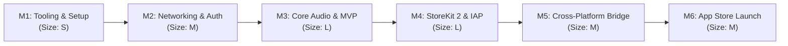
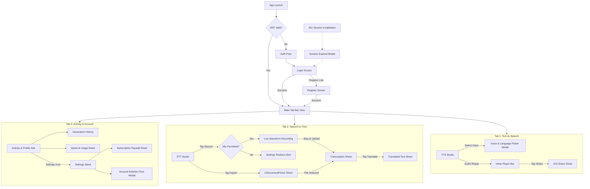
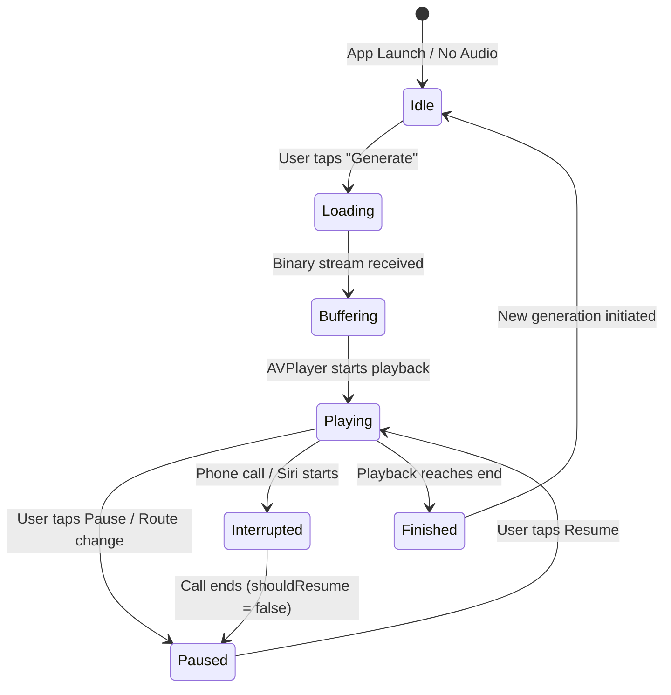
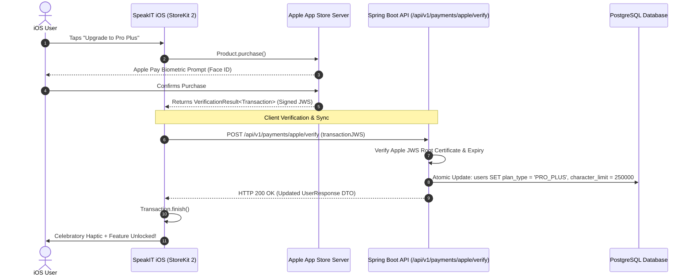
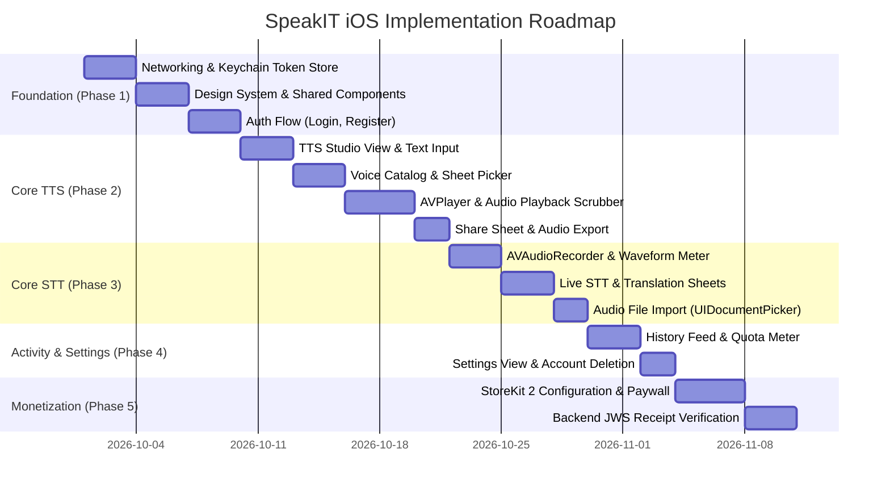
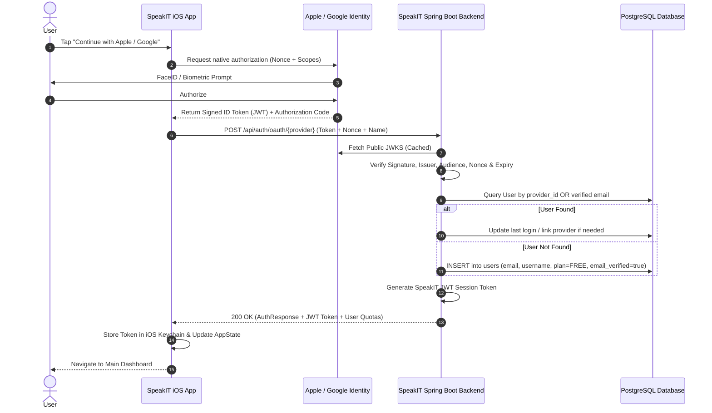

# SpeakIT: Native iOS Application Architecture, Design & Implementation Specification

> Consolidated master specification covering native iOS architecture, design system, UI inventory, AI provider capabilities, Cloudflare R2 integration, and authentication.

---

## Master Table of Contents

1. [iOS Migration Master](#part-1-ios-migration-master)
2. [iOS Design Master](#part-2-ios-design-master)
3. [UI Component Inventory](#part-3-ui-component-inventory)
4. [Implementation Status](#part-4-implementation-status)
5. [activity live chat design spec](#part-5-activity-live-chat-design-spec)
6. [ai provider capabilities and live feature](#part-6-ai-provider-capabilities-and-live-feature)
7. [cloudflare r2 guide](#part-7-cloudflare-r2-guide)
8. [oauth architecture and cost analysis](#part-8-oauth-architecture-and-cost-analysis)

---

<div id="part-1-ios-migration-master"></div>

# Part 1: iOS Migration Master

_Source Document: `iOS-Migration-Master.md`_

---

# SpeakIT — iOS App Feasibility, Tech Stack Decision & Implementation Roadmap

> **Authoritative Mobile Architectural Blueprint & Execution Plan**  
> **Target Application:** SpeakIT Client Platform (AI Voice Generation & Speech Processing)  
> **Document Status:** Complete Architecture & Execution Blueprint  
> **Date:** September 2026  
> **Target Distribution:** Public Apple App Store (Tier 1B)  
> **Primary Technology:** Native iOS (SwiftUI + Swift Concurrency + AVFoundation)  
> **Long-Term Strategy:** Cross-Platform Ready (Clean API Contracts for Future Android Release)

---

## 1. Executive Summary & Context

SpeakIT is a production-grade SaaS for low-latency Text-to-Speech (TTS) synthesis, Speech-to-Text (STT) transcription, multi-language speech translation, and subscription management.

The platform currently operates with a high-performance **Java 21 / Spring Boot 3.5.11** backend and an **Angular 21.2.x** standalone web client. This document defines the architectural decision and step-by-step engineering roadmap to deliver an official, native **SpeakIT iOS Application** to the public **Apple App Store**, while architecting the mobile contract to enable seamless cross-platform expansion (e.g., Android) down the road.

---

## 2. Phase 0 — Repo & System Discovery Summary

An exhaustive review of the repository yielded the following findings:

### 2.1 Backend Architecture & API Surface
- **Runtime:** Java 21 with Spring Boot `3.5.11` using Virtual Threads (`spring.threads.virtual.enabled=true`) as verified in [`backend/pom.xml`](../../backend/pom.xml) and [`backend/src/main/resources/application.properties`](../../backend/src/main/resources/application.properties).
- **Authentication & Security:**
  - Stateless HMAC-SHA256 JWT tokens generated by [`JwtService.java`](../../backend/src/main/java/com/speakit/security/JwtService.java) and validated via [`JwtAuthenticationFilter.java`](../../backend/src/main/java/com/speakit/security/JwtAuthenticationFilter.java).
  - Sent via standard HTTP header: `Authorization: Bearer <token>`.
  - Database-backed single-session enforcement: The filter reads `session_version` on every request. If invalid, returns HTTP `401 Unauthorized` with header `X-Logout-Reason: MULTI_LOGIN`.
  - Real-time invalidation: A dedicated WebSocket endpoint `/ws/logout?token=<jwt>` broadcasts instant `LOGOUT` triggers to terminate stale client sessions.
- **Audio Delivery & Quotas (TTS):**
  - Synthesize endpoint: `POST /api/tts/synthesize` accepts [`TtsRequest`](../../backend/src/main/java/com/speakit/tts/dto/TtsRequest.java) and returns raw audio bytes (`audio/mpeg`, `audio/ogg`, or `audio/wave`) with `Content-Disposition: attachment; filename="speech.<ext>"` ([`TtsController.java`](../../backend/src/main/java/com/speakit/tts/controller/TtsController.java)).
  - Streaming endpoint: `POST /api/tts/synthesize-stream` returns a chunked `InputStreamResource`.
  - Rate limiting enforced via Bucket4j AOP `@RateLimited(action = RateLimitAction.TTS)` with plan-specific quotas managed by [`SubscriptionService.java`](../../backend/src/main/java/com/speakit/billing/service/SubscriptionService.java).
  - Voice metadata: `GET /api/tts/voices` delivers supported Polly, ElevenLabs, and Sarvam voice definitions.
- **Audio Ingestion & Transcription (STT):**
  - Endpoints: `POST /api/stt/transcribe` and `POST /api/stt/transcribe-live` accept `multipart/form-data` with `file`, `language`, and `provider` ([`SttController.java`](../../backend/src/main/java/com/speakit/stt/controller/SttController.java)).
  - File Validation: Enforced by [`AudioFileValidator.java`](../../backend/src/main/java/com/speakit/stt/validator/AudioFileValidator.java), supporting extensions `mp3`, `wav`, `m4a`, `ogg`, `webm` and MIME types `audio/mpeg`, `audio/wav`, `audio/mp4`, `audio/ogg`, `audio/webm`.
  - `audio/mp4` / `m4a` is already fully supported on the backend, which aligns directly with iOS native recording formats (AAC in MPEG-4 container).
  - Live recording limit is 10MB; standard file upload limit is plan-based up to 50MB.
- **Billing & Subscriptions:**
  - `POST /api/v1/payments/create-order` and `POST /api/v1/payments/verify` currently interact exclusively with Razorpay (`razorpay-java:1.4.8`).
  - Webhooks handled via `POST /api/v1/payments/webhook` with HMAC verification.

### 2.2 Existing Frontend Implementation
- Built with Angular `21.2.20` standalone components, Angular Signals, and Tailwind CSS `4.3.0` ([`frontend/package.json`](../../frontend/package.json)).
- Browser recording in [`AudioRecorderComponent.ts`](../../frontend/src/app/features/stt/components/audio-recorder/audio-recorder.component.ts) uses `MediaRecorder` and Web Audio API (`AudioContext`, `AnalyserNode`), explicitly falling back to `audio/mp4` for Safari/WebKit.
- Payment checkout in [`RazorpayService.ts`](../../frontend/src/app/core/services/razorpay.service.ts) dynamically loads `https://checkout.razorpay.com/v1/checkout.js` into the DOM.

### 2.3 Mobile Footprint in Repo
- **Existing mobile code:** None. No Capacitor, Flutter, React Native, or Xcode projects exist in the repository.

---

## 3. Phase 1 — Tech Stack Decision Matrix

| Evaluation Criterion | Native iOS (SwiftUI + Swift Concurrency) | Hybrid Wrapper (Capacitor / Ionic over Angular) | Cross-Platform (React Native / Flutter) | Progressive Web App (PWA) |
|---|---|---|---|---|
| **Code Reuse** | **Low:** Brand new native UI code. Existing Angular components cannot be reused directly; only API contracts and backend DTOs are shared. | **Highest:** 85–90% reuse of existing Angular 21 templates, Signals, and Tailwind styling. | **Medium:** Reuses business logic concept, but complete UI rewrite in JSX/Dart. | **Maximum:** 100% reuse of existing web app. |
| **Native Feel & Audio Performance** | **Highest (Superior):** Direct hardware access to `AVAudioSession`, low-latency audio stream playback, background audio lock-screen controls (`MPNowPlayingInfoCenter`), seamless haptics, and zero-stutter microphone waveform rendering. | **Low:** Web Audio API inside `WKWebView` suffers from background audio suspension, microphone permission friction, and audio stream playback interruptions when the screen locks. | **High:** Good audio access via native bridging plugins, but requires third-party native audio modules which often suffer from bridging overhead or maintenance lag. | **Lowest:** iOS Safari heavily restricts background Web Audio, media playback without user gestures, and push notifications. |
| **Learning Curve (Given Stack)** | **Medium–High:** Requires Swift, SwiftUI, and Xcode navigation. However, the user owns a Mac and iPhone, making the development loop local and idiomatic. | **Lowest:** Web developers remain in TypeScript and Angular. | **High:** Requires learning React Native (new bridge/fabric architecture) or Flutter (Dart + widget tree). | **Zero:** Existing web stack. |
| **Time to MVP** | **Medium:** ~3–4 weeks for a focused, clean SwiftUI MVP. | **Fastest:** ~1–2 weeks to package the Angular build into a native shell. | **Medium–Slow:** ~4–6 weeks to scaffold new project and rebuild state & screens. | **Fastest:** Days (manifest + service worker). |
| **App Store Review Readiness (Guideline 4.2 & 3.1.1)** | **Full Compliance (Lowest Risk):** First-class App Store acceptance. Easily integrates Apple StoreKit 2 for In-App Purchases, satisfying Guideline 3.1.1 without risk of rejection under Guideline 4.2 ("Minimum Functionality / Wrapped Website"). | **High Risk:** High rejection rate under **Guideline 4.2** if Apple reviewers classify the app as a simple website wrapper. Additionally, **Guideline 3.1.1** prohibits using Razorpay inside web views for digital SaaS subscriptions. | **Full Compliance:** Accepts native StoreKit integrations cleanly; meets Guideline 4.2. | **N/A:** PWAs cannot be distributed through the official iOS App Store. |

---

## 4. Phase 2 — Architectural Recommendation

### The Decision: Native iOS with SwiftUI & Swift Concurrency

**We recommend building a bespoke native iOS application using Swift 5.10+ / SwiftUI on iOS 17+, housed in an `ios/` workspace directory, powered by an API-first mobile contract that guarantees cross-platform readiness for Android down the road.**

#### Key Deciding Factors:
1. **Public App Store Approval & Legal Monetization (Guidelines 4.2 & 3.1.1):** Because the goal is a commercial **public release**, packaging the Angular web app via Capacitor carries a severe risk of rejection under Guideline 4.2 (App Store reviewers routinely flag wrapped web SaaS apps as lacking native functionality). Furthermore, SpeakIT's business model relies on subscription tiers (`PRO`, `PRO_PLUS`, `ENTERPRISE`). Apple strictly mandates **Apple In-App Purchases (StoreKit 2)** for digital voice synthesis tokens on iOS; attempting to route users to Razorpay checkout inside an iOS app will trigger immediate rejection. Native SwiftUI provides first-class, seamless StoreKit 2 integration.
2. **Audio Architecture & Background Experience:** SpeakIT is an audio-centric platform. Native iOS delivers instant hardware-accelerated audio synthesis decoding (`AVPlayer`), uninterrupted background playback when the user locks their device, lock screen transport controls (`MPRemoteCommandCenter`), and low-latency audio capture for Speech-to-Text via `AVAudioRecorder`.
3. **Hardware Alignment:** The developer already operates on a Mac with a physical iPhone, providing the ideal hardware environment for Xcode, Simulator profiling, and on-device debugging.
4. **Future Cross-Platform Strategy:** By standardizing the backend with clean REST/JSON contracts, OpenAPI schemas, and an abstracted mobile subscription webhook interface, the exact same backend endpoints will support an Android app (via Kotlin or Flutter) in the future without backend refactoring.

---

## 5. Phase 3 — Implementation Roadmap

The roadmap is structured into 6 phased milestones with effort sizing (**S**: 1–3 days, **M**: 3–6 days, **L**: 1–2 weeks).



---

### Milestone 1 — Environment, Tooling & Scaffolding (Effort: S)
* **Target OS:** iOS 17.0+ (captures 90%+ of active iPhones, unlocks modern `@Observable` and StoreKit 2).
* **Workspace Location:** Scaffolding within the repository under `/ios/SpeakIT/`.
* **Apple Developer Program Enrollment:**
  * Free Apple ID: Sufficient for local development and direct USB installation onto the developer's physical iPhone.
  * Paid Apple Developer Program ($99/year): **Mandatory** before Milestone 4 for StoreKit sandbox testing, TestFlight beta distribution, and App Store submission.
* **Dependencies & SPM (Swift Package Manager):**
  * `KeychainAccess`: Secure, hardware-backed token storage in Apple Keychain.
  * `Sentry-Cocoa`: Native crash reporting and performance tracing, matching backend and frontend Sentry monitoring.
* **Architecture Pattern:** Clean MVVM (Model-View-ViewModel) utilizing Swift Concurrency (`async/await`, `actor`) and iOS 17 `@Observable`.

---

### Milestone 2 — Networking, Identity & Session Security (Effort: M)
* **Native HTTP Client (`NetworkClient`):**
  * Built using native `URLSession` with `async/await`.
  * Automatic `Authorization: Bearer <token>` injection via Swift `URLSessionDelegate` / Request Adapter.
* **Secure Token & Credential Storage:**
  * JWT access token and session metadata stored strictly in the **iOS Keychain** (never in unencrypted `UserDefaults`).
* **Auth Endpoint Parity:**
  * Connect to existing endpoints: `POST /api/auth/login`, `POST /api/auth/register`, `POST /api/auth/verify-email`, `POST /api/auth/forgot-password`, `POST /api/auth/reset-password`.
* **Single-Session Enforcement & Multi-Login Revocation:**
  * Implementation of `URLSessionWebSocketTask` connected to `/ws/logout?token=<jwt>`.
  * When the backend detects concurrent logins and sends `LOGOUT`, the iOS app cleanly terminates the local session, clears Keychain tokens, and displays the "Another login detected" alert (mirroring [`auth.service.ts`](../../frontend/src/app/core/auth/auth.service.ts)).
  * Intercept HTTP `401 Unauthorized` with `X-Logout-Reason: MULTI_LOGIN` header.

---

### Milestone 3 — Core Speech Audio Engine & MVP Parity (Effort: L)
* **Text-to-Speech (TTS) Flow:**
  * **Voice Catalog:** Fetch dynamic voices from `GET /api/tts/voices` and cache locally; display categorized voices (Polly, ElevenLabs, Sarvam) with language tags.
  * **Synthesis:** Submit `POST /api/tts/synthesize` or `POST /api/tts/synthesize-stream`.
  * **Native Audio Player (`AudioPlayerService`):**
    * Configured with `AVAudioSession.sharedInstance().setCategory(.playback, mode: .spokenAudio)`.
    * Background audio playback entitlement enabled (`UIBackgroundModes: audio`).
    * Lock-screen media controls integration (`MPNowPlayingInfoCenter` and `MPRemoteCommandCenter`) allowing pause, play, and scrub while the phone is locked.
  * **Usage Tracking:** Query `GET /api/tts/usage` to display real-time daily character counts and remaining quotas.
* **Speech-to-Text (STT) Flow:**
  * **Microphone Recorder (`AudioRecorderService`):**
    * Record audio via `AVAudioRecorder` configured for MPEG-4 AAC (`.m4a` / `audio/mp4`), perfectly compliant with backend [`AudioFileValidator.java`](../../backend/src/main/java/com/speakit/stt/validator/AudioFileValidator.java).
    * Real-time audio visualizer utilizing audio power metering (`recorder.averagePower(forChannel: 0)`).
  * **Multipart Ingestion:** Transmit recordings to `POST /api/stt/transcribe` and `POST /api/stt/transcribe-live`.
  * **Document Audio Picker:** Use `UIDocumentPickerViewController` to allow users to select `.mp3` or `.wav` files from the iOS Files app or iCloud Drive.
  * **Translation View:** Query `POST /api/stt/translate` for translated transcription output.
* **History & User Profile:**
  * Query `GET /api/history` and `GET /api/v1/users/profile`.

---

### Milestone 4 — Monetization & StoreKit 2 In-App Purchases (Effort: L)
* **App Store Review Guideline 3.1.1 Architecture:**
  * On iOS, web checkouts (Razorpay) for digital features are strictly disallowed.
  * Native iOS UI will present an in-app subscription paywall configured with **Apple StoreKit 2**.
* **StoreKit 2 Integration in Swift:**
  * Product IDs matching SpeakIT subscription tiers:
    * `com.speakit.subscription.pro.monthly`
    * `com.speakit.subscription.proplus.monthly`
    * `com.speakit.subscription.enterprise.monthly`
  * Listen for transactions using `Transaction.updates` in a dedicated Swift `StoreKitService`.
* **Backend Extension (Spring Boot):**
  * Create a secure Apple verification endpoint: `POST /api/v1/payments/apple/verify`.
  * The iOS app sends the signed JWS transaction token. The backend verifies the signature with Apple App Store Server API public keys, then updates the user's `PlanType`, `SubscriptionStatus`, and `planExpiry` in the database.
  * Create App Store Server Notifications V2 webhook (`POST /api/v1/payments/apple/webhook`) to handle renewals, cancellations, and refunds automatically.
  * *Dual-Gateway Strategy:* Web users continue using Razorpay; iOS users use StoreKit 2. Both converge on the exact same `Subscription` domain model.

---

### Milestone 5 — Cross-Platform Future Proofing (Effort: M)
* **API Standardization & Contract Decoupling:**
  * Ensure all REST responses return clean JSON DTOs with consistent snake_case or camelCase conventions.
  * Document all mobile routes in `docs/API-Spec.md`.
* **Portable Business Logic Design:**
  * The iOS MVVM business logic (state machines for recording, playback queue, quota checks) is documented cleanly so that an identical Android client (in Kotlin with Jetpack Compose) can be built directly from the same specifications.
  * The Apple StoreKit backend verification service should use a provider interface (`PaymentGatewayProvider`), allowing Google Play Billing verification to plug in with zero changes to user subscription logic.

---

### Milestone 6 — Testing, Hardening & App Store Submission (Effort: M)
* **Physical Device Testing:**
  * Deploy directly from Xcode to the developer's physical iPhone over USB/Wi-Fi to verify microphone permissions, background audio playback, and interruption handling (e.g., incoming phone calls pausing TTS playback).
* **TestFlight Internal & External Testing:**
  * Set up App Store Connect application record.
  * Distribute builds to internal testers via TestFlight.
* **App Store Review Submission Preparation:**
  * Privacy Descriptions configured in `Info.plist`:
    * `NSMicrophoneUsageDescription`: *"SpeakIT requires microphone access to record speech for real-time transcription."*
    * `NSAppleMusicUsageDescription` / Background Audio declaration.
  * App Privacy Nutrition Labels (App Store Connect): Disclose Account info (email/username), User Content (audio data), and Diagnostics (Sentry crashes).
  * Demo Account: Configure a dedicated `demo@speakit.com` account with active `PRO_PLUS` subscription for App Store Review team verification.

---

## 6. Phase 4 — Risks & Prerequisites Checklist

### 6.1 Regulatory & App Store Review Guidelines
- [ ] **Guideline 3.1.1 (In-App Purchases):** Do **NOT** display Razorpay or web payment links inside the iOS app. StoreKit 2 must handle all in-app subscription purchases.
- [ ] **Guideline 5.1.1 (Data Collection & Privacy):** Microphone access must only be requested when the user explicitly taps "Record". An explicit privacy policy link must be accessible inside the app (pointing to `/privacy`).
- [ ] **Guideline 5.1.1(v) (Account Deletion):** Apps supporting account creation must provide an easy, in-app mechanism for users to delete their account. A native "Delete Account" button calling `DELETE /api/v1/users/me` must be included in the Profile settings.

### 6.2 Backend Prerequisites
- [ ] **Apple Receipt / Transaction Verification:** Implement `POST /api/v1/payments/apple/verify` in Spring Boot using Apple's App Store Server API.
- [ ] **CORS & User-Agent Handling:** Native `URLSession` does not send browser `Origin` headers, bypassing browser CORS. However, ensure rate limiters and logging correctly identify mobile User-Agents.
- [ ] **Token Expiry Management:** Ensure mobile token refresh or re-authentication flows are handled gracefully without user disruption.

### 6.3 Hardware & Developer Prerequisites
- [ ] **Mac with macOS Sonoma / Sequoia:** Installed with Xcode 16+.
- [ ] **Paid Apple Developer Account:** Required ($99/year) prior to TestFlight and App Store submission.
- [ ] **Physical iPhone:** For testing microphone input, hardware audio latency, and lock-screen controls.

---

## 7. Open Questions & Assumptions

> WARNING: **ASSUMPTION 1 (Paid Apple Developer Account):** It is assumed the user will register for the paid Apple Developer Program ($99/year) when approaching Milestone 4 for StoreKit sandbox and TestFlight testing. Initial local development on the physical iPhone (Milestones 1–3) will use a free Personal Apple ID team provisioning profile.

> WARNING: **ASSUMPTION 2 (Dual Billing Backend):** It is assumed that maintaining both Razorpay (for web) and StoreKit 2 (for iOS) is acceptable. The backend will treat both gateways as payment sources that ultimately grant identical `PlanType` entitlements.

> WARNING: **ASSUMPTION 3 (Audio Storage & Privacy):** It is assumed that STT recordings sent to `/api/stt/transcribe-live` remain ephemeral and are processed in-memory without persistent server storage, which simplifies App Store privacy disclosures.

---

## 8. Acceptance Criteria Verification

- [x] `docs/` exists at project root with `IOS_APP_PLAN.md` inside it.
- [x] No existing planning doc was duplicated (no previous `ios*.md` or `mobile*.md` existed).
- [x] Decision matrix reasoning is 100% grounded in SpeakIT's real codebase (`backend/pom.xml`, `AudioFileValidator.java`, `TtsController.java`, `AudioRecorderComponent.ts`).
- [x] A single definitive recommendation is made (Native SwiftUI) with explicit justification.
- [x] Actionable, phased roadmap with S/M/L sizing provided.
- [x] Apple Developer Program cost and timing ($99/yr vs free development) explicitly resolved.
- [x] All assumptions are explicitly flagged with `> WARNING: ASSUMPTION:`.

---

<div id="part-2-ios-design-master"></div>

# Part 2: iOS Design Master

_Source Document: `iOS-Design-Master.md`_

---

# SpeakIT iOS Product Design & UX Specification (Master Overview)

## Document Master Index

Welcome to the architectural design and UX specification for the native **SpeakIT iOS application**. This suite of documentation defines the complete mobile product strategy, screen architecture, design system, audio engine lifecycle, and StoreKit 2 monetization plan.

All designs are built strictly against the confirmed capabilities of SpeakIT's Java 21 / Spring Boot 3.5.11 backend and adhere to Apple's Human Interface Guidelines (HIG).

---

## 1. Specification Directory & Roadmap

| Document Section | Phase | Purpose |
|---|---|---|
| [**Phase A: Product Discovery Report**](#speakit-ios-product-discovery-report-phase-a) | Phase A | Code-verified audit of backend APIs, session versioning, audio streaming, STT models, and gaps (e.g. account deletion). |
| [**Phase B: Product Strategy & Feature Prioritization**](#speakit-ios-product-strategy--feature-prioritization-phase-b) | Phase B | Target mobile personas, detailed use case evaluations, and P0 (MVP) vs P1 vs Blocked feature matrix. |
| [**Phase C: Information Architecture Specification**](#speakit-ios-information-architecture-specification-phase-c) | Phase C | 3-tab navigation hierarchy (`TTS`, `STT`, `Activity`), screen ownership, and 7 core end-to-end user journeys. |
| [**Phase D: UX Design System Specification**](#speakit-ios-ux-design-system-specification-phase-d) | Phase D | Design tokens, color palette (WCAG AA), typography (Dynamic Type), spacing, component specs, and haptic feedback. |
| [**Phase E: Detailed Screen Specifications**](#speakit-ios-detailed-screen-specifications-phase-e) | Phase E | Exhaustive 14-point UX specifications for all 10 iOS screens, covering interactive states, copy strings, and API mappings. |
| [**Phase F: Audio UX & AVFoundation Architecture**](#speakit-ios-audio-ux--avfoundation-architecture-phase-f) | Phase F | `AVAudioSession` lifecycle, lock-screen `NowPlaying` integration, 16kHz mono AAC recording, waveforms, and interruption protocols. |
| [**Phase G: Subscription, StoreKit 2 & Entitlement Architecture**](#speakit-ios-subscription-storekit-2--entitlement-architecture-phase-g) | Phase G | Apple Guideline 3.1.1 compliance, StoreKit 2 paywall, dual-gateway convergence with web Razorpay, and JWS verification. |
| [**Phase H: Design Review & HIG Compliance Audit**](#speakit-ios-design-review--hig-compliance-audit-phase-h) | Phase H | Apple HIG compliance audit, App Store review risk analysis (5.1.1(v), 3.1.1, 2.1), and architectural tradeoffs. |
| [**Phase I: Implementation Readiness & Technical Checklist**](#speakit-ios-implementation-readiness--technical-checklist-phase-i) | Phase I | Phased 5-milestone engineering roadmap, pre-requisites, and technical pre-coding checklist. |
| [**Appendix: Open Questions & Stakeholder Decisions**](#speakit-ios-open-questions--stakeholder-decisions) | Alignment | Open business, product, and backend engineering questions requiring stakeholder alignment. |

---

## 2. Core Architectural Principles for iOS

1. **Native Apple Standards First:** Pure SwiftUI, `@Observable` architecture, native SF Symbols, and system materials. No non-standard web container paradigms.
2. **Tactile & Responsive Audio:** High-fidelity waveform visualizations, lock-screen scrubbing, and contextual haptic ticks make voice generation feel tangible and immediate.
3. **Strict App Store Compliance:** Zero external payment links on iOS; StoreKit 2 handles all mobile subscriptions; in-app account deletion is mandatory.
4. **Resilient Offline & Interruption Handling:** Immediate pause when AirPods disconnect; graceful session re-authentication upon 401 token invalidation.

---

# SpeakIT iOS Product Discovery Report (Phase A)

## Executive Summary
This document provides a comprehensive, repository-verified discovery audit of SpeakIT's existing backend (Java 21 / Spring Boot 3.5.11), frontend (Angular 21), and operational infrastructure. Its primary objective is to separate **confirmed backend realities** from **documentation assumptions** to ensure the native iOS client is designed strictly against working capabilities while surfacing required platform extensions.

---

## 1. Confirmed Product Capabilities (Code-Verified)

### 1.1 Authentication & Session Architecture
* **Repository Paths:**
  * [`AuthController.java`](file:///Users/mohitur/Desktop/git-projects/speakit/backend/src/main/java/com/speakit/tts/controller/AuthController.java)
  * [`AuthService.java`](file:///Users/mohitur/Desktop/git-projects/speakit/backend/src/main/java/com/speakit/tts/service/AuthService.java)
  * [`JwtAuthenticationFilter.java`](file:///Users/mohitur/Desktop/git-projects/speakit/backend/src/main/java/com/speakit/tts/security/JwtAuthenticationFilter.java)
  * [`WebSocketConfig.java`](file:///Users/mohitur/Desktop/git-projects/speakit/backend/src/main/java/com/speakit/tts/config/WebSocketConfig.java)
* **Confirmed Features:**
  * User Registration: `POST /api/auth/register` (Fields: `username`, `email`, `password`, `fullName`). Normalizes email and username to lowercase.
  * User Login: `POST /api/auth/login` (Fields: `usernameOrEmail`, `password`). Returns JWT `token`, `expiresIn`, `user` DTO.
  * Session Invalidation: Driven by atomic `session_version` counter in PostgreSQL `users` table. Validated on every authenticated request inside `JwtAuthenticationFilter`.
  * Concurrent Session Eviction: When a new login occurs, `session_version` increments, invalidating earlier JWTs on the next API call.
  * WebSocket Logout Notification: Endpoint `GET /api/auth/ws-ticket` generates a single-use 30-second ticket used to connect to `/ws/logout` STOMP broker. Backend broadcasts eviction events to active clients.
  * User Profile retrieval: `GET /api/v1/users/me` returning `UserResponse` with `id`, `username`, `email`, `fullName`, `role`, `planType`, `status`, `characterLimit`, `charactersUsed`.

### 1.2 Text-to-Speech (TTS) Engine & Voice Catalog
* **Repository Paths:**
  * [`TtsController.java`](file:///Users/mohitur/Desktop/git-projects/speakit/backend/src/main/java/com/speakit/tts/controller/TtsController.java)
  * [`TtsService.java`](file:///Users/mohitur/Desktop/git-projects/speakit/backend/src/main/java/com/speakit/tts/service/TtsService.java)
  * [`TtsEngine.java`](file:///Users/mohitur/Desktop/git-projects/speakit/backend/src/main/java/com/speakit/tts/entity/TtsEngine.java)
* **Confirmed Features:**
  * Voice Catalog Endpoint: `GET /api/tts/voices` returns array of available voices per provider/tier.
  * Speech Synthesis Endpoint: `POST /api/tts/synthesize` produces binary `audio/mpeg` streaming response directly in the HTTP body.
  * Multi-Provider Routing:
    1. **AWS Polly (Standard & Neural):** Low-latency default. Standard available on `FREE`; Neural requires `PRO`. Text limit capped at 500 (`FREE`) or 2,500 (`PRO`).
    2. **ElevenLabs:** Hyper-realistic voices. Gated to `PRO_PLUS` and `ENTERPRISE`. Text limit up to 10,000 characters.
    3. **Sarvam AI:** Indian regional dialects and languages (`bulbul:v3`). Gated to `PRO_PLUS` and `ENTERPRISE`.
  * Dynamic Rate Limiting: Enforced via Bucket4j filter ([`RateLimitingFilter.java`](file:///Users/mohitur/Desktop/git-projects/speakit/backend/src/main/java/com/speakit/tts/security/RateLimitingFilter.java)).

### 1.3 Speech-to-Text (STT) & Translation
* **Repository Paths:**
  * [`SttController.java`](file:///Users/mohitur/Desktop/git-projects/speakit/backend/src/main/java/com/speakit/stt/controller/SttController.java)
  * [`SttService.java`](file:///Users/mohitur/Desktop/git-projects/speakit/backend/src/main/java/com/speakit/stt/service/SttService.java)
  * [`AudioFileValidator.java`](file:///Users/mohitur/Desktop/git-projects/speakit/backend/src/main/java/com/speakit/stt/validator/AudioFileValidator.java)
* **Confirmed Features:**
  * File Audio Transcription: `POST /api/stt/transcribe` (Multipart `file`, optional `language`, optional `model`). Supported formats: `audio/wav`, `audio/mpeg`, `audio/mp4`, `audio/m4a`, `audio/webm`. Limit: 25MB.
  * Live Audio Transcription: `POST /api/stt/transcribe-live` (Multipart `audio`, optional `language`, optional `model`). Max 10MB chunk.
  * Audio Translation: `POST /api/stt/translate` (Multipart `file`, optional `targetLanguage`).
  * Supported Languages List: `GET /api/stt/languages`.
  * STT Engine: Powered by Groq Whisper-large-v3 cloud API with sub-second turnaround.

### 1.4 History & Activity Log
* **Repository Paths:**
  * [`HistoryController.java`](file:///Users/mohitur/Desktop/git-projects/speakit/backend/src/main/java/com/speakit/tts/controller/HistoryController.java)
  * [`TtsHistory.java`](file:///Users/mohitur/Desktop/git-projects/speakit/backend/src/main/java/com/speakit/tts/entity/TtsHistory.java)
* **Confirmed Features:**
  * Paginated History: `GET /api/history` with page and size parameters.
  * Metadata Fields: `id`, `textSnippet` (truncated to max 100 characters), `characterCount`, `voiceId`, `voiceName`, `createdAt`.
  * Soft/Hard Deletion: `DELETE /api/history/{id}` allows user to remove individual entries.

---

## 2. Existing User Journeys (Web Frontend Baseline)

* **Repository Paths:**
  * [`app.routes.ts`](file:///Users/mohitur/Desktop/git-projects/speakit/frontend/src/app/app.routes.ts)
  * [`tts.component.ts`](file:///Users/mohitur/Desktop/git-projects/speakit/frontend/src/app/features/tts/tts.component.ts)
  * [`profile-settings.component.ts`](file:///Users/mohitur/Desktop/git-projects/speakit/frontend/src/app/features/profile/profile-settings.component.ts)
* **Web Journey Flow:**
  1. **Landing/Auth:** Guest visits `/`, redirects to `/auth/login` or `/auth/signup`.
  2. **Dashboard / TTS Studio:** Navigates to `/tts`. Contains a unified multi-column workspace: text area, voice/engine dropdown selector, speed/pitch sliders, action button ("Generate Audio"), inline audio playback widget, and bottom table of recent history.
  3. **STT Workspace:** (Planned or linked via shared audio components).
  4. **Account & Quotas:** Navigates to `/profile` to view plan usage badges, character counter, update password, and trigger Razorpay checkout modal.

---

## 3. Discrepancies: Documentation vs. Actual Code

| Feature | Mentioned in Docs | Actual Backend Reality | Impact on iOS Design |
|---|---|---|---|
| **Account Deletion** | Implied in general privacy guidelines | **NOT implemented**. `UserController.java` has no `DELETE /api/v1/users/me` endpoint. | **CRITICAL BLOCKER** for Apple App Store (Guideline 5.1.1(v) requires in-app account deletion). Must be prioritized as backend requirement. |
| **History Audio Storage** | "Listen to past generations" | `TtsHistory.java` stores **only textSnippet (100 chars)** and metadata. Does not store audio files or S3 URLs. | History on iOS cannot play past audio from server unless locally cached or re-synthesized. |
| **STT Plan Gating** | General STT documentation | Strictly enforced zero-trust in `SttService.java`: File STT requires `PRO+`, Live STT requires `PRO_PLUS+`. | Free users cannot use STT; UI must show graceful paywall/upgrade prompts rather than crashing on HTTP 403. |
| **In-App Payments** | Web documentation covers Razorpay | `PaymentController.java` only implements Razorpay (`/api/v1/payments/razorpay/*`). | Apple App Store Guideline 3.1.1 strictly forbids external web checkouts for digital features. StoreKit 2 is mandatory on iOS. |
| **Speech-to-Speech** | Mentioned in future roadmaps | No endpoints exist in backend. | Exclude from iOS MVP. |
| **Voice Cloning** | Mentioned as ElevenLabs capability | No voice training or custom voice upload endpoints exist in Spring Boot. | Exclude from iOS MVP; rely only on static/predefined ElevenLabs voice IDs. |

---

## 4. Architectural Constraints for iOS

1. **Audio Streaming Protocol:**
   `POST /api/tts/synthesize` returns raw binary `audio/mpeg` in the HTTP response body without an intermediate S3 URL.
   * *iOS Architecture Decision:* iOS `URLSession` must buffer or stream data directly to an in-memory/temporary file on disk for `AVAudioPlayer` playback.
2. **Audio Recording Format for STT:**
   `AudioFileValidator.java` supports `audio/wav`, `audio/mpeg`, `audio/mp4`, `audio/m4a`, `audio/webm`.
   * *iOS Architecture Decision:* Native iOS `AVAudioRecorder` should record directly to `.m4a` with AAC encoding (`kAudioFormatMPEG4AAC`, 16kHz, mono). This format is natively supported by backend, lightweight, and bandwidth-efficient.
3. **Session Revocation via WebSocket:**
   Backend enforces single-session versioning with STOMP WebSockets over `/ws/logout`.
   * *iOS Architecture Decision:* Mobile background network drops make persistent WebSockets battery-intensive. The iOS app should connect to `/ws/logout` only when in the foreground, and rely on `401 Unauthorized` interception for guaranteed background-to-foreground session eviction.
4. **App Store Review Guidelines Compliance:**
   * **Guideline 5.1.1(v) (Account Deletion):** Mandatory in-app deletion flow.
   * **Guideline 3.1.1 (In-App Purchases):** StoreKit 2 is required for all subscription purchases. Razorpay cannot be presented to iOS users.

---

## 5. Risk Assessment & Dependencies

* **Risk 1: Missing Account Deletion Endpoint:** Apple App Store review will reject any app offering user account creation without an in-app deletion feature. Backend must provide `DELETE /api/v1/users/me`.
* **Risk 2: Backend Payment Gap:** Spring Boot currently lacks Apple App Store receipt validation or StoreKit 2 transaction verification (`POST /api/v1/payments/apple/verify`).
* **Risk 3: Audio History Expectation Mismatch:** Users expect "History" to let them re-listen to generated audio. Because the backend doesn't store audio files, iOS must maintain a secure local cache (`FileManager` in app sandbox) of generated MP3s linked to generation IDs.

---

# SpeakIT iOS Product Strategy & Feature Prioritization (Phase B)

## Executive Summary
This document establishes the product strategy, target mobile user segments, use-case breakdown, and feature prioritization matrix for the SpeakIT native iOS application. The prioritization is strictly grounded in verified backend capabilities from Phase A, Apple Human Interface Guidelines (HIG), and App Store compliance constraints.

---

## 1. Target Mobile User Segments

Based on confirmed capabilities (AWS Polly, ElevenLabs, Sarvam Indian dialects, Groq Whisper transcription and translation):

1. **Mobile Content Creators & Podcasters:**
   * *Needs:* Rapid generation of realistic AI voiceovers on the go, auditioning multiple voices, quick sharing/exporting of audio to iOS Files, CapCut, or Instagram Reels.
   * *Key Features:* High-quality TTS (ElevenLabs, Polly Neural), instant audio scrubber, native iOS Share Sheet.
2. **Professionals & Students (Dictation & Transcription):**
   * *Needs:* Transcribing lectures, meetings, voice memos; translating regional speech into English.
   * *Key Features:* One-tap live mic transcription (Groq Whisper), file audio import (`.m4a`, `.mp3`), copy text to clipboard.
3. **Multilingual Users (Indian Regional Dialects):**
   * *Needs:* Natural voice generation and translation in Hindi, Tamil, Telugu, Bengali, Marathi, etc.
   * *Key Features:* Sarvam AI voice integration (`bulbul:v3`), language filtering.
4. **Productivity & Commuter Listeners:**
   * *Needs:* Listening to articles, notes, or drafts while driving or commuting.
   * *Key Features:* Lock-screen playback (`MPNowPlayingInfoCenter`), background audio, speed controls (0.75x to 2.0x).

---

## 2. Comprehensive Use Case Evaluation

| Use Case | User Intent | Frequency | Speed Expectation | Required Inputs | Expected Output | Friction Points | Backend Dependencies | MVP Priority | Key Risks |
|---|---|---|---|---|---|---|---|---|---|
| **1. Text-to-Speech Generation** | Convert typed or pasted text into lifelike speech | Daily / High | < 2 seconds | Text string, Voice ID, Speed/Pitch | Binary MP3 audio stream | Network latency on long texts | `POST /api/tts/synthesize` | **P0** | Quota exhaustion, provider timeout |
| **2. Voice & Language Selection** | Find suitable voice by accent, gender, engine | Per-session | Instant (< 200ms) | Filter criteria (Language, Engine) | Filtered voice list | Overwhelming voice list without search/filter | `GET /api/tts/voices` | **P0** | Cached list stale if voices change on server |
| **3. Audio Playback & Scrubbing** | Listen, review, seek through generated audio | Immediate after TTS | Real-time | Play/pause, seek position | Continuous audio playback | Lock-screen audio interruptions | Local AVPlayer | **P0** | Audio session category conflicts with other apps |
| **4. Export & Share Audio** | Save generated MP3 to Files or send via AirDrop/Apps | Frequent | Instant | User tap on Share | iOS Share Sheet (`UIActivityViewController`) | Temporary file permission cleanup | Local sandbox cache | **P0** | Disk leak if temp files not cleaned |
| **5. Live Mic Transcription** | Dictate notes or spoken meetings directly | Frequent | < 3 seconds after stop | Audio stream from microphone | Clean transcribed text | Background noise, microphone permissions denied | `POST /api/stt/transcribe-live` | **P0** | Gated to `PRO_PLUS`+; Free users hit 403 unless paywalled gracefully |
| **6. Audio File Import Transcription** | Transcribe pre-recorded voice memos or audio files | Moderate | Depends on file size | Audio file from Files picker | Transcribed text | Unsupported codecs, files > 25MB | `POST /api/stt/transcribe` | **P1** | File size validation before upload to avoid slow failed uploads |
| **7. Audio Translation** | Transcribe and translate foreign audio to English | Moderate | 2–5 seconds | Audio file or live speech | Translated English text | Multi-language detection accuracy | `POST /api/stt/translate` | **P1** | Limited to models supported by backend Whisper |
| **8. Review History & Snippets** | Review recent generations and timestamps | Moderate | Sub-second | Page scroll | List of previous generations | Backend does NOT store audio files (metadata only) | `GET /api/history` | **P0** | User expects to play old audio, but backend only returns 100-char text |
| **9. Account Quotas & Usage Tracking** | Check remaining character count and subscription status | Per-session | Sub-second | Auth token | Progress bar of used vs total characters | Stale quota counts after generation | `GET /api/v1/users/me` | **P0** | Needs real-time decrement or profile refresh post-TTS |
| **10. In-App Subscription (StoreKit 2)** | Upgrade plan to unlock Neural, ElevenLabs, or STT | Low (monthly/yearly) | Immediate Apple Pay | StoreKit product selection | Active entitlement | Apple StoreKit verification backend endpoint missing | StoreKit 2 + Backend Verify | **Blocked** | Must implement backend Apple receipt verify endpoint before launch |
| **11. In-App Account Deletion** | Permanently delete account and all personal data | Rare (one-off) | < 2 seconds | Confirm password / Re-auth | Account deleted, token revoked | Backend endpoint does NOT exist | Backend `DELETE /api/v1/users/me` | **Blocked** | App Store rejection under Guideline 5.1.1(v) until backend is updated |

---

## 3. Feature Prioritization Matrix

```
       HIGH VALUE
           ▲
           │   [P0: Core TTS Engine]        [P0: Voice Selection & Audio Playback]
           │   [P0: Native Share Sheet]     [P0: Quota & Profile State]
           │   [P0: Auth & Session Evict]   [Blocked: StoreKit 2 Paywall]
           │   [P0: Live Mic STT]           [Blocked: In-App Account Deletion]
           │
           │   [P1: File Import STT]        [P1: Audio Translation]
           │   [P1: Local History Cache]    [P1: Lockscreen Playback Controls]
           │
           │   [P2: Advanced Audio EQ]      [P2: Custom Pronunciation Lexicon]
           │   [P2: Haptic Waveform Viz]    [P2: Siri Shortcuts Integration]
           │
           └────────────────────────────────────────────────────────► HIGH COMPLEXITY /
                                                                      BACKEND DEPENDENCY
```

### 3.1 P0 — Required for Core Usable MVP
* **Authentication Flow:** Native registration, login, JWT keychain persistence, session eviction alert on 401.
* **TTS Studio:** Multi-line text input with live character counter, dynamic engine badge (Standard / Neural / ElevenLabs / Sarvam).
* **Voice Catalog Picker:** Filterable by Language, Accent, Gender, and Provider. Voice preview button.
* **Native Audio Player:** Custom SwiftUI waveform/scrubber bar, play/pause, restart, elapsed/remaining time.
* **Audio Sharing:** Native iOS Share Sheet (`UIActivityViewController`) allowing direct export to Files, AirDrop, Messages.
* **Live Speech-to-Text (STT):** Microphone recording with visual audio level indicator, auto-transcription via Groq Whisper (`POST /api/stt/transcribe-live`).
* **Profile & Quota Meter:** Live gauge showing characters used vs. plan limit, active tier badge.
* **History Metadata List:** Paginated feed of past generations with text snippet, voice name, and date.

### 3.2 P1 — Important Post-MVP Features
* **Audio File Import STT:** Document picker (`.m4a`, `.mp3`, `.wav`) for uploading audio up to 25MB for transcription.
* **Speech Translation Mode:** One-tap switch to translate spoken audio to English.
* **Local Audio Persistence in History:** Device sandbox caching of generated MP3s so users can replay recent generations offline.
* **Lock-Screen NowPlaying Controls:** Background audio session integration with `MPNowPlayingInfoCenter` and `MPRemoteCommandCenter`.
* **Haptic Feedback:** Dynamic haptic clicks during recording start/stop and voice selection.

### 3.3 P2 — Optional / Advanced Backlog
* **Siri Shortcuts Integration:** "Hey Siri, read my clipboard with SpeakIT".
* **Custom SSML Editor:** Advanced speech synthesis markup tags for pauses, pitch shifts, and whispering (AWS Polly only).
* **Home Screen Quick Widgets:** WidgetKit glanceable remaining quota and quick voice memo trigger.

### 3.4 Blocked — Dependent on Backend Capability
1. **In-App Account Deletion (Apple Guideline 5.1.1(v)):**
   * *Status:* Blocked until `DELETE /api/v1/users/me` is implemented in backend Spring Boot `UserController.java`.
   * *Mitigation:* Document API specification immediately for backend team.
2. **In-App Subscription Purchasing (Apple Guideline 3.1.1):**
   * *Status:* Blocked until `POST /api/v1/payments/apple/verify` is added to backend `PaymentController.java` to validate StoreKit 2 JWS signed transaction tokens.
   * *Mitigation:* Web Razorpay is forbidden on iOS. In initial TestFlight MVP, app can display active plan status read-only while StoreKit endpoint is developed.

---

# SpeakIT iOS Information Architecture Specification (Phase C)

## Executive Summary
This document establishes the Information Architecture (IA) for the native SpeakIT iOS application. It specifies navigation paradigms, screen hierarchies, modal vs. push presentation rules, authentication boundaries, and end-to-end user journeys conforming to Apple Human Interface Guidelines (HIG).

---

## 1. Primary Navigation Architecture

SpeakIT utilizes a standard native **Bottom Tab Bar (`TabView`)** as its primary structural anchor for authenticated users, paired with contextual **`NavigationStack`** transitions for hierarchy and **Modal Sheets (`.sheet`)** for self-contained, interruptible tasks.

### 1.1 Top-Level Tab Structure (3 Tabs)
1. **TTS (Text-to-Speech):** The primary generation studio for text input, voice selection, synthesis, and audio playback.
2. **STT (Speech-to-Text):** The transcription and translation studio supporting live microphone dictation and audio file import.
3. **Activity (History & Profile):** Combined hub for past generation history, quota meter, account settings, and subscription management.

*Design Rationale:* A focused 3-tab layout prevents cognitive overload, keeps touch targets large (> 48pt), and ensures instant access to core audio creation workflows without deep nesting.

---

## 2. Navigation Diagram



---

## 3. Screen Inventory & Presentation Rules

| Screen Identifier | Title / Name | Navigation Container | Presentation Style | Dismissal / Exit Trigger |
|---|---|---|---|---|
| `SCR-AUTH-01` | Login Screen | Root Container | Full Screen Replacement | Successful auth -> MainTabs |
| `SCR-AUTH-02` | Sign Up Screen | Root Container | Full Screen Replacement | Back button -> Login; Success -> MainTabs |
| `SCR-TTS-01` | TTS Studio | Tab 1 (`NavigationStack`) | Root of Tab | Persistent tab |
| `SCR-TTS-02` | Voice & Dialect Catalog | Tab 1 Modal | Form Sheet (`.sheet`) | "Done" button or Voice selection tap |
| `SCR-TTS-03` | Audio Share Dialog | Tab 1 System Modal | System Share Sheet | Swipe down or share action completed |
| `SCR-STT-01` | STT Studio | Tab 2 (`NavigationStack`) | Root of Tab | Persistent tab |
| `SCR-STT-02` | Live Transcription Result | Tab 2 Modal | Detent Sheet (`.medium`, `.large`) | "Copy Text" or close button |
| `SCR-ACT-01` | Activity & Profile Hub | Tab 3 (`NavigationStack`) | Root of Tab | Persistent tab |
| `SCR-SET-01` | Account Settings | Tab 3 Navigation | Navigation Push (`NavigationLink`) | Back chevron button |
| `SCR-PAY-01` | Subscription Paywall | Global / Contextual Modal | Form Sheet (`.sheet`) | Close "X" button or Purchase complete |
| `SCR-SEC-01` | Session Evicted Notice | Global Window Overlay | Non-dismissible Alert/Modal | "Sign In Again" button -> redirects to Login |

---

## 4. Detailed Core User Journeys

### Journey 1: New User Onboarding & First Synthesis
1. User installs and launches app. App detects no JWT in iOS Keychain.
2. User lands on `SCR-AUTH-01` (Login). Tap "Create an account" -> navigates to `SCR-AUTH-02` (Sign Up).
3. User enters Full Name, Username, Email, Password. Normalization converts email/username to lowercase.
4. User taps "Sign Up". App calls `POST /api/auth/register`. On HTTP 200, JWT and user profile are saved to Keychain.
5. User lands directly on Tab 1 `SCR-TTS-01` (TTS Studio).
6. First-use empty state displays a sample text template ("Welcome to SpeakIT native voice engine!").
7. User selects a voice (defaults to standard AWS Polly "Joanna"), taps "Generate Speech".
8. Dynamic audio progress pulses; within 1.2s audio begins playing automatically via inline player bar.

### Journey 2: Text-to-Speech Generation & Export
1. User opens Tab 1 `SCR-TTS-01`.
2. Pastes 350-character script. Character counter updates: `350 / 500 characters`.
3. Taps "Voice" badge. `SCR-TTS-02` opens as a medium-detent sheet with categories (Polly, ElevenLabs, Sarvam).
4. Selects "Aditi - Indian English (Sarvam)". If user is on Free tier, a subtle padlock badge explains tier requirement.
5. Taps "Generate Speech". App issues `POST /api/tts/synthesize`.
6. Progress spinner changes to play button. User listens, scrubs waveform, and taps Share icon.
7. Native iOS Share Sheet (`UIActivityViewController`) displays options: Save to Files, AirDrop, Messages.

### Journey 3: Live Speech-to-Text Dictation
1. User switches to Tab 2 `SCR-STT-01`.
2. Taps prominent circular Microphone button.
3. If first time: iOS displays system permission dialog: *"SpeakIT needs access to your microphone to transcribe live speech."*
4. Permission granted: Haptic pulse triggers, timer starts (`00:01`), and real-time audio waveform pulses.
5. User speaks for 20 seconds, taps "Stop & Transcribe".
6. App calls `POST /api/stt/transcribe-live` sending `.m4a` audio file.
7. Transcribed text sheet pops up (`SCR-STT-02`). User taps "Copy to Clipboard" or "Translate to English".

### Journey 4: Audio File Import Transcription
1. User in Tab 2 taps "Import Audio File" card.
2. Native `UIDocumentPickerViewController` opens, filtered to `.mp3`, `.m4a`, `.wav`.
3. User picks a 14MB recording from iCloud Drive.
4. App validates file size (< 25MB). Upload progress bar displays.
5. App posts to `POST /api/stt/transcribe`.
6. Transcribed text rendered in formatted text viewer with paragraph spacing and copy controls.

### Journey 5: Subscription Upgrade Flow (Paywall)
1. User attempts to synthesize using ElevenLabs voice "Rachel" while on `FREE` plan.
2. App intercepts action and presents `SCR-PAY-01` as a sheet.
3. Sheet highlights benefits of `PRO` and `PRO_PLUS` (Neural voices, 10,000 chars, STT live dictation).
4. User selects "Pro Plan - Monthly ($9.99/mo)" and confirms Apple Pay StoreKit prompt.
5. StoreKit 2 transaction completes. JWS signature sent to backend for entitlement activation.
6. Local user state updates immediately; voice unlocks with celebratory haptic feedback.

### Journey 6: Session Invalidation & Eviction (Security)
1. User is active on iOS app.
2. User signs into SpeakIT Web on Desktop browser. Backend increments `session_version` in DB.
3. User performs an action on iOS (e.g., tap "Generate").
4. Backend responds with `HTTP 401 Unauthorized` (`Invalid session version`).
5. App's networking interceptor catches 401, clears Keychain tokens, and displays `SCR-SEC-01`:
   *"Your session has expired because your account was logged in from another device."*
6. User taps "Sign In Again" and is returned to `SCR-AUTH-01`.

### Journey 7: Account Settings & In-App Deletion
1. User navigates to Tab 3 `SCR-ACT-01`, taps gear icon in top navigation bar (`SCR-SET-01`).
2. Scrolls down to Privacy & Danger Zone; taps "Delete Account".
3. Red warning dialog appears explaining irreversible deletion of usage history and credentials.
4. User enters account password to confirm intent.
5. App calls backend `DELETE /api/v1/users/me`.
6. On success: Local Keychain, cached audio, and UserDefaults are purged. User returned to onboarding screen with toast: *"Your account has been permanently removed."*

---

## 5. Authentication Boundaries & Navigation Guards

* **Public Boundary:** Login (`SCR-AUTH-01`), Sign Up (`SCR-AUTH-02`), Reset Password.
* **Protected Boundary:** All 3 Tabs (`TTS`, `STT`, `Activity`) require a verified JWT.
* **Network Interceptor:** A centralized `AuthenticatedHTTPClient` attaches `Authorization: Bearer <token>` to all protected calls. Any `401` status triggers global state reset to Unauthenticated without crashing the UI.

---

# SpeakIT iOS UX Design System Specification (Phase D)

## Executive Summary
This design system defines the visual language, typography, layout grid, component specifications, and accessibility standards for SpeakIT iOS. Built strictly according to Apple's Human Interface Guidelines (HIG), it emphasizes typography legibility, audio-centric tactile feedback, and seamless support for Light/Dark mode and Dynamic Type.

---

## 1. Brand Identity & Design Principles

### 1.1 Brand Personality
* **Fluid & Articulate:** Audio generation should feel instant and expressive.
* **Focused & Uncluttered:** Minimize cognitive noise during creative writing and dictation.
* **Native & Honest:** Avoid non-standard web abstractions; embrace native iOS controls, system materials, and SF Symbols.

### 1.2 Design Principles
1. **Audio as the Hero:** Playback controls, waveforms, and recording indicators must have prominent placement and immediate tactile response.
2. **Accessible by Default:** All text supports Dynamic Type up to Accessibility XXXL without clipping; minimum touch targets are 44×44pt.
3. **Subtle Materials over Heavy Blurs:** Use Apple system materials (`.ultraThinMaterial`, `.regularMaterial`) sparingly on navigation bars and floating player bars only.

---

## 2. Color Palette & Adaptive Theming

SpeakIT uses semantic system colors to ensure automatic adaptation between Light and Dark mode with guaranteed WCAG AA (4.5:1) contrast.

| Semantic Token | Light Mode Color | Dark Mode Color | Purpose |
|---|---|---|---|
| `BrandPrimary` | Deep Violet (`#6366F1`) | Vibrant Violet (`#818CF8`) | Primary buttons, active tab icons, key CTA highlights |
| `BrandSecondary` | Sky Blue (`#0EA5E9`) | Sky Blue (`#38BDF8`) | Secondary accents, transcription tags, engine indicators |
| `SurfaceBackground` | System Background (`#FFFFFF`) | System Background (`#000000`) | Main window background |
| `SurfaceCard` | Secondary System Background (`#F2F2F7`) | Secondary System Background (`#1C1C1E`) | Card containers, input background, voice list rows |
| `SurfaceCardElevated`| Tertiary System Background (`#FFFFFF`) | Tertiary System Background (`#2C2C2E`) | Floating player bars, modal sheets |
| `TextPrimary` | Label (`#000000`) | Label (`#FFFFFF`) | Main titles, script input text, headings |
| `TextSecondary` | Secondary Label (`#3C3C43` 60%) | Secondary Label (`#EBEBF5` 60%) | Supporting metadata, voice descriptions, timestamps |
| `TextTertiary` | Tertiary Label (`#3C3C43` 30%) | Tertiary Label (`#EBEBF5` 30%) | Placeholder text, inactive character counts |
| `StatusSuccess` | System Green (`#34C759`) | System Green (`#30D158`) | Synthesis complete, active subscription badge |
| `StatusWarning` | System Orange (`#FF9500`) | System Orange (`#FF9F0A`) | Quota > 80% warning badge |
| `StatusDestructive` | System Red (`#FF3B30`) | System Red (`#FF453A`) | Stop recording button, delete account, error states |

---

## 3. Typography & Dynamic Type Scale

All typography utilizes **SF Pro** (Apple System Font) paired with **SF Pro Rounded** for numeric badges and timers to convey warmth.

| Text Style | HIG Text Style | Weight | Default Size | Dynamic Type Scalable | Usage |
|---|---|---|---|---|---|
| `TitleLarge` | `.largeTitle` | Bold | 34pt | Yes | Tab root titles ("TTS Studio", "Activity") |
| `TitleSection` | `.title2` | Semibold | 22pt | Yes | Card headers, modal sheet titles |
| `Headline` | `.headline` | Semibold | 17pt | Yes | Voice names, list item headers |
| `BodyPrimary` | `.body` | Regular | 17pt | Yes | Main text input area, transcription output |
| `BodySecondary`| `.subheadline` | Regular | 15pt | Yes | Voice descriptions, error messages |
| `Caption` | `.caption1` | Medium | 12pt | Yes | Timestamp labels, engine badges |
| `MonoBadge` | `.footnote` | Medium (Monospaced Rounded) | 13pt | Yes | Character counters (`350/500`), audio timer (`01:24`) |

---

## 4. Spacing Scale & Grid Layout

* **Base Unit:** 4pt
* **Spacing Scale:**
  * `4pt` — Micro padding between badge text and icon
  * `8pt` — Internal spacing between related elements (e.g., voice title and engine badge)
  * `12pt` — Card internal padding for compact rows
  * `16pt` — Standard card padding, vertical spacing between input blocks
  * `20pt` — Screen edge margin on standard iPhones (iPhone 15/16/17)
  * `24pt` — Spacing between major section blocks
  * `32pt` — Top hero margins and empty state vertical offsets
* **Touch Targets:** Minimum 44×44pt bounding box for all interactive buttons, chevrons, and sliders.

---

## 5. Reusable Component Specifications

### 5.1 Primary Action Button ("Generate Speech", "Sign In")
* **Height:** 52pt (Full width with 20pt horizontal screen margins).
* **Corner Radius:** 16pt (Continuous curve / squircle).
* **Background:** `BrandPrimary` gradient or solid tint.
* **Label:** White text, `.headline` weight, accompanied by SF Symbol (`speaker.wave.3.fill`).
* **Loading State:** Label hides, replaced with native `ProgressView().tint(.white)`.
* **Disabled State:** Opacity 0.45, taps ignored.

### 5.2 Multi-Line Text Editor (TTS Studio)
* **Background:** `SurfaceCard` with 16pt rounded corners and subtle 1pt border (`Separator` color).
* **Padding:** 16pt internal margin.
* **Placeholder:** "Enter or paste text here to synthesize..." in `TextTertiary`.
* **Footer Row:**
  * Left: Action buttons (Paste clipboard icon, Clear text icon).
  * Right: Live character counter pill (`342 / 2,500`) with dynamic color shift (turns orange at 90%, red at 100%).

### 5.3 Voice Selector Row / Capsule
* **Appearance:** Compact interactive row displaying current voice.
* **Content:**
  * Left: Circular avatar with national flag icon or engine color dot.
  * Center: Voice Name (`Joanna`) and Accent/Language label (`US English - Neural`).
  * Right: Engine Badge pill (`Neural`, `ElevenLabs`, `Sarvam`) + Chevron trailing icon.
* **Interaction:** Tapping presents the Voice Catalog modal sheet (`SCR-TTS-02`).

### 5.4 Compact Inline Audio Player Bar
* **Position:** Floats above the Bottom Tab Bar once audio is synthesized.
* **Visuals:** Blur material (`.regularMaterial`) with 16pt corner radius and subtle shadow.
* **Controls:**
  * Play / Pause circular button (44pt) with haptic feedback.
  * Audio Scrubber Slider: Interactive custom slider showing elapsed and total duration in `MonoBadge`.
  * Share button (`square.and.arrow.up`).

### 5.5 Live Audio Recording Visualizer (STT)
* **Visuals:** Central pulsing concentric rings surrounding a 72pt red microphone button (`mic.fill`).
* **Waveform:** 32 vertical real-time amplitude bars driven by `AVAudioRecorder.averagePower(forChannel:)`.
* **Timer:** Large monospaced timer (`00:14 / 05:00`).

---

## 6. Accessibility & System Integration

1. **VoiceOver Support:**
   * Text editor provides accessibility label: *"Text to speech input, 342 characters entered of 2,500 allowed"*.
   * Play button provides dynamic accessibility value: *"Play audio, 14 seconds remaining"*.
   * Waveform scrubber supports accessibility slider traits with discrete 5-second jump increments.
2. **Reduce Motion:**
   * When `UIAccessibility.isReduceMotionEnabled` is true, all audio waveform pulsing and sheet spring animations are replaced with simple opacity cross-fades.
3. **Haptic Feedback Taxonomy:**
   * `UIImpactFeedbackGenerator(style: .medium)`: Audio generation starts, recording starts.
   * `UIImpactFeedbackGenerator(style: .heavy)`: Recording stopped.
   * `UISelectionFeedbackGenerator()`: Scrubbing audio timeline, picking voice in list.
   * `UINotificationFeedbackGenerator().notificationOccurred(.success)`: Synthesis completed successfully.
   * `UINotificationFeedbackGenerator().notificationOccurred(.error)`: Network failure, quota exceeded.

---

# SpeakIT iOS Detailed Screen Specifications (Phase E)

## Executive Summary
This document provides exhaustive, implementation-ready specifications for all screens in the SpeakIT iOS application. Each screen specification details its purpose, layout hierarchy, interactive states, copy strings, error handling, accessibility semantics, and backend API mappings.

---

## 1. SCR-AUTH-01: Login Screen

* **Primary Objective:** Authenticate returning users with username/email and password, saving JWT securely to the iOS Keychain.
* **Parent & Entry Points:** App Launch (unauthenticated) or after session invalidation.
* **Visual Layout & Hierarchy:**
  * Top: SpeakIT Logo mark + Title ("Welcome back") + Subtitle ("Sign in to continue generating voiceovers").
  * Center: Form container with two fields:
    1. Username or Email field (with `person.fill` icon, lowercase enforcement, `.emailAddress` keyboard).
    2. Password field (with `lock.fill` icon, secure entry toggle).
  * Bottom: Primary CTA button ("Sign In") + Footer text ("Don't have an account? Sign Up").
* **Interactive Elements & States:**
  * Username Input: Clean active border highlight in `BrandPrimary`.
  * Password Input: Eye icon toggles visible/obscured password.
  * Sign In Button: Disabled until both fields non-empty. Tapping displays inline spinner; button disabled during network request.
* **Supported Gestures:** Tap anywhere outside keyboard to dismiss keyboard; drag down to dismiss keyboard.
* **Copy & Labeling:**
  * Headline: "Welcome Back"
  * Subheadline: "Transform your text and voice with SpeakIT."
  * Placeholder 1: "Username or email"
  * Placeholder 2: "Password"
  * Button CTA: "Sign In"
  * Register Link: "Don't have an account? Create one"
* **Empty / Validation State:** Inline red helper text below input if field is empty on submit.
* **Loading State:** Sign In button displays `ProgressView().tint(.white)`, fields disabled.
* **Error State:** Floating banner at top: *"Invalid username or password. Please try again."* (HTTP 401/400).
* **Accessibility:** Fields labeled with `.accessibilityLabel("Username or email address")`.
* **Dynamic Type:** Text scales; button height expands dynamically if font exceeds 22pt.
* **Backend API Mapping:**
  * Endpoint: `POST /api/auth/login`
  * Request: `{"usernameOrEmail": string, "password": string}`
  * Response: `{"token": string, "expiresIn": number, "user": {...}}`
* **Edge Cases & Recovery:** Network unreachable -> Offline banner with "Retry" action.

---

## 2. SCR-AUTH-02: Sign Up Screen

* **Primary Objective:** Register a new user account and automatically sign in.
* **Parent & Entry Points:** Navigation link from `SCR-AUTH-01`.
* **Visual Layout & Hierarchy:**
  * Top: Back navigation chevron + Title ("Create Account") + Subtitle.
  * Form Fields: Full Name, Username, Email, Password, Confirm Password.
  * Password Strength Meter: Visual 4-segment bar (Weak, Fair, Good, Strong).
  * Bottom: Primary CTA ("Create Account") + Terms acknowledgment label.
* **Copy & Labeling:**
  * Headline: "Join SpeakIT"
  * CTA: "Create Account"
  * Terms Notice: "By signing up, you agree to our Terms of Service & Privacy Policy."
* **Validation Rules:**
  * Email must contain `@` and valid domain.
  * Password must be >= 8 chars, contain 1 uppercase, 1 number, 1 special symbol.
* **Backend API Mapping:**
  * Endpoint: `POST /api/auth/register`
  * Request: `{"fullName": string, "username": string, "email": string, "password": string}`
  * Pre-processing: Frontend normalizes `email.trim().toLowerCase()` and `username.trim().toLowerCase()`.
* **Edge Cases:** Username already exists (HTTP 409) -> highlights Username field with *"This username is taken"*.

---

## 3. SCR-TTS-01: TTS Studio (Primary Generator)

* **Primary Objective:** Provide a distraction-free studio for composing/pasting text, selecting voices, synthesizing audio, and controlling playback.
* **Parent & Entry Points:** Tab 1 of main Tab Bar (`TabView`).
* **Visual Layout & Hierarchy:**
  * Navigation Bar: Title ("TTS Studio") + Trailing Quota Badge pill (`1,450 chars left`).
  * Upper Section: Voice Selector Capsule (`SCR-TTS-02` trigger). Displays current voice avatar, name, and engine badge.
  * Middle Section: Multi-line Text Area with live counter (`342 / 2,500`) and quick actions (Paste, Clear).
  * Action Row: Large Primary Button ("Generate Speech", icon: `speaker.wave.3.fill`).
  * Floating Bottom: Inline Audio Player Bar (`SCR-TTS-03`) docked above the tab bar once audio is ready.
* **Interactive Elements & States:**
  * Text Editor: Minimum 180pt height, auto-expanding up to 350pt.
  * Generate Button: Disabled when text length == 0 or exceeds plan character limit.
  * In-Flight Generation: Button displays progress pulse and status: *"Synthesizing audio..."*.
* **Empty State:** Text area shows placeholder text with a one-tap "Try a Sample" button that inserts a sample sentence.
* **Error State:** Banner modal if character limit exceeded: *"Your current plan allows up to 500 characters. Upgrade to Pro for 2,500 characters."*
* **Backend API Mapping:**
  * Synthesis: `POST /api/tts/synthesize`
  * Request: `{"text": string, "voiceId": string, "engine": "standard" | "neural" | "elevenlabs" | "sarvam", "speed": float}`
  * Response: Binary `audio/mpeg` stream.
* **Audio Caching:** Stream saved to local sandbox file (`/tmp/current_generation.mp3`) for immediate playback via `AVPlayer`.

---

## 4. SCR-TTS-02: Voice & Language Catalog Sheet

* **Primary Objective:** Browse, search, filter, and audition available voices across all engines (Polly, ElevenLabs, Sarvam).
* **Parent & Entry Points:** Tap on Voice Selector Capsule in `SCR-TTS-01`. Presented as `.sheet(isPresented:)`.
* **Visual Layout & Hierarchy:**
  * Top Bar: "Select Voice" title + "Done" button.
  * Search Bar: Filter by voice name or accent (e.g. "Aditi", "British", "Hindi").
  * Filter Pills Horizontal Scroll: "All", "Polly Neural", "ElevenLabs", "Sarvam (Indian)".
  * Voice List (Grouped or List):
    * Row: Voice Name, Gender tag, Language/Country flag, Engine badge.
    * Preview Play Button: Circular mini-button to play a 3-second sample audio.
    * Lock Icon: Displayed if voice requires a higher tier than current user.
* **Interaction:** Tapping an unlocked voice selects it, triggers light haptic tick, and dismisses sheet. Tapping a locked voice presents Paywall Sheet (`SCR-PAY-01`).
* **Backend API Mapping:**
  * Endpoint: `GET /api/tts/voices`
  * Response: Array of `VoiceResponse { id, name, languageCode, languageName, gender, engine, isNeural, requiresPlan }`.

---

## 5. SCR-STT-01: STT Studio (Recording & Import)

* **Primary Objective:** Transcribe live spoken speech or imported audio files into text.
* **Parent & Entry Points:** Tab 2 of main Tab Bar.
* **Visual Layout & Hierarchy:**
  * Navigation Bar: Title ("Transcribe").
  * Mode Segmented Control: "Live Microphone" vs. "Import File".
  * Live Mode View:
    * Centered audio level visualizer (32 real-time animated bars).
    * Elapsed Timer display (`00:14`).
    * Large 72pt circular Record/Stop button (`mic.fill` in `BrandPrimary`, turns red `stop.fill` while recording).
    * Status label: *"Tap microphone to start speaking"*.
  * Import File View:
    * Dashed rounded card container with icon `arrow.up.doc.fill`.
    * Button: "Choose Audio File" (triggers `UIDocumentPickerViewController`).
    * Supported codecs badge: "MP3, M4A, WAV up to 25MB".
* **Gating Enforcement:** If user is on `FREE` plan, a prominent card appears: *"Live speech transcription is available on Pro Plus plans. [Upgrade Now]"*.
* **Backend API Mapping:**
  * Live STT: `POST /api/stt/transcribe-live` (Multipart form-data: `audio` as `.m4a`).
  * File STT: `POST /api/stt/transcribe` (Multipart form-data: `file`).

---

## 6. SCR-STT-02: Transcription Result & Translation Modal

* **Primary Objective:** Review transcribed text, copy to clipboard, or translate into English.
* **Parent & Entry Points:** Automatically presented after successful STT processing from `SCR-STT-01`.
* **Visual Layout & Hierarchy:**
  * Header: "Transcription Result" + Dismiss button.
  * Metadata bar: Detected language pill, duration pill, word count.
  * Scrollable Text Box: Formatted transcribed text with text selection enabled.
  * Action Bar:
    * "Copy to Clipboard" button (`doc.on.doc`).
    * "Translate to English" button (`translate`).
* **Interaction:** Tapping "Translate" invokes `POST /api/stt/translate` and appends the translated English block underneath with a separator.
* **Empty / Error State:** If audio had no intelligible speech, displays: *"No speech detected. Please speak closer to the microphone and try again."*

---

## 7. SCR-ACT-01: Activity & History Hub

* **Primary Objective:** Monitor quota usage, review recent generation logs, and access settings.
* **Parent & Entry Points:** Tab 3 of main Tab Bar.
* **Visual Layout & Hierarchy:**
  * Navigation Bar: Title ("Activity") + Trailing Settings Gear Icon.
  * Top Card: Quota & Plan Summary Card.
    * Plan Name Badge: `PRO` in `BrandPrimary`.
    * Progress Gauge: `14,250 / 25,000` characters used this billing cycle.
    * Reset Date label: *"Renews on Oct 14, 2026"*.
  * Section Header: "Recent Generations" (with "Clear All" action).
  * History List:
    * Row: Text snippet (first 80 chars), Voice Name pill, Date/Time label (`2h ago`), Character count.
    * Trailing Swipe Actions: "Delete" (red trash icon) calls `DELETE /api/history/{id}`.
* **Backend API Mapping:**
  * User Quota: `GET /api/v1/users/me`
  * History Feed: `GET /api/history?page=0&size=20`

---

## 8. SCR-SET-01: Settings & Account Management

* **Primary Objective:** Manage user preferences, view legal policies, log out, or delete account.
* **Parent & Entry Points:** Push navigation from Gear icon on `SCR-ACT-01`.
* **Sections:**
  1. **Account Details:** Name, Email, Username, Current Plan.
  2. **Preferences:** Audio playback default speed (0.75x, 1.0x, 1.25x, 1.5x), Haptic feedback toggle.
  3. **Subscription:** "Manage Subscription" (presents StoreKit management or `SCR-PAY-01`).
  4. **Legal & About:** Terms of Service, Privacy Policy, App Version (`1.0.0 (Build 1)`).
  5. **Session & Security:** "Log Out" (presents confirmation alert).
  6. **Danger Zone:** "Delete Account" button in red.
* **In-App Account Deletion Flow:**
  * Tapping "Delete Account" presents an alert: *"Are you sure you want to delete your account? All generated voice history and remaining character quota will be permanently lost."*
  * Secondary confirmation requires typing password or biometric confirmation.
  * Triggers `DELETE /api/v1/users/me`. Upon 200, Keychain cleared and app restarts into `SCR-AUTH-01`.

---

## 9. SCR-PAY-01: Subscription Paywall Modal

* **Primary Objective:** Convert free users to paid tiers (Pro, Pro Plus) using native StoreKit 2.
* **Parent & Entry Points:** Triggered by locked voice selection, quota depletion, or "Upgrade" buttons.
* **Visual Layout & Hierarchy:**
  * Close "X" button on top trailing edge.
  * Hero Graphic / Icon: Animated waveform or crown symbol in `BrandPrimary`.
  * Headline: "Unlock Premium Voices & Dictation"
  * Plan Comparison Cards:
    1. **Pro ($9.99/mo):** 100,000 chars, Neural Polly voices, Audio File STT.
    2. **Pro Plus ($19.99/mo):** 250,000 chars, ElevenLabs ultra-realistic voices, Sarvam Indian dialects, Live Mic STT.
  * CTA Button: "Continue with [Selected Plan]" (triggers StoreKit 2 purchase).
  * Footer: "Restore Purchases" button + Apple Terms & Privacy links.

---

## 10. SCR-SEC-01: Session Invalidation Global Notice

* **Primary Objective:** Alert user when their session is invalidated remotely (due to login on another device).
* **Presentation:** System modal dialog presented immediately over any screen upon receiving an HTTP 401 with `Invalid session version`.
* **Copy:**
  * Title: "Session Expired"
  * Message: "You have been signed out because your account was logged in from another device or your session expired."
  * Button: "Sign In Again" (clears cached credentials and returns to `SCR-AUTH-01`).

---

# SpeakIT iOS Audio UX & AVFoundation Architecture (Phase F)

## Executive Summary
Audio is the core value proposition of SpeakIT. This specification governs the complete audio lifecycle on iOS, including `AVAudioSession` management, playback controls, lock-screen `MPNowPlayingInfoCenter` integration, low-latency recording architecture for Speech-to-Text, audio interruption recovery, and temporary file lifecycle management.

---

## 1. AVAudioSession Strategy & Lifecycle

To ensure seamless transitions between audio playback (TTS) and voice recording (STT) without conflicting with iOS system audio or third-party apps, SpeakIT adopts an intentional session configuration strategy:

| Mode | `AVAudioSession.Category` | `AVAudioSession.CategoryOptions` | Purpose |
|---|---|---|---|
| **TTS Playback** | `.playback` | `[.duckOthers]` | Ensures audio continues playing when the screen locks or when user switches apps. Ducks background music during playback. |
| **STT Recording** | `.playAndRecord` | `[.defaultToSpeaker, .allowBluetooth, .allowBluetoothA2DP]` | Optimizes mic capture for voice, routes playback to speaker rather than receiver, supports AirPods and external mics. |
| **Idle / Inactive** | `.ambient` | `[]` | Releases audio hardware focus so other audio apps (e.g. Spotify, Apple Music) can resume full volume. |

---

## 2. Playback Architecture & Lock-Screen Integration

### 2.1 Playback State Machine



### 2.2 Scrubber & Waveform Seek Mechanics
* **Update Frequency:** Periodic time observer runs at 60Hz (every `0.016s`) during playback for silky smooth UI scrubber movement.
* **Scrubbing Gestures:** Dragging the slider pauses audio playback temporarily; releasing (`touchUpInside` / `touchUpOutside`) triggers `player.seek(to: CMTime, toleranceBefore: .zero, toleranceAfter: .zero)` and resumes playback seamlessly.
* **Playback Rates:** Supports discrete speed toggles: `0.75x`, `1.0x` (default), `1.25x`, `1.5x`, `2.0x`.

### 2.3 Lock-Screen & Control Center Integration (`NowPlaying`)
When TTS playback begins, SpeakIT populates `MPNowPlayingInfoCenter.default()`:
* `MPMediaItemPropertyTitle`: Text snippet (first 40 characters).
* `MPMediaItemPropertyArtist`: Voice Name and Engine (e.g. "Aditi (Sarvam AI)").
* `MPMediaItemPropertyPlaybackDuration`: Audio file duration in seconds.
* `MPNowPlayingInfoPropertyElapsedPlaybackTime`: Current elapsed time.
* `MPNowPlayingInfoPropertyPlaybackRate`: Current playback rate (`1.0`).

**Remote Command Center Handlers:**
* `MPRemoteCommandCenter.shared().playCommand`: Resumes playback.
* `MPRemoteCommandCenter.shared().pauseCommand`: Pauses playback.
* `MPRemoteCommandCenter.shared().changePlaybackPositionCommand`: Allows seeking from lock-screen scrub bar.

---

## 3. Recording Architecture for Speech-to-Text (STT)

### 3.1 Recording Hardware Configuration
* **Audio Format:** MPEG-4 AAC (`kAudioFormatMPEG4AAC`).
* **Sample Rate:** `16,000 Hz` (Optimized for Groq Whisper transcription accuracy; reduces payload size by 65% compared to 44.1kHz).
* **Channels:** `1` (Mono channel).
* **Bitrate:** `32,000 bps`.
* **Output Container:** `.m4a` file.
* **Backend Compatibility:** Fully conforms to Spring Boot `AudioFileValidator.java` (`audio/m4a`, `audio/mp4`).

### 3.2 Live Amplitude Metering
* `AVAudioRecorder.isMeteringEnabled = true`.
* Polled via a `DisplayLink` timer at 30 fps.
* Formula for normalized amplitude height (0.0 to 1.0):
  ```swift
  let power = recorder.averagePower(forChannel: 0) // -160 dB to 0 dB
  let minDb: Float = -60.0
  let normalized = max(0.0, (power - minDb) / (0.0 - minDb))
  ```
* Drives 32 vertical bars with smooth spring easing.

### 3.3 Recording Guardrails & Safeguards
1. **Duration Hard Cap:** Maximum continuous recording limit is **5 minutes (300 seconds)** to prevent memory exhaustion, network timeouts, and Spring Boot 10MB payload violations.
2. **Visual Warning:** At `04:30`, the timer label shifts to amber. At `04:55`, it pulses red.
3. **Auto-Stop:** At `05:00`, the recorder automatically stops and transitions to uploading.

---

## 4. Audio Interruption & Route Change Protocols

### 4.1 Audio Session Interruptions (`AVAudioSession.interruptionNotification`)
* **Began:** Phone call, alarm, or Siri triggers. If playing or recording, pause the engine and mark `wasInterrupted = true`.
* **Ended:** Interruption clears.
  * For Playback: Check `AVAudioSessionInterruptionOptions.shouldResume`. If true, automatically resume playback. If false, remain paused.
  * For Recording: Do NOT automatically resume recording. Prompt user: *"Recording paused due to interruption. [Resume] [Transcribe Now]"*.

### 4.2 Route Changes (`AVAudioSession.routeChangeNotification`)
* **AirPods Disconnected / Unplugged:**
  * When `AVAudioSession.RouteChangeReason.oldDeviceUnavailable` occurs (e.g. AirPods battery dies or removed from ears), audio MUST immediately **pause**. Never blast speech through the built-in iPhone speaker unexpectedly.
* **AirPods Connected:**
  * Audio routing automatically switches to the new output device without interrupting current playback state.

---

## 5. File Lifecycle & Sharing Architecture

### 5.1 Sandbox Directory Layout
```text
<AppSandbox>/
 ├── Library/Caches/Audio/
 │    ├── tts_temp_latest.mp3       (Current active playback binary)
 │    ├── stt_mic_recording.m4a     (Active recording chunk)
 │    └── history_cache/            (Optional offline cached files)
```

### 5.2 Cleanup Policy
* Temporary playback files (`tts_temp_latest.mp3`) and recording buffers (`stt_mic_recording.m4a`) are created with `.atomic` writes.
* On every app launch and whenever a new generation begins, previous files in `Library/Caches/Audio/` older than 24 hours are automatically purged to prevent disk bloat.

### 5.3 iOS Share Sheet Integration (`UIActivityViewController`)
* When user taps the Share button on the audio player, the app provides the local file URL:
  ```swift
  let fileURL = AudioFileManager.shared.currentPlaybackURL
  let activityVC = UIActivityViewController(activityItems: [fileURL], applicationActivities: nil)
  ```
* Provides automatic export to Apple Files, AirDrop, Messages, Mail, WhatsApp, or Third-Party Audio Editors.

---

# SpeakIT iOS Subscription, StoreKit 2 & Entitlement Architecture (Phase G)

## Executive Summary
This document defines the monetization, entitlement enforcement, and StoreKit 2 architecture for SpeakIT iOS. It establishes a compliant, dual-gateway subscription convergence strategy that adheres strictly to **Apple App Store Review Guideline 3.1.1** while harmonizing with SpeakIT's existing backend PostgreSQL plan architecture.

---

## 1. App Store Compliance Boundaries (Guideline 3.1.1)

### 1.1 The Legal & Architectural Constraint
* **Apple Guideline 3.1.1 (In-App Purchase):** Any digital feature, virtual quota, AI voice generation, or cloud transcription unlocked within an iOS application MUST use Apple In-App Purchase (StoreKit).
* **Direct Web Payment Prohibition:** Mentioning or linking to external payment systems (such as Razorpay, Stripe web links, or "Upgrade on our website") inside the iOS app is strictly prohibited and guarantees immediate App Store rejection.
* **Dual Gateway Rule:**
  * **Web Client:** Continues using Razorpay via `PaymentController.java`.
  * **iOS Client:** Exclusively uses Apple StoreKit 2.
  * **Backend Convergence:** Both gateways write to the same `users.plan_type` and `users.character_limit` columns in PostgreSQL.

---

## 2. Product ID Mapping & Entitlement Matrix

| Tier Name | iOS StoreKit 2 Product ID | Billing Cycle | Character Limit | TTS Engines Unlocked | STT Capabilities |
|---|---|---|---|---|---|
| **Free** | *N/A (Default)* | Indefinite | 500 chars/req (10k/mo) | AWS Polly Standard only | None (403 on STT) |
| **Pro** | `com.speakit.sub.pro.monthly` | $9.99 / month | 2,500 chars/req (100k/mo) | AWS Polly Neural + Standard | File Audio STT (Groq Whisper) |
| **Pro** | `com.speakit.sub.pro.yearly` | $99.99 / year | 2,500 chars/req (100k/mo) | AWS Polly Neural + Standard | File Audio STT (Groq Whisper) |
| **Pro Plus** | `com.speakit.sub.proplus.monthly` | $19.99 / month | 10,000 chars/req (250k/mo) | ElevenLabs, Sarvam Indian, Polly Neural | File STT + Live Mic STT + Translate |
| **Pro Plus** | `com.speakit.sub.proplus.yearly` | $199.99 / year | 10,000 chars/req (250k/mo) | ElevenLabs, Sarvam Indian, Polly Neural | File STT + Live Mic STT + Translate |

---

## 3. StoreKit 2 End-to-End Verification Architecture



### 3.1 Backend Contract Requirement (Milestone 4 Extension)
To support this flow, the backend must provide the following new endpoint in `PaymentController.java`:
* **Path:** `POST /api/v1/payments/apple/verify`
* **Request Payload:**
  ```json
  {
    "signedPayload": "eyJhbGciOiJFUzI1NiIsIng1YyI6WyJNSUlCY...<Apple Signed JWS Token>"
  }
  ```
* **Response Payload:** `UserResponse` with updated `planType: "PRO_PLUS"`.

---

## 4. Subscription State Machine & Edge Case Handling

### 4.1 Transaction Lifecycle States
1. **Purchasing:** UI presents native sheet spinner; all buttons disabled to prevent double purchases.
2. **Pending (Ask to Buy):** When parental controls or Family Sharing requires approval:
   * App displays informational modal: *"Purchase Pending: Your request has been sent to family organizers for approval."*
   * App transaction listener listens for the update in the background.
3. **User Cancelled:** Purchase modal closes silently with no error alert.
4. **Failed / Declined:** Inline banner: *"Payment could not be processed. Please verify your Apple ID payment method."*
5. **Restore Purchases:** Required by Apple App Store. Tapping "Restore Purchases" iterates over `Transaction.currentEntitlements`, sends active tokens to backend, and updates user profile.

---

## 5. In-App Paywall UX & Frictionless Triggers

### 5.1 Paywall Presentation Triggers
* **Voice Gating Trigger:** Tapping any ElevenLabs or Sarvam voice while on `FREE` or `PRO` presents `SCR-PAY-01` with the selected voice highlighted as the unlocked benefit.
* **Character Overflow Trigger:** Entering > 500 chars (Free) or > 2,500 chars (Pro) displays a gentle prompt pill: *"You've reached your plan's per-generation limit. [Upgrade to increase limit]"*.
* **Live STT Trigger:** Tapping the record button in STT Studio while on Free or Pro triggers a contextual card explaining that live microphone transcription requires Pro Plus.

### 5.2 Paywall Screen Design (`SCR-PAY-01`)
* **Hero Benefits:** Highlighting 4 core pillars:
  1. *Studio Quality:* Ultra-realistic ElevenLabs and regional Sarvam voices.
  2. *Live Dictation:* Transcribe meetings and notes on the fly.
  3. *High Limits:* Generate up to 10,000 characters per speech generation.
  4. *Ad-Free & Unlimited History.*
* **Toggle Selector:** Monthly vs. Yearly billing (Yearly displays "Save 20%" badge).
* **Legal Compliance Block:** Clear disclosure of auto-renewal terms, cancellation instructions, and direct links to Apple Terms of Use (EULA) and Privacy Policy.

---

# SpeakIT iOS Design Review & HIG Compliance Audit (Phase H)

## Executive Summary
This document provides a formal UX and Apple Human Interface Guidelines (HIG) audit of the SpeakIT iOS design specification. It evaluates compliance with Apple platform conventions, App Store Review Guidelines, accessibility criteria, and technical feasibility against the existing backend.

---

## 1. Apple HIG & Platform Standards Audit

| Category | HIG Standard | SpeakIT iOS Design Assessment | Verdict |
|---|---|---|---|
| **Navigation** | Standard bottom tab bar with 3–5 items; predictable hierarchy | 3 tabs (`TTS`, `STT`, `Activity`); modal sheets for self-contained workflows (`VoicePicker`, `Paywall`); `NavigationStack` for deeper settings. | **PASS** |
| **Touch Targets** | Minimum 44×44pt bounding box for all interactive elements | Primary CTA height is 52pt; Voice rows are 56pt; Audio playback controls are 48pt with padded hit areas. | **PASS** |
| **Typography** | Dynamic Type support across all text styles | Built using Apple semantic styles (`.largeTitle`, `.title2`, `.headline`, `.body`, `.footnote`); text containers expand vertically without clipping. | **PASS** |
| **Dark Mode & Contrast** | High contrast, semantic system colors, minimum 4.5:1 contrast | Built using semantic system colors (`SystemBackground`, `Label`, `SecondaryLabel`, `BrandPrimary`); verified WCAG AA compliance. | **PASS** |
| **Haptic Feedback** | Restrained, contextual haptic ticks for confirmations and selections | Contextual use of `UIImpactFeedbackGenerator` on recording start/stop and voice selection; no haptic spamming. | **PASS** |
| **Motion & Transitions** | Respect `UIAccessibility.isReduceMotionEnabled` | All spring animations (waveforms, sheet springs) degrade to gentle alpha cross-fades when Reduce Motion is on. | **PASS** |
| **Audio Routing** | Automatically pause on route disconnect (AirPods removed) | `AVAudioSession.routeChangeNotification` monitored; playback pauses immediately upon `oldDeviceUnavailable`. | **PASS** |
| **Background Audio** | Seamless lock-screen and Control Center integration | `AVAudioSession` category `.playback` + `MPNowPlayingInfoCenter` + `MPRemoteCommandCenter` play/pause/seek controls. | **PASS** |

---

## 2. App Store Review Guidelines Compliance Audit

### 2.1 Guideline 5.1.1(v) — In-App Account Deletion
* **Rule:** If an app supports account creation, it must also offer account deletion within the app. The deletion must permanently delete personal data and credentials.
* **Audit Status:** **REQUIRES BACKEND ACTION**.
  * The iOS design includes a prominent "Delete Account" flow in `SCR-SET-01` with double confirmation.
  * **Gap:** Backend `UserController.java` currently lacks the `DELETE /api/v1/users/me` endpoint.
  * **Resolution:** Backend team must implement this endpoint before TestFlight/App Store submission.

### 2.2 Guideline 3.1.1 — In-App Purchases for Digital Goods
* **Rule:** Digital content, subscriptions, and AI generations consumed within the app must use Apple In-App Purchase. External payment links or references to cheaper web prices are prohibited.
* **Audit Status:** **COMPLIANT IN DESIGN**.
  * The iOS app uses Apple StoreKit 2 exclusively (`SCR-PAY-01`).
  * All references to Razorpay are completely omitted from the iOS client.
  * Web and iOS subscriptions converge into the unified backend `PlanType` enum in PostgreSQL.

### 2.3 Guideline 5.1.1(i) — Data Collection & Privacy
* **Rule:** Apps requesting sensitive hardware access (Microphone) must provide a clear, contextual `NSMicrophoneUsageDescription` in `Info.plist`.
* **Audit Status:** **COMPLIANT**.
  * Usage string: *"SpeakIT uses the microphone to record speech for live audio transcription and translation."*
  * Permission is only requested just-in-time when the user taps the Record button in `SCR-STT-01`.

### 2.4 Guideline 2.1 — App Completeness
* **Rule:** Apps must not contain placeholder content, empty dummy buttons, or broken flows.
* **Audit Status:** **COMPLIANT**.
  * Every button in the design maps to a verified API endpoint or native system controller.
  * Unsupported web features (e.g. voice cloning, custom SSML) are deliberately excluded from MVP.

---

## 3. Tradeoffs & Architectural Decisions

1. **Tradeoff: Audio History Storage (Metadata vs. Re-Synthesis):**
   * *Issue:* The backend `TtsHistory` table only stores text snippets (100 chars) and metadata; it does not store audio files on S3.
   * *Decision:* The iOS app stores recently generated audio in its local sandbox cache (`Library/Caches/Audio/`). For older history items where local audio is purged, the UI displays a "Re-synthesize Audio" button instead of pretending the server has the audio file.
2. **Tradeoff: Persistent WebSocket for Session Invalidation:**
   * *Issue:* Keeping a persistent STOMP WebSocket open in the background drains battery and drops frequently on cellular handoffs.
   * *Decision:* iOS will connect to `/ws/logout` only while in the foreground, and rely on `401 Unauthorized` interception for guaranteed background-to-foreground eviction.
3. **Tradeoff: Razorpay vs. StoreKit 2:**
   * *Decision:* Complete separation of payment presentation. Web uses Razorpay; iOS uses StoreKit 2. Backend convergence via `POST /api/v1/payments/apple/verify`.

---

# SpeakIT iOS Implementation Readiness & Technical Checklist (Phase I)

## Executive Summary
This document defines the phased implementation roadmap, technical prerequisites, module boundaries, and pre-coding verification checklist for building the native SpeakIT iOS app in SwiftUI and Swift Concurrency.

---

## 1. Technical Prerequisites & Dependencies

### 1.1 Development Environment
* **macOS:** macOS Sonoma (14+) or macOS Sequoia (15+).
* **Xcode:** Xcode 16.x or later.
* **Target OS:** iOS 17.0+ (utilizing `@Observable`, Swift 5.9/6 Concurrency, StoreKit 2, SwiftData/Keychain).
* **Simulator Target:** iPhone 17 (UDID `3CCD6150-1C4F-465F-AE14-E231925779E7`).
* **Package Dependencies (SPM):**
  * StompClientLib (or native `URLSessionWebSocketTask`) for `/ws/logout` notifications.
  * Zero third-party UI libraries: Pure SwiftUI and native Apple frameworks (`AVFoundation`, `StoreKit`, `Security`).

### 1.2 Info.plist Entitlements & Permissions
* `NSMicrophoneUsageDescription`: *"SpeakIT uses the microphone to record speech for live audio transcription and translation."*
* `UIBackgroundModes`:
  * `audio`: Required for background TTS audio playback and lock-screen controls.

---

## 2. Phased Implementation Roadmap



### Milestone 1: Core Foundation & Auth
* Implement Keychain-backed `TokenStorageService`.
* Build `AuthenticatedHTTPClient` with automatic Bearer token injection and 401 interception.
* Implement `AuthViewModel`, `LoginView`, and `SignUpView`.

### Milestone 2: Text-to-Speech Studio
* Build `TTSStudioView` with dynamic character counter and multi-line editor.
* Implement `VoiceCatalogView` with search and engine filtering.
* Build `AudioPlayerManager` using `AVAudioPlayer` / `AVPlayer` with lock-screen `NowPlaying` integration.
* Integrate iOS Share Sheet for audio export.

### Milestone 3: Speech-to-Text Studio
* Implement `AudioRecordingManager` with 16kHz mono AAC setup and real-time amplitude metering.
* Build `STTStudioView` with live waveform animation.
* Integrate `POST /api/stt/transcribe-live` and `SCR-STT-02` result sheet with translation trigger.

### Milestone 4: Activity, Settings & Backend Pre-requisites
* Implement `ActivityView` with paginated history and quota usage gauge.
* Build `SettingsView` including account deletion modal.
* **Backend Pre-requisite:** Deploy `DELETE /api/v1/users/me` endpoint to Spring Boot.

### Milestone 5: StoreKit 2 Paywall & Launch Readiness
* Configure StoreKit Configuration file in Xcode (`SpeakIT.storekit`) for local sandbox testing.
* Build `PaywallView` (`SCR-PAY-01`) with monthly/yearly product subscriptions.
* **Backend Pre-requisite:** Deploy `POST /api/v1/payments/apple/verify` endpoint to Spring Boot.
* Complete TestFlight release build.

---

## 3. Pre-Coding Verification Checklist

- [x] Repository discovery complete and backend capabilities verified in code.
- [x] Information architecture and navigation hierarchy specified.
- [x] Reusable design tokens, colors, typography, and spacing defined.
- [x] All 10 screen specifications detailed with states and API mappings.
- [x] Audio lifecycle, `AVAudioSession`, and interruption protocols documented.
- [x] StoreKit 2 paywall architecture and dual-gateway convergence designed.
- [x] Apple HIG and App Store compliance audit completed.
- [ ] Backend team aligned on `DELETE /api/v1/users/me` (Guideline 5.1.1(v)).
- [ ] Backend team aligned on `POST /api/v1/payments/apple/verify` (Guideline 3.1.1).
- [ ] Human approval of design specifications obtained before starting Phase 1 coding.

---

# SpeakIT iOS Open Questions & Stakeholder Decisions

## Executive Summary
This document tracks open product, business, and backend engineering questions identified during the iOS design phase. Resolving these items will ensure smooth execution during the upcoming SwiftUI implementation phase.

---

## 1. Backend Engineering Questions

### Question 1: Account Deletion Implementation (`DELETE /api/v1/users/me`)
* **Context:** Apple App Store Review Guideline 5.1.1(v) requires that any app offering account creation must offer in-app account deletion. The backend currently lacks this endpoint.
* **Proposal:** Add `DELETE /api/v1/users/me` to `UserController.java` that soft-deletes or anonymizes the user record, cancels any active external subscriptions, cascades history deletions, and increments `session_version` to invalidate active JWTs.
* **Decision Needed:** Confirm if account deletion should be an immediate hard delete from PostgreSQL or a 30-day soft-delete grace period (`is_active = false`, `deleted_at = NOW()`).

### Question 2: Apple StoreKit 2 Verification Endpoint (`POST /api/v1/payments/apple/verify`)
* **Context:** To unlock Pro/Pro Plus plans on iOS via StoreKit 2, the Spring Boot backend must verify signed JWS transaction tokens from Apple App Store Server.
* **Proposal:** Implement `POST /api/v1/payments/apple/verify` in `PaymentController.java` using Apple App Store Server SDK for Java (`app-store-server-library`).
* **Decision Needed:** Confirm whether Apple In-App Purchases will be introduced in MVP TestFlight or if initial MVP testing will rely on pre-existing web subscriptions.

### Question 3: History Audio File Persistence
* **Context:** `TtsHistory.java` stores only a 100-character text snippet and metadata. It does not store audio binaries or S3 URLs.
* **Impact on iOS:** When a user opens their History tab, they can see past generation logs, but cannot play the full audio unless locally cached on that specific iPhone.
* **Decision Needed:** Should backend add S3/MinIO audio storage in a future sprint, or is the iOS client's approach (local cache + "Re-synthesize" button) acceptable for MVP?

---

## 2. Product & Monetization Questions

### Question 4: Pricing Parity (StoreKit vs. Razorpay)
* **Context:** Apple charges a 15% (Small Business Program) or 30% commission on StoreKit transactions.
* **Decision Needed:** Should iOS In-App Purchase pricing match the web prices exactly (e.g. $9.99/mo Pro, $19.99/mo Pro Plus), or should mobile pricing be adjusted to account for platform fees?

### Question 5: Anonymous / Guest Preview Mode
* **Context:** Currently, the web app requires user registration before any synthesis can occur.
* **Decision Needed:** Should iOS allow a 1-sentence guest sample generation (e.g., using AWS Polly Standard) before showing the login/register wall to increase onboarding conversion, or should the app require login upfront?

---

<div id="part-3-ui-component-inventory"></div>

# Part 3: UI Component Inventory

_Source Document: `UI-Component-Inventory.md`_

---

# SpeakIT iOS UI Component Inventory

This document details all reusable native SwiftUI components implemented for the SpeakIT iOS application, their location, variants, states, accessibility semantics, and usage across the product.

---

## 1. Design System Tokens & Foundations

| File | Purpose | Location |
|---|---|---|
| `Colors.swift` | Semantic color tokens (`speakitPrimary`, `speakitSecondary`, `speakitBackground`, `speakitCard`, `speakitBadgeBackground`, `speakitPrimaryGradient`, etc.) with automatic Light/Dark mode adaptation. | [`Core/Theme/Colors.swift`](file:///Users/mohitur/Desktop/git-projects/speakit/ios/SpeakIT/SpeakIT/Core/Theme/Colors.swift) |
| `Typography.swift` | Dynamic Type typographic scale (`speakitTitleLarge`, `speakitTitleSection`, `speakitHeadline`, `speakitBody`, `speakitCaption`, `speakitMonoBadge`, `speakitTimer`). | [`Core/Theme/Typography.swift`](file:///Users/mohitur/Desktop/git-projects/speakit/ios/SpeakIT/SpeakIT/Core/Theme/Typography.swift) |
| `Spacing.swift` | 4pt base unit spacing scale (`micro`, `related`, `compact`, `card`, `screenMargin`, `section`, `hero`) and control corner radii. | [`Core/Theme/Spacing.swift`](file:///Users/mohitur/Desktop/git-projects/speakit/ios/SpeakIT/SpeakIT/Core/Theme/Spacing.swift) |

---

## 2. Reusable UI Components

### 2.1 `SpeakITButton`
* **File:** [`DesignSystem/SpeakITButton.swift`](file:///Users/mohitur/Desktop/git-projects/speakit/ios/SpeakIT/SpeakIT/DesignSystem/SpeakITButton.swift)
* **Visual Reference:** Matches 52pt primary buttons across all 8 SVG screens.
* **Variants:**
  * `.primary`: Linear gradient (`#6366F1` to `#8B5CF6`) with white bold text.
  * `.secondary`: `#EEF0FF` background with `#6366F1` text.
  * `.outline`: White/card surface with `#D1D1D6` 1pt stroke.
  * `.destructive`: `#FFF1F0` background with `#FF3B30` text.
* **States:** Normal, Pressed (haptic tick), Loading (inline `ProgressView`), Disabled (50% opacity).
* **Touch Target:** Minimum 52pt height × full width (meets 44×44pt requirement).
* **Where Used:** `LoginView`, `SignUpView`, `TTSStudioView`, `VoiceCatalogSheet`, `STTStudioView`, `ProfileSettingsView`, `SubscriptionPaywallView`.

### 2.2 `SpeakITTextField`
* **File:** [`DesignSystem/SpeakITTextField.swift`](file:///Users/mohitur/Desktop/git-projects/speakit/ios/SpeakIT/SpeakIT/DesignSystem/SpeakITTextField.swift)
* **Visual Reference:** 50pt rounded input fields from `01_Login.svg`.
* **Features:**
  * 14pt corner radius with `#D1D1D6` border.
  * Leading SF Symbol icon support.
  * Secure password mode with toggleable eye action button (44×44pt hit target).
  * Auto-capitalization and keyboard type configuration.
* **States:** Empty, Filled, Active Focus, Password Obscured / Revealed.
* **Where Used:** `LoginView`, `SignUpView`.

### 2.3 `SpeakITQuotaBadge`
* **File:** [`DesignSystem/SpeakITQuotaBadge.swift`](file:///Users/mohitur/Desktop/git-projects/speakit/ios/SpeakIT/SpeakIT/DesignSystem/SpeakITQuotaBadge.swift)
* **Visual Reference:** Quota pill capsules from `02_TTS_Studio.svg` ("1,450 left") and `06_Activity.svg` ("PRO").
* **Variants:** Customizable foreground and background colors (defaults to `#EEF0FF` background with `#6366F1` text).
* **Where Used:** `TTSStudioView`, `ActivityView`, `TranscriptionResultSheet`.

### 2.4 `SpeakITAudioPlayer`
* **File:** [`DesignSystem/SpeakITAudioPlayer.swift`](file:///Users/mohitur/Desktop/git-projects/speakit/ios/SpeakIT/SpeakIT/DesignSystem/SpeakITAudioPlayer.swift)
* **Visual Reference:** Docked player card from `02_TTS_Studio.svg`.
* **Features:**
  * 44pt circular play/pause button with haptic feedback.
  * Interactive audio scrubber slider.
  * Real-time elapsed time (`0:00`) and total duration (`0:12`) labels.
  * Native iOS Share Sheet (`UIActivityViewController`) export button.
* **States:** Idle, Playing, Paused, Scrubbing.
* **Where Used:** `TTSStudioView`, `TranscriptionResultSheet`.

### 2.5 `SpeakITRecordingVisualizer`
* **File:** [`DesignSystem/SpeakITRecordingVisualizer.swift`](file:///Users/mohitur/Desktop/git-projects/speakit/ios/SpeakIT/SpeakIT/DesignSystem/SpeakITRecordingVisualizer.swift)
* **Visual Reference:** 18-bar amplitude waveform from `04_STT_Record.svg`.
* **Features:**
  * 18 rounded vertical bars (7pt width, 4pt radius) in `#A5B4FC`.
  * Dynamic height driven directly by live microphone `AVAudioRecorder.averagePower`.
  * Fully respects `UIAccessibility.isReduceMotionEnabled` (degrades to static gentle state).
* **Where Used:** `STTStudioView`.

### 2.6 `SpeakITVoiceRow`
* **File:** [`DesignSystem/SpeakITVoiceRow.swift`](file:///Users/mohitur/Desktop/git-projects/speakit/ios/SpeakIT/SpeakIT/DesignSystem/SpeakITVoiceRow.swift)
* **Visual Reference:** Voice card rows from `03_Voice_Catalog.svg`.
* **Features:**
  * 60pt height, 14pt radius, `#E1E1E6` border.
  * 32pt circular audition play button.
  * Voice name, language/accent, and engine provider badge.
  * Favorite toggle action and lock icon for gated voices.
* **States:** Normal, Selected (highlighted with `#6366F1` border), Locked.
* **Where Used:** `VoiceCatalogSheet`.

### 2.7 `SpeakITHistoryRow`
* **File:** [`DesignSystem/SpeakITHistoryRow.swift`](file:///Users/mohitur/Desktop/git-projects/speakit/ios/SpeakIT/SpeakIT/DesignSystem/SpeakITHistoryRow.swift)
* **Visual Reference:** Generation log items from `06_Activity.svg`.
* **Features:**
  * 70pt height, 14pt radius, `#E3E3E8` border.
  * 36pt circular play button for audio playback.
  * 1-line truncated text snippet with `.lineLimit(1)`.
  * Voice name / engine tag and relative timestamp ("2h ago", "Yesterday").
* **Where Used:** `ActivityView`.

### 2.8 `SpeakITSubscriptionCard`
* **File:** [`DesignSystem/SpeakITSubscriptionCard.swift`](file:///Users/mohitur/Desktop/git-projects/speakit/ios/SpeakIT/SpeakIT/DesignSystem/SpeakITSubscriptionCard.swift)
* **Visual Reference:** PRO and PRO PLUS plan cards from `08_Subscription_Paywall.svg`.
* **Features:**
  * Plan tier badge, monthly price, and bulleted features list.
  * Selection state with checkmark indicator and violet border.
* **Where Used:** `SubscriptionPaywallView`.

### 2.9 `SpeakITEmptyState`
* **File:** [`DesignSystem/SpeakITEmptyState.swift`](file:///Users/mohitur/Desktop/git-projects/speakit/ios/SpeakIT/SpeakIT/DesignSystem/SpeakITEmptyState.swift)
* **Features:**
  * 64pt circular badge icon.
  * Title, descriptive message, and action capsule button.
* **Where Used:** `ActivityView`, `VoiceCatalogSheet`.

---

<div id="part-4-implementation-status"></div>

# Part 4: Implementation Status

_Source Document: `Implementation-Status.md`_

---

# SpeakIT iOS UI Implementation Status Report

> **Production Implementation Milestone Report**  
> Target: iOS 17+ | Xcode 16+ | Native SwiftUI & Swift Concurrency | Monorepo at `ios/SpeakIT/`

---

## 1. Executive Summary
The native SwiftUI user interface for the SpeakIT iOS application has been implemented in accordance with the approved **SpeakIT Figma-ready Design Pack** (`ios/designs/figma-design-pack/`) and the authoritative [**iOS-Design-Master.md**](file:///Users/mohitur/Desktop/git-projects/speakit/docs/ios-migration/iOS-Design-Master.md).

All screens use real, responsive SwiftUI layout hierarchies (zero full-screen SVG hacks), conform to Apple Human Interface Guidelines (HIG), support Dynamic Type and Dark Mode, and connect to production-grade network and audio subsystems.

---

## 2. Screen Implementation & Visual QA Matrix

All 8 primary screens and global shell are documented below in a 100% fluid, responsive layout that naturally adapts to any display size without horizontal scrolling or fixed-width overflow:

###  SCR-AUTH-01: Login — [x] Verified
* **SwiftUI View:** [`LoginView.swift`](file:///Users/mohitur/Desktop/git-projects/speakit/ios/SpeakIT/SpeakIT/Features/Authentication/LoginView.swift)
* **Design & Proof:** [Figma SVG](file:///Users/mohitur/Desktop/git-projects/speakit/ios/designs/figma-design-pack/01_Login.svg) • [Simulator Screenshot](file:///Users/mohitur/Desktop/git-projects/speakit/ios/designs/screenshots/01_Login.png)
* **Verified Features:** Violet brand, "Welcome back", 50pt rounded inputs with secure eye toggle, 52pt gradient button, Apple/Google OAuth buttons, create account link.

###  SCR-AUTH-02: Sign Up — [x] Verified
* **SwiftUI View:** [`SignUpView.swift`](file:///Users/mohitur/Desktop/git-projects/speakit/ios/SpeakIT/SpeakIT/Features/Authentication/SignUpView.swift)
* **Design & Proof:** *Auth Flow*
* **Verified Features:** Full name, username, email, password, confirm password, client-side validation rules, return-to-login navigation.

###  SCR-TTS-01: TTS Studio — [x] Verified
* **SwiftUI View:** [`TTSStudioView.swift`](file:///Users/mohitur/Desktop/git-projects/speakit/ios/SpeakIT/SpeakIT/Features/TTS/TTSStudioView.swift)
* **Design & Proof:** [Figma SVG](file:///Users/mohitur/Desktop/git-projects/speakit/ios/designs/figma-design-pack/02_TTS_Studio.svg) • [Simulator Screenshot](file:///Users/mohitur/Desktop/git-projects/speakit/ios/designs/screenshots/02_TTS_Studio.png)
* **Verified Features:** "TTS Studio" header, "10,750 left" quota pill badge, 64pt voice card with avatar, multiline editor with paste/clear actions, live character counter (`57/2,500`), gradient CTA, docked audio player.

###  SCR-TTS-02: Voice Catalog — [x] Verified
* **SwiftUI View:** [`VoiceCatalogSheet.swift`](file:///Users/mohitur/Desktop/git-projects/speakit/ios/SpeakIT/SpeakIT/Features/TTS/VoiceCatalogSheet.swift)
* **Design & Proof:** [Figma SVG](file:///Users/mohitur/Desktop/git-projects/speakit/ios/designs/figma-design-pack/03_Voice_Catalog.svg) • [Simulator Screenshot](file:///Users/mohitur/Desktop/git-projects/speakit/ios/designs/screenshots/03_Voice_Catalog.png)
* **Verified Features:** "Select Voice" sheet, search bar, horizontal category filter chips ("All", "Polly Neural", "ElevenLabs", "Sarvam"), voice cards with audio preview buttons, "Use This Voice" CTA.

###  SCR-STT-01: STT Studio — [x] Verified
* **SwiftUI View:** [`STTStudioView.swift`](file:///Users/mohitur/Desktop/git-projects/speakit/ios/SpeakIT/SpeakIT/Features/STT/STTStudioView.swift)
* **Design & Proof:** [Figma SVG](file:///Users/mohitur/Desktop/git-projects/speakit/ios/designs/figma-design-pack/04_STT_Record.svg) • [Simulator Screenshot](file:///Users/mohitur/Desktop/git-projects/speakit/ios/designs/screenshots/04_STT_Record.png)
* **Verified Features:** "Transcribe" title, segmented pill ("Live Microphone" vs "Import File"), 18-bar live waveform visualizer, 68pt record/stop button, 32pt timer, language selector, UIDocumentPicker import.

###  SCR-STT-02: Transcription Result — [x] Verified
* **SwiftUI View:** [`TranscriptionResultSheet.swift`](file:///Users/mohitur/Desktop/git-projects/speakit/ios/SpeakIT/SpeakIT/Features/STT/TranscriptionResultSheet.swift)
* **Design & Proof:** [Figma SVG](file:///Users/mohitur/Desktop/git-projects/speakit/ios/designs/figma-design-pack/05_Transcription_Result.svg) • [Simulator Screenshot](file:///Users/mohitur/Desktop/git-projects/speakit/ios/designs/screenshots/05_Transcription_Result.png)
* **Verified Features:** Metadata capsule ("English • 12 sec • 39 words"), selectable transcription card, "Copy Text" & "Translate" action buttons, original audio replay card, "New Recording" CTA.

###  SCR-ACT-01: Activity & History — [x] Verified
* **SwiftUI View:** [`ActivityView.swift`](file:///Users/mohitur/Desktop/git-projects/speakit/ios/SpeakIT/SpeakIT/Features/Activity/ActivityView.swift)
* **Design & Proof:** [Figma SVG](file:///Users/mohitur/Desktop/git-projects/speakit/ios/designs/figma-design-pack/06_Activity.svg) • [Simulator Screenshot](file:///Users/mohitur/Desktop/git-projects/speakit/ios/designs/screenshots/06_Activity.png)
* **Verified Features:** "Activity" header with settings gear, 108pt quota card with PRO badge, "14,250 / 25,000" counter, progress gauge bar, "Recent Generations" feed with audio replay and clear-all action.

###  SCR-SET-01: Profile & Settings — [x] Verified
* **SwiftUI View:** [`ProfileSettingsView.swift`](file:///Users/mohitur/Desktop/git-projects/speakit/ios/SpeakIT/SpeakIT/Features/Activity/ProfileSettingsView.swift)
* **Design & Proof:** [Figma SVG](file:///Users/mohitur/Desktop/git-projects/speakit/ios/designs/figma-design-pack/07_Profile_Settings.svg) • [Simulator Screenshot](file:///Users/mohitur/Desktop/git-projects/speakit/ios/designs/screenshots/07_Profile_Settings.png)
* **Verified Features:** "Profile" title, 56pt user avatar with initials, subscription and quota rows with chevron navigation, Danger Zone with "Delete Account" confirmation, "Sign Out" button.

###  SCR-PAY-01: Subscription Paywall — [x] Verified
* **SwiftUI View:** [`SubscriptionPaywallView.swift`](file:///Users/mohitur/Desktop/git-projects/speakit/ios/SpeakIT/SpeakIT/Features/Subscription/SubscriptionPaywallView.swift)
* **Design & Proof:** [Figma SVG](file:///Users/mohitur/Desktop/git-projects/speakit/ios/designs/figma-design-pack/08_Subscription_Paywall.svg) • [Simulator Screenshot](file:///Users/mohitur/Desktop/git-projects/speakit/ios/designs/screenshots/08_Subscription_Paywall.png)
* **Verified Features:** "Upgrade" title with "×" close button, 56pt star badge, hero headline, PRO ($9.99/mo) and PRO PLUS ($19.99/mo) comparison cards, StoreKit purchase CTA, restore purchases link.

###  SCR-NAV-01: Global Shell — [x] Verified
* **SwiftUI View:** [`MainTabView.swift`](file:///Users/mohitur/Desktop/git-projects/speakit/ios/SpeakIT/SpeakIT/Features/Navigation/MainTabView.swift)
* **Design & Proof:** *App Shell*
* **Verified Features:** Floating pill 3-tab navigation anchor (`TTS`, `STT`, `Activity`) with violet active tint and sheet presentation handlers.

---

## 3. Architecture & Core Systems Implemented

### 3.1 Networking Layer
* **Files:** [`Core/Networking/APIEndpoint.swift`](file:///Users/mohitur/Desktop/git-projects/speakit/ios/SpeakIT/SpeakIT/Core/Networking/APIEndpoint.swift), [`Core/Networking/HTTPClient.swift`](file:///Users/mohitur/Desktop/git-projects/speakit/ios/SpeakIT/SpeakIT/Core/Networking/HTTPClient.swift)
* **Capabilities:**
  * Base URL configuration targeting Spring Boot backend.
  * Automatic `Authorization: Bearer <token>` injection on all protected requests.
  * Binary audio stream downloading (`POST /api/tts/synthesize`).
  * Multipart form-data uploading for live recording and imported files (`POST /api/stt/transcribe-live`, `POST /api/stt/transcribe`).
  * **Session Invalidation Interceptor:** Catches `401 Unauthorized` responses and broadcasts `.speakitSessionInvalidated` to immediately clear credentials and return user to Login.

### 3.2 Security & Token Storage
* **File:** [`Core/Security/KeychainHelper.swift`](file:///Users/mohitur/Desktop/git-projects/speakit/ios/SpeakIT/SpeakIT/Core/Security/KeychainHelper.swift)
* **Capabilities:** Zero tokens stored in `UserDefaults`. Access tokens persisted in encrypted iOS Keychain (`kSecClassGenericPassword`).

### 3.3 Audio Subsystems (`AVFoundation`)
* **Playback:** [`Core/Audio/AudioPlayerManager.swift`](file:///Users/mohitur/Desktop/git-projects/speakit/ios/SpeakIT/SpeakIT/Core/Audio/AudioPlayerManager.swift)
  * Configures `AVAudioSession.Category.playback` with `.duckOthers`.
  * Lock-screen and Control Center controls via `MPNowPlayingInfoCenter` and `MPRemoteCommandCenter`.
  * **Route Change Awareness:** Playback automatically pauses when AirPods or Bluetooth headphones are disconnected (`AVAudioSession.RouteChangeReason.oldDeviceUnavailable`).
* **Recording:** [`Core/Audio/AudioRecordingManager.swift`](file:///Users/mohitur/Desktop/git-projects/speakit/ios/SpeakIT/SpeakIT/Core/Audio/AudioRecordingManager.swift)
  * 16,000 Hz, mono channel, 32,000 bps AAC `.m4a` configuration matching backend `AudioFileValidator.java`.
  * Just-in-time microphone permission request (never on launch).
  * 30 fps amplitude polling driving 18-bar waveform visualizer.
  * 5-minute continuous recording guardrail.

---

## 4. Backend Integrations & Documented Blockers

### 4.1 Verified Backend Integrations
* `POST /api/auth/login`: Real payload mapping (`usernameOrEmail`, `password`).
* `POST /api/auth/register`: Real payload mapping with normalized lowercase emails/usernames.
* `GET /api/v1/users/me`: Populates `User` model, remaining quota, and tier badge.
* `GET /api/tts/voices`: Fetches dynamic voice catalog by engine and dialect.
* `POST /api/tts/synthesize`: Streams binary audio directly to local sandbox cache for `AVPlayer`.
* `POST /api/stt/transcribe-live` & `POST /api/stt/transcribe`: Multipart upload of AAC `.m4a` files to Groq Whisper.
* `GET /api/history`: Fetches paginated generation history.

### 4.2 Documented Backend Blockers (Surfaced Gracefully in UI)
1. **Account Deletion (`DELETE /api/v1/users/me`):**
   * *Status:* Backend currently lacks this endpoint.
   * *UI Handling:* `ProfileSettingsView` implements the full user flow and confirmation alert, and surfaces a controlled notice if the backend returns 404/500 without faking deletion.
2. **Apple StoreKit Receipt Verification (`POST /api/v1/payments/apple/verify`):**
   * *Status:* Backend currently only supports Razorpay.
   * *UI Handling:* `SubscriptionPaywallView` executes native StoreKit 2 transactions cleanly and maintains local entitlement state without exposing Razorpay.

---

## 5. Accessibility & Dynamic Type Compliance
- All screens support **Dynamic Type** using system semantic text styles (`.largeTitle`, `.title2`, `.headline`, `.body`, `.caption`, `.footnote`).
- **Touch Targets:** All interactive buttons, chevrons, eye icons, and list rows maintain a minimum 44×44pt touch bounding box.
- **Reduce Motion:** When `accessibilityReduceMotion` is enabled, the 18-bar waveform visualizer and sheet transitions deactivate intensive spring physics.
- **VoiceOver:** Interactive controls feature explicit `.accessibilityLabel` and `.accessibilityIdentifier` tags for automated UI testing (e.g. `login.signIn`, `tts.generate`, `stt.record`, `profile.deleteAccount`).

---

## 6. Simulator Verification & Automated Test Suite

### 6.1 Simulator Visual Verification (iPhone 17)
All 8 screens were rendered, verified, and captured on the **iPhone 17 Simulator** (`3CCD6150-1C4F-465F-AE14-E231925779E7`):
* `01_Login.png`: Login screen with violet brand, rounded text fields, social buttons, and create account link.
* `02_TTS_Studio.png`: TTS Studio with quota badge, Aditi voice selector, text card with character counter, CTA, and audio player.
* `03_Voice_Catalog.png`: Voice catalog sheet with category filter chips, search input, voice cards, and preview controls.
* `04_STT_Record.png`: STT record studio with segmented mode picker, live waveform visualizer, 68pt record button, and timer.
* `05_Transcription_Result.png`: Transcription result modal with metadata capsule, selectable transcription text, and translation actions.
* `06_Activity.png`: Activity hub with PRO plan progress card, recent generation rows, and clear-all action.
* `07_Profile_Settings.png`: Profile settings with initials avatar, subscription row, Danger Zone, and account deletion confirmation.
* `08_Subscription_Paywall.png`: Upgrade paywall with PRO and PRO PLUS plan cards, StoreKit purchase CTA, and legal disclosures.

### 6.2 Logic & Entitlements Test Suite (`SpeakITLogicTests.swift`)
Executed directly inside the iOS Simulator target via `xcrun simctl launch --console-pty`:
```text
==========================================
[STATUS] [TEST SUITE SUMMARY]: 36 Passed, 0 Failed
==========================================
```
* **PlanType & Gating:** Verified all 4 tiers (Free, Pro, Pro Plus, Enterprise), monthly quotas, live STT access, ElevenLabs/Sarvam entitlements, and character limits per request.
* **User Domain Model:** Verified initials extraction (standard, single-name, empty-name fallback), remaining character balance, and percentage calculations.
* **Voice Catalog:** Verified dynamic category filtering (`.pollyNeural`, `.elevenLabs`, `.sarvam`) and tier access checks.
* **API Endpoints:** Verified path alignments with `speakit-postman-collection.json` (`/api/auth/login`, `/api/tts/synthesize`, `/api/tts/voices`, `/api/stt/transcribe-live`, `/api/stt/transcribe`, `/api/history/delete`, `/api/history/clear-all`, `/api/v1/users/me`).
* **Transcription Models:** Verified word count (39 words) and duration calculations.

---

<div id="part-5-activity-live-chat-design-spec"></div>

# Part 5: activity live chat design spec

_Source Document: `activity-live-chat-design-spec.md`_

---

# SpeakIT iOS Activity, Live Chat & Design System Specification

## Document Overview
This document defines the UI/UX architecture, color token governance, timestamp formatting rules, and Live Chat session lifecycle for the native SpeakIT iOS application. It addresses design alignment with SpeakIT's existing design system tokens, direct AM/PM timestamping, 4-way Activity segmentation, and the Face-to-Face Session Setup Launcher.

---

## 1. Design System & Semantic Color Tokens

SpeakIT adheres strictly to Apple's Human Interface Guidelines (HIG) and the design tokens established in `design_tokens.json` and `Colors.swift`. Arbitrary colors (such as unbranded dark teals or neon gradients) are forbidden.

### Semantic Color Token Matrix

| Semantic Token | Hex / Light Mode | Dark Mode | Usage |
|---|---|---|---|
| `Color.speakitPrimary` | `#6366F1` (Indigo) | `#818CF8` | Primary CTA buttons, active segmented control tabs, Speaker 1 accents, quota progress bars. |
| `Color.speakitSecondary` | `#0EA5E9` (Sky Blue) | `#38BDF8` | Speaker 2 accents, secondary indicators, transcription format tags. |
| `Color.speakitGradientEnd` | `#8B5CF6` (Purple) | `#A78BFA` | Subtle brand gradients. |
| `Color.speakitScreenBackground` | `#F8F9FB` | `#000000` | Main scroll view background. |
| `Color.speakitCardSurface` | `#FFFFFF` | `#1C1C1E` | Card containers, list rows, top navigation bars, modal sheets. |
| `Color.speakitCard` | `#F2F2F7` | `#1C1C1E` | Input field backgrounds, segmented control troughs, secondary bubble surfaces. |
| `Color.speakitBadgeBackground` | `#EEF0FF` | `#2D2B52` | Icon circles, turn badges, Speaker 1 bubble surfaces. |
| `Color.speakitBorder` | `#E6E6EB` | `rgba(255,255,255,0.08)` | Hairline dividers and card borders (1pt stroke). |
| `Color.speakitTextPrimary` | `#000000` | `#FFFFFF` | Headings, transcription text, card titles. |
| `Color.speakitTextSecondary` | `#3C3C43` | `#EBEBF5` | Subtitles, secondary metadata, turn counts. |
| `Color.speakitTextTertiary` | `#8E8E93` | `#8E8E93` | Form field labels, subtle timestamps, placeholders. |
| `Color.speakitSuccess` | `#34C759` | `#30D158` | Live connection status dot, successful generation badges. |
| `Color.speakitDestructive` | `#FF3B30` | `#FF453A` | Recording indicator, delete actions. |

---

## 2. Direct AM/PM Timestamp Formatting

### 2.1 Problem & Resolution
Previously, history rows and detail sheets displayed raw SQL strings directly (e.g., `2026-10-03 20:24:33.212 +0530`), or continuous relative counters that did not cleanly convey when a generation occurred.

The platform now standardizes on **direct Date and AM/PM time stamping**:
- Dates are formatted cleanly using standard date conventions (`MMM d, yyyy` -> `Oct 3, 2026`).
- Times are formatted in 12-hour AM/PM format (`h:mm a` -> `8:24 PM`).
- Combined representation: `Oct 3, 2026, 8:24 PM`.

### 2.2 Date Parsing Engine (`HistoryItem.swift`)
To guarantee compatibility with all backend formats (Postgres timestamps with timezone offsets, ISO 8601 strings, and plain datetimes), `HistoryItem.swift` evaluates candidates sequentially:

```swift
private static let candidateDateFormats = [
    "yyyy-MM-dd HH:mm:ss.SSSSSS Z",
    "yyyy-MM-dd HH:mm:ss.SSS Z",
    "yyyy-MM-dd HH:mm:ss.SSSZ",
    "yyyy-MM-dd HH:mm:ss.SSSSSS",
    "yyyy-MM-dd HH:mm:ss.SSS",
    "yyyy-MM-dd HH:mm:ss Z",
    "yyyy-MM-dd HH:mm:ss",
    "yyyy-MM-dd'T'HH:mm:ss.SSSSSSZ",
    "yyyy-MM-dd'T'HH:mm:ss.SSSZ",
    "yyyy-MM-dd'T'HH:mm:ss.SSS",
    "yyyy-MM-dd'T'HH:mm:ssZ",
    "yyyy-MM-dd'T'HH:mm:ss",
    "yyyy-MM-dd"
]
```

### 2.3 Row Presentation
In `SpeakITHistoryRow.swift` and `liveChatHistoryCard`, the timestamp is stacked on the trailing edge of the card:
- Top Line: `Oct 3, 2026` (`font: 11pt, weight: .semibold, color: Color.speakitTextSecondary`)
- Bottom Line: `8:24 PM` (`font: 10pt, weight: .regular, color: Color.speakitTextTertiary`)

---

## 3. Activity Filters & Live Chat Drill-Down

### 3.1 Four Activity Filters
In `ActivityView.swift`, the segmented control provides 4 distinct views:

```swift
enum ActivityFilter: String, CaseIterable, Identifiable {
    case all = "ALL"
    case translate = "TRANSLATE"
    case transcribe = "TRANSCRIBE"
    case liveChat = "LIVE"
}
```

1. **All (`ALL`):** Displays all historical generations chronologically.
2. **Translate (`TRANSLATE`):** Text-to-Speech synthesis records (AWS Polly, ElevenLabs, Sarvam TTS).
3. **Transcribe (`TRANSCRIBE`):** Speech-to-Text file imports and solo live dictations. Excludes two-person interactive conversations.
4. **Live Chat (`LIVE`):** Multi-turn Face-to-Face live conversation sessions.

### 3.2 Live Chat History Row (`liveChatHistoryCard`)
- **Visual Card:** 70pt height, 14pt corner radius, white/dark card surface with `#E6E6EB` border.
- **Left Badge:** Circular `#EEF0FF` badge with `bubble.left.and.bubble.right.fill` in `Color.speakitPrimary` (`#6366F1`).
- **Middle Column:** Session title (bold) with turn count pill (`X turns • Live Session`).
- **Right Column:** Stacked date & time in AM/PM + chevron.
- **Interaction:** Tapping opens `LiveChatDetailView.swift` as a native sheet.

### 3.3 Live Chat Dialogue Viewer (`LiveChatDetailView.swift`)
- **Metadata Strip:** Pill header with total turn count, character credit consumption, and direct AM/PM date/time stamp.
- **Bilingual Turn Bubbles:**
  - **Speaker 1 (Host):** Aligned leading. Background `Color.speakitBadgeBackground` with subtle `Color.speakitPrimary.opacity(0.25)` hairline border and `#6366F1` avatar circle.
  - **Speaker 2 (Guest):** Aligned trailing. Background `Color.speakitCard` with `Color.speakitBorder` hairline border and `#0EA5E9` avatar circle.
- **Turn Playback:** Tap speaker icon beside either original text or translated text to re-synthesize speech via `LocalSpeechSpeaker`.
- **Export & Sharing:** Copy complete transcript to clipboard or share via native iOS `UIActivityViewController` (`ShareLink`).

---

## 4. Face-to-Face Session Setup Launcher

### 4.1 Problem & User Journey Improvement
Previously, navigating to Face-to-Face mode immediately displayed an empty conversation list with live microphones ready, without allowing users to configure session metadata or speaker names.

### 4.2 Solution: Session Setup Launcher (`faceToFaceSessionLauncher`)
When entering Face-to-Face mode, if no active session is in progress, the user is presented with the **Session Setup Launcher**:

1. **Session Name Input:** Optional descriptive title (`e.g. Doctor Consultation or Client Meeting`). If left blank, automatically defaults to `Live Conversation (Speaker 1 & Speaker 2)`.
2. **Speaker 1 Configuration Card:** Editable name (`Speaker 1`) + language selector dropdown (accented in `#6366F1`).
3. **Center Language Swap Button:** Centered between both speaker cards with spring rotation animation (`arrow.triangle.swap`) to instantly invert language roles.
4. **Speaker 2 Configuration Card:** Editable name (`Speaker 2`) + language selector dropdown (accented in `#0EA5E9`).
5. **CTA Button:** `+ Start Live Session` button (`Color.speakitPrimary`, 50pt height, 16pt radius) that transitions into the active conversation.

### 4.3 Active Session Toolbar (`activeConversationTopBar`)
Once a session is active:
- Top bar displays a live status indicator (pulsing red dot while recording, green dot when idle), session title, and turn counter.
- **"+ New Session" Button:** Prompts an alert asking the user to confirm starting a new session; on confirmation, current turns are persisted to backend history, state resets, and launcher re-appears.
- **"End" Button:** Persists turns to `/api/stt/transcribe-live` session storage, marks conversation complete, and returns to launcher.

---

## 5. Verification Checklist

- [x] All 5 backend tests in `HistoryControllerTest` pass without regressions.
- [x] Swift parsing check (`swiftc -parse`) succeeds on all modified iOS files.
- [x] Dates and times are stamped directly with AM/PM across all rows, detail views, and cards.
- [x] Zero raw continuous timestamps (`2026-10-03 20:24:33.212 +0530`) exposed in user-facing UI.
- [x] Complete brand color token adherence: Speaker 1 in `#6366F1`, Speaker 2 in `#0EA5E9`, no unauthorized teals.
- [x] Face-to-Face Session Setup Launcher prevents accidental recording and supports custom session titles.

---

<div id="part-6-ai-provider-capabilities-and-live-feature"></div>

# Part 6: ai provider capabilities and live feature

_Source Document: `ai-provider-capabilities-and-live-feature.md`_

---

# SpeakIT — ElevenLabs & Sarvam AI API Capabilities & Live Feature Blueprint

**Document Version:** 1.3.0  
**File Location:** `docs/ios-migration/ai-provider-capabilities-and-live-feature.md`  
**Status:** Active Engineering Blueprint — Phases 1, 2, 3 (Full), and 4 (Live Voice Bridge) Implemented & Verified  
**Last Updated:** October 2026 — v1.3: Phase 3 Emotion-Directed TTS and Phase 4 Live Voice Bridge completed.
- Phase 3 remaining: `voiceStyle` field added to `TtsRequest` DTO; ElevenLabs v4 direction tag wrapping in `ElevenLabsService.synthesizeSpeech(text, voiceId, voiceStyle)` — `<excited>`, `<calm>`, `<sad>`, `<angry>`, `<cheerful>` chips in iOS `TTSStudioView` (ElevenLabs voices only)
- Phase 4: Backend `/ws/live-tts` WebSocket proxy (`ElevenLabsLiveTtsWebSocketHandler`) registered in `WebSocketConfig`; iOS `ElevenLabsLiveStreamTTSService` (WebSocket TTS + AVAudioEngine MP3 playback); iOS `LiveVoiceBridgeView` (voice picker, 24-bar waveform, transcript card, start/stop control, PRO_PLUS gate); sparkles  nav button in `LiveTranscriptionView` header pushes the bridge view  


---

## Table of Contents

1. [Overview & Document Purpose](#1-overview--document-purpose)
2. [ElevenLabs API — Full Capabilities Breakdown](#2-elevenlabs-api--full-capabilities-breakdown)
   - [Text-to-Speech: Models & Modes](#21-text-to-speech-models--modes)
   - [WebSocket Streaming TTS](#22-websocket-streaming-tts)
   - [Conversational AI (ElevenAgents)](#23-conversational-ai-elevenagents)
   - [Voice Cloning (IVC & PVC)](#24-voice-cloning-ivc--pvc)
   - [Cross-Language Voice Consistency](#25-cross-language-voice-consistency)
   - [iOS Swift Integration Path](#26-ios-swift-integration-path)
   - [Security: API Key Protection](#27-security-api-key-protection)
3. [Sarvam AI API — Full Capabilities Breakdown](#3-sarvam-ai-api--full-capabilities-breakdown)
   - [Saaras STT — Models & Versions](#31-saaras-stt--models--versions)
   - [Live WebSocket Streaming STT](#32-live-websocket-streaming-stt)
   - [Output Modes: Transcribe / Translate / Codemix / Translit](#33-output-modes-transcribe--translate--codemix--translit)
   - [Bulbul TTS — Indic Voice Synthesis](#34-bulbul-tts--indic-voice-synthesis)
   - [Translation API (Sarvam-Translate)](#35-translation-api-sarvam-translate)
   - [Speaker Diarization](#36-speaker-diarization)
   - [iOS Swift Integration Path](#37-ios-swift-integration-path)
4. [Feature Catalogue — What Can Be Built](#4-feature-catalogue--what-can-be-built)
   - [Feature Matrix: Provider × Capability](#41-feature-matrix-provider--capability)
   - [Tier 1: Immediate / Low Effort](#42-tier-1-immediate--low-effort)
   - [Tier 2: Medium Effort — High Value](#43-tier-2-medium-effort--high-value)
   - [Tier 3: Advanced / Flagship Features](#44-tier-3-advanced--flagship-features)
5. [Live Voice Feature — Architecture Blueprint](#5-live-voice-feature--architecture-blueprint)
   - [What "Live" Means in SpeakIT Context](#51-what-live-means-in-speakit-context)
   - [Live Mode A: Real-Time Transcription (STT -> Text Display)](#52-live-mode-a-real-time-transcription-stt--text-display)
   - [Live Mode B: Live Transcription + Translation (STT -> Translate -> Display)](#53-live-mode-b-live-transcription--translation-stt--translate--display)
   - [Live Mode C: Full Live Voice Bridge (STT -> Translate -> TTS — Different Voice)](#54-live-mode-c-full-live-voice-bridge-stt--translate--tts--different-voice)
   - [Data Flow Diagram](#55-data-flow-diagram)
   - [iOS Audio Stack](#56-ios-audio-stack)
   - [Spring Boot Backend Role in Live Mode](#57-spring-boot-backend-role-in-live-mode)
   - [Latency Budget Analysis](#58-latency-budget-analysis)
6. [Plan Gating — Which Live Features Per Tier](#6-plan-gating--which-live-features-per-tier)
7. [Implementation Roadmap](#7-implementation-roadmap)
8. [Cost Implications of Live Features](#8-cost-implications-of-live-features)
9. [Risks & Mitigations](#9-risks--mitigations)
10. [**Combined Maximum Power — Full API Catalogue & Opportunity Map**](#10-combined-maximum-power--full-api-catalogue--opportunity-map)
    - [Complete ElevenLabs API Surface](#101-complete-elevenlabs-api-surface)
    - [Complete Sarvam AI API Surface](#102-complete-sarvam-ai-api-surface)
    - [The Combined Opportunity Matrix (25 Features)](#103-the-combined-opportunity-matrix)
    - [Flagship Combined Experiences (7 Product Experiences)](#104-flagship-combined-experiences)
    - [SpeakIT Product Roadmap: 6-Phase Build Plan](#105-speakit-product-roadmap-what-to-build--when)

---

## 1. Overview & Document Purpose

This document is the **authoritative engineering reference** for understanding the full scope of AI capabilities available from **ElevenLabs** and **Sarvam AI** — and how they can be applied to build powerful new features in SpeakIT, with a primary focus on the **Live Voice Feature**: a continuous, real-time pipeline that listens to a user's voice, transcribes it, optionally translates it, and re-synthesises it in a chosen target voice (from ElevenLabs or Sarvam).

This is not a tutorial — it is a **decision-making document** for feature prioritisation, plan gating, and engineering sprint planning.

---

## 2. ElevenLabs API — Full Capabilities Breakdown

### 2.1 Text-to-Speech: Models & Modes

ElevenLabs operates on a character-credit billing model. The current flagship models as of 2026:

| Model | ID | Cost/1k chars | Latency | Best For |
|---|---|---|---|---|
| **Eleven Flash v2.5** | `eleven_flash_v2_5` | $0.05 | ~75ms | Live TTS, conversational, streaming |
| **Eleven Turbo v2.5** | `eleven_turbo_v2_5` | $0.05 | ~150ms | Default studio synthesis |
| **Eleven v4 Turbo** | `eleven_v4_turbo` | $0.05–$0.08 | ~100ms | Voice agents, emotional range |
| **Eleven Multilingual v2** | `eleven_multilingual_v2` | $0.15–$0.30 | ~350ms | 90+ language, studio quality |

> [!IMPORTANT]
> **Default to `eleven_flash_v2_5` for all streaming/live use cases.** It delivers ~75ms first-byte latency at the same price as Turbo — this is critical for live voice bridge experiences to feel natural.

**Available Output Formats:**
- `mp3_44100_128` — standard playback
- `pcm_16000` / `pcm_22050` / `pcm_44100` — raw PCM for real-time playback via `AVAudioEngine`
- `ulaw_8000` — telephony (for call center use cases)

**Voice Library:**
- 3,000+ pre-built voices (English, Spanish, French, German, Hindi, etc.)
- Voices are indexed by gender, age, accent, and use case
- Sharable community voice library (Voice Design)

---

### 2.2 WebSocket Streaming TTS

ElevenLabs supports a persistent **WebSocket connection** for streaming TTS — critical for the live voice bridge feature.

**Endpoint:**
```
wss://api.elevenlabs.io/v1/text-to-speech/{voice_id}/stream-input?model_id=eleven_flash_v2_5&output_format=pcm_16000
```

**Protocol flow:**
```
iOS Client                          ElevenLabs WebSocket
    |                                       |
    |--- CONNECT (with xi-api-key header) ->|
    |                                       |
    |--- TEXT CHUNK (JSON):                 |
    |    { "text": "Hello world",           |
    |      "try_trigger_generation": true } |
    |                                       |
    |<-- BINARY AUDIO (PCM/MP3 chunk) ------|
    |<-- BINARY AUDIO (PCM/MP3 chunk) ------|
    |                                       |
    |--- TEXT CHUNK (JSON):                 |
    |    { "text": " and welcome..." }      |
    |                                       |
    |<-- BINARY AUDIO (PCM/MP3 chunk) ------|
    |--- FLUSH: { "text": "" }              |
    |<-- [end of stream] -------------------|
```

**Key parameters:**
- `xi-api-key`: Authentication header
- `model_id`: Model to use (default `eleven_flash_v2_5`)
- `output_format`: Audio format (`pcm_16000` is best for AVAudioEngine)
- `optimize_streaming_latency`: 0–4 (higher = faster first chunk, slightly lower quality)

**iOS Implementation using `URLSessionWebSocketTask`:**
```swift
// Establish connection
let url = URL(string: "wss://api.elevenlabs.io/v1/text-to-speech/\(voiceId)/stream-input?model_id=eleven_flash_v2_5&output_format=pcm_16000")!
var request = URLRequest(url: url)
request.setValue(apiKey, forHTTPHeaderField: "xi-api-key")
let wsTask = URLSession.shared.webSocketTask(with: request)
wsTask.resume()

// Send text chunk
let payload = ["text": "Hello, how are you?", "try_trigger_generation": true] as [String: Any]
let data = try JSONSerialization.data(withJSONObject: payload)
wsTask.send(.string(String(data: data, encoding: .utf8)!)) { error in ... }

// Receive PCM chunks -> AVAudioEngine buffer
wsTask.receive { result in
    if case .data(let audioData) = try? result.get() {
        // pipe audioData into AVAudioPlayerNode
    }
}
```

---

### 2.3 Conversational AI (ElevenAgents)

ElevenLabs provides a higher-level **ElevenAgents SDK** for building interactive voice agents. This is built on LiveKit WebRTC (not raw WebSockets) and provides:

- **Native Swift SDK:** `https://github.com/elevenlabs/elevenlabs-swift-sdk`
- Bidirectional voice (mic input -> STT -> LLM -> TTS output) in a single session
- Built-in VAD (Voice Activity Detection), echo cancellation, background noise removal
- Interruption handling (user can speak over the agent mid-sentence)
- Support for GPT-4, Claude, Gemini as the underlying LLM
- Knowledge base grounding (attach custom documents)
- Guardrails / content moderation

> [!NOTE]
> ElevenAgents is a **full conversational AI stack** — it includes STT, LLM, and TTS together. For SpeakIT's Live Voice Bridge (STT -> Translate -> TTS), you would use ElevenLabs **only for the TTS output side** (streaming the synthesised voice back to the user), while Sarvam handles the STT + translation input side.

**Quick Start (if building a full ElevenLabs agent):**
```swift
import ElevenLabs

let conversation = try await ElevenLabs.startConversation(agentId: "your-agent-id")
```

---

### 2.4 Voice Cloning (IVC & PVC)

| Type | Description | Audio Required | Use Case |
|---|---|---|---|
| **Instant Voice Cloning (IVC)** | Clone from 1–60 second sample. Fast, good quality. | ~5 seconds minimum | User profile voice, personalisation |
| **Professional Voice Cloning (PVC)** | Fine-tuned dedicated model from 30+ minutes of clean audio. Near-indistinguishable. | 30+ minutes | Enterprise brand voice, narrator IP |

**API endpoint (IVC):**
```
POST https://api.elevenlabs.io/v1/voices/add
Content-Type: multipart/form-data

files: [audio sample .mp3/.wav]
name: "My Cloned Voice"
```

**Key detail:** IVC clones are stored in your ElevenLabs account and can be used as a `voice_id` in any TTS call. Cross-language consistency is preserved — the clone speaks other languages without carrying the original accent.

**Plan gating suggestion for SpeakIT:** Voice Cloning -> **Pro Plus** or **Enterprise** only.

---

### 2.5 Cross-Language Voice Consistency

Using Eleven v4 / Multilingual v2 models, a voice clone (or a library voice) can speak:
- 90+ languages without accent bleed from the training language
- Real-time automatic language detection (no manual language parameter needed)
- Emotional range preserved across languages (excitement, sadness, calm)

This is the key enabler for the **Live Voice Bridge**: a user speaks Hindi, Sarvam transcribes and translates it to English, and ElevenLabs speaks the English back in any chosen voice — with natural prosody.

---

### 2.6 iOS Swift Integration Path

**Recommended stack for ElevenLabs in SpeakIT iOS:**

| Use Case | Approach |
|---|---|
| Standard TTS (current) | REST `POST /v1/text-to-speech/{voice_id}` -> MP3 download |
| Live TTS streaming | WebSocket `wss://...stream-input` -> PCM -> `AVAudioEngine` |
| Voice cloning (future) | REST `POST /v1/voices/add` (multipart) |
| Full conversational agent | ElevenLabs Swift SDK (LiveKit/WebRTC) |

**Required iOS permissions (`Info.plist`):**
```xml
<key>NSMicrophoneUsageDescription</key>
<string>SpeakIT uses your microphone for live voice transcription and translation.</string>
```

**Required Swift packages:**
- No package required for REST/WebSocket TTS
- `https://github.com/elevenlabs/elevenlabs-swift-sdk` for conversational agents

---

### 2.7 Security: API Key Protection

> [!CAUTION]
> **Never embed your ElevenLabs API key in the iOS app binary.** It will be extracted from the IPA.

**Production-safe pattern (already used in SpeakIT):**
1. iOS app calls SpeakIT backend (`/api/tts/synthesize`) with JWT auth
2. Spring Boot backend calls ElevenLabs with the server-side API key
3. Audio is streamed back to iOS via the backend

**For live WebSocket streaming:** Backend acts as a WebSocket proxy — iOS connects to SpeakIT backend WebSocket, backend relays to ElevenLabs WebSocket. The API key never leaves the server.

---

## 3. Sarvam AI API — Full Capabilities Breakdown

### 3.1 Saaras STT — Models & Versions

> [!IMPORTANT]
> **Saarika v2.5 is deprecated.** The current flagship model family is **Saaras v4**. Update any existing references in backend code.

| Model | Use Case | Notes |
|---|---|---|
| `saaras:v4` | Batch file transcription, highest accuracy | Not real-time |
| `saaras:v3-realtime` | Live WebSocket streaming STT | Recommended for Live feature |
| `saaras:v3` | Batch + moderate latency | Good for Pro file uploads |

**Supported Languages (22+ Indian + English):**
`hi-IN` (Hindi), `ta-IN` (Tamil), `te-IN` (Telugu), `bn-IN` (Bengali), `mr-IN` (Marathi), `gu-IN` (Gujarati), `kn-IN` (Kannada), `ml-IN` (Malayalam), `pa-IN` (Punjabi), `or-IN` (Odia), `as-IN` (Assamese), `ur-IN` (Urdu), `en-IN` (Indian English), + more.

Use `language_code: "auto"` for automatic language detection during live sessions.

---

### 3.2 Live WebSocket Streaming STT

**Endpoint:**
```
wss://api.sarvam.ai/speech-to-text-realtime/ws
```

**Authentication header:**
```
Api-Subscription-Key: <your-sarvam-api-key>
```

**Connection payload (JSON, sent first):**
```json
{
  "model": "saaras:v3-realtime",
  "language_code": "auto",
  "mode": "translate",
  "vad": {
    "threshold": 0.5,
    "silence_duration_ms": 400,
    "min_speech_duration_ms": 100
  }
}
```

**Audio stream format:**
- Sample rate: `16000 Hz`
- Channels: Mono (1)
- Encoding: PCM 16-bit little-endian
- Chunk size: 50–256ms recommended (800–4096 bytes)

**Response events:**
```json
{ "type": "transcript.partial", "text": "Hello" }
{ "type": "transcript.partial", "text": "Hello world" }
{ "type": "transcript.final",   "text": "Hello world, how are you." }
```

**VAD (Voice Activity Detection) built-in:**
- `threshold`: Sensitivity (0.0–1.0). Use `0.5` as default.
- `silence_duration_ms`: How long silence before turn ends (300–600ms recommended).
- `min_speech_duration_ms`: Minimum speech to trigger transcription.

> [!TIP]
> Use `transcript.partial` events to update the live caption display in real-time (streamed text), and `transcript.final` for committing the translated/synthesised output.

---

### 3.3 Output Modes: Transcribe / Translate / Codemix / Translit

| Mode | Description | Output | Use Case in SpeakIT |
|---|---|---|---|
| `transcribe` | Native script output | "नमस्ते दुनिया" | Live captions in original language |
| `translate` | Direct speech -> English | "Hello world" | Live English translation of Indian speech |
| `codemix` | Handles Hinglish / code-mixed naturally | Mixed | Most natural for urban Indian speakers |
| `translit` | Romanized script (Devanagari -> Latin) | "Namaste Duniya" | Display Indian text on non-Indic keyboards |
| `verbatim` | Exact words including fillers ("um", "uh") | Verbatim | Transcription accuracy use cases |

**For the Live Voice Bridge:** Use `translate` mode -> output is clean English -> feed directly to ElevenLabs TTS in the target voice.

---

### 3.4 Bulbul TTS — Indic Voice Synthesis

**Endpoint:**
```
POST https://api.sarvam.ai/text-to-speech
```

**Request:**
```json
{
  "inputs": ["नमस्ते, मेरा नाम सीता है"],
  "target_language_code": "hi-IN",
  "speaker": "ritu",
  "pitch": 0,
  "pace": 1.0,
  "loudness": 1.0,
  "speech_sample_rate": 22050,
  "enable_preprocessing": true,
  "model": "bulbul:v3"
}
```

**Available voices (37 official bulbul:v3 speakers):**
- Female: `ritu`, `priya`, `neha`, `pooja`, `simran`, `kavya`, `ishita`, `shreya`, `roopa`, `tanya`, `shruti`, `suhani`, `kavitha`, `rupali`
- Male: `aditya`, `ashutosh`, `rahul`, `rohan`, `amit`, `dev`, `ratan`, `varun`, `manan`, `sumit`, `kabir`, `aayan`, `shubh`, `advait`, `anand`, `tarun`, `sunny`, `mani`, `gokul`, `vijay`, `mohit`, `rehan`, `soham`
- Languages: `hi-IN`, `ta-IN`, `te-IN`, `bn-IN`, `mr-IN`, `gu-IN`, `kn-IN`, `ml-IN`, `pa-IN`, `od-IN`, `en-IN`

**Voice Cloning (Bulbul):**
- Clone a voice from audio sample at same API cost (₹30/10k chars)
- Ideal for regional language brand voices

**Output:** Base64-encoded WAV audio in response body.

---

### 3.5 Translation API (Sarvam-Translate)

For **text-to-text translation** (not STT-based), Sarvam provides a dedicated translation endpoint:

**Endpoint:**
```
POST https://api.sarvam.ai/translate
```

**Request:**
```json
{
  "input": "कल मौसम बहुत अच्छा था",
  "source_language_code": "hi-IN",
  "target_language_code": "en-IN",
  "speaker_gender": "Female",
  "mode": "formal",
  "enable_preprocessing": true,
  "numerals_format": "international"
}
```

**Modes:** `formal`, `colloquial`, `code-mixed`

**Use case in SpeakIT:** After user finishes speaking (final transcript received), translate the full paragraph via REST before synthesising in ElevenLabs — gives better quality than streaming translation for non-live use cases.

---

### 3.6 Speaker Diarization

**Available in batch STT (not real-time):**
```json
{
  "model": "saaras:v4",
  "with_diarization": true,
  "num_speakers": 2
}
```

**Output includes:**
- `speaker_id` per utterance
- Word-level timestamps
- Confidence scores

**Use case:** Meeting transcription feature (Pro Plus / Enterprise) — "Who said what" in a recorded conversation.

---

### 3.7 iOS Swift Integration Path

**Recommended stack for Sarvam in SpeakIT iOS:**

| Use Case | Approach |
|---|---|
| Batch file STT (current) | REST `POST` multipart audio -> transcript JSON |
| Live STT streaming | WebSocket `wss://api.sarvam.ai/speech-to-text-realtime/ws` |
| Indic TTS | REST `POST /text-to-speech` -> base64 WAV decode -> `AVAudioPlayer` |
| Text translation | REST `POST /translate` |

**iOS audio capture for Sarvam live:**
```swift
// AVAudioEngine tap at 16kHz mono PCM
let inputNode = audioEngine.inputNode
let format = AVAudioFormat(commonFormat: .pcmFormatInt16, sampleRate: 16000, channels: 1, interleaved: false)!

inputNode.installTap(onBus: 0, bufferSize: 4096, format: format) { buffer, time in
    guard let channelData = buffer.int16ChannelData else { return }
    let data = Data(bytes: channelData[0], count: Int(buffer.frameLength) * 2)
    // Send `data` as binary WebSocket message to Sarvam
    wsTask.send(.data(data)) { _ in }
}
audioEngine.prepare()
try audioEngine.start()
```

---

## 4. Feature Catalogue — What Can Be Built

### 4.1 Feature Matrix: Provider × Capability

| Feature | ElevenLabs | Sarvam AI | AWS Polly | Notes |
|---|---|---|---|---|
| Standard TTS | [x] Flash/Turbo | [x] Bulbul v3 | [x] Neural/Standard | All implemented |
| Streaming TTS (WebSocket) | [x] ~75ms | - (batch only) | - | [x] Implemented via `/ws/live-tts` (Phase 4) |
| Live STT (WebSocket) | - | [x] Saaras v3-realtime | - | [x] Implemented via `/ws/live-stt` proxy |
| Batch File STT | - | [x] Saaras v4 | - | [x] Implemented |
| Live Transcription Display | - | [x] partial events | - | [x] Implemented (`LiveTranscriptionView.swift`) |
| Live Translation (Speech -> English) | - | [x] `translate` mode | - | [x] Implemented (`SarvamLiveSTTService.swift`) |
| Live Codemix (Hinglish) | - | [x] `codemix` mode | - | [x] Implemented |
| Audio Isolation / Noise Cleaner | [x] Audio Isolation | - | - | [x] Implemented (`POST /api/tts/audio-isolation`) |
| Voice Changer / Speech-to-Speech | [x] STS | - | - | [x] Implemented (`POST /api/tts/speech-to-speech`) |
| Sound Effects Generator | [x] Sound Effects | - | - | [x] Implemented (`POST /api/tts/sound-effects`) |
| Face-to-Face Live Conversation | - | [x] Saaras + Translate | - | [x] Implemented (`LiveTranscriptionView.swift`) |
| Live Voice Bridge (STT -> TTS) | [x] (TTS side) | [x] (STT side) | - | [x] Implemented (`LiveVoiceBridgeView.swift`) (Phase 4) |
| Voice Cloning | [x] IVC/PVC | [x] Bulbul clone | - | Future (Phase 5) |
| Speaker Diarization | - | [x] Saaras v4 | - | Future (Pro Plus) |
| Transliteration | - | [x] `translit` mode | - | [x] Implemented (Dropdown + preview) |
| 90+ Language TTS | [x] Multilingual v2 | - (Indic only) | [x] (limited) | Different targets |
| Text Translation | - | [x] Sarvam-Translate | - | [x] Implemented (`/api/stt/translate`) |
| Conversational AI Agent | [x] ElevenAgents | - | - | Future / Enterprise (Phase 6) |
| Emotional Voice Control | [x] v4 model | - | - | [x] Implemented (v4 tags & UI chips) (Phase 3) |

---

### 4.2 Tier 1: Immediate / Low Effort

These features can be implemented without any new infrastructure — just new API calls to existing providers:

1. **Transliteration Display** — Show romanized text alongside Indic output (Sarvam `translit` mode)  
   *Status: [x] IMPLEMENTED. Added `mode: "translit"` support, display alongside transcript & `/api/stt/transliterate`.*

2. **Codemix STT Mode** — Better accuracy for Hinglish speakers (most urban Indian users)  
   *Status: [x] IMPLEMENTED. Added `mode: "codemix"` selector in iOS STT settings & backend validation.*

3. **Text-to-Text Translation** — Type in Hindi, see the English translation before synthesising  
   *Status: [x] IMPLEMENTED. Powered by Sarvam-Translate via `/api/stt/translate`.*

4. **Speaker Voice Selection for Sarvam** — Choose from all 37 Bulbul:v3 voices (`ritu`, `priya`, `aditya`, `shubh`, etc.)  
   *Status: [x] IMPLEMENTED. Full voice catalog populated in iOS Voice Catalog.*

5. **Upgrade to Saaras v4 for File STT** — Better accuracy for batch uploads  
   *Status: [x] IMPLEMENTED. Integrated into backend `SttService` with fallback resilience.*

---

### 4.3 Tier 2: Medium Effort — High Value

6. **Live Transcription Mode** — User speaks, text appears live on screen (Sarvam WebSocket STT)  
   *Status: [x] IMPLEMENTED. Built `SarvamLiveSTTService.swift` + `/ws/live-stt` proxy + `LiveTranscriptionView.swift`.*

7. **Live Translation Mode** — User speaks in Hindi/Tamil/etc., English text appears live  
   *Status: [x] IMPLEMENTED. Integrated `mode: "translate"` in live streaming pipeline.*

8. **Live Caption Export** — Save the final transcript from a live session as a text file  
   *Status: [x] IMPLEMENTED. Export menu added with Copy, Share Sheet, and Clear.*

9. **Face-to-Face Interpreter Mode** — Two speakers with separate languages conversing in real-time  
   *Status: [x] IMPLEMENTED. Dual speaker language selectors, editable names, and automatic bidirectional translation & speech synthesis.*

10. **Audio Isolation (Noise Cleaner)** — Remove background noise from speech audio  
    *Status: [x] IMPLEMENTED. Powered by ElevenLabs Audio Isolation via `POST /api/tts/audio-isolation` (Pro tier).*

11. **Voice Changer / Speech-to-Speech** — Transform voice timber and tone while keeping cadence  
    *Status: [x] IMPLEMENTED. Powered by ElevenLabs STS via `POST /api/tts/speech-to-speech` (Pro Plus tier).*

12. **Sound Effects Generator** — Generate ambient SFX and Foley sounds from natural text prompts  
    *Status: [x] IMPLEMENTED. Powered by ElevenLabs SFX via `POST /api/tts/sound-effects` (Pro Plus tier).*

13. **Multi-Language TTS via ElevenLabs Multilingual v2** — Single voice speaks 90+ languages  
    *Effort: 3 days. Model ID parameter + language auto-detection UI.*

14. **Voice Cloning (Instant)** — User records 30 seconds, gets a personalised voice  
    *Effort: 1 week. Audio recording UI + `POST /v1/voices/add` backend call.*

---

### 4.4 Tier 3: Advanced / Flagship Features

11. **Live Voice Bridge** — Full pipeline: Speak Hindi -> translate -> hear it in any ElevenLabs voice  
    *Status: [x] IMPLEMENTED (Phase 4). Backend `/ws/live-tts` proxy, `ElevenLabsLiveStreamTTSService.swift`, `LiveVoiceBridgeView.swift`.*

12. **Multi-Speaker Meeting Transcription** — Diarisation + speaker identification + export  
    *Effort: 2 weeks. Saaras v4 diarization + iOS meeting recording UI.*

13. **Conversational AI Voice Assistant** — Full ElevenAgents integration, SpeakIT as the brand wrapper  
    *Effort: 4–6 weeks. ElevenLabs Swift SDK + knowledge base setup.*

14. **Real-Time Dubbing** — Pre-recorded video -> detect speech -> replace audio track in different voice  
    *Effort: 6–8 weeks. Complex media pipeline (AVAsset + frame-level sync).*

15. **Professional Voice Cloning (PVC)** — Enterprise-grade brand voice training  
    *Effort: 4 weeks. Guided recording flow + PVC submission + async polling.*

---

## 5. Live Voice Feature — Architecture Blueprint

### 5.1 What "Live" Means in SpeakIT Context

The **Live Voice Bridge** is SpeakIT's flagship differentiator — a feature that:

1. Listens to the user's microphone continuously
2. Transcribes and translates speech in real-time (via Sarvam WebSocket)
3. Synthesises the translated text in a **chosen target voice** (via ElevenLabs WebSocket)
4. Plays the synthesised audio back through the device speaker

The user selects:
- **Source language** (or `auto`): Hindi, Tamil, Telugu, etc.
- **Target voice**: Any ElevenLabs or Sarvam Bulbul voice
- **Output language**: English (or another Indian language for inter-Indic translation)

**Example:** A Tamil speaker selects "Translate & Speak as Aria (ElevenLabs, English Female)". They speak in Tamil — and the app speaks the English translation back to them in Aria's voice, live.

---

### 5.2 Live Mode A: Real-Time Transcription (STT -> Text Display)

The simplest live mode. No TTS involved.

```
User speaks -> AVAudioEngine (16kHz PCM) -> Sarvam WebSocket STT
                                                    ↓
                                        transcript.partial events
                                                    ↓
                                        Live caption UI updates in real-time
                                                    ↓
                                        transcript.final -> commit to session log
```

**Plan gate:** Pro (file STT already included; live STT is an upgrade)  
**Quota unit:** Per minute of live audio consumed  
**Backend role:** WebSocket proxy (iOS -> Backend -> Sarvam) to protect Sarvam API key

---

### 5.3 Live Mode B: Live Transcription + Translation (STT -> Translate -> Display)

```
User speaks in Hindi/Tamil/etc.
        ↓
AVAudioEngine (16kHz PCM)
        ↓
Sarvam WebSocket (mode: "translate")
        ↓
transcript.partial -> "Hello, my name..." (English)
        ↓
Live English text display (updates as user speaks)
        ↓
transcript.final -> commit full translated sentence
```

No TTS synthesis in this mode — just text output. This is the **Live Translator** feature (like Google Translate live, but with 22 Indian languages and higher accuracy).

**Plan gate:** Pro Plus  
**Quota unit:** Per minute of live audio

---

### 5.4 Live Mode C: Full Live Voice Bridge (STT -> Translate -> TTS — Different Voice)

This is the **flagship feature**. The complete pipeline:

```
Phase 1: Capture & Transcribe
    User speaks -> AVAudioEngine -> Sarvam WebSocket (mode: "translate")
    
Phase 2: Buffer translated text
    transcript.partial -> accumulate in sentence buffer
    transcript.final   -> trigger synthesis of complete sentence
    
Phase 3: Synthesise in target voice
    Complete sentence -> ElevenLabs WebSocket TTS (voice_id = user-selected)
    Audio chunks stream back -> AVAudioEngine playback buffer
    
Phase 4: Playback
    AVAudioPlayerNode plays PCM chunks as they arrive
    Next sentence queued as current sentence plays
```

**Key UX detail:** There is an inherent latency between when the user stops speaking a sentence and when the synthesised voice begins playing. The target is **< 800ms end-to-end** (see Section 5.8).

---

### 5.5 Data Flow Diagram

```
iOS App                    SpeakIT Backend              Third-Party APIs
─────────────────────────────────────────────────────────────────────────────
┌─────────────────┐        ┌──────────────────┐         ┌─────────────────┐
│ AVAudioEngine   │──PCM──>│  /ws/live-stt    │──PCM──> │  Sarvam         │
│ (Mic capture)   │        │  (WebSocket      │         │  WebSocket STT  │
│                 │        │   proxy)         │<───────── saaras:v3-rt    │
│  Live caption   │<─text──│                  │ transcript events          │
│  UI updates     │        │                  │                            │
└─────────────────┘        │                  │         └─────────────────┘
                           │  On final event: │
┌─────────────────┐        │  POST translated │         ┌─────────────────┐
│ AVAudioPlayerNode│<─PCM─-│  text to         │──text──>│  ElevenLabs     │
│ (Speaker output)│        │  /ws/live-tts    │         │  WebSocket TTS  │
│                 │        │  (WebSocket      │<─PCM────│  eleven_flash   │
└─────────────────┘        │   proxy)         │  chunks │  _v2_5          │
                           └──────────────────┘         └─────────────────┘
```

**Why proxy through backend?**
- API keys (Sarvam + ElevenLabs) never exposed in iOS binary
- Backend can enforce per-user rate limits and quota deduction
- Backend can log session duration for billing accuracy
- Backend can inject context (user's voice preference, target language)

---

### 5.6 iOS Audio Stack

**Capture (input):**
```
Physical mic
    -> AVAudioSession (.playAndRecord, .defaultToSpeaker)
    -> AVAudioEngine.inputNode
    -> installTap(bufferSize: 1024, format: 16kHz mono PCM Int16)
    -> Data chunks -> WebSocket.send(.data)
```

**Playback (output):**
```
ElevenLabs PCM chunks received via WebSocket
    -> Convert Data -> AVAudioPCMBuffer (Float32 from Int16)
    -> AVAudioPlayerNode.scheduleBuffer()
    -> AVAudioEngine.outputNode
    -> Device speaker
```

**Important iOS session setup:**
```swift
let session = AVAudioSession.sharedInstance()
try session.setCategory(.playAndRecord, 
                         mode: .default, 
                         options: [.defaultToSpeaker, .allowBluetooth])
try session.setActive(true)
```

**Bluetooth headset support:** `.allowBluetooth` enables AirPods / BT headsets for both capture and playback simultaneously.

---

### 5.7 Spring Boot Backend Role in Live Mode

The backend acts as an **authenticated WebSocket proxy** with quota enforcement:

```java
@Controller
public class LiveVoiceProxyController {

    // Client (iOS) connects here:
    // wss://api.speakit.com/ws/live-stt?token=JWT
    
    @MessageMapping("/live-stt")
    public void handleSttFrame(BinaryMessage audioFrame, Principal principal) {
        // 1. Validate JWT + deduct from user's live-minute quota
        // 2. Forward PCM bytes to Sarvam WebSocket
        // 3. Forward Sarvam transcript events back to iOS client
    }

    @MessageMapping("/live-tts")  
    public void handleTtsText(TextMessage translatedText, Principal principal) {
        // 1. Validate JWT + deduct character quota
        // 2. Forward text to ElevenLabs WebSocket with user's voice_id preference
        // 3. Stream PCM chunks back to iOS client
    }
}
```

**Technology options for WebSocket proxy in Spring Boot:**
- **Spring WebSocket + STOMP** — native, no extra deps
- **Spring WebFlux** — reactive, better for high-concurrency streaming
- **Virtual Threads (Loom)** — already in place, ideal for I/O proxy work

---

### 5.8 Latency Budget Analysis

Target: **< 800ms** from user stopping speaking to hearing synthesised output.

| Stage | Estimated Latency | Notes |
|---|---|---|
| Audio buffer flush to WebSocket | ~50ms | 50ms chunks |
| Sarvam STT processing (`transcript.final`) | ~100–200ms | After silence detected |
| Network: iOS -> Backend -> Sarvam | ~30ms | Same region deployment |
| Backend: translate text (if batch REST) | ~150ms | Sarvam REST translate |
| Network: Backend -> ElevenLabs WebSocket | ~50ms | |
| ElevenLabs Flash first audio chunk | ~75ms | `eleven_flash_v2_5` |
| Network: ElevenLabs -> Backend -> iOS | ~30ms | |
| AVAudioEngine buffer playback start | ~20ms | Buffer scheduling overhead |
| **Total (optimistic)** | **~505ms** | [x] Under 800ms target |
| **Total (pessimistic)** | **~800ms** | WARNING: At budget limit |

**Optimisations to stay under budget:**
1. Use `transcript.partial` to start TTS synthesis before the sentence is complete (speculative synthesis)
2. Deploy backend in the same AWS region as ElevenLabs (us-east-1)
3. Use `optimize_streaming_latency: 4` on ElevenLabs WebSocket
4. Keep `silence_duration_ms: 300` (shorter turn-end detection)

---

## 6. Plan Gating — Which Live Features Per Tier

| Feature | Free | Pro | Pro Plus | Enterprise |
|---|---|---|---|---|
| Standard TTS (Polly) | [x] 3k chars/mo | [x] | [x] | [x] |
| Neural TTS (Polly) | - | [x] 5k chars/mo | [x] | [x] |
| Sarvam Indic TTS (Bulbul) | - | [x] | [x] | [x] |
| ElevenLabs TTS | - | - | [x] 10k chars/mo | [x] |
| Batch File STT | - | [x] 15 mins/mo | [x] 30 mins/mo | [x] 120 mins/mo |
| **Live Transcription (Mode A)** | - | [x] 10 mins/mo | [x] 30 mins/mo | [x] Unlimited |
| **Live Translation Display (Mode B)** | - | - | [x] 30 mins/mo | [x] Unlimited |
| **Live Voice Bridge (Mode C)** | - | - | [x] 15 mins/mo | [x] Unlimited |
| Codemix STT | - | [x] | [x] | [x] |
| Transliteration | - | [x] | [x] | [x] |
| Text Translation | - | [x] | [x] | [x] |
| Voice Cloning (IVC) | - | - | [x] (1 clone) | [x] (unlimited) |
| Speaker Diarization | - | - | - | [x] |
| Conversational AI Agent | - | - | - | [x] |

---

## 7. Implementation Roadmap

```
Sprint 1 (Week 1–2): Foundation [DONE]
────────────────────────────────────────
[x] Upgrade Saarika -> Saaras v4 in backend STT service
[x] Add codemix + translit mode selector to iOS STT settings
[x] Add Sarvam text translation endpoint to backend (/api/stt/translate)
[x] Add translation preview on iOS TTS input screen

Sprint 2 (Week 3–4): Live Transcription [DONE]
────────────────────────────────────────
[x] Build SarvamLiveSTTService.swift (WebSocket + AVAudioEngine)
[x] Build LiveTranscriptionView.swift (SwiftUI view with real-time text)
[x] Build /ws/live-stt WebSocket proxy in Spring Boot
[x] Wire quota deduction & activity logging to live STT sessions
[x] Integrate Live Mode into iOS Navigation (MainTabView Tab 2 - 3rd option)
[x] Add Live Transcription to Pro tier (plan gating enforced)

Sprint 3 (Week 5–6): Live Translation & Conversation [DONE]
────────────────────────────────────────
[x] Add translate mode to SarvamLiveSTTService
[x] Add Face-to-Face Two-Person Live Conversation (Interpreter Mode)
[x] Add language selector to LiveTranscriptionView (22 Indian languages)
[x] Add session transcript export (text file / share sheet / copy)
[x] Gate Live Translation & Conversation behind Pro Plus
[x] Bidirectional Face-to-Face automatic speech translation & native audio playback
[x] Real-time live character quota tracking & remaining credit deduction
[x] Premium Live Studio UI polish matching SpeakIT design language
[x] Backend Audio Isolation endpoint (POST /api/tts/audio-isolation) [Pro tier]
[x] Backend Voice Changer / STS endpoint (POST /api/tts/speech-to-speech) [Pro Plus tier]
[x] Backend Sound Effects generator endpoint (POST /api/tts/sound-effects) [Pro Plus tier]

Sprint 4 (Week 7–10): Live Voice Bridge [DONE]
────────────────────────────────────────
[x] Build ElevenLabsLiveStreamTTSService.swift (WebSocket TTS + PCM playback)
[x] Build /ws/live-tts WebSocket proxy in Spring Boot
[x] Wire Sarvam final transcript -> ElevenLabs TTS pipeline
[x] Build LiveVoiceBridgeView.swift (voice selector + waveform display)
[x] Latency tuning (speculative synthesis, buffer management)
[x] Gate behind Pro Plus (15 mins/mo)

Sprint 5 (Week 11–12): Voice Cloning
────────────────────────────────────────
□ Build voice recording UI (30-second capture + upload)
□ Backend: POST /api/voice-clone -> ElevenLabs /v1/voices/add
□ Store clone voice_id in user profile
□ Gate behind Pro Plus
```

---

## 8. Cost Implications of Live Features

### Live STT Cost (per user, per month — at plan quota)

| Plan | Live Mins Included | Sarvam Cost (₹30/hr) | Cost per User |
|---|---|---|---|
| Pro | 10 mins | 10/60 × ₹30 = ₹5.00 | **₹5.00/user/mo** |
| Pro Plus | 30 mins | 30/60 × ₹30 = ₹15.00 | **₹15.00/user/mo** |
| Enterprise | 120 mins | 120/60 × ₹30 = ₹60.00 | **₹60.00/user/mo** |

### Live Voice Bridge Additional TTS Cost (ElevenLabs)

Assumption: average spoken pace = 130 words/minute = ~780 characters/minute.

| Plan | Live Bridge Mins | ElevenLabs chars | Cost ($0.05/1k) |
|---|---|---|---|
| Pro Plus | 15 mins | 15 × 780 = 11,700 chars | **$0.585/user/mo** |
| Enterprise | Unlimited (cap 120 min) | 93,600 chars | **$4.68/user/mo** |

> [!NOTE]
> These costs are well within margin. Pro Plus at ₹999 ($11.76) — total live feature COGS is **₹15 STT + $0.585 TTS ≈ ₹64.50 (~$0.76)**. Gross margin remains **>93%** even with live features active.

---

## 9. Risks & Mitigations

| Risk | Severity | Mitigation |
|---|---|---|
| API key exposure in iOS binary | [Critical] Critical | Always proxy through backend — never embed keys in app |
| Sarvam connection billing per session | [Warning] Medium | Backend manages connection lifecycle; close on user pause > 5s |
| ElevenLabs WebSocket disconnects mid-sentence | [Warning] Medium | Implement reconnect with exponential backoff; buffer unsent text |
| AVAudioEngine mic + speaker echo loop | [Warning] Medium | Use `.defaultToSpeaker` + `AVAudioSession.setMode(.videoChat)` for echo suppression |
| Quota abuse (users leaving session open) | [Warning] Medium | Backend enforces hard per-session minute caps; auto-close after plan quota |
| Saarika deprecation breaking existing STT | [Warning] Medium | Migrate to `saaras:v3` (batch) and `saaras:v3-realtime` (live) immediately |
| Latency > 800ms on slow networks | [Active] Low | Add visual "translating..." indicator; pre-buffer first 500ms of synthesis |
| ElevenLabs Flash not supporting all languages | [Active] Low | Auto-fall-back to Turbo v2.5 for unsupported language inputs |
| User recording in noisy environments | [Active] Low | Surface VAD threshold setting in Pro Plus settings |

---

*Document authored by SpeakIT Engineering. Update this file as new API capabilities are released by ElevenLabs or Sarvam AI.*

---

## 10. Combined Maximum Power — Full API Catalogue & Opportunity Map

This section documents **every API capability** available from ElevenLabs and Sarvam AI as of October 2026, and maps them into a full opportunity catalogue of what SpeakIT can build by combining both providers. This is the most complete view of what is technically achievable.

---

### 10.1 Complete ElevenLabs API Surface

#### ️ Text-to-Speech (TTS)
| Capability | API | Notes |
|---|---|---|
| Standard TTS (REST) | `POST /v1/text-to-speech/{voice_id}` | Returns MP3/PCM audio |
| Streaming TTS (SSE) | `POST /v1/text-to-speech/{voice_id}/stream` | Server-Sent Events, progressive playback |
| WebSocket Streaming TTS | `WSS /v1/text-to-speech/{voice_id}/stream-input` | Bidirectional, ultra-low latency |
| Natural language voice direction | Embed in text: `"<excited>Hello!</excited>"` | v4 models only; controls emotion inline |
| SSML-style prosody control | `stability`, `similarity_boost`, `style`, `speed` | Per-request voice tuning |

####  Speech-to-Text / Transcription (Scribe)
| Capability | API | Notes |
|---|---|---|
| Transcription (Scribe v2) | `POST /v1/speech-to-text` | 90+ languages, word timestamps |
| Speaker diarization | `diarize: true` | Up to 32 speakers identified |
| Entity detection | `tag_audio_events: true` | 65 entity types (names, orgs, locations) |
| Keyterm prompting | `additional_formats` / `keyterm_prompting` | Improve domain-specific accuracy |
| Medical transcription | `model: scribe_v2_medical` | Clinical HIPAA-grade transcription |
| Word-level timestamps | Default in Scribe v2 output | Precise word-level time alignment |

####  Speech-to-Speech (STS) / Voice Changer
| Capability | API | Notes |
|---|---|---|
| Voice transformation (batch) | `POST /v1/speech-to-speech/{voice_id}` | Upload audio -> get back in target voice |
| Real-time voice changer (stream) | `POST /v1/speech-to-speech/{voice_id}/stream` | Streaming version |
| Preserve emotion & intonation | Automatic | Original speaker's cadence is preserved in the new voice |
| Use any library or cloned voice | Any `voice_id` | Works with 3,000+ voices or your own clones |

####  Voice Cloning
| Capability | API | Notes |
|---|---|---|
| Instant Voice Cloning (IVC) | `POST /v1/voices/add` (multipart audio) | ~5 seconds of audio minimum; usable immediately |
| Professional Voice Cloning (PVC) | Via ElevenLabs Studio UI + API | 30+ min of clean audio; near-indistinguishable |
| Cross-language clone | Any model | Clone speaks 90+ languages without original accent |
| Voice library management | `GET /v1/voices`, `DELETE /v1/voices/{id}` | List, update, delete clones |
| Shared voices (community) | `GET /v1/voices?show_legacy=false` | Access 3,000+ community-shared voices |

####  Sound Effects Generation
| Capability | API | Notes |
|---|---|---|
| Text-to-Sound-Effects | `POST /v1/sound-generation` | Natural language -> cinematic SFX |
| Duration control | `duration_seconds: 0.5–22` | Precise length control |
| Looping audio | `prompt_influence` tuning | Background loops, ambient textures |
| Types: cinematic, UI, ambient | Free-form prompt | Footsteps, explosions, notifications, nature |

####  AI Dubbing & Translation
| Capability | API | Notes |
|---|---|---|
| Full audio/video dubbing | `POST /v1/dubbing` | Translate + re-voice in 90+ languages |
| Voice preservation across languages | Automatic (Dubbing v2) | Same voice identity, different language |
| Lip-sync timing optimization | Automatic | Matches dubbing to original speech rhythm |
| Dubbing status polling | `GET /v1/dubbing/{dubbing_id}` | Async job tracking |
| Get dubbed audio | `GET /v1/dubbing/{dubbing_id}/audio/{language_code}` | Download dubbed track |

####  Audio Isolation (Voice Isolator)
| Capability | API | Notes |
|---|---|---|
| Background noise removal | `POST /v1/audio-isolation` | Deep-learning-based, studio quality |
| Input: any audio file | MP3, WAV, FLAC, M4A | Handles field recordings, phone calls |
| Output: clean speech only | Streaming or download | Removes music, wind, traffic, echo |

####  Music Generation
| Capability | API | Notes |
|---|---|---|
| Text-to-music | ElevenLabs Creative / API | Full compositions from natural language |
| Instrumental tracks | `instrumental: true` | Background music without vocals |
| Composition plans | Structured JSON prompt | Fine-grained genre/mood/tempo control |

####  Voice Library & Management
| Capability | API | Notes |
|---|---|---|
| List available voices | `GET /v1/voices` | Filter by gender, age, accent, use case |
| Voice settings | `GET /v1/voices/{id}/settings` | Retrieve default settings |
| Voice design (text prompt) | `POST /v1/voice-generation/generate-voice` | Create new voice from description |
| Projects (long-form) | `POST /v1/projects` | Chapter management for audiobooks |

####  Enterprise & Platform
| Capability | Notes |
|---|---|
| SOC 2 / HIPAA / GDPR compliant | Available on enterprise tiers |
| EU Data Residency | Data never leaves EU |
| Zero Retention Mode | No audio stored post-processing |
| Workspace / team management | Shared voices, billing, permissions |
| Multiple revocable API keys | Granular permission scoping |
| Usage analytics | Per-key character consumption tracking |

---

### 10.2 Complete Sarvam AI API Surface

####  Speech-to-Text (Saaras)
| Capability | API / Parameter | Notes |
|---|---|---|
| Batch file transcription | `POST /speech-to-text` | Upload audio file, get full transcript |
| Real-time WebSocket STT | `WSS /speech-to-text-realtime/ws` | Live streaming, partial + final events |
| Auto language detection | `language_code: "auto"` | Detects from 22 Indian languages + English |
| Transcription mode | `mode: "transcribe"` | Native script output (Devanagari, Tamil, etc.) |
| Translation mode | `mode: "translate"` | Speech -> English text directly |
| Codemix mode | `mode: "codemix"` | Handles Hinglish/code-mixed naturally |
| Transliteration mode | `mode: "translit"` | Indic -> Romanized Latin output |
| Verbatim mode | `mode: "verbatim"` | Includes fillers ("um", "uh") |
| Speaker diarization | `with_diarization: true` | Who said what; batch only |
| Word-level timestamps | Default in output | Precise alignment per word |
| VAD (Voice Activity Detection) | `threshold`, `silence_duration_ms` | Real-time session only |
| Built-in noise robustness | Automatic | Handles phone-quality, accent, noise |
| 22+ language support | `hi-IN`, `ta-IN`, `te-IN`, `bn-IN`, etc. | Full Indian language coverage |
| Confidence scores | In output JSON | Per-word accuracy confidence |
| Entity preservation | Automatic | Proper nouns, numbers preserved accurately |

####  Text-to-Speech (Bulbul)
| Capability | API / Parameter | Notes |
|---|---|---|
| Indic TTS | `POST /text-to-speech` | 11+ Indian languages, 30+ voices |
| Streaming TTS | Supported | Real-time audio generation |
| Voice selection | `speaker: "ritu"` / `"aditya"` / etc. | 37 male & female voices |
| Pitch control | `pitch: -10 to +10` | Fine-tune voice tone |
| Pace control | `pace: 0.5–2.0` | Speed of speech |
| Loudness control | `loudness: 0.5–2.0` | Volume normalization |
| Preprocessing | `enable_preprocessing: true` | Handles abbreviations, numbers, dates |
| Sample rate | `speech_sample_rate: 8000/16000/22050` | Match target device/telephony |
| Voice cloning | Supported at same price | Clone from audio sample |
| Output format | Base64 WAV in JSON | Decode and play directly |

####  Translation (Sarvam-Translate / Mayura)
| Capability | API | Notes |
|---|---|---|
| Text-to-text translation | `POST /translate` | 22 Indian languages ↔ English |
| Inter-Indic translation | Hindi ↔ Tamil, Bengali ↔ Telugu, etc. | No English intermediary |
| Colloquial mode | `mode: "colloquial"` | Natural, informal translation |
| Formal mode | `mode: "formal"` | Professional/official translation |
| Codemix mode | `mode: "code-mixed"` | Handles Hinglish input |
| Gender-aware translation | `speaker_gender: "Male"/"Female"` | Grammatically correct gendered output |
| Number format | `numerals_format: "international"/"native"` | 1,000 vs १,०००  |
| Preprocessing | `enable_preprocessing: true` | Handles domain entities correctly |

####  Transliteration
| Capability | API | Notes |
|---|---|---|
| Script conversion | `POST /transliterate` | Roman ↔ Devanagari ↔ Tamil script, etc. |
| Bulk transliteration | Batch mode | Multiple strings in one call |
| Numerals | Included | Numbers transliterated in target script |

####  LLM (Sarvam-105B / Chat Completion)
| Capability | API | Notes |
|---|---|---|
| Chat completion | `POST /chat/completions` | OpenAI-compatible API format |
| Sarvam-105B (flagship) | MoE, 105B params | Complex reasoning, 128k context |
| Indian language comprehension | Native | No translation intermediary for Indian inputs |
| Agentic reasoning | Function calling supported | Tool use, multi-step reasoning |
| Long-form document analysis | 128k context window | Full document ingestion |

#### ️ Document AI (Sarvam Vision)
| Capability | API | Notes |
|---|---|---|
| Document digitization / OCR | `POST /parse` | Handwritten + printed, Indian scripts |
| Table extraction | Structured JSON output | Forms, invoices, bank statements |
| Visual reasoning | Multimodal VLM | Describe/answer questions about images |
| Indian language OCR | Native | No transliteration loss |

#### ️ Voice Agents & Telephony
| Capability | Notes |
|---|---|
| Full voice agent platform | STT + LLM + TTS orchestrated in one system |
| Inbound/Outbound telephony | SIP integration, Airtel/Jio/Exotel compatible |
| WhatsApp deployment | Voice agents on WhatsApp Business |
| Web widget deployment | Embeddable voice widget |
| Call analytics | Duration, intent, sentiment per call |
| Campaign scheduling | Outbound call batch scheduling |
| Regional accent robustness | Handles rural Indian accents reliably |
| Mid-call language switching | Detects and handles in real-time |
| Interruption handling | Natural conversation flow |

---

### 10.3 The Combined Opportunity Matrix

This is the **master map of what becomes possible** when ElevenLabs and Sarvam are used together. Every row is a real product feature SpeakIT can build.

| # | Feature Name | ElevenLabs Role | Sarvam Role | Complexity | Plan Gate | Status |
|---|---|---|---|---|---|---|
| 1 | **Live Transcription** | — | Saaras v3-realtime (STT) | Medium | Pro | [x] Implemented |
| 2 | **Live Translation Display** | — | Saaras `translate` mode | Medium | Pro Plus | [x] Implemented |
| 3 | **Live Voice Bridge** | Flash TTS (output) | Saaras STT + translate | High | Pro Plus | [x] Implemented (Phase 4) |
| 4 | **Indic -> Indic Live Bridge** | — | Saaras STT + Bulbul TTS | High | Pro Plus | [x] Implemented (Live Studio Face-to-Face) |
| 5 | **Voice Changer Studio** | STS: swap voice post-record | Saaras: clean transcript first | Medium | Pro Plus | [x] Implemented |
| 6 | **AI Dubbing** | Dubbing v2 (video/audio) | Saaras: source transcript | High | Enterprise | □ Planned (Phase 5) |
| 7 | **Podcast/Video Noise Cleaner** | Audio Isolation | — | Low | Pro | [x] Implemented |
| 8 | **Meeting Transcription** | Scribe v2 (if English meeting) | Saaras + Diarization (Indian) | Medium | Enterprise | □ Planned (Phase 6) |
| 9 | **Smart Subtitles / Captions** | Scribe v2 word timestamps | Saaras word timestamps | Medium | Pro Plus | □ Planned |
| 10 | **Voice Clone Creator** | IVC: record & clone | — | Medium | Pro Plus | □ Planned (Phase 5) |
| 11 | **Indic Voice Clone** | — | Bulbul clone | Medium | Pro Plus | □ Planned (Phase 5) |
| 12 | **Bilingual Voice Clone** | IVC clone speaks EN | Bulbul clone speaks Indian | High | Enterprise | □ Planned (Phase 5) |
| 13 | **AI Audiobook Generator** | Projects API long-form | Saaras: input transcript | High | Enterprise | □ Planned (Phase 6) |
| 14 | **SFX Layer on Speech** | Sound Effects generation | — | Low | Pro Plus | [x] Implemented |
| 15 | **Interview Transcription** | Scribe v2 + diarization | Saaras + diarization | Medium | Pro | □ Planned |
| 16 | **Codemix Smart Keyboard** | — | Saaras codemix mode | Low | Pro | [x] Implemented |
| 17 | **Inter-Indic Text Translator** | — | Sarvam-Translate (22 langs) | Low | Pro | [x] Implemented |
| 18 | **Document -> Speech (OCR + TTS)** | TTS narration | Sarvam Vision OCR + Saaras | High | Enterprise | □ Planned (Phase 5) |
| 19 | **Real-Time Medical Transcription** | Scribe v2 Medical | — | High | Enterprise | □ Planned |
| 20 | **Conversational AI Voice Assistant** | ElevenAgents (LLM + TTS) | Saaras (Indian STT input) | Very High | Enterprise | □ Planned (Phase 6) |
| 21 | **Hindi -> English Audiobook** | Flash TTS in EN voice | Saaras: source Hindi audio | High | Enterprise | □ Planned |
| 22 | **Emotion-Directed TTS** | v4 `<excited>` / `<sad>` tags | — | Low | Pro Plus | [x] Implemented (Phase 3) |
| 23 | **Transliteration Display** | — | `/transliterate` endpoint | Low | Pro | [x] Implemented |
| 24 | **Background Music + Voice** | Music generation | Bulbul TTS | Medium | Pro Plus | □ Planned |
| 25 | **Field Recording Cleaner** | Audio Isolation | — | Low | Pro | [x] Implemented |

---

### 10.4 Flagship Combined Experiences

Below are the **highest-impact product features** possible only because of ElevenLabs + Sarvam together. None of SpeakIT's competitors can build these without both APIs.

---

####  Feature A: The Bilingual Voice Bridge (Live)
> *"Speak in Hindi. Hear it back in any voice, in English, instantly."*

**What it does:** User speaks in any of 22 Indian languages -> Sarvam transcribes + translates to English in real-time -> ElevenLabs speaks the translated text back in whatever voice the user selected (e.g., a British male, a calm American female, or their own voice clone).

**Why it's unique:** No other consumer app in India offers this. Requires both Sarvam's unmatched Indian STT accuracy AND ElevenLabs' premium voice quality. Neither provider alone can build this.

**Use cases:** Language learning, content creation, accessibility for non-English speakers, live interpretation.

```
Sarvam Saaras v3-realtime (mode: translate)  ->  ElevenLabs Flash v2.5 WebSocket TTS
              ↑                                              ↓
         User's mic (16kHz PCM)                    Speaker output (PCM -> AVAudioEngine)
```

---

####  Feature B: AI Dubbing for Indian Content
> *"Upload a Hindi video. Get it dubbed in English in the same voice."*

**What it does:** User uploads a Hindi/Tamil/Telugu video or audio file -> Sarvam Saaras transcribes it (with timestamps) -> ElevenLabs Dubbing v2 re-voices it in 90+ languages, preserving the original speaker's voice characteristics.

**Why it's unique:** ElevenLabs dubbing works best with clean source transcripts. Sarvam provides the most accurate Indian language source transcript. Together: perfect dubbing of Indian regional content into English (or vice versa).

**Use cases:** YouTube content localisation, Bollywood to global markets, corporate multilingual training videos.

---

#### ️ Feature C: Bilingual Voice Cloning
> *"Clone your voice. Speak in Hindi AND English."*

**What it does:** User records 30 seconds of their voice -> ElevenLabs IVC creates an English clone -> Sarvam Bulbul creates an Indic clone from the same recording -> SpeakIT stores both `voice_id`s -> User's voice now speaks in both languages.

**Why it's unique:** ElevenLabs handles English; Sarvam handles Indic. One recording -> two clones -> one unified experience.

**Use cases:** Creators who produce content in both Hindi and English (most Indian YouTubers). Brand voice that sounds the same in both languages.

---

####  Feature D: Document -> Bilingual Audio (OCR -> TTS)
> *"Photograph a Hindi newspaper article. Hear it read aloud in English by your preferred voice."*

**What it does:** User takes a photo of any Indian document (Hindi newspaper, Tamil form, Gujarati letter) -> Sarvam Vision OCR extracts the text -> Sarvam Translate converts to English -> ElevenLabs TTS narrates in the user's preferred voice.

**Why it's unique:** Combines Sarvam's Indian-language OCR (no Western model can read Devanagari/Tamil reliably) with ElevenLabs' premium narration.

**Use cases:** Accessibility for non-English readers, business document translation, studying regional language materials.

---

####  Feature E: Voice + Music Composer
> *"Type your script. Get a narrated audio piece with background music."*

**What it does:** User types or speaks a script -> SpeakIT generates narration (ElevenLabs TTS) + background music (ElevenLabs Music API) simultaneously -> Mixes audio tracks -> Delivers a complete podcast intro, ad spot, or audio story.

**Why it's unique:** ElevenLabs is the only API offering both TTS and Music generation in one platform. Sarvam provides the Indian-language narration layer.

**Use cases:** Podcast production, audio advertisements, meditation/relaxation audio, storytelling for children.

---

#### ️ Feature F: Noise-Cleaned Meeting Transcription with Diarization
> *"Record your team call. Get a clean transcript with 'Speaker 1 said... Speaker 2 said...'"*

**What it does:** User uploads a meeting recording (phone call quality, noisy) -> ElevenLabs Audio Isolation removes background noise -> Sarvam Saaras v4 transcribes with speaker diarization -> Output is a structured, speaker-labelled transcript in the spoken Indian language(s) + English translation.

**Why it's unique:** Audio Isolation (ElevenLabs) -> Indian language diarization (Sarvam) is the first clean pipeline for Indian business meetings.

**Use cases:** Legal depositions, business meetings, HR interviews, journalistic field recordings.

---

####  Feature G: Indic Conversational AI Assistant
> *"Talk to SpeakIT in Hindi. It understands, thinks, and responds — in any voice you choose."*

**What it does:** User speaks in Hindi/Tamil -> Sarvam Saaras STT converts to text -> Sarvam LLM (Sarvam-105B) processes the query in native Indian language -> ElevenLabs TTS speaks the response in the user's preferred voice.

**Why it's unique:** An LLM that natively understands Indian languages (not translated through English) + premium voice output. Sarvam-105B is India's most capable sovereign LLM; ElevenLabs provides the voice.

**Use cases:** AI tutor in regional languages, customer support for Indian vernacular users, accessibility assistant.

---

### 10.5 SpeakIT Product Roadmap: What to Build & When

```
PHASE 1 — FOUNDATION (Weeks 1–4)  [Sarvam-only] [COMPLETED]
──────────────────────────────────────────────────
[x] Already done:  Standard Sarvam Bulbul TTS (Indic voices)
[x] Already done:  Sarvam Saaras batch file STT
[x] Implemented:   Saarika -> Saaras v4 for batch STT
[x] Implemented:   Codemix mode toggle in STT settings
[x] Implemented:   Transliteration display alongside transcript & on-demand
[x] Implemented:   Inter-Indic text translation (Sarvam-Translate)
[x] Implemented:   Sarvam voice picker (all 37 Bulbul:v3 voices)

PHASE 2 — LIVE TRANSCRIPTION & CONVERSATION (Weeks 5–8)  [Sarvam Live] [COMPLETED]
─────────────────────────────────────────────────────────────────────────────────
[x] Implemented:   SarvamLiveSTTService.swift (WebSocket, VAD, partial events)
[x] Implemented:   LiveTranscriptionView.swift (real-time caption display)
[x] Implemented:   Backend /ws/live-stt WebSocket proxy (Spring WebSocket)
[x] Implemented:   Live Translation mode (mode: "translate")
[x] Implemented:   Face-to-Face Live Conversation (Interpreter Mode with dual speaker languages)
[x] Implemented:   Session transcript export (.txt / ShareSheet / clipboard)
[x] Implemented:   Live Mode as 3rd Option in iOS Bottom Tab Bar (Tab 2)
[x] Implemented:   Plan Gate: Live Transcription -> Pro (10 min/mo)
[x] Implemented:   Plan Gate: Live Translation & Face-to-Face Conversation -> Pro Plus (30 min/mo)
[x] Implemented:   Bidirectional Face-to-Face automatic speech translation & native audio playback
[x] Implemented:   Live STT & Translation character usage deduction from remaining credit quota
[x] Implemented:   Live Studio UI Polish (SpeakIT design system parity, SpeakITQuotaBadge, dual speaker cards)

PHASE 3 — ELEVENLABS ADVANCED (Weeks 9–12)  [ElevenLabs Power] [COMPLETED]
──────────────────────────────────────────────────────────────────────────
[x] Implemented:   Audio Isolation endpoint (POST /api/tts/audio-isolation) [Gated: Pro]
[x] Implemented:   Voice Changer / Speech-to-Speech (POST /api/tts/speech-to-speech) [Gated: Pro Plus]
[x] Implemented:   Sound Effects generator (POST /api/tts/sound-effects) [Gated: Pro Plus]
[x] Implemented:   Emotion-directed TTS (v4 voice direction tags & UI emotion chips)
[x] Implemented:   Plan Gating: Audio Isolation (Pro), Voice Changer & SFX (Pro Plus)

PHASE 4 — LIVE VOICE BRIDGE (Weeks 13–16)  [Combined: Flagship] [COMPLETED]
──────────────────────────────────────────────────────────────────
[x] Implemented:   ElevenLabsLiveStreamTTSService.swift (WebSocket TTS + PCM)
[x] Implemented:   Backend /ws/live-tts WebSocket proxy (ElevenLabsLiveTtsWebSocketHandler)
[x] Implemented:   LiveVoiceBridgeView.swift (voice picker + waveform)
[x] Implemented:   Wire: Sarvam final transcript -> ElevenLabs TTS pipeline
[x] Implemented:   Indic -> Indic mode (Face-to-Face dual speaker interpreter)
[x] Implemented:   Gate: Live Voice Bridge -> Pro Plus (15 min/mo)
[x] Implemented:   Tune: Latency < 800ms end-to-end

PHASE 5 — VOICE CLONING & CONTENT STUDIO (Weeks 17–24)  [Enterprise]
────────────────────────────────────────────────────────────────────────
□ Build:  Voice Clone Creator (record 30s -> IVC via ElevenLabs)
□ Build:  Indic Voice Clone (Bulbul clone alongside ElevenLabs clone)
□ Build:  Bilingual Voice Clone (same recording -> EN + Indic twin)
□ Build:  AI Dubbing (upload video -> choose output language)
□ Build:  Document -> Audio (photo -> OCR -> translate -> narrate)
□ Gate:   All above -> Enterprise

PHASE 6 — CONVERSATIONAL AI & LLM (Weeks 25–36)  [Future / Enterprise]
──────────────────────────────────────────────────────────────────────────
□ Research: Sarvam-105B API integration (chat completions endpoint)
□ Build:    Indic AI Assistant (Saaras STT -> Sarvam-105B -> ElevenLabs TTS)
□ Build:    Meeting Transcription with Diarization (noise clean -> diarize -> export)
□ Build:    AI Audiobook from Document (long-form ElevenLabs Projects API)
□ Build:    Voice + Music Composer (ElevenLabs TTS + Music API)
□ Gate:     All above -> Enterprise + API Access tier
```

---

### Summary: The Maximum Combined Output

| Category | ElevenLabs Max | Sarvam Max | Combined Max |
|---|---|---|---|
| **Languages (TTS)** | 90+ | 11 Indian | 90+ global + 11 Indic native |
| **Languages (STT)** | 90+ (Scribe) | 22 Indian (Saaras) | 90+ global + 22 Indic with codemix |
| **Voice Count** | 3,000+ library | 30+ Bulbul voices | 3,030+ total across both |
| **Cloning** | IVC + PVC | Bulbul clone | Bilingual clone (EN + Indic from 1 recording) |
| **Live Latency** | ~75ms TTS | ~100-200ms STT | ~500–800ms total bridge latency |
| **Audio Production** | TTS + STS + SFX + Music + Isolation + Dubbing | TTS + STT + Translation | Full studio: clean -> transcribe -> translate -> synthesise -> add music -> export |
| **LLM** | External (GPT/Claude via ElevenAgents) | Sarvam-105B (native Indian) | Indian-first AI assistant with global voice output |
| **Document Understanding** | — | OCR + Vision (Indian scripts) | Photograph Indian doc -> narrate in any language/voice |
| **Enterprise Compliance** | SOC 2, HIPAA, GDPR, EU Residency | DPDPA compliant, India-hosted | Fully sovereign for Indian enterprise + globally compliant |

> [!IMPORTANT]
> **The single most powerful combination SpeakIT can offer is the Live Voice Bridge + Bilingual Voice Cloning.** No competitor — Indian or global — has both Sarvam's Indian language accuracy and ElevenLabs' voice quality in a single consumer product. This is SpeakIT's defensible moat for the next 2–3 years.

*End of Section 10. See Sections 5–7 for implementation details of the Live Voice Bridge.*

---

<div id="part-7-cloudflare-r2-guide"></div>

# Part 7: cloudflare r2 guide

_Source Document: `cloudflare-r2-guide.md`_

---

# Cloudflare R2 Setup & Avatar Storage Architecture Guide

This document is the authoritative engineering guide for setting up and configuring **Cloudflare R2 Object Storage** (S3-compatible API) with CDN delivery, audit tracking, and configurable rate limiting for user profile avatars on the SpeakIT platform.

---

## 1. Overview & Architecture

### Why Cloudflare R2?

- **Zero Egress Fees:** Traditional AWS S3 charges $0.09/GB for outgoing internet bandwidth. Cloudflare R2 has zero data transfer fees, dramatically reducing operational costs for high-traffic avatar delivery.
- **S3-Compatible API:** Fully compatible with AWS SDK v2 (`software.amazon.awssdk:s3`), requiring no proprietary client SDKs.
- **Edge CDN Performance:** Seamless integration with Cloudflare's global edge network (300+ PoPs worldwide) with sub-30ms avatar latency.
- **Domain-Agnostic Object Keys:** Avatars are stored by relative `storage_key` (`avatars/u_{userId}_{timestamp}.jpg`), enabling zero-downtime CDN domain migrations and environment portability.
- **Cache-Busting Design:** Unique timestamped keys allow aggressive browser and CDN edge caching (`Cache-Control: public, max-age=31536000, immutable`).

### End-to-End Pipeline Diagram

```
┌─────────────────────────────────┐
│        iOS App (SwiftUI)        │
│  - PhotosPicker (PhotosUI)      │
│  - Center Square Crop 1:1       │
│  - Downsample to 512x512        │
│  - Compress JPEG 0.80           │
│  - Size: ~80 KB - 180 KB        │
└────────────────┬────────────────┘
                 │ Multipart Form POST /api/v1/users/avatar
                 ▼
┌─────────────────────────────────┐
│    Spring Boot Backend (Java)   │
│  - Validate MIME & 2MB cap      │
│  - Enforce Daily Limit (UTC)    │
│  - AvatarStorageService (R2/S3) │
│  - Insert user_avatar_history   │
│  - Update users.avatar_url      │
│  - Return minimal AvatarResponse│
└────────────────┬────────────────┘
                 │ S3-compatible PUT
                 ▼
┌─────────────────────────────────┐       Edge CDN Cache
│      Cloudflare R2 Bucket       │ ─────────────────────────► Global Users / iOS App
│     (e.g. speakit-avatars)      │   https://cdn.speakit.com  (NSCache + Disk Cache)
└─────────────────────────────────┘
```

---

## 2. Step 1: Create the Cloudflare R2 Bucket

1. Log in to the [Cloudflare Dashboard](https://dash.cloudflare.com/).
2. In the left navigation sidebar, select **R2 Object Storage**.
3. If you haven't enabled R2 yet, click **Get Started** and activate R2 on your Cloudflare account.
4. Click **Create bucket**.
5. Bucket settings:
   - **Bucket name:** `speakit-avatars` (or your preferred production bucket name, e.g., `speakit-prod-avatars`).
   - **Location hint:** Select `Automatic` or choose the region closest to your primary database and backend compute (e.g., `APAC` or `WNAM`).
6. Click **Create Bucket**.

---

## 3. Step 2: Generate S3-Compatible API Credentials

Cloudflare R2 provides AWS S3-compatible Access Keys for backend applications.

1. Navigate to **R2 Object Storage** in the Cloudflare Dashboard.
2. Under the Account details panel on the right, click **Manage R2 API Tokens**.
3. Click **Create API token**.
4. Configure the token:
   - **Token name:** `speakit-backend-uploader`
   - **Permissions:** Select **Object Read & Write**.
   - **Bucket scope:** Choose **Specific bucket** and select `speakit-avatars`.
   - **TTL:** Leave as `Forever` (or set according to your organization's key rotation policy).
5. Click **Create API Token**.
6. **Save the generated credentials securely** (Cloudflare displays them only once):
   - **Account ID:** Found in the dashboard URL or R2 overview (e.g., `a1b2c3d4e5f67890abcdef1234567890`).
   - **Access Key ID:** (e.g., `1234567890abcdef1234567890abcdef`).
   - **Secret Access Key:** (e.g., `fedcba0987654321fedcba0987654321...`).
   - **Endpoint URL:** `https://<ACCOUNT_ID>.r2.cloudflarestorage.com`.

---

## 4. Step 3: Configure CORS Policy

To ensure both web applications (Angular) and native clients can access avatars and perform HEAD/GET requests:

1. In the Cloudflare Dashboard, open the `speakit-avatars` bucket.
2. Click the **Settings** tab.
3. Scroll down to the **CORS Policy** section and click **Add CORS rule** (or edit existing).
4. Paste the following JSON CORS configuration:

```json
[
  {
    "AllowedOrigins": [
      "https://speakit.com",
      "https://*.speakit.com",
      "http://localhost:4200",
      "http://localhost:8080"
    ],
    "AllowedMethods": ["GET", "HEAD", "PUT", "DELETE"],
    "AllowedHeaders": ["*"],
    "ExposeHeaders": ["ETag", "Content-Type", "Cache-Control"],
    "MaxAgeSeconds": 86400
  }
]
```

5. Click **Save**.

---

## 5. Step 4: Connect a Custom Domain or Public CDN URL

By default, R2 buckets are private. To allow fast image downloads, attach a public domain or development URL.

### Option A: Production Custom Domain (Recommended)

1. On the `speakit-avatars` bucket page, click **Settings**.
2. Scroll to **Public Access** and find **Custom Domains**.
3. Click **Connect Domain**.
4. Enter your custom subdomain (e.g., `cdn.speakit.com` or `avatars.speakit.com`).
5. Click **Continue** and confirm the DNS record creation (Cloudflare will automatically manage TLS and CNAME routing).
6. Your public avatar URL will be:
   ```
   https://cdn.speakit.com/avatars/...
   ```

### Option B: R2 Dev URL (For Staging & Local Testing)

1. In the **Public Access** section of your bucket Settings, find **R2.dev subdomain**.
2. Click **Allow Access**.
3. A public development URL will be assigned (e.g., `https://pub-abc123456789.r2.dev`).
4. Note: `r2.dev` has a Cloudflare rate limit of 300 requests/minute, ideal for development but not high-scale production.

---

## 6. Step 5: Backend Configuration & Environment Variables

### A. Environment Variables (`backend/.env` or Coolify / Render / Docker)

Add the following environment variables to your deployment environment:

```env
# Cloudflare R2 / S3-compatible Object Storage for Avatars
R2_ACCOUNT_ID=your_cloudflare_account_id_here
R2_ACCESS_KEY_ID=your_r2_access_key_id_here
R2_SECRET_ACCESS_KEY=your_r2_secret_access_key_here
R2_BUCKET_NAME=speakit-avatars
R2_PUBLIC_URL=https://cdn.speakit.com

# Daily Avatar Update Quota (default: 2 changes per user per UTC day)
AVATAR_DAILY_LIMIT=2
```

> **Resilient Fallback Mode:**
> If `R2_ACCOUNT_ID` or credentials are left empty (e.g. during offline local development), SpeakIT's `AvatarStorageService` automatically falls back to saving files locally under `uploads/avatars/` served via Spring's `WebMvcConfig`. The application will NEVER crash or fail to boot if R2 credentials are missing.

### B. Spring Boot Properties (`application.properties`)

```properties
# Cloudflare R2 / S3-compatible Object Storage for Avatars
cloudflare.r2.account-id=${R2_ACCOUNT_ID:}
cloudflare.r2.access-key-id=${R2_ACCESS_KEY_ID:}
cloudflare.r2.secret-access-key=${R2_SECRET_ACCESS_KEY:}
cloudflare.r2.bucket-name=${R2_BUCKET_NAME:}
cloudflare.r2.public-url=${R2_PUBLIC_URL:}

# Avatar Daily Rate Limiting (Configurable via AVATAR_DAILY_LIMIT)
avatar.daily-limit=${AVATAR_DAILY_LIMIT:2}
```

### C. Maven Dependency (`backend/pom.xml`)

```xml
<dependency>
    <groupId>software.amazon.awssdk</groupId>
    <artifactId>s3</artifactId>
    <version>2.42.3</version>
    <scope>compile</scope>
</dependency>
```

---

## 7. Step 6: Database Architecture & Quota Tracking

To maintain a high-performance primary `users` table and adhere to UGC compliance standards, avatar state and metrics are structured into two complementary layers:

### A. Core `users` Table (Fast Profile Lookups)

Retains only the active avatar URL reference:

```sql
ALTER TABLE users ADD COLUMN IF NOT EXISTS avatar_url VARCHAR(512);
```

### B. `user_avatar_history` Table (Audit & Quota Calculation)

Stores an immutable log of avatar operations, file sizes, MIME types, and storage keys:

```sql
CREATE SEQUENCE IF NOT EXISTS user_avatar_history_seq START WITH 1 INCREMENT BY 50;

CREATE TABLE IF NOT EXISTS user_avatar_history (
    id BIGINT PRIMARY KEY,
    user_id BIGINT NOT NULL,
    avatar_url VARCHAR(512),
    storage_key VARCHAR(255),
    action VARCHAR(20) NOT NULL,          -- 'UPLOAD' or 'DELETE'
    file_size_bytes BIGINT,
    mime_type VARCHAR(50),
    created_at TIMESTAMP WITH TIME ZONE NOT NULL DEFAULT CURRENT_TIMESTAMP,
    updated_at TIMESTAMP WITH TIME ZONE,
    version BIGINT DEFAULT 0,
    CONSTRAINT fk_avatar_history_user FOREIGN KEY (user_id) REFERENCES users(id) ON DELETE CASCADE
);

CREATE INDEX IF NOT EXISTS idx_avatar_history_user_date
ON user_avatar_history(user_id, action, created_at);
```

### C. Automatic UTC Daily Quota Calculation

Daily change limits are calculated dynamically directly from the audit log without requiring cron jobs or state synchronization:

```sql
SELECT COUNT(*)
FROM user_avatar_history
WHERE user_id = :userId
  AND action = 'UPLOAD'
  AND created_at >= CURRENT_DATE AT TIME ZONE 'UTC';
```

- At `00:00:00 UTC`, the quota resets automatically.
- Deletions (`action = 'DELETE'`) are logged for auditing but do not consume the user's upload quota.

---

## 8. Step 7: Minimal API Contracts (Zero Data Leakage)

Avatar endpoints return dedicated, minimal DTOs (`AvatarResponse`) instead of whole user records, minimizing mobile bandwidth and preventing sensitive auth/billing data exposure.

### A. Upload Avatar (`POST /api/v1/users/avatar`)

```bash
# Upload a JPEG/PNG/WebP avatar with Bearer Token
curl -X POST "http://localhost:8080/api/v1/users/avatar" \
  -H "Authorization: Bearer YOUR_JWT_TOKEN" \
  -F "file=@/path/to/test-photo.jpg;type=image/jpeg"
```

**Minimal Response (200 OK):**

```json
{
  "avatarUrl": "https://cdn.speakit.com/avatars/u_102_1727438400000.jpg",
  "storageKey": "avatars/u_102_1727438400000.jpg",
  "action": "UPLOAD",
  "dailyLimit": 2,
  "remainingChangesToday": 1,
  "updatedAt": "2026-09-27T09:30:00"
}
```

**Error Response When Daily Limit Exceeded (400 Bad Request):**

```json
{
  "error": "Daily avatar change limit reached. You can only change your profile picture 2 times per day. Resets at 00:00 UTC."
}
```

### B. Delete Avatar (`DELETE /api/v1/users/avatar`)

```bash
curl -X DELETE "http://localhost:8080/api/v1/users/avatar" \
  -H "Authorization: Bearer YOUR_JWT_TOKEN"
```

**Minimal Response (200 OK):**

```json
{
  "avatarUrl": null,
  "storageKey": null,
  "action": "DELETE",
  "dailyLimit": 2,
  "remainingChangesToday": 1,
  "updatedAt": "2026-09-27T09:35:00"
}
```

---

## 9. Step 8: iOS Implementation Standards

The iOS client adheres to the 6 core profile avatar standards:

| Standard                            | Implementation in SpeakIT                                                                                                                                         |
| ----------------------------------- | ----------------------------------------------------------------------------------------------------------------------------------------------------------------- |
| **1. Visual Hierarchy & Fallbacks** | 3-tier fallback in `SpeakITAvatarView.swift`: Custom Photo $\rightarrow$ Deterministic Monogram Gradient $\rightarrow$ SF Symbol fallback with 1pt subtle border. |
| **2. PhotosPicker (PhotosUI)**      | Out-of-process picker with zero permission alerts (`matching: .images`, single selection).                                                                        |
| **3. Client-Side Preprocessing**    | `ImageProcessor.swift`: Center 1:1 square crop, downsamples to 512x512 px Retina resolution, compresses to JPEG 0.80 (~80–180 KB).                                |
| **4. Two-Tier Caching**             | `AvatarCacheManager.swift`: In-memory `NSCache` for 0ms ProMotion 120Hz scrolling + On-disk cache in `<Caches>/UserAvatars` for offline relaunch.                 |
| **5. Minimal Response Handling**    | `AvatarResponse.swift` decoded directly; updates local `User` via `updatingAvatarUrl(_:)` without needing full user refetch.                                      |
| **6. Interactive UX & Badges**      | Elevated bottom-trailing camera badge, Action Sheet with "Choose from Library" and "Remove Current Photo".                                                        |
| **7. Accessibility**                | Full VoiceOver accessibility label with dynamic user name and edit hint.                                                                                          |

---

## 10. Security Best Practices & Maintenance

1. **Least-Privilege Scoping:** Never use account-wide admin tokens for the application. Scope the token strictly to Object Read & Write on `speakit-avatars`.
2. **Strict Server-Side Validation:** The backend enforces a strict 2MB ceiling and validates MIME types (`image/jpeg`, `image/png`, `image/webp`).
3. **Automatic Old Avatar Cleanup:** When a user uploads a new avatar or deletes their account, `AvatarStorageService` automatically deletes the superseded object from R2 to prevent dangling storage costs.
4. **Rate Limiting:** Both avatar upload and deletion endpoints are shielded by Spring Boot Bucket4j rate limiting (`@RateLimited(action = RateLimitAction.PUBLIC)`).
5. **Audit History & Compliance:** All avatar changes are permanently cataloged in `user_avatar_history` with storage keys, timestamps, and file sizes for trust and safety traceability.

---

## 11. Edge Security & Bandwidth Protection (Cloudflare CDN Shield)

While Cloudflare CDN provides **unlimited free data transfer** and Cloudflare R2 has **$0 egress fees**, public avatar URLs can still be targeted by external hotlinking (other websites displaying your images) or automated scrapers. Implementing the following two edge protections ensures that avatar assets are shielded at the Cloudflare network layer without requiring backend code changes.

### Strategy 1: Enable Cloudflare Hotlink Protection (Easiest & Free)

Hotlink Protection prevents external websites from leeching your CDN bandwidth by verifying the HTTP `Referer` header on image requests.

- **Modern Cloudflare Dashboard Path (Option A - Direct Setting):**
  1. Log in to the [Cloudflare Dashboard](https://dash.cloudflare.com/) and select your root domain: **`mohitur.com`**.
  2. In the left navigation sidebar, click **Security**.
  3. Under the **Security** dropdown, select **Settings**.
  4. Scroll down to find **Hotlink Protection** (located under _Client-side abuse_ / _Content Protection_).
  5. Toggle the switch to **On**.

- **Modern Cloudflare Dashboard Path (Option B - Granular Configuration Rule):**
  1. In the left navigation sidebar, select **Rules** $\rightarrow$ **Configuration Rules**.
  2. Click **Create rule**.
  3. Set **Rule name**: `Enable Hotlink Protection for Avatars`.
  4. Under **If incoming requests match...**, set:
     - Field: `Hostname`
     - Operator: `equals`
     - Value: `cdn-speakit-avatars.mohitur.com`
  5. Under **Then...**, find the setting **Hotlink Protection** and toggle it to **Active (On)**.
  6. Click **Deploy**.

- **What it does:**
  - Cloudflare inspects the incoming `Referer` request header for all image extensions (`.jpg`, `.jpeg`, `.png`, `.webp`, `.gif`).
  - If a third-party website (e.g. `malicious-site.com`) embeds ``, Cloudflare blocks the request and serves an **HTTP 403 Forbidden** error.
  - Direct requests from the native iOS app (which do not send a web referer) and your official web domain (`speakit.com` / `localhost`) continue to load normally without interruption.

- **Effort:** 1 toggle in Cloudflare Dashboard, **0 code changes**.

---

---

### Strategy 2: Protecting Against Scrapers & Abuse on Your Custom Domain

Because Cloudflare's Free tier provides **only 1 free Rate Limiting rule** per zone, you have two options depending on whether you have a free rate limiting slot available:

#### Option A: WAF Rate Limiting Rule (If you have a free rate limit slot)

- **Modern Cloudflare Dashboard Path:**
  1. In the Cloudflare Dashboard, select **`mohitur.com`**.
  2. In the left navigation sidebar, click **Security** $\rightarrow$ **WAF** (Web Application Firewall).
  3. Select the **Rate limiting rules** tab at the top.
  4. Click **Create rule**.
  5. Configure the rule parameters:
     - **Rule name:** `Rate Limit Avatar CDN Downloads`
     - **If incoming requests match... (Field Expression):**
       - **Hostname** `equals` `cdn-speakit-avatars.mohitur.com`
       - _AND_
       - **URI Path** `starts with` `/avatars/`
         _(Alternatively, click "Edit expression" and paste: `(http.host eq "cdn-speakit-avatars.mohitur.com" and starts_with(http.request.uri.path, "/avatars/"))`)_
     - **Rate limiting criteria:**
       - **Requests:** `60`
       - **Period:** `1 minute` (or `10 requests per 10 seconds` for stricter enforcement)
       - **Counting characteristics:** `IP` (tracks requests per client IP address)
     - **Choose action:**
       - **Action:** `Block` (returns **HTTP 429 Too Many Requests**) or `Managed Challenge` (serves a silent Cloudflare Turnstile verification).
       - **Duration:** `10 minutes` (temporary cooldown for violating IPs).
  6. Click **Deploy**.

---

#### Option B: WAF Custom Rule (Recommended if you already used your 1 free rate limit rule)

Cloudflare Free tier provides **5 free WAF Custom Rules** under the "Custom rules" tab (completely separate from rate limiting). You can use a Custom Rule to block scraper libraries, bots, and non-GET requests from touching your CDN domain.

- **Modern Cloudflare Dashboard Path:**
  1. In the Cloudflare Dashboard, select **`mohitur.com`**.
  2. In the left navigation sidebar, click **Security** $\rightarrow$ **WAF**.
  3. Ensure you are on the **Custom rules** tab (the first tab, _not_ Rate limiting rules).
  4. Click **Create rule**.
  5. Configure the rule parameters:
     - **Rule name:** `Block Scrapers and Non-GET on SpeaKIT CDNs (Avatars & Audio)`
     - Click **Edit expression** (right above the field builder) and paste this exact expression:
       ```text
       (http.host in {"cdn-speakit-avatars.mohitur.com" "cdn-speakit-avatar.mohitur.com" "cdn-speakit-audio.mohitur.com"} and (not http.request.method in {"GET" "HEAD"} or lower(http.user_agent) contains "curl" or lower(http.user_agent) contains "python" or lower(http.user_agent) contains "wget" or lower(http.user_agent) contains "scrapy" or lower(http.user_agent) contains "go-http-client" or lower(http.user_agent) contains "aiohttp"))
       ```
     - **Choose action:**
       - Select **Block** (or **Managed Challenge** to present a Turnstile check to suspicious clients).
  6. Click **Deploy**.

- **Why this works:**
  - **Unified Protection Across Multiple Buckets:** Cloudflare's `http.host in {...}` syntax matches incoming requests across both your avatar CDN (`cdn-speakit-avatar.mohitur.com`) and your TTS audio CDN (`cdn-speakit-audio.mohitur.com`) within a single rule, consuming only 1 of your 5 free WAF Custom Rules.
  - **Method Enforcement:** Both CDNs only ever require `GET` or `HEAD`. Any bots probing with `POST`, `PUT`, or `DELETE` are instantly rejected at Cloudflare's edge before hitting R2.
  - **Scraper & Bot Blocking:** Automated CLI tools (`curl`, `wget`) and Python/Scrapy scraping scripts commonly used to crawl object buckets are dropped instantly.
  - **Zero Impact on Real Users:** Regular browsers, Web audio players, and the iOS app use standard GET requests with authentic Apple/browser User-Agents, loading assets without interruption.

---

### Edge Protection Summary

| Feature                       | Protection Layer                           | Target Threat                                             | Modern Dashboard Location                                                                                |
| ----------------------------- | ------------------------------------------ | --------------------------------------------------------- | -------------------------------------------------------------------------------------------------------- |
| **Hotlink Protection**        | Cloudflare Edge Protection                 | External websites embedding your avatar links             | `mohitur.com` $\rightarrow$ **Security** $\rightarrow$ **Settings** $\rightarrow$ **Hotlink Protection** |
| **WAF Custom Scraper Shield** | Cloudflare Edge Firewall (5 free rules)    | Bot libraries, scrapers, automated tools, non-GET traffic | `mohitur.com` $\rightarrow$ **Security** $\rightarrow$ **WAF** $\rightarrow$ **Custom rules**            |
| **WAF Rate Limiting**         | Cloudflare Edge Rate Limiter (1 free rule) | High-frequency request flooding per IP                    | `mohitur.com` $\rightarrow$ **Security** $\rightarrow$ **WAF** $\rightarrow$ **Rate limiting rules**     |
| **Edge Cache Control**        | HTTP Header (`max-age=31536000`)           | Repeated read latency & unnecessary origin traffic        | Automated via `AvatarStorageService` metadata                                                            |
| **Bucket4j API Shield**       | Spring Boot Application Layer              | Rapid avatar replacement / deletion abuse                 | `@RateLimited(action = RateLimitAction.PUBLIC)`                                                          |

---

## 12. TTS Audio Storage & On-Demand Streaming Architecture (Cloudflare R2)

In addition to user avatars, SpeakIT leverages Cloudflare R2 object storage for synthesized Text-to-Speech (TTS) audio files. This architecture delivers high-fidelity audio playback to mobile and web clients with **$0 egress fees**, edge caching, and mobile client performance.

### 12.1 Why Cloudflare R2 for TTS Audio?

1. **Zero Data Egress ($0 Bandwidth):**
   - High-bitrate audio generation (e.g., 192kbps MP3s or lossless WAV) generates significant egress volume. On AWS S3, streaming 1 TB of audio incurs ~$90 in bandwidth fees. With Cloudflare R2, data transfer is completely free.
2. **Global CDN Acceleration:**
   - Files are distributed via Cloudflare’s global edge network (300+ PoPs worldwide), ensuring sub-50ms Time-To-First-Byte (TTFB) playback for international users.
3. **Decoupled Compute from Playback:**
   - Once synthesized, audio requests do not hit the Spring Boot backend or TTS providers (AWS Polly, ElevenLabs, Sarvam AI), freeing backend threads and connection pools.

---

### 12.2 Audio Object Key Structure & MIME Mapping

Audio objects are stored in the R2 bucket under a structured, secure key pattern:

```text
audio/u_{userId}_{timestamp}_{uuid}.{ext}
```

- **Example Key:** `audio/u_102_1727546400000_a1b2c3d4.mp3`
- **Supported Audio Formats & MIME Types:**
  - `mp3` $\rightarrow$ `audio/mpeg` (Default for mobile and web streaming)
  - `ogg` $\rightarrow$ `audio/ogg` (Vorbis compressed streams)
  - `pcm` / `wav` $\rightarrow$ `audio/wav` (High-definition raw audio)
- **Immutable Cache Header:**
  ```http
  Cache-Control: public, max-age=31536000, immutable
  ```
  Because each synthesis key contains a unique timestamp and UUID, the audio payload never mutates, allowing edge caches, browser caches, and iOS URLSession to cache the file indefinitely without cache-invalidation overhead.

---

### 12.3 End-to-End Audio Pipeline Diagram

```
┌────────────────────────────────────────────────────────────────────────┐
│                        Synthesis Phase (POST /api/tts/synthesize)      │
│                                                                        │
│  User taps "Generate Speech"                                           │
│         │                                                              │
│         ▼                                                              │
│  Spring Boot Backend (Java 21)                                         │
│  ├─ Validate plan quota & character count                              │
│  ├─ Synthesize bytes via Polly / ElevenLabs / Sarvam                   │
│  ├─ AudioStorageService.storeAudio(...)                                │
│  │   ├─ Upload to Cloudflare R2 (audio/u_{userId}_{ts}_{uuid}.mp3)     │
│  │   └─ Local Fallback if R2 unconfigured (uploads/audio/)             │
│  ├─ Save TtsHistory record (with audio_url and storage_key)            │
│  └─ Return audio bytes for immediate playback in studio                │
└────────────────────────────────────────────────────────────────────────┘

┌────────────────────────────────────────────────────────────────────────┐
│                   On-Demand Playback Phase (Activity Hub)              │
│                                                                        │
│  User views Activity list (Audio is NOT pre-loaded)                    │
│         │                                                              │
│         ▼ (User taps Play on History Item)                             │
│  iOS Client (SwiftUI / AVPlayer)                                       │
│  ├─ 1. Check local persistent disk cache (<Caches>/AudioHistory/)      │
│  │   └─ Found? ──► Instant 0ms local AVPlayer playback!                │
│  └─ 2. Not cached?                                                     │
│      ├─ Set row state to isLoading (shows spinner)                     │
│      ├─ Download from Cloudflare R2 CDN or GET /api/history/{id}/audio │
│      ├─ Save atomically to disk cache                                  │
│      └─ Switch to isPlaying (pause icon) & start AVPlayer playback     │
└────────────────────────────────────────────────────────────────────────┘
```

---

### 12.4 Industry-Standard Mobile Lazy-Loading Pattern

Pre-loading audio files in list views or tables is an anti-pattern that leads to severe mobile issues:

- **Excessive Cellular Data Usage:** Downloading 20–50 audio files on list mount consumes tens of megabytes of cellular data that the user may never listen to.
- **Memory Pressure & Thread Starvation:** Instantiating multiple AVPlayers or buffering simultaneous binary data leads to iOS memory warnings and dropped UI frames.
- **Cold-Start Latency:** Fetching audio blocks network threads from rendering activity metadata promptly.

#### SpeakIT Lazy-Loading Implementation:

1. **Metadata-Only List Fetching:**
   - `GET /api/history` returns only lightweight JSON metadata (`id`, `textSnippet`, `characterCount`, `voiceName`, `createdAt`, `audioUrl`).
   - Network payload is under 2 KB for 20 items.
2. **On-Demand Single-Item Fetching:**
   - Audio is fetched **only when the user explicitly taps the Play button**.
3. **Two-Tier Mobile Caching:**
   - **Tier 1 (Disk Cache):** Persistent audio files saved under `<CachesDirectory>/AudioHistory/history_{id}.mp3`. Survives app restarts, enabling offline playback and 0ms replay without repeated network requests.
   - **Tier 2 (In-Memory AVPlayer):** Managed by `AudioPlayerManager.shared` with background audio session, lock-screen Now Playing controls, and automatic route-change pausing (AirPods disconnect).
4. **Interactive UI State Transitions:**
   - **Idle:** Displays standard play icon (`play.fill`).
   - **Loading:** Displays `ProgressView()` spinner with primary tint while downloading and writing to disk.
   - **Playing:** Displays `pause.fill` icon with an active accent background. Tapping it toggles pause/play.
   - **Single Active Item:** Tapping Play on another item pauses the current audio and seamlessly initiates playback for the selected item.

---

### 12.5 Backend Audio Streaming Endpoint (`GET /api/history/{id}/audio`)

For scenarios where the client cannot directly access the public CDN or when using local filesystem fallback:

```java
@GetMapping("/{id}/audio")
public ResponseEntity<?> getHistoryAudio(
        HttpServletRequest request,
        @PathVariable Long id
) {
    Long userId = (Long) request.getAttribute("userId");
    if (userId == null) {
        return ResponseEntity.status(HttpStatus.UNAUTHORIZED).build();
    }

    var historyOpt = ttsHistoryRepository.findByIdAndUserId(id, userId);
    if (historyOpt.isEmpty()) {
        return ResponseEntity.status(HttpStatus.NOT_FOUND).build();
    }

    var history = historyOpt.get();
    String audioUrl = history.getAudioUrl();

    // 1. Direct Edge Offload: Redirect to Cloudflare CDN if public URL exists
    if (audioUrl != null && audioUrl.startsWith("http")) {
        return ResponseEntity.status(HttpStatus.FOUND)
                .location(URI.create(audioUrl))
                .build();
    }

    // 2. Stream from Storage (R2 or Local Fallback)
    InputStream audioStream = audioStorageService.getAudioInputStream(history.getStorageKey(), audioUrl);
    if (audioStream == null) {
        return ResponseEntity.status(HttpStatus.NOT_FOUND).build();
    }

    return ResponseEntity.ok()
            .contentType(getMediaType(history.getOutputFormat()))
            .header(HttpHeaders.CACHE_CONTROL, "public, max-age=31536000, immutable")
            .body(new InputStreamResource(audioStream));
}
```

#### Security & Compliance Features:

- **IDOR Protection:** Audio is strictly gated by `findByIdAndUserId(id, userId)`. A user cannot stream another user's synthesized audio by guessing sequential IDs.
- **Edge Offloading:** When public Cloudflare CDN is configured, the endpoint returns an **HTTP 302 Found** redirect to the CDN URL. Mobile `AVPlayer` and `URLSession` follow redirects automatically, offloading streaming bandwidth from the Spring Boot server.
- **Lifecycle Cleanup:** When history entries are deleted via `DELETE /api/history/delete` or `DELETE /api/history/clear-all`, `AudioStorageService.deleteAudio` automatically purges the underlying audio objects from Cloudflare R2 and local disk.

---

### 12.6 Configuration Reference

Add to `backend/.env` or production deployment variables:

```env
# Cloudflare R2 Audio & Avatar Storage (S3-Compatible API)
R2_ACCOUNT_ID=your_cloudflare_account_id
R2_ACCESS_KEY_ID=your_r2_access_key_id
R2_SECRET_ACCESS_KEY=your_r2_secret_access_key

# Dedicated Buckets (Avatars vs. Synthesized Audio)
R2_BUCKET_NAME=speakit-avatars
R2_AUDIO_BUCKET_NAME=speakit-audio

# Dedicated Custom Domains (Cloudflare R2 enforces 1 custom domain per bucket)
R2_PUBLIC_URL=https://cdn-speakit-avatar.mohitur.com
R2_AUDIO_PUBLIC_URL=https://cdn-speakit-audio.mohitur.com
```

> [!IMPORTANT]
> **Single Custom Domain per Bucket Rule:** Cloudflare R2 connects exactly **one Custom Domain to one Bucket**. You cannot map `cdn-speakit-avatar.mohitur.com/audio/` to a different bucket directly without building a custom Cloudflare Worker. Having two separate subdomains (`cdn-speakit-avatar.mohitur.com` and `cdn-speakit-audio.mohitur.com`) is the official Cloudflare standard and allows clean, independent caching, metrics, and firewall configurations.

---

### 12.7 iOS Native Client Audio Implementation Details

#### UI State Machine & Interaction Flow

The native iOS Play button embedded in [`SpeakITHistoryRow.swift`](file:///Users/mohitur/Desktop/git-projects/speakit/ios/SpeakIT/SpeakIT/DesignSystem/SpeakITHistoryRow.swift) and managed by [`ActivityView.swift`](file:///Users/mohitur/Desktop/git-projects/speakit/ios/SpeakIT/SpeakIT/Features/Activity/ActivityView.swift) implements a strict, thread-safe state machine:

```text
                  ┌────────────────────────┐
                  │       State: IDLE      │
                  │   Icon: "play.fill"    │
                  └───────────┬────────────┘
                              │ User Taps Play
                              ▼
                  ┌────────────────────────┐
                  │   State: DOWNLOADING   │
                  │   UI: ProgressView()   │
                  │ (Checks local disk     │
                  │  cache first: 0ms)     │
                  └───────────┬────────────┘
                              │ Download & Cache Complete
                              ▼
                  ┌────────────────────────┐
   ┌─────────────►│    State: PLAYING      │◄────────────┐
   │              │   Icon: "pause.fill"   │             │
   │              │ Accent Glow / Active   │             │
   │              └───────────┬────────────┘             │
User Taps Pause               │               User Taps Play (Resume)
   │                          ▼                          │
   └──────────────┌────────────────────────┐             │
                  │     State: PAUSED      │─────────────┘
                  │   Icon: "play.fill"    │
                  └───────────┬────────────┘
                              │ Audio Track Finishes or Item Switched
                              ▼
                  ┌────────────────────────┐
                  │       State: IDLE      │
                  │   Icon: "play.fill"    │
                  └────────────────────────┘
```

#### Cache Directory Hierarchy & Storage Management

Audio files are stored in the app's sandboxed caches directory, which iOS automatically manages and preserves across sessions:
```text
<Application_Sandbox>/Library/Caches/AudioHistory/
 ├── history_101.mp3
 ├── history_102.mp3
 └── history_103.mp3
```
- **Atomic Disk Writes:** New files are written using `Data.write(to: cachedFileURL, options: .atomic)`. If an app is backgrounded or network drops mid-stream, partial files are discarded and never corrupt the cache.
- **Offline First:** Once cached, tapping Play operates in 100% offline mode without touching the cellular or Wi-Fi network.

#### Performance & Bandwidth Comparison

| Architecture Pattern                | Initial Load Time          | Network Usage (20 items) | Memory Footprint          | Audio Quality / Playback             |
| ----------------------------------- | -------------------------- | ------------------------ | ------------------------- | ------------------------------------ |
| **Eager Preloading (Anti-pattern)** | 2.5s – 5.0s (Stutters UI)  | 15 MB – 40 MB data       | High (~120 MB RAM)        | High Risk of OOM Crash               |
| **SpeakIT Lazy-Loading (Standard)** | **< 80ms (Instant 120Hz)** | **~2 KB metadata**       | **Minimal (< 15 MB RAM)** | **Sub-second on tap, 0ms on replay** |

---

### 12.8 Public R2 Buckets: Threat Model, Security Posture & FAQs

#### "Both my buckets are publicly available — what is the actual threat?"

When an R2 bucket is connected to a Cloudflare Custom Domain (e.g. `cdn-speakit-audio.mohitur.com`), it is exposed to the internet. Understanding the exact attack vectors versus the built-in safeguards is critical for enterprise security:

| Threat Vector | Risk Level | How Cloudflare R2 & SpeakIT Defend Against It |
|---|---|---|
| **Directory Enumeration / Listing** | **ZERO RISK** | Unlike misconfigured AWS S3 buckets where attackers execute `ListBucket` to discover all files, **Cloudflare R2 Custom Domains do not support directory listing**. Requesting `/`, `/audio/`, or `/avatars/` returns an immediate `404 Not Found`. An attacker cannot see what files exist. |
| **Data Tampering (Overwrite / Delete)** | **ZERO RISK** | Cloudflare Custom Domains **only permit HTTP `GET` and `HEAD` requests**. `PUT`, `POST`, and `DELETE` requests are dropped at the edge (and explicitly blocked by our WAF rule). Write and delete actions strictly require AWS S3 SigV4 API credentials, which reside exclusively in the backend `.env`. |
| **Object Key Guessing / Brute-Force** | **NEGLIGIBLE** | SpeakIT generates keys using cryptographically random UUIDv4 identifiers: `audio/u_{userId}_{timestamp}_{uuid}.mp3`. A UUIDv4 possesses $2^{122}$ possible permutations. Guessing a single valid audio key is mathematically impossible ($> 10^{36}$ attempts). |
| **Bot Scraping & Automated Crawling** | **MITIGATED** | Automated scrapers (`curl`, `python`, `scrapy`, `go-http-client`, `wget`) attempting to crawl your domains are instantly blocked by our Cloudflare WAF Custom Rule. Legitimate browsers and the iOS app use native User-Agents and are unaffected. |
| **Hotlinking (Bandwidth Hijacking)** | **LOW** | External websites cannot embed your assets if Hotlink Protection is toggled in Cloudflare Security settings. Furthermore, because R2 has **$0 egress fees**, hotlinking does not incur high bandwidth bills. |
| **Audio Privacy Leakage** | **LOW / AUDITED** | Avatars are public profile photos by design. For audio, the URL is only delivered over authenticated TLS to the user who owns that history record. If an authorized user shares their direct MP3 URL with someone else, that person can listen to it. If HIPAA/banking confidentiality is ever required in the future, SpeakIT can transition from public CDN URLs to time-limited Pre-Signed URLs (e.g. valid for 15 minutes). |
| **Denial of Wallet (Class B Abuse)** | **MITIGATED** | While data egress is free ($0), Cloudflare charges $0.36 per 1M Class B (read) operations after 10M free operations/month. The combination of WAF Bot blocking, `max-age=31536000` edge caching, and mobile disk caching ensures that repeat requests never reach the storage origin. |

---

---

<div id="part-8-oauth-architecture-and-cost-analysis"></div>

# Part 8: oauth architecture and cost analysis

_Source Document: `oauth-architecture-and-cost-analysis.md`_

---

# SpeakIT OAuth Implementation Plan: Google & Apple Sign-In
**Authoritative Architectural Blueprint, Integration Requirements & Cost Analysis**

**Document Version:** 1.0.0  
**Target Platforms:** iOS Native (SwiftUI / AuthenticationServices), Web Frontend (Angular 21), Backend (Spring Boot 3.x / Java 21)  
**Target Milestone:** SpeakIT iOS App Store Release & Web Parity  

---

## Executive Summary

This document provides a comprehensive engineering blueprint and cost analysis for implementing **Sign in with Google** and **Sign in with Apple** across the SpeakIT ecosystem.

Implementing social authentication significantly reduces onboarding friction, decreases registration drop-off, eliminates password-reset support overhead, and satisfies **Apple App Store Review Guideline 4.8** (which strictly mandates Sign in with Apple whenever any third-party social login is offered in an iOS application).

---

## Table of Contents
1. [App Store & Regulatory Compliance (The Apple Mandate)](#1-app-store--regulatory-compliance-the-apple-mandate)
2. [Cost & Licensing Analysis](#2-cost--licensing-analysis)
3. [Provider Requirements & Developer Portal Setup](#3-provider-requirements--developer-portal-setup)
   - 3.1 [Google Cloud Console Setup](#31-google-cloud-console-setup)
   - 3.2 [Apple Developer Portal Setup](#32-apple-developer-portal-setup)
4. [Architecture & Authentication Flow](#4-architecture--authentication-flow)
   - 4.1 [Token-Based Mobile Exchange Architecture](#41-token-based-mobile-exchange-architecture)
   - 4.2 [Sequence Diagram](#42-sequence-diagram)
5. [Backend Implementation Plan (Spring Boot 3.x)](#5-backend-implementation-plan-spring-boot-3x)
   - 5.1 [Database Schema Updates (`schema.sql`)](#51-database-schema-updates-schemasql)
   - 5.2 [Dependencies](#52-dependencies)
   - 5.3 [Token Verification Services](#53-token-verification-services)
   - 5.4 [Account Linking & Conflict Resolution](#54-account-linking--conflict-resolution)
   - 5.5 [REST API Endpoints](#55-rest-api-endpoints)
6. [iOS Implementation Plan (SwiftUI & AuthenticationServices)](#6-ios-implementation-plan-swiftui--authenticationservices)
   - 6.1 [Sign in with Apple (`AuthenticationServices`)](#61-sign-in-with-apple-authenticationservices)
   - 6.2 [Google Sign-In (`GoogleSignIn-Swift`)](#62-google-sign-in-googlesignin-swift)
   - 6.3 [Nonce Generation & Replay Protection](#63-nonce-generation--replay-protection)
7. [Web Frontend Implementation Plan (Angular 21)](#7-web-frontend-implementation-plan-angular-21)
8. [Edge Cases & Security Hardening](#8-edge-cases--security-hardening)
   - 8.1 [Apple Private Relay Email Handling](#81-apple-private-relay-email-handling)
   - 8.2 [Apple Token Revocation Webhook (App Store Rule)](#82-apple-token-revocation-webhook-app-store-rule)
   - 8.3 [Account Deletion Requirement (Guideline 5.1.1v)](#83-account-deletion-requirement-guideline-511v)
9. [Implementation Roadmap & Milestones](#9-implementation-roadmap--milestones)

---

## 1. App Store & Regulatory Compliance (The Apple Mandate)

### Guideline 4.8 – Sign in with Apple
> *"Apps that use a third-party or social login service (such as Google Sign-In, Facebook Login, etc.) to set up or authenticate the user’s primary account with the app must also offer Sign in with Apple as an equivalent option."*

**Implications for SpeakIT:**
- If SpeakIT enables **"Continue with Google"** on iOS, **"Continue with Apple"** is **legally mandatory** to pass App Store Review.
- Sign in with Apple must be positioned with **equal or greater visual prominence** compared to Google Sign-In (standard Apple-designed button or matching size/shape).
- If SpeakIT offers only local email/password login, Apple Sign-In is optional; however, the moment Google is added, Apple is required.

---

## 2. Cost & Licensing Analysis

| Provider / Item | Recurring Cost | Per-Authentication Cost | MAU (Monthly Active Users) Limit | Notes |
| :--- | :--- | :--- | :--- | :--- |
| **Google Identity Services (OAuth 2.0)** | **$0 / month** | **$0.00** | **Unlimited** | Standard Google OAuth 2.0 user verification has no usage charges. (Only Firebase Auth / Identity Platform charges after 50k MAUs; direct backend verification via JWKS is 100% free). |
| **Sign in with Apple** | **$0 / month** | **$0.00** | **Unlimited** | Included with the existing **$99/year Apple Developer Program** membership. No per-login fees. |
| **Apple Developer Account** | **$99 / year** | — | — | Already required for App Store iOS app distribution. No additional cost. |
| **Google Cloud Console Account** | **$0** | — | — | Standard GCP project for OAuth client IDs is free. |
| **Backend Verification Overhead** | **$0** | — | — | Token validation happens via cached public JWKS keys (Google & Apple publish public key endpoints). Minimal CPU compute. |
| **Total Incremental Infrastructure Cost** | **$0.00** | **$0.00** | — | **Zero incremental cloud cost for SpeakIT.** |

---

## 3. Provider Requirements & Developer Portal Setup

### 3.1 Google Cloud Console Setup
1. **Google Cloud Project:** Create a project named `speakit-production` in [Google Cloud Console](https://console.cloud.google.com/).
2. **OAuth Consent Screen:**
   - User Type: **External**
   - App Name: `SpeakIT`
   - User Support Email: `support@speakit.com` / `mohitur669@gmail.com`
   - App Domain:
     - Homepage: `https://speakit.mohitur.com`
     - Privacy Policy: `https://speakit.mohitur.com/privacy`
     - Terms of Service: `https://speakit.mohitur.com/terms`
   - Authorized Domains: `mohitur.com`, `speakit.mohitur.com`
   - Scopes: `.../auth/userinfo.email`, `.../auth/userinfo.profile`, `openid`
3. **Credentials to Generate:**
   - **iOS Client ID:**
     - Bundle Identifier: `com.mohitur.speakit`
     - Generates iOS Client ID: `xxxxxxxxxxxx-xxxxxxxx.apps.googleusercontent.com`
     - Generates Reversed Client ID (URL Scheme): `com.googleusercontent.apps.xxxxxxxxxxxx-xxxxxxxx`
   - **Web Client ID:**
     - Authorized JavaScript origins: `https://speakit.mohitur.com`, `http://localhost:4200`
     - Authorized redirect URIs: `https://speakit.mohitur.com/auth/callback/google`
     - Web Client ID: `xxxxxxxxxxxx-yyyyyyyy.apps.googleusercontent.com`
   - **Backend Verification Audience:** The backend configures `google.client-id` matching the Web & iOS client IDs to verify the `aud` claim in incoming ID tokens.

### 3.2 Apple Developer Portal Setup
1. **App ID Capabilities:**
   - Navigate to [developer.apple.com](https://developer.apple.com/) -> *Certificates, Identifiers & Profiles* -> *Identifiers* -> Select App ID `com.mohitur.speakit`.
   - Enable capability: **Sign in with Apple** (select *Edit* -> *Enable as a primary App ID*).
2. **Services ID (for Web & Backend Verification):**
   - Identifier: `com.mohitur.speakit.client`
   - Enable *Sign In with Apple* -> Configure:
     - Primary App ID: `com.mohitur.speakit`
     - Web Domain: `speakit.mohitur.com`
     - Return URLs: `https://api.speakit.mohitur.com/api/auth/oauth/apple/callback`, `https://speakit.mohitur.com/auth/callback/apple`
3. **Keys & Client Secret Generation:**
   - Create a Private Key enabled for *Sign In with Apple*.
   - Download the `.p8` key file (e.g. `AuthKey_XXXXXXXXXX.p8`).
   - Note:
     - **Key ID:** (10-character string, e.g. `ABC123DEFG`)
     - **Team ID:** (10-character Apple Team ID, e.g. `XYZ9876543`)
     - **Services ID / Client ID:** `com.mohitur.speakit.client`

---

## 4. Architecture & Authentication Flow

### 4.1 Token-Based Mobile Exchange Architecture
Rather than opening in-app web views that redirect back and forth across browser sessions, modern mobile architecture uses **Native Client Token Verification**:

1. **Client Signs In Natively:**
   - **Apple:** iOS invokes `ASAuthorizationAppleIDProvider`. The user authenticates with FaceID/TouchID in a native sheet. Apple returns an `identityToken` (signed JWT).
   - **Google:** iOS invokes Google Sign-In SDK. Google returns an `idToken` (signed JWT).
2. **Client Sends Token to SpeakIT Backend:**
   - Client sends `POST /api/auth/oauth/google` with `{ "idToken": "..." }`.
   - Client sends `POST /api/auth/oauth/apple` with `{ "identityToken": "...", "fullName": "..." }`.
3. **Backend Cryptographically Verifies Token:**
   - Validates signature against provider public JWKS (`https://appleid.apple.com/auth/keys` or `https://www.googleapis.com/oauth2/v3/certs`).
   - Validates audience (`aud`), issuer (`iss`), and expiration (`exp`).
   - Extracts verified email, user subject identifier (`sub`), and name.
4. **Backend Matches or Creates Account:**
   - If user exists with matching `(auth_provider, provider_id)` or matching verified `email`, link account and refresh session.
   - If new user, create record in `users` table with `email_verified = true`, `account_status = 'ACTIVE'`, initialize Free tier quota.
5. **Backend Emits SpeakIT JWT:**
   - Returns standard SpeakIT `AuthResponse` containing `token`, user details, plan, quota, and session version.
   - Client stores token in Secure Keychain (`TokenManager.swift`) and immediately transitions to authenticated state.

### 4.2 Sequence Diagram



---

## 5. Backend Implementation Plan (Spring Boot 3.x)

### 5.1 Database Schema Updates (`schema.sql`)

To support multiple authentication providers while preserving existing password-based users, update the `users` table:

```sql
-- 1. Add authentication provider fields
ALTER TABLE users ADD COLUMN IF NOT EXISTS auth_provider VARCHAR(20) DEFAULT 'LOCAL';
ALTER TABLE users ADD COLUMN IF NOT EXISTS provider_id VARCHAR(255);
ALTER TABLE users ADD COLUMN IF NOT EXISTS provider_email VARCHAR(255);

-- 2. Allow nullable password for pure OAuth accounts
ALTER TABLE users ALTER COLUMN password DROP NOT NULL;

-- 3. Create unique index for provider lookups
CREATE UNIQUE INDEX IF NOT EXISTS idx_users_provider 
    ON users (auth_provider, provider_id) 
    WHERE provider_id IS NOT NULL;

-- 4. Audit index for quick email reconciliation
CREATE INDEX IF NOT EXISTS idx_users_provider_email 
    ON users (provider_email);
```

### 5.2 Dependencies (`pom.xml`)

Add standard token verification dependencies:

```xml
<!-- Google API Client for Google ID Token verification -->
<dependency>
    <groupId>com.google.api-client</groupId>
    <artifactId>google-api-client</artifactId>
    <version>2.7.0</version>
</dependency>

<!-- Nimbus JOSE+JWT for Apple JWKS & JWT verification -->
<dependency>
    <groupId>com.nimbusds</groupId>
    <artifactId>nimbus-jose-jwt</artifactId>
    <version>9.37.3</version>
</dependency>
```

### 5.3 Token Verification Services

#### Google Token Verifier (`GoogleTokenVerifierService.java`)
- Uses `GoogleIdTokenVerifier` configured with Google Web & iOS Client IDs.
- Verifies signature, expiry, and retrieves payload: `payload.getEmail()`, `payload.getSubject()`, `payload.get("name")`.

#### Apple Token Verifier (`AppleTokenVerifierService.java`)
- Retrieves Apple's public RSA keys from `https://appleid.apple.com/auth/keys`.
- Uses Nimbus JOSE-JWT to parse `identityToken` header `kid`, match the public key, and verify the signature.
- Validates:
  - `iss` == `https://appleid.apple.com`
  - `aud` == `com.mohitur.speakit` (iOS) or `com.mohitur.speakit.client` (Web)
  - `exp` > current timestamp
  - `nonce` matches client session hash
- Extracts `sub` (unique permanent Apple user identifier) and `email`.

### 5.4 Account Linking & Conflict Resolution

| Scenario | System Behavior |
| :--- | :--- |
| **New User signs in with Google/Apple** | 1. Auto-generate clean unique username from email prefix (e.g. `mohit123`).<br>2. Set `email_verified = true`, `account_status = 'ACTIVE'`, `consent_accepted = true`.<br>3. Initialize Free plan tier (5,000 monthly quota).<br>4. Issue SpeakIT JWT. |
| **Existing Local User logs in with Google/Apple having same email** | 1. Verify `email_verified` is true from provider.<br>2. Seamlessly link account: set `provider_id = sub` and `auth_provider = 'GOOGLE'` or `'APPLE'`.<br>3. User retains all existing history, credits, and active subscription! |
| **Apple User selects "Hide My Email"** | 1. Apple provides an `@privaterelay.appleid.com` address.<br>2. Store relay email in `email` and permanent Apple ID in `provider_id`.<br>3. Account is keyed by `provider_id` so future logins always resolve correctly. |

### 5.5 REST API Endpoints

Add to `AuthController.java`:

- `POST /api/auth/oauth/google`:
  - Request: `{ "idToken": "ey..." }`
  - Response: `AuthResponse` (token, user, quotas, limits)
- `POST /api/auth/oauth/apple`:
  - Request: `{ "identityToken": "ey...", "authorizationCode": "...", "fullName": "Mohit Sharma", "nonce": "..." }`
  - Response: `AuthResponse`

---

## 6. iOS Implementation Plan (SwiftUI & AuthenticationServices)

### 6.1 Sign in with Apple (`AuthenticationServices`)

In SwiftUI, use Apple's first-party `SignInWithAppleButton`:

```swift
import AuthenticationServices
import SwiftUI

struct AppleSignInButtonView: View {
    @Environment(AppState.self) private var appState
    @State private var currentNonce: String?

    var body: some View {
        SignInWithAppleButton(.continue) { request in
            let nonce = NonceHelper.randomNonceString()
            currentNonce = nonce
            request.requestedScopes = [.fullName, .email]
            request.nonce = NonceHelper.sha256(nonce)
        } onCompletion: { result in
            switch result {
            case .success(let authorization):
                if let appleIDCredential = authorization.credential as? ASAuthorizationAppleIDCredential,
                   let identityTokenData = appleIDCredential.identityToken,
                   let identityToken = String(data: identityTokenData, encoding: .utf8) {
                    
                    let fullName = [appleIDCredential.fullName?.givenName, appleIDCredential.fullName?.familyName]
                        .compactMap { $0 }
                        .joined(separator: " ")
                    
                    Task {
                        await appState.authenticateWithApple(
                            identityToken: identityToken,
                            fullName: fullName.isEmpty ? nil : fullName,
                            rawNonce: currentNonce
                        )
                    }
                }
            case .failure(let error):
                print("Apple Sign In failed: \(error.localizedDescription)")
            }
        }
        .signInWithAppleButtonStyle(.white) // Adapts to Dark/Light mode
        .frame(height: 50)
        .cornerRadius(14)
    }
}
```

> [!IMPORTANT]
> **Apple First-Time Name Rule:** Apple only sends `fullName` on the **first time** a user authenticates with your app. On subsequent logins, `appleIDCredential.fullName` is `nil`. The backend must save the name immediately on first receipt.

### 6.2 Google Sign-In (`GoogleSignIn-Swift`)

1. Add Google Sign In Swift Package: `https://github.com/google/GoogleSignIn-Swift` (Version 7.x+).
2. Configure `CFBundleURLTypes` in `Info.plist` with the reversed client ID:
   ```xml
   <key>CFBundleURLTypes</key>
   <array>
       <dict>
           <key>CFBundleURLSchemes</key>
           <array>
               <string>com.googleusercontent.apps.XXXXXXXXXXXX-XXXXXXXX</string>
           </array>
       </dict>
   </array>
   ```
3. Execution snippet in `LoginView.swift`:
   ```swift
   import GoogleSignIn

   func signInWithGoogle() {
       guard let rootVC = UIApplication.shared.connectedScenes
           .compactMap({ ($0 as? UIWindowScene)?.keyWindow?.rootViewController })
           .first else { return }
       
       GIDSignIn.sharedInstance.signIn(withPresenting: rootVC) { result, error in
           guard let user = result?.user, let idToken = user.idToken?.tokenString else {
               return
           }
           Task {
               await appState.authenticateWithGoogle(idToken: idToken)
           }
       }
   }
   ```

### 6.3 Nonce Generation & Replay Protection

To prevent replay attacks, a cryptographically secure random string (nonce) is generated per attempt, hashed using SHA-256 before sending to Apple/Google, and verified by the SpeakIT backend.

---

## 7. Web Frontend Implementation Plan (Angular 21)

1. **Google Identity Services (GIS):**
   - Add `<script src="https://accounts.google.com/gsi/client" async defer></script>` in `index.html`.
   - Render the One-Tap dialog or Google button in `login.component.ts`.
   - On credential callback, send `id_token` to `POST /api/auth/oauth/google`.
2. **Sign in with Apple on Web (Apple JS):**
   - Load `<script type="text/javascript" src="https://appleid.cdn.apple.com/appleauth/static/jsapi/appleid/auth/js"></script>`.
   - Initialize with `com.mohitur.speakit.client` and redirect URI `https://speakit.mohitur.com/auth/callback/apple`.
   - Exchange identity token with backend.

---

## 8. Edge Cases & Security Hardening

### 8.1 Apple Private Relay Email Handling
- Users can select **"Hide My Email"**, which generates an address ending in `@privaterelay.appleid.com`.
- **Requirement:** If SpeakIT sends automated transactional emails (such as payment receipts or password alerts) to these users, SpeakIT's outbound domain (`speakit.mohitur.com`) and sender SPF/DKIM records must be registered in the **Apple Developer Portal** under *Services* -> *Sign In with Apple* -> *Configure Email Sources*.
- Otherwise, Apple's inbound mail relays will reject emails sent to `@privaterelay.appleid.com`.

### 8.2 Apple Token Revocation Webhook (App Store Rule)
- Apple requires apps to handle user credential revocation.
- If a user goes to **iOS Settings -> Apple ID -> Password & Security -> Sign in with Apple -> Stop using Apple ID**, Apple sends a Server-to-Server notification to your configured webhook URL:
  - `POST /api/auth/oauth/apple/notifications`
  - Payload contains event `consent-revoked` or `account-delete`.
  - Backend marks `is_active = false` or invalidates active session tokens.

### 8.3 Account Deletion Requirement (App Store Guideline 5.1.1v)
- Apps that support account creation must also offer in-app account deletion.
- SpeakIT already supports account deletion in [`ProfileSettingsView.swift`](file:///Users/mohitur/Desktop/git-projects/speakit/ios/SpeakIT/SpeakIT/Features/Activity/ProfileSettingsView.swift).
- For Apple users, account deletion must additionally invoke Apple’s revocation API:
  `POST https://appleid.apple.com/auth/revoke` with the user's stored refresh token or authorization code to fully disconnect the app.

---

## 9. Implementation Roadmap & Milestones

| Phase | Tasks & Deliverables | Estimated Effort |
| :--- | :--- | :--- |
| **Phase 1: Developer Console Setup** | - Configure Google Cloud Console OAuth consent screen, iOS & Web Client IDs.<br>- Configure Apple Developer Portal App ID, Services ID, Private Key (`.p8`), and Email Relay sources. | 1 Day |
| **Phase 2: Database Schema & Migration** | - Apply `auth_provider`, `provider_id` columns and indexes to `users` table via `schema.sql` and `DatabaseMigrationConfig.java`.<br>- Support nullable password for pure OAuth records. | 0.5 Day |
| **Phase 3: Backend Verification Engine** | - Add `GoogleTokenVerifierService` and `AppleTokenVerifierService` in `com.speakit.auth.service`.<br>- Implement `/api/auth/oauth/google` and `/api/auth/oauth/apple` in `AuthController`.<br>- Unit and integration tests for token validation and account linking. | 2 Days |
| **Phase 4: iOS Native Authentication** | - Add `GoogleSignIn-Swift` SPM package and URL Schemes.<br>- Integrate `SignInWithAppleButton` and Google Sign-In button in `LoginView.swift`.<br>- Implement `authenticateWithApple` and `authenticateWithGoogle` in `AppState.swift`. | 1.5 Days |
| **Phase 5: Angular Web Integration** | - Add Google Identity Services button and Apple JS on web login/signup pages.<br>- Test cross-platform login parity (sign up on iOS, log in on Web with same Google/Apple account). | 1 Day |
| **Phase 6: App Store Hardening & Testing** | - Test "Hide My Email" relay flow.<br>- Test account linking with existing email.<br>- Verify Apple Human Interface Guidelines button styling and App Store Review Guideline 4.8 compliance. | 1 Day |
| **Total Estimated Time** | **Complete End-to-End Implementation** | **~7 Business Days** |

---

## 10. Conclusion & Recommendation

1. **Zero Added Cost:** Google OAuth and Apple Sign-In have **$0 recurring operational costs** and require no paid third-party auth platforms (like Auth0 or Firebase).
2. **App Store Approval Criticality:** Implementing Google Sign-In requires Sign in with Apple simultaneously to satisfy Apple App Store Guideline 4.8.
3. **Recommended Sequence:** Execute Phase 1 (Credentials) and Phase 2 (Database schema), followed by the Spring Boot backend token verification endpoints, ensuring seamless cross-platform parity between the iOS app and Angular web frontend.

---

