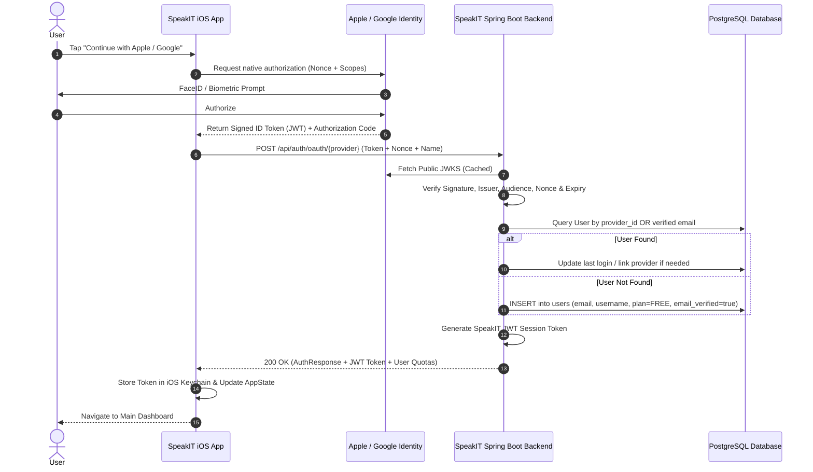

# SpeakIT OAuth Implementation Plan: Google & Apple Sign-In
**Authoritative Architectural Blueprint, Integration Requirements & Cost Analysis**

**Document Version:** 1.0.0  
**Target Platforms:** iOS Native (SwiftUI / AuthenticationServices), Web Frontend (Angular 21), Backend (Spring Boot 3.x / Java 21)  
**Target Milestone:** SpeakIT iOS App Store Release & Web Parity  

---

## Executive Summary

This document provides a comprehensive engineering blueprint and cost analysis for implementing **Sign in with Google** and **Sign in with Apple** across the SpeakIT ecosystem.

Implementing social authentication significantly reduces onboarding friction, decreases registration drop-off, eliminates password-reset support overhead, and satisfies **Apple App Store Review Guideline 4.8** (which strictly mandates Sign in with Apple whenever any third-party social login is offered in an iOS application).

---

## Table of Contents
1. [App Store & Regulatory Compliance (The Apple Mandate)](#1-app-store--regulatory-compliance-the-apple-mandate)
2. [Cost & Licensing Analysis](#2-cost--licensing-analysis)
3. [Provider Requirements & Developer Portal Setup](#3-provider-requirements--developer-portal-setup)
   - 3.1 [Google Cloud Console Setup](#31-google-cloud-console-setup)
   - 3.2 [Apple Developer Portal Setup](#32-apple-developer-portal-setup)
4. [Architecture & Authentication Flow](#4-architecture--authentication-flow)
   - 4.1 [Token-Based Mobile Exchange Architecture](#41-token-based-mobile-exchange-architecture)
   - 4.2 [Sequence Diagram](#42-sequence-diagram)
5. [Backend Implementation Plan (Spring Boot 3.x)](#5-backend-implementation-plan-spring-boot-3x)
   - 5.1 [Database Schema Updates (`schema.sql`)](#51-database-schema-updates-schemasql)
   - 5.2 [Dependencies](#52-dependencies)
   - 5.3 [Token Verification Services](#53-token-verification-services)
   - 5.4 [Account Linking & Conflict Resolution](#54-account-linking--conflict-resolution)
   - 5.5 [REST API Endpoints](#55-rest-api-endpoints)
6. [iOS Implementation Plan (SwiftUI & AuthenticationServices)](#6-ios-implementation-plan-swiftui--authenticationservices)
   - 6.1 [Sign in with Apple (`AuthenticationServices`)](#61-sign-in-with-apple-authenticationservices)
   - 6.2 [Google Sign-In (`GoogleSignIn-Swift`)](#62-google-sign-in-googlesignin-swift)
   - 6.3 [Nonce Generation & Replay Protection](#63-nonce-generation--replay-protection)
7. [Web Frontend Implementation Plan (Angular 21)](#7-web-frontend-implementation-plan-angular-21)
8. [Edge Cases & Security Hardening](#8-edge-cases--security-hardening)
   - 8.1 [Apple Private Relay Email Handling](#81-apple-private-relay-email-handling)
   - 8.2 [Apple Token Revocation Webhook (App Store Rule)](#82-apple-token-revocation-webhook-app-store-rule)
   - 8.3 [Account Deletion Requirement (Guideline 5.1.1v)](#83-account-deletion-requirement-guideline-511v)
9. [Implementation Roadmap & Milestones](#9-implementation-roadmap--milestones)

---

## 1. App Store & Regulatory Compliance (The Apple Mandate)

### Guideline 4.8 – Sign in with Apple
> *"Apps that use a third-party or social login service (such as Google Sign-In, Facebook Login, etc.) to set up or authenticate the user’s primary account with the app must also offer Sign in with Apple as an equivalent option."*

**Implications for SpeakIT:**
- If SpeakIT enables **"Continue with Google"** on iOS, **"Continue with Apple"** is **legally mandatory** to pass App Store Review.
- Sign in with Apple must be positioned with **equal or greater visual prominence** compared to Google Sign-In (standard Apple-designed button or matching size/shape).
- If SpeakIT offers only local email/password login, Apple Sign-In is optional; however, the moment Google is added, Apple is required.

---

## 2. Cost & Licensing Analysis

| Provider / Item | Recurring Cost | Per-Authentication Cost | MAU (Monthly Active Users) Limit | Notes |
| :--- | :--- | :--- | :--- | :--- |
| **Google Identity Services (OAuth 2.0)** | **$0 / month** | **$0.00** | **Unlimited** | Standard Google OAuth 2.0 user verification has no usage charges. (Only Firebase Auth / Identity Platform charges after 50k MAUs; direct backend verification via JWKS is 100% free). |
| **Sign in with Apple** | **$0 / month** | **$0.00** | **Unlimited** | Included with the existing **$99/year Apple Developer Program** membership. No per-login fees. |
| **Apple Developer Account** | **$99 / year** | — | — | Already required for App Store iOS app distribution. No additional cost. |
| **Google Cloud Console Account** | **$0** | — | — | Standard GCP project for OAuth client IDs is free. |
| **Backend Verification Overhead** | **$0** | — | — | Token validation happens via cached public JWKS keys (Google & Apple publish public key endpoints). Minimal CPU compute. |
| **Total Incremental Infrastructure Cost** | **$0.00** | **$0.00** | — | **Zero incremental cloud cost for SpeakIT.** |

---

## 3. Provider Requirements & Developer Portal Setup

### 3.1 Google Cloud Console Setup
1. **Google Cloud Project:** Create a project named `speakit-production` in [Google Cloud Console](https://console.cloud.google.com/).
2. **OAuth Consent Screen:**
   - User Type: **External**
   - App Name: `SpeakIT`
   - User Support Email: `support@speakit.com` / `mohitur669@gmail.com`
   - App Domain:
     - Homepage: `https://speakit.mohitur.com`
     - Privacy Policy: `https://speakit.mohitur.com/privacy`
     - Terms of Service: `https://speakit.mohitur.com/terms`
   - Authorized Domains: `mohitur.com`, `speakit.mohitur.com`
   - Scopes: `.../auth/userinfo.email`, `.../auth/userinfo.profile`, `openid`
3. **Credentials to Generate:**
   - **iOS Client ID:**
     - Bundle Identifier: `com.mohitur.speakit`
     - Generates iOS Client ID: `xxxxxxxxxxxx-xxxxxxxx.apps.googleusercontent.com`
     - Generates Reversed Client ID (URL Scheme): `com.googleusercontent.apps.xxxxxxxxxxxx-xxxxxxxx`
   - **Web Client ID:**
     - Authorized JavaScript origins: `https://speakit.mohitur.com`, `http://localhost:4200`
     - Authorized redirect URIs: `https://speakit.mohitur.com/auth/callback/google`
     - Web Client ID: `xxxxxxxxxxxx-yyyyyyyy.apps.googleusercontent.com`
   - **Backend Verification Audience:** The backend configures `google.client-id` matching the Web & iOS client IDs to verify the `aud` claim in incoming ID tokens.

### 3.2 Apple Developer Portal Setup
1. **App ID Capabilities:**
   - Navigate to [developer.apple.com](https://developer.apple.com/) ➔ *Certificates, Identifiers & Profiles* ➔ *Identifiers* ➔ Select App ID `com.mohitur.speakit`.
   - Enable capability: **Sign in with Apple** (select *Edit* ➔ *Enable as a primary App ID*).
2. **Services ID (for Web & Backend Verification):**
   - Identifier: `com.mohitur.speakit.client`
   - Enable *Sign In with Apple* ➔ Configure:
     - Primary App ID: `com.mohitur.speakit`
     - Web Domain: `speakit.mohitur.com`
     - Return URLs: `https://api.speakit.mohitur.com/api/auth/oauth/apple/callback`, `https://speakit.mohitur.com/auth/callback/apple`
3. **Keys & Client Secret Generation:**
   - Create a Private Key enabled for *Sign In with Apple*.
   - Download the `.p8` key file (e.g. `AuthKey_XXXXXXXXXX.p8`).
   - Note:
     - **Key ID:** (10-character string, e.g. `ABC123DEFG`)
     - **Team ID:** (10-character Apple Team ID, e.g. `XYZ9876543`)
     - **Services ID / Client ID:** `com.mohitur.speakit.client`

---

## 4. Architecture & Authentication Flow

### 4.1 Token-Based Mobile Exchange Architecture
Rather than opening in-app web views that redirect back and forth across browser sessions, modern mobile architecture uses **Native Client Token Verification**:

1. **Client Signs In Natively:**
   - **Apple:** iOS invokes `ASAuthorizationAppleIDProvider`. The user authenticates with FaceID/TouchID in a native sheet. Apple returns an `identityToken` (signed JWT).
   - **Google:** iOS invokes Google Sign-In SDK. Google returns an `idToken` (signed JWT).
2. **Client Sends Token to SpeakIT Backend:**
   - Client sends `POST /api/auth/oauth/google` with `{ "idToken": "..." }`.
   - Client sends `POST /api/auth/oauth/apple` with `{ "identityToken": "...", "fullName": "..." }`.
3. **Backend Cryptographically Verifies Token:**
   - Validates signature against provider public JWKS (`https://appleid.apple.com/auth/keys` or `https://www.googleapis.com/oauth2/v3/certs`).
   - Validates audience (`aud`), issuer (`iss`), and expiration (`exp`).
   - Extracts verified email, user subject identifier (`sub`), and name.
4. **Backend Matches or Creates Account:**
   - If user exists with matching `(auth_provider, provider_id)` or matching verified `email`, link account and refresh session.
   - If new user, create record in `users` table with `email_verified = true`, `account_status = 'ACTIVE'`, initialize Free tier quota.
5. **Backend Emits SpeakIT JWT:**
   - Returns standard SpeakIT `AuthResponse` containing `token`, user details, plan, quota, and session version.
   - Client stores token in Secure Keychain (`TokenManager.swift`) and immediately transitions to authenticated state.

### 4.2 Sequence Diagram



---

## 5. Backend Implementation Plan (Spring Boot 3.x)

### 5.1 Database Schema Updates (`schema.sql`)

To support multiple authentication providers while preserving existing password-based users, update the `users` table:

```sql
-- 1. Add authentication provider fields
ALTER TABLE users ADD COLUMN IF NOT EXISTS auth_provider VARCHAR(20) DEFAULT 'LOCAL';
ALTER TABLE users ADD COLUMN IF NOT EXISTS provider_id VARCHAR(255);
ALTER TABLE users ADD COLUMN IF NOT EXISTS provider_email VARCHAR(255);

-- 2. Allow nullable password for pure OAuth accounts
ALTER TABLE users ALTER COLUMN password DROP NOT NULL;

-- 3. Create unique index for provider lookups
CREATE UNIQUE INDEX IF NOT EXISTS idx_users_provider 
    ON users (auth_provider, provider_id) 
    WHERE provider_id IS NOT NULL;

-- 4. Audit index for quick email reconciliation
CREATE INDEX IF NOT EXISTS idx_users_provider_email 
    ON users (provider_email);
```

### 5.2 Dependencies (`pom.xml`)

Add standard token verification dependencies:

```xml
<!-- Google API Client for Google ID Token verification -->
<dependency>
    <groupId>com.google.api-client</groupId>
    <artifactId>google-api-client</artifactId>
    <version>2.7.0</version>
</dependency>

<!-- Nimbus JOSE+JWT for Apple JWKS & JWT verification -->
<dependency>
    <groupId>com.nimbusds</groupId>
    <artifactId>nimbus-jose-jwt</artifactId>
    <version>9.37.3</version>
</dependency>
```

### 5.3 Token Verification Services

#### Google Token Verifier (`GoogleTokenVerifierService.java`)
- Uses `GoogleIdTokenVerifier` configured with Google Web & iOS Client IDs.
- Verifies signature, expiry, and retrieves payload: `payload.getEmail()`, `payload.getSubject()`, `payload.get("name")`.

#### Apple Token Verifier (`AppleTokenVerifierService.java`)
- Retrieves Apple's public RSA keys from `https://appleid.apple.com/auth/keys`.
- Uses Nimbus JOSE-JWT to parse `identityToken` header `kid`, match the public key, and verify the signature.
- Validates:
  - `iss` == `https://appleid.apple.com`
  - `aud` == `com.mohitur.speakit` (iOS) or `com.mohitur.speakit.client` (Web)
  - `exp` > current timestamp
  - `nonce` matches client session hash
- Extracts `sub` (unique permanent Apple user identifier) and `email`.

### 5.4 Account Linking & Conflict Resolution

| Scenario | System Behavior |
| :--- | :--- |
| **New User signs in with Google/Apple** | 1. Auto-generate clean unique username from email prefix (e.g. `mohit123`).<br>2. Set `email_verified = true`, `account_status = 'ACTIVE'`, `consent_accepted = true`.<br>3. Initialize Free plan tier (5,000 monthly quota).<br>4. Issue SpeakIT JWT. |
| **Existing Local User logs in with Google/Apple having same email** | 1. Verify `email_verified` is true from provider.<br>2. Seamlessly link account: set `provider_id = sub` and `auth_provider = 'GOOGLE'` or `'APPLE'`.<br>3. User retains all existing history, credits, and active subscription! |
| **Apple User selects "Hide My Email"** | 1. Apple provides an `@privaterelay.appleid.com` address.<br>2. Store relay email in `email` and permanent Apple ID in `provider_id`.<br>3. Account is keyed by `provider_id` so future logins always resolve correctly. |

### 5.5 REST API Endpoints

Add to `AuthController.java`:

- `POST /api/auth/oauth/google`:
  - Request: `{ "idToken": "ey..." }`
  - Response: `AuthResponse` (token, user, quotas, limits)
- `POST /api/auth/oauth/apple`:
  - Request: `{ "identityToken": "ey...", "authorizationCode": "...", "fullName": "Mohit Sharma", "nonce": "..." }`
  - Response: `AuthResponse`

---

## 6. iOS Implementation Plan (SwiftUI & AuthenticationServices)

### 6.1 Sign in with Apple (`AuthenticationServices`)

In SwiftUI, use Apple's first-party `SignInWithAppleButton`:

```swift
import AuthenticationServices
import SwiftUI

struct AppleSignInButtonView: View {
    @Environment(AppState.self) private var appState
    @State private var currentNonce: String?

    var body: some View {
        SignInWithAppleButton(.continue) { request in
            let nonce = NonceHelper.randomNonceString()
            currentNonce = nonce
            request.requestedScopes = [.fullName, .email]
            request.nonce = NonceHelper.sha256(nonce)
        } onCompletion: { result in
            switch result {
            case .success(let authorization):
                if let appleIDCredential = authorization.credential as? ASAuthorizationAppleIDCredential,
                   let identityTokenData = appleIDCredential.identityToken,
                   let identityToken = String(data: identityTokenData, encoding: .utf8) {
                    
                    let fullName = [appleIDCredential.fullName?.givenName, appleIDCredential.fullName?.familyName]
                        .compactMap { $0 }
                        .joined(separator: " ")
                    
                    Task {
                        await appState.authenticateWithApple(
                            identityToken: identityToken,
                            fullName: fullName.isEmpty ? nil : fullName,
                            rawNonce: currentNonce
                        )
                    }
                }
            case .failure(let error):
                print("Apple Sign In failed: \(error.localizedDescription)")
            }
        }
        .signInWithAppleButtonStyle(.white) // Adapts to Dark/Light mode
        .frame(height: 50)
        .cornerRadius(14)
    }
}
```

> [!IMPORTANT]
> **Apple First-Time Name Rule:** Apple only sends `fullName` on the **first time** a user authenticates with your app. On subsequent logins, `appleIDCredential.fullName` is `nil`. The backend must save the name immediately on first receipt.

### 6.2 Google Sign-In (`GoogleSignIn-Swift`)

1. Add Google Sign In Swift Package: `https://github.com/google/GoogleSignIn-Swift` (Version 7.x+).
2. Configure `CFBundleURLTypes` in `Info.plist` with the reversed client ID:
   ```xml
   <key>CFBundleURLTypes</key>
   <array>
       <dict>
           <key>CFBundleURLSchemes</key>
           <array>
               <string>com.googleusercontent.apps.XXXXXXXXXXXX-XXXXXXXX</string>
           </array>
       </dict>
   </array>
   ```
3. Execution snippet in `LoginView.swift`:
   ```swift
   import GoogleSignIn

   func signInWithGoogle() {
       guard let rootVC = UIApplication.shared.connectedScenes
           .compactMap({ ($0 as? UIWindowScene)?.keyWindow?.rootViewController })
           .first else { return }
       
       GIDSignIn.sharedInstance.signIn(withPresenting: rootVC) { result, error in
           guard let user = result?.user, let idToken = user.idToken?.tokenString else {
               return
           }
           Task {
               await appState.authenticateWithGoogle(idToken: idToken)
           }
       }
   }
   ```

### 6.3 Nonce Generation & Replay Protection

To prevent replay attacks, a cryptographically secure random string (nonce) is generated per attempt, hashed using SHA-256 before sending to Apple/Google, and verified by the SpeakIT backend.

---

## 7. Web Frontend Implementation Plan (Angular 21)

1. **Google Identity Services (GIS):**
   - Add `<script src="https://accounts.google.com/gsi/client" async defer></script>` in `index.html`.
   - Render the One-Tap dialog or Google button in `login.component.ts`.
   - On credential callback, send `id_token` to `POST /api/auth/oauth/google`.
2. **Sign in with Apple on Web (Apple JS):**
   - Load `<script type="text/javascript" src="https://appleid.cdn.apple.com/appleauth/static/jsapi/appleid/auth/js"></script>`.
   - Initialize with `com.mohitur.speakit.client` and redirect URI `https://speakit.mohitur.com/auth/callback/apple`.
   - Exchange identity token with backend.

---

## 8. Edge Cases & Security Hardening

### 8.1 Apple Private Relay Email Handling
- Users can select **"Hide My Email"**, which generates an address ending in `@privaterelay.appleid.com`.
- **Requirement:** If SpeakIT sends automated transactional emails (such as payment receipts or password alerts) to these users, SpeakIT's outbound domain (`speakit.mohitur.com`) and sender SPF/DKIM records must be registered in the **Apple Developer Portal** under *Services* ➔ *Sign In with Apple* ➔ *Configure Email Sources*.
- Otherwise, Apple's inbound mail relays will reject emails sent to `@privaterelay.appleid.com`.

### 8.2 Apple Token Revocation Webhook (App Store Rule)
- Apple requires apps to handle user credential revocation.
- If a user goes to **iOS Settings ➔ Apple ID ➔ Password & Security ➔ Sign in with Apple ➔ Stop using Apple ID**, Apple sends a Server-to-Server notification to your configured webhook URL:
  - `POST /api/auth/oauth/apple/notifications`
  - Payload contains event `consent-revoked` or `account-delete`.
  - Backend marks `is_active = false` or invalidates active session tokens.

### 8.3 Account Deletion Requirement (App Store Guideline 5.1.1v)
- Apps that support account creation must also offer in-app account deletion.
- SpeakIT already supports account deletion in [`ProfileSettingsView.swift`](file:///Users/mohitur/Desktop/git-projects/speakit/ios/SpeakIT/SpeakIT/Features/Activity/ProfileSettingsView.swift).
- For Apple users, account deletion must additionally invoke Apple’s revocation API:
  `POST https://appleid.apple.com/auth/revoke` with the user's stored refresh token or authorization code to fully disconnect the app.

---

## 9. Implementation Roadmap & Milestones

| Phase | Tasks & Deliverables | Estimated Effort |
| :--- | :--- | :--- |
| **Phase 1: Developer Console Setup** | - Configure Google Cloud Console OAuth consent screen, iOS & Web Client IDs.<br>- Configure Apple Developer Portal App ID, Services ID, Private Key (`.p8`), and Email Relay sources. | 1 Day |
| **Phase 2: Database Schema & Migration** | - Apply `auth_provider`, `provider_id` columns and indexes to `users` table via `schema.sql` and `DatabaseMigrationConfig.java`.<br>- Support nullable password for pure OAuth records. | 0.5 Day |
| **Phase 3: Backend Verification Engine** | - Add `GoogleTokenVerifierService` and `AppleTokenVerifierService` in `com.speakit.auth.service`.<br>- Implement `/api/auth/oauth/google` and `/api/auth/oauth/apple` in `AuthController`.<br>- Unit and integration tests for token validation and account linking. | 2 Days |
| **Phase 4: iOS Native Authentication** | - Add `GoogleSignIn-Swift` SPM package and URL Schemes.<br>- Integrate `SignInWithAppleButton` and Google Sign-In button in `LoginView.swift`.<br>- Implement `authenticateWithApple` and `authenticateWithGoogle` in `AppState.swift`. | 1.5 Days |
| **Phase 5: Angular Web Integration** | - Add Google Identity Services button and Apple JS on web login/signup pages.<br>- Test cross-platform login parity (sign up on iOS, log in on Web with same Google/Apple account). | 1 Day |
| **Phase 6: App Store Hardening & Testing** | - Test "Hide My Email" relay flow.<br>- Test account linking with existing email.<br>- Verify Apple Human Interface Guidelines button styling and App Store Review Guideline 4.8 compliance. | 1 Day |
| **Total Estimated Time** | **Complete End-to-End Implementation** | **~7 Business Days** |

---

## 10. Conclusion & Recommendation

1. **Zero Added Cost:** Google OAuth and Apple Sign-In have **$0 recurring operational costs** and require no paid third-party auth platforms (like Auth0 or Firebase).
2. **App Store Approval Criticality:** Implementing Google Sign-In requires Sign in with Apple simultaneously to satisfy Apple App Store Guideline 4.8.
3. **Recommended Sequence:** Execute Phase 1 (Credentials) and Phase 2 (Database schema), followed by the Spring Boot backend token verification endpoints, ensuring seamless cross-platform parity between the iOS app and Angular web frontend.
